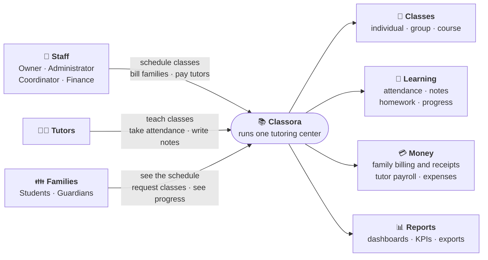
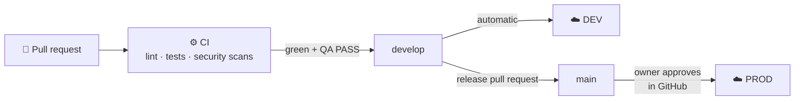
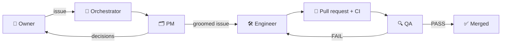

# Classora

[](https://github.com/JaimeSolisS/classora/actions/workflows/ci.yml)
[](https://github.com/JaimeSolisS/classora/actions/workflows/deploy-dev.yml)

**Classora runs a tutoring center in one place: who teaches what and when,
who attended, what each family owes and what each tutor earns.**

> Looking for every command and setting? See the
> [full README](_docs/Full_README.md).

## The problem

A small tutoring or test-prep center usually runs on spreadsheets, chat
groups and paper. Classes get double-booked. Nobody is sure whether a
student came. Families ask "how much do I owe?" and get a different answer
each time. Paying tutors means adding up hours by hand at the end of the
month. The owner sees how the business is doing only when the bank balance
changes.

## What Classora does

One web app for everyone in the center, each person seeing only what their
role allows:

| Who | What they do in Classora |
|---|---|
| **Owner and administrators** | Set up subjects, classrooms, prices and opening hours. Schedule individual, group and course classes. Invite people. Approve requests and refunds. See the KPI dashboard and reports. |
| **Coordinators** | Offer classes to tutors and arrange substitutes. Manage course templates. Correct attendance, review class notes and approve progress reports. |
| **Finance staff** | Charge families and record payments (each gets a receipt). Prepare tutor payroll and record tutor payments. Track expenses. |
| **Tutors** | See their agenda, take attendance, write session notes and homework, and see their earnings. |
| **Guardians and students** | See the schedule, request classes or changes, and follow progress. Guardians also see the family's balance and receipts. |



**What you can expect it to do:**
- **Scheduling:** a class can't double-book a tutor, a student or a
  classroom, or overfill a room. Booking outside opening hours, on a closure
  day or when the tutor is unavailable needs an explicit override with a
  reason, which is audited.
- **Approvals:** changes requested by families or tutors wait for staff
  approval.
- **Money:** every amount a family owes or a tutor earns comes from recorded
  classes, charges, payments and pay terms. Corrections are new entries, never silent
  edits.
- **Privacy:** people see only their own data. A guardian sees only their
  own children; a tutor sees only their own students.
- **Bilingual:** the interface, the PDF receipts and payslips, and the CSV
  and Excel exports are in Spanish and English.

The full feature list is in the
[full README](_docs/Full_README.md#features), and the product rules are in the
[specification](_docs/spec.md).

## Try it

| Where | Link |
|---|---|
| DEV: every merge to `develop` deploys here. Sign in as `visitor` / `visitor-classora` (an Owner on an English simulated center; the other simulated accounts in the [full README](_docs/Full_README.md#simulated-operations-data) also work; DEV resets nightly at 04:00 UTC) | <https://dev.classora.dev> |
| PROD: the owner releases here after approval (serves after the first release) | <https://app.classora.dev> |
| Monitoring (Grafana, login required) | <https://grafana.classora.dev> |

### Run it on your machine

You need Docker (with Compose v2), GNU Make, [uv](https://docs.astral.sh/uv/)
and Node.js 24. Then run one command:

```bash
make start
```

It creates `.env` from `.env.example`, sets up the database and starts every
part of the system in Docker. It returns when all of them are healthy:
- PostgreSQL;
- PgBouncer;
- the API;
- the background worker;
- the web app.

Open <http://127.0.0.1:5173>.

To get a center full of realistic, invented data, with an account for every
role, run:

```bash
make seed-data-english   # or make seed-data-spanish
```

Then sign in as `owner` with the password `classora-sim-owner` (in Spanish,
use `direccion`). The [full README](_docs/Full_README.md#simulated-operations-data)
lists every other login. To create a real first owner on an empty database
instead, use `make bootstrap-owner USERNAME=<name>`.

Stop everything with `docker compose down`. Your data is kept; add `-v` to
delete it.

## How it is built

| Part | Technology |
|---|---|
| Web app | React, TypeScript, Vite, TanStack Query, Tailwind CSS with shadcn/ui |
| API | Python FastAPI, a modular monolith with one module per business area |
| Database | PostgreSQL behind PgBouncer, schema changes with Alembic migrations |
| Background jobs | Procrastinate, a job queue that lives in PostgreSQL (no Redis) |
| Containers | Docker Compose, locally and on the servers |
| Cloud | AWS, created with Terraform: one small server per environment, with HTTPS from Caddy |

The browser talks only to the API, and the API and the worker are the only
parts that touch the database. The design and its reasons are in
[architecture](_docs/architecture.md) and the
[decision records (ADRs)](_docs/adr/).

## Tests

```bash
make test   # all API unit and integration tests, then the web app tests
make e2e    # end-to-end tests in a real browser, with accessibility checks
```

- **Unit tests** check the business rules on their own.
- **Integration tests** run the API against a real, throwaway PostgreSQL
  started by [Testcontainers](https://testcontainers.com/). They cover
  permissions between roles and financial invariants (money always adds up).
- **End-to-end tests** (Playwright) click through the app on its own Docker
  stack.

The API tests need Docker running and Pango installed on the host, which the
PDF tests use (see [prerequisites](_docs/Full_README.md#prerequisites)).
The end-to-end tests need nothing beyond Docker, uv and Node.

How to write tests is in the
[testing guidelines](_docs/testing-guidelines.md).

## From pull request to production



- **CI** runs on every pull request ([`ci.yml`](.github/workflows/ci.yml)):
  - lint;
  - unit, integration and end-to-end tests;
  - checks that the generated API client is up to date;
  - container image builds;
  - security scans: dependencies, secrets and code.

  One required check, `ci-required`, blocks the merge if anything fails.
- **CD to DEV** is automatic
  ([`deploy-dev.yml`](.github/workflows/deploy-dev.yml)). Every merge to
  `develop` builds the images, deploys them to DEV, checks that the app is
  healthy and rolls back if it isn't.
- **Deploy to PROD** is manual
  ([`release-prod.yml`](.github/workflows/release-prod.yml)). The owner merges
  a release pull request into `main` and approves the deploy in GitHub. PROD
  then runs the exact images DEV already tested.

The servers back up their database every night and are rebuilt from code
with Terraform. Details are in the
[runbooks](_docs/runbooks/index.md).

## Monitoring and alerts

The API and the worker send logs, metrics and traces through OpenTelemetry to
a separate monitoring server, viewed in Grafana:
- **Storage:** metrics in Prometheus, logs in Loki, traces in Tempo.
- **Dashboards:** API, database, background jobs, errors, logs, and host and
  containers.

- **One request, one ID:** every log line carries the `trace_id` of the
  request or job that wrote it. Grafana jumps from a slow or failing request
  to its trace and its logs.
- **No personal data in telemetry:**
  - spans keep the route template, never the URL, the body or the
    headers;
  - SQL keeps placeholders, never values;
  - logs are redacted.

  A test plants personal data and checks that none of it is exported.
- **Alerts e-mail the owner** when users would feel it:
  - the API stops answering its readiness check;
  - a background job fails or hangs;
  - a nightly backup fails or is missing;
  - the server runs out of CPU, memory or disk.

The full alert list is in the [monitoring runbook](_docs/runbooks/monitoring.md#alerts).
The same monitoring stack runs locally in Docker. It's off by default and uses
about 700 MB more RAM:

```sh
make dev-observability        # the app, plus the collector, Prometheus, Loki, Tempo and Grafana
make dev-observability-down   # stop only the monitoring containers; the app keeps running
```

Grafana is then at <http://127.0.0.1:3000> (`GRAFANA_PORT` in `.env`). Log in
as `admin` with the `GRAFANA_ADMIN_PASSWORD` from `.env`. It can't be empty or
`admin`.

## How the work is done: a team of AI agents

The product is specified in the [specification](_docs/spec.md). Every piece
of work is a public [GitHub issue](https://github.com/JaimeSolisS/classora/issues)
with acceptance criteria, grouped into
[milestones](https://github.com/JaimeSolisS/classora/milestones). A team of AI
agents does the work, and the repository owner takes the product decisions:

| Agent | Responsibility |
|---|---|
| **Orchestrator** (main session) | Picks the next issue, launches the other agents, opens and merges pull requests. Keeps one issue in flight. |
| **Product manager** ([role](_docs/team/pm.md)) | Grooms the issue against the spec and architecture: checkable acceptance criteria, roles, edge cases, tests and what is out of scope. Escalates conflicts to the owner instead of guessing. |
| **Software engineer** ([role](_docs/team/software-engineer.md)) | Implements the groomed issue in its own git worktree, with tests and docs. |
| **QA engineer** ([role](_docs/team/qa-engineer.md)) | Checks every criterion independently on its own database, and posts PASS or FAIL with evidence. |



Each agent's report is posted as a comment on the issue, so the history of
every decision stays in the tracker. Agents start from
[`AGENTS.md`](AGENTS.md), which points them to:
- the [delivery process](_docs/process.md);
- the role files;
- the [testing guidelines](_docs/testing-guidelines.md);
- the [API conventions](_docs/api.md);
- the [architecture](_docs/architecture.md).

## Lessons learned

Classora was built in four weeks (from 2026-10-16) by the agent team above:
310 issues closed and 279 pull requests merged. What we learned:

- **Independent QA is worth its cost.** About one QA report in five was a
  FAIL. QA found false claims in docs, broken edge cases and, on the grader
  path (#672), a test command that passed on the engineer's subsets but
  failed in full on both CPU architectures. An agent's "done" is a claim
  that still needs checking, never proof.
- **Groom first, then build.** Issues with checkable acceptance criteria and
  the owner's decisions written down went through in one round. A decision
  changed mid-build is expensive: the demo visitor's guards (#673) were
  dropped after an engineer had started on them.
- **One machine, one agent.** On an 8 GB laptop, running agents in parallel
  made them wait for each other and swap memory, roughly doubling the time
  per issue. One issue in flight, with heavy commands run one at a time,
  was faster overall.
- **Engineers run only the tests for what they changed.** CI runs the full
  suites on every pull request, and QA cites that run. A local full-suite
  run had taken longer than writing the code.
- **Agents need hard boundaries around shared state.** Two early incidents
  reached the owner's own local stack (no data was lost). Since then every agent uses its
  own Compose project, ports and database, and prints its target before
  migrating.
- **Flaky tests add up fast.** Tests that search for a number inside JSON
  with timestamps (#557), or that give a database 2 seconds to connect
  (#661), each turned a pull request red and cost a 25-minute rerun.
- **CI speed is an architecture decision.** Most integration tests create
  their own database and run all 96 migrations on it. That is about 2.5 hours
  of test time per pull request and roughly 25 minutes of waiting. By the
  time it hurt, thousands of tests depended on it.

### What we'd do differently

- **Set a CI time budget in the first milestone** (for example 10 minutes
  per pull request). Migrate one template database per test session and copy
  it for each test, or roll each test back in a transaction.
- **Fix a flaky test the first time it shows up** instead of rerunning it,
  and give flake fixes priority over features.
- **Test the grader path from day one.** A CI job that runs the README's
  commands on a clean machine with only Docker would have caught missing
  host tools weeks earlier.
- **Decide the demo and environment story early:** who will try the app,
  where, and with which data and accounts.
- **Keep issues small.** The largest issues needed several QA rounds; small
  ones usually passed the first time.
- **Run agents in the cloud,** or on a bigger machine, so they can run in
  parallel safely.

## Status

**Pre-alpha, close to its first production release.**
- **Built:** every feature in the [full README](_docs/Full_README.md#features)
  works end to end on DEV.
- **Hardening done:**
  - a security review found no critical or high issues
    ([security review](_docs/security-review.md));
  - the server size was load-tested ([report](_docs/load-test-report.md)).
- **Not in this version:** file uploads and documents.
- **Remaining work:** what's left is in the open
  [milestones](https://github.com/JaimeSolisS/classora/milestones).

## Documentation

- [Full README](_docs/Full_README.md): every command, setting and environment detail
- [Product specification](_docs/spec.md)
- [Architecture](_docs/architecture.md) and [ADRs](_docs/adr/)
- [API conventions](_docs/api.md)
- [Design system](_docs/design-system.md)
- [Testing guidelines](_docs/testing-guidelines.md)
- [Delivery process](_docs/process.md) and [agent instructions](AGENTS.md)
- [Runbooks](_docs/runbooks/index.md): AWS environments, deploys, releases, backups, monitoring
