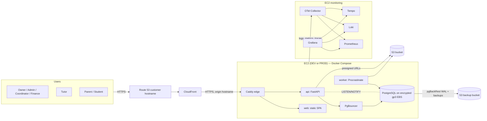
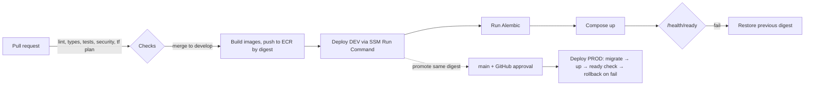

# Classora — Architecture

**Derived from:** `_docs/spec.md` v1.2 (2026-10-16)  
**Status:** Draft. Sections 1–9 restate decisions **already approved** in the spec. Section 10 lists ambiguities, contradictions and missing implementation details; every resolution there is **PROPOSED**, not approved, until it is accepted and recorded as an ADR in `_docs/adr/`.  
**No application code exists yet.**

> **Rules for this document**
>
> - It must not override `_docs/spec.md`. Where the two disagree, the spec wins until the spec is deliberately changed.
> - It introduces no new technologies or architectural style. Where a proposal needs a supporting library or AWS feature the spec does not name, the proposal says so explicitly and needs approval.
> - In sections 1–9, text tagged `→ ISSUE-xx` depends on an open item in §10.

---

## 1. Architectural style (approved)

- **Single-tenant, single-center product.** No multi-tenancy, no branches.
- **Modular monolith.** One FastAPI codebase (`apps/api`) organized by business domain. It ships as two runtime processes from the same image: the **API** and the **Procrastinate worker**.
- **Single-page web client.** React + TypeScript + Vite (`apps/web`). It talks to the API only through the **generated typed client** (`packages/api-client`).
- **PostgreSQL is the only stateful backend service.** It holds business data, server sessions, the job queue (Procrastinate), notifications and the LISTEN/NOTIFY fan-out. **No Redis and no Celery.**
- **Object storage:** S3 (S3-compatible API locally) holds file contents. PostgreSQL holds the file metadata.
- **Three deployed environments on AWS:** DEV, PROD and a monitoring host. Each one is a single EC2 instance running Docker Compose. There is also a local Compose environment.

## 2. System context



Notes:

- PgBouncer placement and which processes bypass it: → ISSUE-D1.
- How the web container is built and served: → ISSUE-I4.
- How CloudFront authenticates to the origin: → ISSUE-I2.

## 3. Repository layout (approved)

The canonical tree is in `_docs/spec.md` §11. In summary:

| Path | Contents |
|---|---|
| `apps/web/src/features/<feature>/` | React UI organized by business feature |
| `apps/api/app/core/` | Settings (pydantic-settings), DB engine/session, Unit of Work, auth primitives, error handling, telemetry, i18n helpers |
| `apps/api/app/modules/<domain>/` | One package per business domain (§4.1) |
| `apps/api/app/workflows/` | Application-level operations that span modules |
| `apps/api/migrations/` | Alembic |
| `apps/api/tests/` | pytest unit and integration tests (Testcontainers PostgreSQL) |
| `packages/api-client/` | TypeScript client generated from the FastAPI OpenAPI document |
| `infrastructure/{terraform,docker,observability,scripts}/` | IaC, Dockerfiles and Compose stacks, monitoring stack, ops scripts |
| `e2e/` | Playwright |

Inconsistencies between this tree and the companion guides: → ISSUE-G1.

## 4. Backend architecture

### 4.1 Domain modules

The candidate modules mirror the spec §12 domain inventory:

| Module | Responsibility (from spec) |
|---|---|
| `identity` | Users, roles, permissions, sessions, preferences, registration and invitations, reauthentication |
| `families` | Students, guardians, student–guardian links, emergency contacts, consent |
| `staff` | Tutors, qualifications, availability, time off, teaching limits |
| `catalog` | Subjects, education levels, academic periods, classrooms, holidays and closures |
| `scheduling` | Class sessions, recurrence, enrollment, attendance, substitutions, booking requests, conflict detection |
| `courses` | Course templates, modules, cohorts, cohort enrollment, completion criteria |
| `academics` | Evaluations, learning plans, assignments and submissions, session summaries, progress reports, internal notes |
| `billing` | Price catalog, charges, payments, allocations, packages and credits, discounts, refunds, tuition plans, receipts |
| `payroll` | Compensation rates, teaching hours, payroll periods and lines, adjustments, payments, payslips |
| `finance` | Expenses, categories, vendors, recurring expense templates |
| `documents` | Files, folders, access grants, tags, quotas, recycle bin |
| `administration` | Approval inbox, notifications, audit events, business settings, imports |

Where reporting and analytics code lives: → ISSUE-A2.

Each module has the same internal layout (the file names are a convention, not mandated by the spec):

```text
modules/<domain>/
  models.py        # SQLAlchemy 2.0 mapped classes (owned tables)
  schemas.py       # Pydantic create/update/detail/list schemas per operation
  repository.py    # queries; no business rules
  service.py       # domain rules; the module's public Python API
  router.py        # FastAPI routes under /api/v1/<domain>
  permissions.py   # role permissions + record-level policy functions
  tasks.py         # Procrastinate tasks owned by the module
```

### 4.2 Cross-module rules (approved pattern, PROPOSED enforcement → ISSUE-A1)

- A module may call another module **only through that module's `service.py`**.
- Operations that change state in several modules (for example: confirm a booking request → create sessions → post charges → notify) live in `app/workflows/` and run inside **one Unit of Work** (one database transaction).
- There is **no in-process event bus**. Orchestration is explicit, as required by "application-level cross-module orchestration".

### 4.3 Request lifecycle

1. Caddy receives the request from CloudFront and forwards `/api/*` to the API.
2. Middleware assigns or propagates a **request ID** and starts an OTel span.
3. Session cookie → server session lookup in PostgreSQL → CSRF check on unsafe methods → rate-limit check (→ ISSUE-S3).
4. The route dependency resolves the current user and checks the **role permission**.
5. The service loads the target record(s) and runs the **record-level policy** (ownership, guardian link, tutor assignment).
6. The Unit of Work commits. Audit events, notifications and optimistic-version increments are written in the same transaction.
7. Errors are returned as **RFC 9457 Problem Details** with a stable `code`, field errors and the `request_id`.

### 4.4 API conventions (approved)

- Base path `/api/v1/...`. The SPA and the API share one origin, so CORS is not needed.
- Pydantic schemas are operation-specific: `XCreate`, `XUpdate`, `XDetail`, `XListItem`.
- Timestamps use ISO 8601 with offset. Instants are stored as UTC `TIMESTAMPTZ` (→ ISSUE-D3 for date-only values).
- Pagination is offset/limit for ordinary tables and cursor-based for large histories (audit, ledger, notifications).
- Optimistic concurrency uses a `version` column on edited records (→ ISSUE-D5 for the wire format).
- Financial mutations require idempotency keys (→ ISSUE-F4 for the mechanism).

## 5. Data architecture (approved constraints)

- PostgreSQL, self-hosted, one instance per environment, on a dedicated encrypted gp3 EBS volume.
- Async SQLAlchemy 2.0 + asyncpg, connection pooling through PgBouncer (→ ISSUE-D1).
- Alembic, migration-first, validated in CI, expand-and-contract so the previous image keeps working.
- UUID primary keys, FKs, unique and check constraints. Database constraints protect business invariants.
- Search uses B-tree indexes, full-text search and `pg_trgm` (→ ISSUE-D6 for bilingual text).
- Financial data is append-only with corrections made as adjustments and reversals. Payroll periods are locked once finalized. Catalog prices and rates are effective-dated.
- The detailed schema belongs to `_docs/data-model.md` and is **not** designed here.

## 6. Background processing (approved)

- **Procrastinate on PostgreSQL**, running in a **dedicated worker container** built from the API image.
- Jobs include charge generation (recurring tuition and enrollments), recurring expenses, rolling recurrence generation, reminders, report and export generation (WeasyPrint PDF, openpyxl XLSX), imports, file scan follow-up, retention and purge tasks.
- Every job must be **idempotent**. A retry must not create a duplicate business transaction (W4.1, W7.2).
- Failed jobs must be visible to administrators, with retry controls (§9 of the spec).

Open points: → ISSUE-J1 (driver and transactional enqueue), ISSUE-J2 (periodic scheduler placement), ISSUE-J3 (failed-job admin UI), ISSUE-J4 (idempotency mechanics).

## 7. Cross-cutting concerns

### 7.1 Authentication and authorization (approved)

- Server-side sessions stored in PostgreSQL and referenced by an HTTP-only secure cookie. CSRF protection. Expiration and revocation.
- Password reauthentication for sensitive actions.
- Predefined roles plus record-level ownership checks, enforced on the server in endpoints, jobs, generated files and presigned links.
- User states: `pending`, `active`, `suspended`, `archived`.

Open points: → ISSUE-S1, S2, S4, S5, S6, S7.

### 7.2 Notifications (approved)

- Notifications are persisted in PostgreSQL with read/unread state and per-user preferences.
- Live delivery uses **SSE** fed by PostgreSQL **LISTEN/NOTIFY**. There is no email, SMS or WhatsApp for product users.

Open point: → ISSUE-N1.

### 7.3 Files (approved)

- The browser uploads to and downloads from S3 directly through presigned URLs.
- File metadata lives in PostgreSQL. A file stays unreleased until malware scanning passes.
- Visibility levels: private, tutor-only, or shared with authorized students and parents.
- Quotas (global, per user or library, per file). Soft delete to a recycle bin with configurable retention.

Open points: → ISSUE-FL1, FL2, FL3.

### 7.4 Internationalization and time

- The UI uses react-i18next (es and en) and date-fns/date-fns-tz.
- The center's configured time zone governs scheduling, local date boundaries, recurrence and due dates.

Open points: → ISSUE-D3, ISSUE-X1.

### 7.5 Auditing

- Important records get audit events with actor, action, timestamp, prior values and new values.

Open point: → ISSUE-A3.

## 8. Frontend architecture (approved)

- React Router with guarded views. The guards are for UX only; the server is authoritative.
- **TanStack Query** for server state and caching. **Zustand** for UI-only state. React Hook Form + Zod for forms.
- Tailwind + shadcn/ui, central design tokens, Storybook, light/dark/system themes with preferences stored in the database.
- FullCalendar (daily/weekly/monthly; drag-and-drop validated by the server) → ISSUE-X2 for licensing.
- Recharts and TanStack Table for analytics. Customizable dashboards → ISSUE-X3.
- Centralized error handling, safe retries, skeleton states. **No optimistic updates on financial mutations.**
- Layouts adapt by role: desktop-first admin, mobile-friendly tutor, student and guardian views. Target is WCAG 2.2 AA.

Typed API client: `openapi-typescript` + `openapi-fetch`, TanStack Query hooks written by hand (ISSUE-X4, accepted; conventions in [`_docs/api.md`](api.md)).

## 9. Deployment, operations and observability (approved)

### 9.1 Per-environment host (DEV and PROD)

| Compose stack | Services |
|---|---|
| **Data stack** (stateful) | PostgreSQL (+ pgBackRest), PgBouncer (→ ISSUE-D1) |
| **App stack** | Caddy edge, `web`, `api`, `worker`, OTel agent (→ ISSUE-O2) |

- Docker restart policy is `unless-stopped`. systemd units start the data stack before the app stack.
- The EBS data volume is attached and mounted by cloud-init/SSM **without ever formatting a volume that already has a filesystem**.
- Management goes through SSM Session Manager and Run Command. There is no inbound SSH, and PostgreSQL/PgBouncer have no public ports.

### 9.2 Delivery pipeline



- GitHub Actions authenticates with OIDC using least-privilege DEV and PROD roles.
- Images are promoted by **immutable digest** (→ ISSUE-I6 for how the digest reaches `main`).
- Migrations run before the new version starts and are **never** reversed automatically.
- The ECR lifecycle policy must keep deployed digests and rollback candidates.
- Terraform uses separate state per environment and an encrypted, versioned S3 backend with native locking. DEV applies on merge, PROD needs approval, destructive plans need approval everywhere, and critical stateful resources have `prevent_destroy`.

Open points: → ISSUE-I1 through I8.

### 9.3 Observability

- A dedicated monitoring EC2 runs the OTel Collector, Prometheus, Loki, Tempo and Grafana.
- Logs are structured JSON with `request_id` and `trace_id`.
- Health endpoints: `/health/live` (process is up) and `/health/ready` (includes PostgreSQL).
- Alerts are dashboard-only: no email or external notifications.

Open points: → ISSUE-O1 (Sentry), ISSUE-O2 (collection topology), ISSUE-O3 (Grafana access).

### 9.4 Backups

- pgBackRest writes full and differential backups plus continuous WAL archiving to S3, enabling PITR.
- Restore drills are required before production reliance (W8.5).

Open point: → ISSUE-I7.

---

## 10. Issues: ambiguities, contradictions and missing details

**Legend.** Type: **C** = contradiction, **A** = ambiguity, **M** = missing implementation detail.  
Every **Resolution** below is **PROPOSED** unless it is marked **ACCEPTED**. Accepted so far: ISSUE-G1 (in part); ISSUE-D7 (ADR-0001); ISSUE-D1, ISSUE-J1 and ISSUE-J2 (ADR-0003); ISSUE-D2 and ISSUE-D3 (ADR-0004); ISSUE-X4 (issue #12).  
"Spec" references point to `_docs/spec.md` sections.

### 10.1 Governance and documentation

#### ISSUE-G1 — Companion-document references and tree drift (C)
- **Spec:** header, §11, §17.
- **Problem:**
  - The spec names `Classora_FULLREADME.md` as the companion guide and says the tree is "identical to … Part 3, §11". That file does not exist. The guides live in `_docs/guides/` (`full-guide.md`, `agent-driven-guide.md`, `prompt-driven-guide.md`).
  - The spec's tree omits the root `README.md` and `_docs/task-template.md`, but §11's prose mentions `task-template.md`. The agent-driven guide includes both, plus `_docs/team/{pm,software-engineer,qa-engineer}.md`.
  - `full-guide.md` runs `mkdir -p classora/_docs/{architecture,adr,team}`, which creates an `architecture/` **directory** next to `architecture.md`.
- **Resolution — ACCEPTED in part** (human decision on GitHub issue #2, M1-02; no ADR):
  - ACCEPTED: Update the spec header and §11 to point at `_docs/guides/`.
  - PROPOSED: Add `README.md`, `_docs/task-template.md` and `_docs/guides/` to the canonical tree.
  - ACCEPTED: Remove `architecture` from the `mkdir` command in `full-guide.md`.

#### ISSUE-G2 — "Session" names two different entities (C)
- **Spec:** §12 lists `Session` under both Identity (login session) and Scheduling (class occurrence).
- **Problem:** The duplicate name will collide in ORM class names, API paths and conversation.
- **Resolution — PROPOSED:** Use `AuthSession` (identity) and `ClassSession` (scheduling). In the API, use `/api/v1/class-sessions`.

### 10.2 Application structure

#### ISSUE-A1 — Enforcing module boundaries (M)
- **Spec:** §10 "Domain modules; Unit of Work; application-level cross-module orchestration".
- **Problem:**
  - No rule says whether modules may import each other's ORM models or join across module tables.
  - No mechanism enforces the boundary.
- **Resolution — PROPOSED:**
  - Cross-table **foreign keys** are allowed in the database.
  - Python code imports another module only through its `service.py` or schema types.
  - Read-heavy joins across modules are allowed only in `workflows/` and in reporting queries (ISSUE-A2).
  - Enforce this with an import-linter-style CI check. This adds a dev-only tool, which needs approval; otherwise fall back to code review.

#### ISSUE-A2 — Home for analytics, dashboards and exports (A)
- **Spec:** §8 analytics, dashboards, saved reports, exports. §12 has no reporting domain.
- **Problem:** Reports read across almost every module, and none of the twelve domains owns them.
- **Resolution — PROPOSED:**
  - Add a read-only `reporting` module that owns saved report setups and dashboard widget preferences.
  - It runs read-only SQL across module tables and never writes to other modules.
  - Heavy exports run as worker jobs.

#### ISSUE-A3 — How audit events are captured (M)
- **Spec:** §9 audit trail (actor, action, timestamp, prior/new values).
- **Problem:** The spec does not choose between database triggers and application-level capture. It also does not say which records count as "important" or how sensitive fields are treated.
- **Resolution — PROPOSED:**
  - Capture audit events at the application level inside the Unit of Work, so the actor and request ID are always available. A SQLAlchemy flush hook computes field diffs for models marked `Audited`.
  - Store diffs as JSONB.
  - Never store password hashes, tokens or file contents. Mask other secrets.
  - Initial audited set: financial records, payroll, attendance corrections, schedule overrides, role and permission changes, user state changes, consent, settings, academic report approvals.
  - Audit rows are append-only. Revoke UPDATE and DELETE on the audit table from the application database role.

### 10.3 Data layer

#### ISSUE-D1 — PgBouncer vs asyncpg, LISTEN/NOTIFY and Procrastinate (C/M)
- **Spec:** §10 "SQLAlchemy + PgBouncer", "SSE and LISTEN/NOTIFY", "Procrastinate".
- **Problem:**
  - PgBouncer's usual **transaction pooling** mode breaks `LISTEN` (it is session-scoped) and conflicts with asyncpg's prepared-statement cache.
  - Procrastinate's worker relies on `LISTEN/NOTIFY` and advisory locks.
  - Alembic migrations may need session-level features.
- **Resolution — ACCEPTED** (ADR-0003, 2026-10-17): see [ADR-0003](adr/0003-database-connection-topology.md), which also records the approved details for API-side job deferral, worker business sessions and the Procrastinate schema path.
  - The API's request traffic goes through PgBouncer in transaction mode. Disable asyncpg statement caching (`prepared_statement_cache_size=0` / `statement_cache_size=0`) and use unique prepared-statement names.
  - The **SSE listener connection**, the **Procrastinate worker** and **Alembic** connect directly to PostgreSQL on the internal Docker network. An alternative, a separate PgBouncer pool in session mode, was considered and rejected (ADR-0003).
  - PgBouncer runs in the **data stack**.
  - Size `max_connections` for the micro instance (see ISSUE-I8).

#### ISSUE-D2 — Money representation and rounding (M; spec §18.1 open)
- **Spec:** §16 "decimal-safe", strategy left open.
- **Resolution — ACCEPTED** (ADR-0004, 2026-10-17): see [ADR-0004](adr/0004-money-time-and-date-representation.md).
  - Store amounts as `NUMERIC(14,2)` in MXN. Use `NUMERIC(14,4)` for intermediate rates such as per-minute compensation.
  - Use Python `Decimal` end to end.
  - Round half-up to the centavo **per line item**. Totals are sums of rounded lines.
  - JSON carries money as **strings** (`"1250.00"`, OpenAPI `type: string, format: decimal`). The frontend formats them with `Intl.NumberFormat('es-MX', {currency:'MXN'})` and never does arithmetic on floats.

#### ISSUE-D3 — "TIMESTAMPTZ UTC" vs date-only and wall-clock values (C)
- **Spec:** §10 "TIMESTAMPTZ UTC; ISO 8601 API" vs §16 "local date boundaries, recurrence and due dates".
- **Problem:**
  - Birthdates, due dates, holidays, payroll period bounds, academic periods and effective dates are calendar dates, not instants.
  - Recurrence must be defined in local wall-clock time.
- **Resolution — ACCEPTED** (ADR-0004, 2026-10-17): see [ADR-0004](adr/0004-money-time-and-date-representation.md).
  - Use `DATE` for calendar dates.
  - Recurrence rules store a local `TIME`, a duration and a `TZID`.
  - Materialized class sessions store `starts_at` and `ends_at` as `TIMESTAMPTZ`.
  - The center time zone (default `America/Mexico_City`) is a business setting. Changing it after sessions exist requires an explicit migration job rather than a plain settings edit.
  - The API returns `DATE` values as `YYYY-MM-DD`.

#### ISSUE-D4 — Which overlap rules are database-enforced and which are overridable (C)
- **Spec:**
  - §3 says "Prevent student/tutor/room overlap and capacity violations… authorized administrators may override defined restrictions".
  - §16 says database constraints protect invariants.
  - §3 also says workload limits produce warnings only.
- **Problem:** A database constraint cannot be overridden, and the spec does not list which restrictions are overridable.
- **Resolution — PROPOSED:**
  - **Hard, never overridable, enforced in the database:**
    - Tutor double-booking and room double-booking. Use `EXCLUDE USING gist` on `tstzrange` for non-cancelled class sessions. This needs the `btree_gist` extension.
    - Room capacity exceeded.
  - **Soft, overridable with a reason and an audit record, checked in the application:**
    - Tutor outside published availability, missing qualification, group/cohort max size, booking-policy notice windows.
  - **Warning only:** workload limits and required breaks.
  - **Student overlap:** checked in the application inside the booking transaction, using a per-student advisory lock. Group membership makes a pure constraint impractical. Hard by default.

#### ISSUE-D5 — Optimistic concurrency wire format (M)
- **Resolution — PROPOSED:**
  - Detail responses include an integer `version`. Update requests must send it back.
  - A mismatch returns `409` with the Problem `code` `version_conflict`.
  - Choose a body field over `ETag`/`If-Match` so the generated client stays simple.

#### ISSUE-D6 — Bilingual full-text search (M)
- **Problem:** The spec does not choose a PostgreSQL text-search configuration for mixed Spanish and English content.
- **Resolution — PROPOSED:**
  - Names and short fields: `pg_trgm` + `unaccent` with the `simple` configuration.
  - Library documents: a `language` column (`es`/`en`) and a generated `tsvector` that uses `spanish` or `english` accordingly.
  - Enable the `pg_trgm`, `unaccent` and `btree_gist` extensions in the first migration.

#### ISSUE-D7 — Version pins (M)
- **Problem:** The spec pins no major versions.
- **Resolution — ACCEPTED** (ADR-0001, 2026-10-17): see [ADR-0001](adr/0001-runtime-version-pins.md). Pin PostgreSQL 18 (native `uuidv7()` gives index-friendly UUID keys), Python 3.14, Node 24 LTS and pnpm. Record the pins in ADR-0001 and in `.tool-versions` or equivalent files.

### 10.4 Background jobs

#### ISSUE-J1 — Procrastinate driver and transactional enqueue (C/M)
- **Spec:** §10 asyncpg for the ORM and Procrastinate for jobs.
- **Problem:**
  - Procrastinate's connectors are psycopg-based. Verified on 2026-10-17 against the pinned version, Procrastinate 3.10.0: it has psycopg 3 connectors and no asyncpg connector (ADR-0003 §Verification).
  - Because of that, enqueueing a job is not atomic with the business transaction that triggered it.
- **Resolution — ACCEPTED** (ADR-0003, 2026-10-17): see [ADR-0003](adr/0003-database-connection-topology.md).
  - Accept psycopg 3 as a dependency used only by Procrastinate.
  - Enqueue jobs **after commit**.
  - Make every job idempotent (ISSUE-J4).
  - Add periodic **sweeper** tasks that find business records needing work but having no job (for example, enrollments without charges) and enqueue them. This covers a crash between commit and enqueue without adding an outbox pattern.

#### ISSUE-J2 — Where the "periodic scheduler" runs (A)
- **Spec:** §10 "dedicated worker container; periodic scheduler".
- **Problem:** It is unclear whether this means a separate scheduler container. In Procrastinate, periodic tasks are deferred by the worker process itself, with database-level deduplication.
- **Resolution — ACCEPTED** (ADR-0003, 2026-10-17): see [ADR-0003](adr/0003-database-connection-topology.md). Run periodic deferral inside the `worker` container and add no extra container. Every periodic task uses a `queueing_lock` and an idempotent business key.

#### ISSUE-J3 — Failed-job visibility and retry UI (M)
- **Spec:** §9 "failed background tasks visible with retry controls".
- **Problem:** Procrastinate ships no standalone web UI for this.
- **Resolution — PROPOSED:**
  - Add admin API endpoints in `administration` that read the Procrastinate job tables (status, attempts, last error) and trigger a retry.
  - Restrict them to Owner and Administrator.
  - Store error text sanitized, with no PII in task arguments. Tasks receive IDs, not personal data.

#### ISSUE-J4 — Idempotency mechanics for generated financial records (M)
- **Spec:** W4.1, W7.2, §6 "transactional and idempotent".
- **Resolution — PROPOSED:**
  - Each generated record carries a deterministic **natural key** with a unique constraint. Examples: `(tuition_plan_id, billing_period_start)`, `(class_session_id, student_id, charge_kind)`, `(expense_template_id, period_start)`.
  - Jobs insert with `ON CONFLICT DO NOTHING` and treat a conflict as success.

### 10.5 Scheduling

#### ISSUE-SC1 — Assignment offer lifecycle (A)
- **Spec:** §3 "Tutors accept/decline offered assignments", W1.3–4.
- **Problem:** The spec does not say:
  - whether an offered-but-unaccepted session holds the room and tutor slot,
  - whether acceptance applies to a whole series or to each occurrence,
  - what happens if the tutor never responds.
- **Resolution — PROPOSED:**
  - Session states: `draft → offered → confirmed`, plus `declined → unassigned`, and `cancelled` / `completed`.
  - `offered` **holds** the room and tutor slot, so it counts in the overlap constraints.
  - Acceptance is per **series assignment**. Substitutions are per occurrence.
  - Offers have a configurable response deadline. An expired offer becomes an approval-inbox item.
  - Only `confirmed` sessions appear on family calendars.

#### ISSUE-SC2 — Recurrence materialization horizon and editing semantics (M)
- **Spec:** §3 RRULE, rolling generation, exceptions, future-occurrence changes, holiday skipping.
- **Resolution — PROPOSED:**
  - Materialize occurrences on a rolling **12-week** horizon (configurable), extended nightly by a worker task.
  - Each occurrence stores `series_id` and `original_start` (equivalent to RECURRENCE-ID) so exceptions survive regeneration.
  - "This and future" edits end the old rule with `UNTIL` and create a new series. Past and completed occurrences are never rewritten.
  - A center closure turns the affected occurrence into a `skipped_closure` record rather than deleting it.
  - Whether a skipped occurrence creates a makeup obligation and a billing adjustment needs a **product decision** (open).
  - Use the `python-dateutil` `rrule` implementation on the backend. This is a supporting library and needs approval.

#### ISSUE-SC3 — Effective capacity (A)
- **Spec:** §3 "Each group/cohort has its own maximum size and respects room capacity".
- **Resolution — PROPOSED:** Effective capacity = `min(group_max, room_capacity)`. Group max can be overridden (soft, per ISSUE-D4). Room capacity cannot.

### 10.6 Billing and finance

#### ISSUE-F1 — When lesson charges are posted (A)
- **Spec:**
  - §6 "Charges generated automatically from billable lessons".
  - §3 "Rescheduling normally preserves an existing charge".
- **Problem:** The spec does not say whether a charge is created when a session is confirmed, when it occurs, or when closeout is approved. The rescheduling rule implies the charge exists before the session.
- **Resolution — PROPOSED:**
  - Per-session lessons: post the charge when the occurrence is **confirmed and materialized**.
  - Courses: post at **enrollment**.
  - Tuition plans: post per billing period by a periodic job.
  - Packages: charge at purchase. Each delivered session then **debits package credit** at closeout approval.
  - Cancellations and duration changes create adjustment entries according to policy.

#### ISSUE-F2 — Billed duration vs actual duration (A)
- **Spec:** §3 "billable duration changes create adjustment entries"; tutors report actual hours.
- **Resolution — PROPOSED:**
  - Families are billed on **scheduled** duration.
  - An admin-approved change to billable duration creates an adjustment.
  - Tutors are paid on **approved actual** hours.
  - The two values are stored separately on the class session.

#### ISSUE-F3 — Ledger owner and balance derivation (M)
- **Spec:** §6 family-consolidated billing; W4.4 balance formula.
- **Resolution — PROPOSED:**
  - A **family billing account** owns the ledger, and every charge also references the student it covers.
  - Balance = Σ posted charges and adjustments − Σ allocations − Σ refunds/credits. The balance is computed, not stored, with an optional verified snapshot used only for reporting.
  - Rows become immutable once `posted`. The application database role has no UPDATE on posted financial columns, enforced by a trigger or by revoked privileges.
  - When several packages apply, credit is consumed **first-expiring-first**.
  - Data model detail is deferred to `_docs/data-model.md`.

#### ISSUE-F4 — API idempotency keys (M)
- **Spec:** §10 "PostgreSQL transactions and idempotency keys".
- **Resolution — PROPOSED:**
  - Financial POST endpoints (payments, allocations, refunds, payroll approval and payment) require an `Idempotency-Key` header.
  - Store key, user, endpoint, request hash, response status and body in an `idempotency_keys` table for 7 days.
  - A replay with the same hash returns the stored response. The same key with a different hash returns `422`.
  - The frontend generates the key once per form submission.

#### ISSUE-F5 — Receipt and payslip numbering (M)
- **Problem:** Branded receipts need human-readable numbers. PostgreSQL sequences can leave gaps on rollback.
- **Resolution — PROPOSED:** Allocate gap-free yearly series (`R-2026-000123`, `P-2026-000045`) from a counter row locked `FOR UPDATE` inside the posting transaction.

#### ISSUE-F6 — Accrual-basis revenue recognition (A)
- **Spec:** §8 cash and accrual reporting.
- **Problem:** The spec does not say when prepaid packages, course fees and tuition count as earned revenue.
- **Resolution — PROPOSED:**
  - Accrual revenue is recognized on **service delivery** (session date) for packages and per-session charges, and per billing period for tuition plans.
  - Course fees are recognized pro rata over the cohort's sessions.
  - Unrecognized prepaid amounts are reported as deferred revenue.
  - This needs **Owner confirmation**.

#### ISSUE-F7 — Who records payments and approves closeout (C)
- **Spec:**
  - §6 says "Admins record… payments" while W4.3 says "Finance staff record an external payment".
  - §3 says "submission for approval… admins reapprove", §7 says "Academic Coordinators verify hours", and W3.3 says "authorized academic reviewer".
- **Resolution — PROPOSED:**
  - Define permissions, not roles, in the spec.
  - `payment.record` is granted to Finance and Administrator.
  - `teaching_hours.approve` is granted to Academic Coordinator and Administrator.
  - `payroll.prepare` goes to Finance. `payroll.finalize` goes to the Owner and is delegable to an Administrator (ISSUE-S2).

### 10.7 Identity, security and privacy

#### ISSUE-S1 — Account recovery and activation without email (M; spec §18.2 open)
- **Resolution — PROPOSED:**
  - Invitations and password resets use **single-use, time-limited tokens** (24 h, stored hashed).
  - An authorized staff member generates the token in the app and shows it as a link or QR code. Staff hand it over **out of band**, for example in person or by the center's existing phone contact.
  - Self-registration requests stay `pending` until an administrator approves them.
  - Alternative, which would be a **scope change**: transactional-only email (for example, Amazon SES) restricted to authentication messages.

#### ISSUE-S2 — "Authorized Administrator" and multi-role users (A)
- **Spec:** §2 predefined roles. §7 "Owner or authorized Administrator". §12 lists `UserRole`.
- **Problem:**
  - "Authorized" implies per-user grants beyond the fixed roles.
  - `UserRole` implies a user can hold several roles, for example a tutor who is also a parent.
- **Resolution — PROPOSED:**
  - Permission sets per role are fixed in code and seeded.
  - The Owner can grant a small, enumerated set of **delegable permissions** to individual administrators: `payroll.finalize`, `schedule.override`, `finance.refund.approve`, `user.role.assign`.
  - A user may hold several roles, and their effective permissions are the union.
  - Record-level policies still apply. For example, a tutor-parent sees their own children as a guardian and their students as a tutor.

#### ISSUE-S3 — Rate limiting without Redis (C; spec §18.4 open)
- **Spec:** §10 says "Caddy/FastAPI enforcement". Standard Caddy has no rate-limit directive; it needs a third-party module and a custom build.
- **Problem:**
  - FastAPI in-memory limits are per process.
  - Behind CloudFront, the client IP must come from `CloudFront-Viewer-Address`/`X-Forwarded-For`, trusted only from CloudFront.
- **Resolution — PROPOSED:**
  - **Authentication endpoints** (login, reauthentication, token redemption, registration): a PostgreSQL-backed fixed-window counter keyed by IP and account. It is correct across processes.
  - **General API:** a coarse in-process limit per worker process.
  - Caddy trusts forwarded headers only from CloudFront ranges.
  - A Caddy rate-limit module is optional and would ride on the custom build from ISSUE-I3.

#### ISSUE-S4 — Session and CSRF parameters (M)
- **Resolution — PROPOSED:**
  - The cookie is `__Host-classora_session`: `Secure`, `HttpOnly`, `SameSite=Lax`. Only a SHA-256 hash of the token is stored.
  - Staff sessions: 30-minute idle timeout, 12-hour absolute. Family and tutor sessions: 7-day idle, 30-day absolute.
  - CSRF uses a synchronizer token issued with the session and sent in the `X-CSRF-Token` header. The server also checks `Origin`.
  - A user's sessions are revoked when the user is suspended or archived, changes password, or changes role.

#### ISSUE-S5 — List of sensitive actions requiring reauthentication (A)
- **Resolution — PROPOSED:**
  - Actions: role and permission changes, user suspension or archival, payroll finalization, refunds and reversals, financial corrections, retention/permanent-deletion actions, business-settings changes to payment methods or time zone, bulk exports of personal data.
  - Reauthentication stays valid for 5 minutes on the session.

#### ISSUE-S6 — Guardian access to adult students (A)
- **Spec:** §2 "Parents access only linked children… as permitted". §9 privacy and minors' data.
- **Problem:** Students can be university students who are adults. The spec does not say who controls guardian visibility once a student is 18.
- **Resolution — PROPOSED:**
  - Minors: linked guardians have default access.
  - Students aged 18 or older: academic visibility for guardians requires a recorded student consent.
  - Billing visibility follows the **family billing account** regardless of age.
  - Legal wording is still open (spec §18.9).

#### ISSUE-S7 — Student account creation for minors (A)
- **Resolution — PROPOSED:** Creating a login for a minor student requires a linked guardian's **consent record** (who, when, which privacy-notice version).

### 10.8 Notifications

#### ISSUE-N1 — SSE with LISTEN/NOTIFY across processes and CloudFront (M; spec §18.4 open)
- **Resolution — PROPOSED:**
  - Each API worker process holds **one** direct `LISTEN` connection (see ISSUE-D1) and fans events out to its own in-memory SSE subscribers.
  - The `NOTIFY` payload carries only `{user_id, notification_id}`, well under the 8 KB limit. Clients refetch the notification through the regular API.
  - `NOTIFY` is transactional, so it is issued in the same transaction as the insert.
  - The server sends a heartbeat comment every 15 s. Caddy disables response buffering for the SSE route. Set CloudFront's origin response timeout so an idle stream stays open between heartbeats.
  - The client reconnects with `Last-Event-ID` and falls back to TanStack Query polling.

### 10.9 Files

#### ISSUE-FL1 — Malware scanning on a micro instance (C/M; spec §18.5 open)
- **Problem:**
  - The spec requires scanning but names no scanner.
  - A ClamAV daemon needs well over 1 GB of RAM for signatures, which conflicts with the micro instance target.
- **Resolution — PROPOSED:**
  - Option A (recommended): **Amazon GuardDuty Malware Protection for S3** on the uploads bucket. It is a managed AWS feature with no extra container. The worker reads the scan result tag and releases the file or quarantines it.
  - Option B: a ClamAV container. It requires a larger instance.
  - Either option needs approval because the spec names neither.
  - Local development uses a stub scanner that marks files clean.

#### ISSUE-FL2 — Upload, release and download flow (M)
- **Resolution — PROPOSED:**
  - Use **presigned POST** with a `content-length-range` condition so size limits are enforced by S3. A presigned PUT cannot enforce size.
  - Uploads land under `pending/`. The file record is created in state `pending_scan`, and quota is reserved.
  - Once the scan is clean, the worker copies the object to `released/` and the record becomes `available`. An infected file is marked `rejected` and deleted.
  - Downloads: after a server-side permission check, generate a presigned GET with a 5-minute TTL. `Content-Disposition` is `attachment`, except inline for PDF and images. URLs are never stored.
  - The bucket blocks all public access and uses SSE-S3 or SSE-KMS encryption.
  - Recycle-bin purge is a periodic worker task.

#### ISSUE-FL3 — Previews (A)
- **Spec:** §5 "previews where supported".
- **Resolution — PROPOSED:**
  - PDF and images preview in the browser.
  - Word, Excel and PowerPoint are download-only in the first release. Server-side conversion (for example, LibreOffice) is too heavy for the target host.
  - Local development: use an S3-compatible emulator in Compose. MinIO is a candidate if its current licensing and image distribution are acceptable; otherwise use a per-developer prefix in a DEV sandbox bucket.

### 10.10 Infrastructure and delivery

#### ISSUE-I1 — Secret delivery path (A; spec §18.8 open)
- **Spec:** "GitHub Secrets delivered via SSM".
- **Problem:** It is unclear whether this means SSM Parameter Store or passing values through Run Command. Run Command parameters appear in command history and logs.
- **Resolution — PROPOSED:**
  - GitHub Actions writes secrets to **SSM Parameter Store `SecureString`** under `/classora/<env>/...`.
  - The instance role reads only its own environment's path.
  - The deploy script renders an env file at mode `0600` owned by root and passes it to Compose with `env_file`.
  - Run Command receives only the image digest and the release tag.
  - Secrets are never baked into images.

#### ISSUE-I2 — CloudFront-specific origin authentication (M; spec §18.8 open)
- **Resolution — PROPOSED:**
  - CloudFront adds a custom origin header, `X-Origin-Verify: <secret>`, sourced from Parameter Store.
  - Caddy rejects any request without the header (`403`). This applies alongside the security group's CloudFront-prefix-list restriction.
  - Rotate the secret by accepting two values during the switchover.

#### ISSUE-I3 — Origin TLS certificate issuance (C)
- **Problem:**
  - Caddy's default ACME HTTP-01 and TLS-ALPN-01 challenges need Let's Encrypt to reach ports 80/443 directly.
  - The security group allows only CloudFront, so issuance and renewal would fail.
- **Resolution — PROPOSED:**
  - Use the **DNS-01** challenge through Route 53, with a Caddy build that includes the Route 53 DNS module (built in CI with `xcaddy` and pushed to ECR).
  - The instance role may change only the `_acme-challenge.<origin-host>` record.
  - Alternative: an origin certificate managed outside Caddy.

#### ISSUE-I4 — How the SPA is served (A)
- **Spec:** "Caddy origin on EC2 → web/API containers".
- **Resolution — PROPOSED:**
  - The `web` image is a small Caddy image serving the Vite build with an SPA fallback. The edge Caddy proxies `/` to `web` and `/api/*` to `api`.
  - CloudFront behaviors: caching disabled for `/api/*` (forward cookies and `Origin`); long TTL for hashed `/assets/*`; `index.html` sent with `no-cache`.
  - `/health/*` is not exposed through CloudFront. The deploy script checks it from inside the host.
  - Alternative (saves RAM): build the SPA into the edge Caddy image.

#### ISSUE-I5 — Deployment sequence and downtime on one host (A; spec §14, §18.7)
- **Resolution — PROPOSED:**
  - Accept **short downtime** in the first release.
  - The SSM-triggered deploy script:
    1. records the current digests in `/opt/classora/release/previous`;
    2. pulls the new digests;
    3. runs `alembic upgrade head` as a one-off container on a direct database connection;
    4. runs `docker compose up -d` for `api`, `worker` and `web`;
    5. polls `/health/ready` for N seconds;
    6. on failure, restores the previous digests and runs `up` again, without touching the database.
  - The worker stops gracefully with a configured timeout; jobs are idempotent (ISSUE-J4).

#### ISSUE-I6 — Promoting the same digest from `develop` to `main` (C)
- **Spec:** §10 "promoted by immutable digest DEV → PROD", "tested changes → main".
- **Problem:** A merge commit on `main` has a new SHA. A build triggered on `main` would produce a different digest from the one tested in DEV.
- **Resolution — PROPOSED:**
  - Images are built **only** on `develop` and tagged with the commit SHA. ECR tag immutability is on.
  - `main` is updated by **fast-forward only** from a tested `develop` commit.
  - The PROD workflow resolves the digest by that SHA and refuses to deploy if the digest is missing or was never deployed to DEV.
  - The release tag `vX.Y.Z-YYYYMMDD` is added as an extra ECR tag and a Git tag.

#### ISSUE-I7 — pgBackRest packaging and retention (M)
- **Resolution — PROPOSED:**
  - Use a custom PostgreSQL image with pgBackRest installed. `archive_command` uses pgBackRest, and a dedicated repository bucket per environment has versioning, encryption and lifecycle rules.
  - PROD: weekly full backups, daily differentials, 14 days of PITR.
  - DEV: weekly full backups, 3 days of PITR.
  - A worker or host cron runs a monthly restore drill into a scratch container.
  - DEV never receives copies of PROD data; it uses synthetic seeds only.

#### ISSUE-I8 — Micro instance budget (A; spec §14, §18.7)
- **Problem:** PostgreSQL, PgBouncer, API, worker (WeasyPrint), two Caddy containers and the OTel agent must all fit in about 1 GiB.
- **Resolution — PROPOSED:**
  - Set explicit Compose `mem_limit` per service.
  - Run 1–2 Uvicorn workers. Worker concurrency 1–2.
  - PostgreSQL `shared_buffers` around 128 MB.
  - Add a swap file on the root volume.
  - Run a benchmark gate in phase 6, with Terraform instance-type variables ready to step up to a `small` instance.

#### ISSUE-I9 — Network layout between DEV, PROD and monitoring (M)
- **Problem:** The spec does not say whether the hosts share a VPC or how the monitoring ingest endpoints are reached privately.
- **Resolution — PROPOSED:**
  - Use one VPC with separate subnets and security groups per environment.
  - The monitoring host's OTLP ports accept traffic only from the DEV and PROD security groups, over private IPs.
  - DEV and PROD security groups do not allow traffic to each other.

#### ISSUE-I10 — Detecting destructive Terraform plans in DEV (M)
- **Resolution — PROPOSED:**
  - CI runs `terraform show -json` on the plan.
  - Any `delete` or `replace` action routes the apply to a GitHub environment that requires approval, even for DEV.

### 10.11 Observability

#### ISSUE-O1 — Sentry hosting (A; spec §18.3 open)
- **Problem:** Self-hosted Sentry requires Redis, Kafka and ClickHouse. That contradicts "no Redis" and would overload the monitoring host.
- **Resolution — PROPOSED:**
  - Option A: Sentry SaaS. Set `send_default_pii=False`, scrub request bodies, and disable email alerts so it matches the dashboard-only alerting decision. Needs a privacy review because the data includes minors' records.
  - Option B: drop Sentry and record exceptions as OTel span events and logs in Tempo/Loki, with Grafana error dashboards.
  - Either option needs an ADR.

#### ISSUE-O2 — Host and database metrics without extra tools (M)
- **Resolution — PROPOSED:**
  - Run a local OTel Collector **agent** on each environment host, using the `hostmetrics`, `docker_stats` and `postgresql` receivers plus file log collection.
  - It forwards over OTLP to the monitoring collector.
  - This avoids adding node_exporter or postgres_exporter. Procrastinate queue depth is exported as a custom metric by the API.

#### ISSUE-O3 — Grafana access path (A)
- **Resolution — PROPOSED:** Grafana sits behind Caddy on the monitoring host with a Let's Encrypt certificate (DNS-01, as in ISSUE-I3), Grafana login with no anonymous access, and an optional security-group allowlist of admin IPs.

### 10.12 Frontend and UX

#### ISSUE-X1 — Server-rendered text language (M)
- **Problem:** PDFs (receipts, payslips, reports) and job error messages are rendered on the server, but react-i18next only covers the client.
- **Resolution — PROPOSED:**
  - Problem Details `code` values are stable keys that the client translates.
  - Notifications are stored as `{type, params}` and rendered on the client, so a language switch applies retroactively.
  - Server-side PDFs use gettext catalogs plus Babel for date and number formatting. These are supporting libraries and need approval.
  - Each PDF uses the recipient's preferred language, falling back to the center default.

#### ISSUE-X2 — FullCalendar licensing (A; spec §18.6 open)
- **Resolution — PROPOSED:**
  - Ship with the free standard views (day/week/month/list) plus filters.
  - Buy a FullCalendar premium license only if room or tutor **resource columns** are confirmed as required. The license key would be a build-time setting.

#### ISSUE-X3 — Dashboard drag-and-drop (M)
- **Spec:** §8 "drag/reorder widgets".
- **Problem:** No library for drag-and-drop is listed.
- **Resolution — PROPOSED:** Use `dnd-kit`, which is accessible and supports keyboard sorting as WCAG requires. It is a supporting library and needs approval. Widget layout is stored per user in `reporting` (ISSUE-A2).

#### ISSUE-X4 — OpenAPI client generator and drift check (M)
- **Resolution — ACCEPTED** (human decision on GitHub issue #12, M1-12, 2026-10-17, owner JaimeSolisS; no ADR). Option (a) as proposed below; conventions in [`_docs/api.md`](api.md):
  - Commit `packages/api-client/openapi.json`, exported from the app without a running server.
  - Generate types with `openapi-typescript` and calls with `openapi-fetch`. TanStack Query hooks are written by hand in each feature.
  - CI regenerates the client and fails on `git diff`.
  - `_docs/api.md` documents conventions only, not endpoints.

### 10.13 Imports and data lifecycle

#### ISSUE-L1 — Import pipeline (M)
- **Spec:** §9 CSV/Excel imports with validation.
- **Resolution — PROPOSED:**
  - Upload the file (as in ISSUE-FL2), then create an `ImportJob`.
  - A worker parses the rows into a staging table and produces a per-row validation report.
  - An admin reviews the report and **commits** it. The commit runs as one transaction per batch, with natural-key deduplication.
  - Financial imports post as ordinary ledger entries with an import reference.

#### ISSUE-L2 — Retention vs immutability (A; spec §14, §18.9)
- **Resolution — PROPOSED:**
  - Retention jobs **anonymize** personal fields on records that must be kept (financial, audit) and hard-delete only records with no legal hold.
  - Retention periods per category are business settings with a floor set in code.
  - Values are pending legal review.

---

## 11. Proposed ADR backlog

These ADRs record the accepted resolutions. ADR-0001, ADR-0003 and ADR-0004 are **Accepted**. All others are **PROPOSED**.

| ADR | Topic | Issues |
|---|---|---|
| [0001](adr/0001-runtime-version-pins.md) | Runtime version pins — **Accepted** | D7 |
| 0002 | Module boundaries and the reporting module | A1, A2 |
| [0003](adr/0003-database-connection-topology.md) | Database connection topology (PgBouncer, direct connections) and background jobs — **Accepted** | D1, J1, J2 (N1 stays PROPOSED apart from the direct `LISTEN` connection) |
| [0004](adr/0004-money-time-and-date-representation.md) | Money, time and date representation — **Accepted** | D2, D3 |
| 0005 | Scheduling invariants, overrides and recurrence | D4, SC1–SC3 |
| 0006 | Financial ledger, idempotency and numbering | F1–F7, J4 |
| 0007 | Authentication, sessions, recovery and delegated permissions | S1–S7 |
| 0008 | Rate limiting without Redis | S3 |
| 0009 | File scanning, release and previews | FL1–FL3 |
| 0010 | Edge: CloudFront origin auth, TLS, SPA serving | I2–I4 |
| 0011 | Release promotion and single-host deployment | I5, I6, I10 |
| 0012 | Secrets delivery | I1 |
| 0013 | Backups and restore drills | I7 |
| 0014 | Error tracking (Sentry decision) and telemetry collection | O1–O3 |
| 0015 | Server-side i18n | X1 |

## 12. Decisions that need the product owner rather than engineering

These items in §10 are product or business decisions, not technical ones: ISSUE-F1, F2, F6, F7, SC1 (offer deadline), SC2 (makeup after closures), S1 (recovery delivery), S5, S6, X2 (premium calendar), O1 (third-party data processing) and L2 (retention periods).
