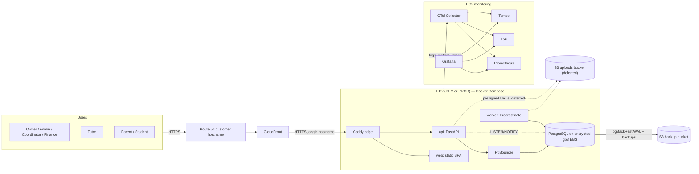
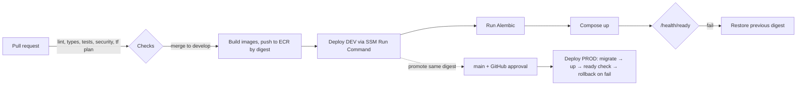

# Classora — Architecture

**Derived from:** `_docs/spec.md` v1.2 (2026-10-16)  
**Status:** Draft. Sections 1–9 restate decisions **already approved** in the spec. Section 10 lists ambiguities, contradictions and missing implementation details; every resolution there is **PROPOSED**, not approved, until it is accepted and recorded as an ADR in `_docs/adr/`.  
**No application code exists yet.**

> **Rules for this document**
>
> - It must not override `_docs/spec.md`. Where the two disagree, the spec wins until the spec is deliberately changed.
> - It introduces no new technologies or architectural style. Where a proposal needs a supporting library or AWS feature the spec does not name, the proposal says so explicitly and needs approval.
> - In sections 1–9, text tagged `→ ISSUE-xx` depends on an open item in §10.

---

## 1. Architectural style (approved)

- **Single-tenant, single-center product.** No multi-tenancy, no branches.
- **Modular monolith.** One FastAPI codebase (`apps/api`) organized by business domain. It ships as two runtime processes from the same image: the **API** and the **Procrastinate worker**.
- **Single-page web client.** React + TypeScript + Vite (`apps/web`). It talks to the API only through the **generated typed client** (`packages/api-client`).
- **PostgreSQL is the only stateful backend service.** It holds business data, server sessions, the job queue (Procrastinate), notifications and the LISTEN/NOTIFY fan-out. **No Redis and no Celery.**
- **Object storage:** S3 (S3-compatible API locally) holds file contents. PostgreSQL holds the file metadata. *(Deferred to a later version, owner decision 2026-10-21: no uploads for now. Until then the app uses no object storage; the only S3 bucket is the backup bucket. See §7.3.)*
- **Three deployed environments on AWS:** DEV, PROD and a monitoring host. Each one is a single EC2 instance running Docker Compose. There is also a local Compose environment.

## 2. System context



Notes:

- The uploads bucket and its presigned URLs (dashed) are deferred to a later version (§7.3).
- PgBouncer placement and which processes bypass it: → ISSUE-D1.
- How the web container is built and served: → ISSUE-I4.
- How CloudFront authenticates to the origin: → ISSUE-I2.

## 3. Repository layout (approved)

The canonical tree is in `_docs/spec.md` §11. In summary:

| Path | Contents |
|---|---|
| `apps/web/src/features/<feature>/` | React UI organized by business feature |
| `apps/api/app/core/` | Settings (pydantic-settings), DB engine/session, Unit of Work, auth primitives, error handling, telemetry, i18n helpers |
| `apps/api/app/modules/<domain>/` | One package per business domain (§4.1) |
| `apps/api/app/workflows/` | Application-level operations that span modules |
| `apps/api/migrations/` | Alembic |
| `apps/api/tests/` | pytest unit and integration tests (Testcontainers PostgreSQL) |
| `packages/api-client/` | TypeScript client generated from the FastAPI OpenAPI document |
| `infrastructure/{terraform,docker,observability,scripts}/` | IaC, Dockerfiles and Compose stacks, monitoring stack, ops scripts |
| `e2e/` | Playwright |

Inconsistencies between this tree and the companion guides: → ISSUE-G1.

## 4. Backend architecture

### 4.1 Domain modules

The candidate modules mirror the spec §12 domain inventory:

| Module | Responsibility (from spec) |
|---|---|
| `identity` | Users, roles, permissions, sessions, preferences, registration and invitations, reauthentication |
| `families` | Students, guardians, student–guardian links, emergency contacts, consent |
| `staff` | Tutors, qualifications, availability, time off, teaching limits |
| `catalog` | Subjects, education levels, academic periods, classrooms, holidays and closures |
| `scheduling` | Class sessions, recurrence, enrollment, attendance, substitutions, booking requests, conflict detection |
| `courses` | Course templates, modules, cohorts, cohort enrollment, completion criteria (templates and snapshots: M4-19; cohorts: M4-20), completion evaluation (M5-18, computed live from the snapshot) |
| `academics` | Evaluations, learning plans, assignments and submissions, session summaries, progress reports, internal notes (session closeouts: M5-10; closeout on behalf, overdue list: M5-10b; closeout review, approval revisions: M5-11; session notes, internal and family-visible: M5-12, read by staff through `academic_note.review` (Owner, Administrator, Academic Coordinator; not delegable), shown to families only through the family route; evaluation templates, evaluations and the unified academic history: M5-13, templates, oversight and voids through `evaluation.manage` (Owner, Administrator, Academic Coordinator; not delegable), shown to families only through the academic history; learning plans with objectives and milestones: M5-14, written by `learning_plan.manage` holders (Owner, Administrator, Academic Coordinator; not delegable) and by tutors currently teaching the student in the plan's subject, shown to families once activated; homework assignments and submissions (text and/or a link, no uploads) and their grades: M5-15, set and graded by the tutor who created them, read by staff through `assignment.review` (Owner, Administrator, Academic Coordinator; read-only, not delegable), shown to the student and their guardians with academic access through one per-student shape, scored grades also in the academic history; progress reports with review: M5-16, written by tutors currently teaching the student, with facts frozen at each submit, approved, sent back or retracted through `progress_report.review` (Owner, Administrator, Academic Coordinator; not delegable; never one's own report unless Owner), shown to families only once approved through one closed shape; report schedules and placeholders: M5-16c, set by `progress_report.review` holders per student, a daily job creating the tutor's empty draft after each week or month; progress dashboard reads (M5-17, in `app/workflows/`): per-student live attendance, grade, homework and learning-plan aggregates and the class log with approved summaries, one closed shape for `evaluation.manage` holders, current tutors and the family, a former tutor reading only the sessions they taught) |
| `billing` | Price catalog, charges, payments, allocations, packages and credits, discounts, refunds, tuition plans, receipts |
| `payroll` | Compensation rates, teaching hours, payroll periods and lines, adjustments, payments, payslips |
| `finance` | Expenses, categories, vendors, recurring expense templates |
| `documents` | Files, folders, access grants, tags, quotas, recycle bin — *deferred to a later version (§7.3)* |
| `administration` | Approval inbox, notifications, audit events, business settings, imports |

Reporting and analytics code lives in a read-only `reporting` module (ISSUE-A2, accepted in [ADR-0002](adr/0002-module-boundaries-and-reporting.md)).

Each module has the same internal layout (the file names are a convention, not mandated by the spec):

```text
modules/<domain>/
  models.py        # SQLAlchemy 2.0 mapped classes (owned tables)
  schemas.py       # Pydantic create/update/detail/list schemas per operation
  repository.py    # queries; no business rules
  service.py       # domain rules; the module's public Python API
  router.py        # FastAPI routes under /api/v1/<domain>
  permissions.py   # role permissions + record-level policy functions
  tasks.py         # Procrastinate tasks owned by the module
```

### 4.2 Cross-module rules (approved pattern; boundary rule and enforcement accepted in [ADR-0002](adr/0002-module-boundaries-and-reporting.md))

- A module may call another module **only through that module's `service.py`** (or use its `schemas.py` types). An `ast`-based pytest check enforces this ([ADR-0002](adr/0002-module-boundaries-and-reporting.md)).
- Operations that change state in several modules (for example: confirm a booking request → create sessions → post charges → notify) live in `app/workflows/` and run inside **one Unit of Work** (one database transaction).
- There is **no in-process event bus**. Orchestration is explicit, as required by "application-level cross-module orchestration".

### 4.3 Request lifecycle

1. Caddy receives the request from CloudFront and forwards `/api/*` to the API.
2. Middleware assigns or propagates a **request ID** and starts an OTel span.
3. Session cookie → server session lookup in PostgreSQL → CSRF check on unsafe methods → rate-limit check ([ADR-0008](adr/0008-rate-limiting-without-redis.md); sessions and CSRF in [ADR-0007](adr/0007-authentication-sessions-recovery-and-delegation.md)) → idempotency key on decorated financial routes, claimed in the request's transaction ([ADR-0006](adr/0006-financial-ledger-idempotency-and-numbering.md); `app/core/idempotency.py`).
4. The route dependency resolves the current user and checks the **role permission**.
5. The service loads the target record(s) and runs the **record-level policy** (ownership, guardian link, tutor assignment).
6. The Unit of Work commits. Audit events, notifications and optimistic-version increments are written in the same transaction.
7. Errors are returned as **RFC 9457 Problem Details** with a stable `code`, field errors and the `request_id`.

### 4.4 API conventions (approved)

- Base path `/api/v1/...`. The SPA and the API share one origin, so CORS is not needed.
- Pydantic schemas are operation-specific: `XCreate`, `XUpdate`, `XDetail`, `XListItem`.
- Timestamps use ISO 8601 with offset. Instants are stored as UTC `TIMESTAMPTZ` (→ ISSUE-D3 for date-only values).
- Pagination is offset/limit for ordinary tables and cursor-based for large histories (audit, ledger, notifications).
- Optimistic concurrency uses a `version` column on edited records (→ ISSUE-D5 for the wire format).
- Financial mutations require idempotency keys (ISSUE-F4, accepted in [ADR-0006](adr/0006-financial-ledger-idempotency-and-numbering.md)).

## 5. Data architecture (approved constraints)

- PostgreSQL, self-hosted, one instance per environment, on a dedicated encrypted gp3 EBS volume.
- Async SQLAlchemy 2.0 + asyncpg, connection pooling through PgBouncer (→ ISSUE-D1).
- Alembic, migration-first, validated in CI, expand-and-contract so the previous image keeps working.
- UUID primary keys, FKs, unique and check constraints. Database constraints protect business invariants.
- Search uses B-tree indexes, full-text search and `pg_trgm` (→ ISSUE-D6 for bilingual text).
- Financial data is append-only with corrections made as adjustments and reversals. Payroll periods are locked once finalized. Catalog prices and rates are effective-dated.
- The detailed schema belongs to `_docs/data-model.md` and is **not** designed here. The billing schema is in [`data-model.md` §3](data-model.md#3-billing-tables).

## 6. Background processing (approved)

- **Procrastinate on PostgreSQL**, running in a **dedicated worker container** built from the API image.
- Jobs include charge generation (recurring tuition and enrollments), recurring expenses, rolling recurrence generation, reminders, report and export generation (WeasyPrint PDF, openpyxl XLSX), imports, file scan follow-up, retention and purge tasks.
- Every job must be **idempotent**. A retry must not create a duplicate business transaction (W4.1, W7.2).
- Periodic tasks today (registered by `app/core/jobs.create_job_app`): `identity:purge_auth_sessions`, `ratelimit:purge_counters` and `idempotency:purge_keys` (hourly; M6-03), `scheduling:expire_offers` (every 5 minutes), `scheduling:materialize_series` (08:00 UTC) and `academics:create_progress_report_placeholders` (07:00 UTC, M5-16c). The last one lives in `app/workflows/progress_report_schedule_tasks.py`, not in a module's `tasks.py`, because it composes `academics` with `scheduling`, `families`, `catalog`, `identity` and `administration`. The billing jobs live in `app/workflows/*_tasks.py` for the same reason: `billing:post_session_charges` and `billing:post_enrollment_charges` (every 15 minutes; M6-06, M6-07), `billing:post_tuition_charges` (07:30 UTC; M6-08), `billing:expire_packages` (07:40 UTC; M6-09) and `billing:send_charge_reminders` (daily at 15:00 UTC, the in-app payment reminders to families; M6-12).
- Failed jobs must be visible to administrators, with retry controls (§9 of the spec).

Open points: → ISSUE-J1 (driver and transactional enqueue), ISSUE-J2 (periodic scheduler placement), ISSUE-J3 (failed-job admin UI). ISSUE-J4 (idempotency mechanics for generated financial records) is accepted in [ADR-0006](adr/0006-financial-ledger-idempotency-and-numbering.md).

## 7. Cross-cutting concerns

### 7.1 Authentication and authorization (approved)

- Server-side sessions stored in PostgreSQL and referenced by an HTTP-only secure cookie. CSRF protection. Expiration and revocation.
- Password reauthentication for sensitive actions.
- Predefined roles plus record-level ownership checks, enforced on the server in endpoints, jobs, generated files and presigned links (presigned links are deferred with §7.3).
- User states: `pending`, `active`, `suspended`, `archived`.

Accepted details (ISSUE-G2, S1, S2, S4, S5, S6, S7): see [ADR-0007](adr/0007-authentication-sessions-recovery-and-delegation.md). Rate limits (ISSUE-S3): see [ADR-0008](adr/0008-rate-limiting-without-redis.md).

### 7.2 Notifications (approved)

- Notifications are persisted in PostgreSQL with read/unread state and per-user preferences.
- Live delivery uses **SSE** fed by PostgreSQL **LISTEN/NOTIFY**. There is no email, SMS or WhatsApp for product users.

Open point: → ISSUE-N1.

### 7.3 Files (approved)

> **Deferred to a later version** (owner decision 2026-10-21: no uploads for now). This covers uploads, object storage, malware scanning, downloads and previews, presigned URLs, quotas, the recycle bin, the shared academic library and attachments (issues #68–#75, milestone "Next version — Files and documents (deferred)"). The text is kept for that version. In this version, generated PDFs are streamed on request and never stored, export results live in a PostgreSQL table with a short expiry behind an authorized endpoint, imports are sent in the request body, and there is no uploads bucket.

- The browser uploads to and downloads from S3 directly through presigned URLs.
- File metadata lives in PostgreSQL. A file stays unreleased until malware scanning passes.
- Visibility levels: private, tutor-only, or shared with authorized students and parents.
- Quotas (global, per user or library, per file). Soft delete to a recycle bin with configurable retention.

Open points: → ISSUE-FL1, FL2, FL3.

### 7.4 Internationalization and time

- The UI uses react-i18next (es and en) and date-fns/date-fns-tz.
- The center's configured time zone governs scheduling, local date boundaries, recurrence and due dates.
- Recurrence expansion and DST handling (local wall-clock expansion, `fold=0`): see [ADR-0005](adr/0005-scheduling-invariants-overrides-and-recurrence.md).

Open points: → ISSUE-D3. Server-rendered text (ISSUE-X1) is accepted in [ADR-0015](adr/0015-server-side-i18n.md).

### 7.5 Auditing

- Important records get audit events with actor, action, timestamp, prior values and new values.

Decision: → ISSUE-A3 (accepted on issue #22).

## 8. Frontend architecture (approved)

- React Router with guarded views. The guards are for UX only; the server is authoritative.
- **TanStack Query** for server state and caching. **Zustand** for UI-only state. React Hook Form + Zod for forms.
- Tailwind + shadcn/ui, central design tokens, Storybook, light/dark/system themes with preferences stored in the database.
- FullCalendar v7 standard views (MIT; no premium resource views) → ADR-0005. Daily/weekly/monthly; drag-and-drop validated by the server.
- Recharts and TanStack Table for analytics; pinned `recharts` 3.10.1, added by #322 (lazy route chunk only). Customizable dashboards → ISSUE-X3.
- Centralized error handling, safe retries, skeleton states. **No optimistic updates on financial mutations.**
- Layouts adapt by role: desktop-first admin, mobile-friendly tutor, student and guardian views. Target is WCAG 2.2 AA.

Typed API client: `openapi-typescript` + `openapi-fetch`, TanStack Query hooks written by hand (ISSUE-X4, accepted; conventions in [`_docs/api.md`](api.md)).

## 9. Deployment, operations and observability (approved)

### 9.1 Per-environment host (DEV and PROD)

| Compose stack | Services |
|---|---|
| **Data stack** (stateful) | PostgreSQL (+ pgBackRest), PgBouncer (→ ISSUE-D1) |
| **App stack** | Caddy edge, `web`, `api`, `worker`, OTel agent (→ ISSUE-O2) |

- Docker restart policy is `unless-stopped`. systemd units start the data stack before the app stack.
- The EBS data volume is attached and mounted by cloud-init/SSM **without ever formatting a volume that already has a filesystem**.
- Management goes through SSM Session Manager and Run Command. There is no inbound SSH, and PostgreSQL/PgBouncer have no public ports.

### 9.2 Delivery pipeline



- GitHub Actions authenticates with OIDC using least-privilege DEV and PROD roles.
- Images are promoted by **immutable digest** (→ ISSUE-I6 for how the digest reaches `main`).
- Migrations run before the new version starts and are **never** reversed automatically.
- The ECR lifecycle policy must keep deployed digests and rollback candidates.
- Terraform uses separate state per environment and an encrypted, versioned S3 backend with native locking. DEV applies on merge, PROD needs approval, destructive plans need approval everywhere, and critical stateful resources have `prevent_destroy`.

Open points: → ISSUE-I1 through I8.

### 9.3 Observability

- A dedicated monitoring EC2 runs the OTel Collector, Prometheus, Loki, Tempo and Grafana.
- Logs are structured JSON with `request_id` and `trace_id`.
- Health endpoints: `/health/live` (process is up) and `/health/ready` (includes PostgreSQL).
- Alerts are dashboard-only: no email or external notifications.

Open points: → ISSUE-O1 (Sentry), ISSUE-O2 (collection topology), ISSUE-O3 (Grafana access).

### 9.4 Backups

- pgBackRest writes full and differential backups plus continuous WAL archiving to S3, enabling PITR.
- Restore drills are required before production reliance (W8.5).

Open point: → ISSUE-I7.

---

## 10. Issues: ambiguities, contradictions and missing details

**Legend.** Type: **C** = contradiction, **A** = ambiguity, **M** = missing implementation detail.  
Every **Resolution** below is **PROPOSED** unless it is marked **ACCEPTED**. Accepted so far: ISSUE-G1 (in part); ISSUE-D7 (ADR-0001); ISSUE-D1, ISSUE-J1 and ISSUE-J2 (ADR-0003); ISSUE-D2 and ISSUE-D3 (ADR-0004); ISSUE-X4 (issue #12); ISSUE-A1 and ISSUE-A2 (ADR-0002); ISSUE-A3 (issue #22); ISSUE-D6 names part (issue #33); ISSUE-G2, ISSUE-S1, ISSUE-S2, ISSUE-S4, ISSUE-S5, ISSUE-S6 and ISSUE-S7 (ADR-0007); ISSUE-S3 (ADR-0008); ISSUE-D4, ISSUE-D6 `btree_gist` part, ISSUE-SC1, ISSUE-SC2, ISSUE-SC3 and ISSUE-X2 (ADR-0005); ISSUE-F7 `teaching_hours.approve` part (issue #77), closeout review part (issue #78) and progress report review part (issue #83); ISSUE-F1, ISSUE-F2, ISSUE-F3, ISSUE-F4, ISSUE-F5, ISSUE-F6, ISSUE-F7 `payment.record` and `payroll.*` parts, and ISSUE-J4 (ADR-0006); ISSUE-X1 (ADR-0015).  
"Spec" references point to `_docs/spec.md` sections.

### 10.1 Governance and documentation

#### ISSUE-G1 — Companion-document references and tree drift (C)
- **Spec:** header, §11, §17.
- **Problem:**
  - The spec names `Classora_FULLREADME.md` as the companion guide and says the tree is "identical to … Part 3, §11". That file does not exist. The guides live in `_docs/guides/` (`full-guide.md`, `agent-driven-guide.md`, `prompt-driven-guide.md`).
  - The spec's tree omits the root `README.md` and `_docs/task-template.md`, but §11's prose mentions `task-template.md`. The agent-driven guide includes both, plus `_docs/team/{pm,software-engineer,qa-engineer}.md`.
  - `full-guide.md` runs `mkdir -p classora/_docs/{architecture,adr,team}`, which creates an `architecture/` **directory** next to `architecture.md`.
- **Resolution — ACCEPTED in part** (human decision on GitHub issue #2, M1-02; no ADR):
  - ACCEPTED: Update the spec header and §11 to point at `_docs/guides/`.
  - PROPOSED: Add `README.md`, `_docs/task-template.md` and `_docs/guides/` to the canonical tree.
  - ACCEPTED: Remove `architecture` from the `mkdir` command in `full-guide.md`.

#### ISSUE-G2 — "Session" names two different entities (C)
- **Spec:** §12 lists `Session` under both Identity (login session) and Scheduling (class occurrence).
- **Problem:** The duplicate name will collide in ORM class names, API paths and conversation.
- **Resolution — ACCEPTED** (ADR-0007, 2026-10-18): see [ADR-0007](adr/0007-authentication-sessions-recovery-and-delegation.md). Use `AuthSession` / `auth_sessions` (identity) and `ClassSession` / `class_sessions` (scheduling). In the API, use `/api/v1/class-sessions`.

### 10.2 Application structure

#### ISSUE-A1 — Enforcing module boundaries (M)
- **Spec:** §10 "Domain modules; Unit of Work; application-level cross-module orchestration".
- **Problem:**
  - No rule says whether modules may import each other's ORM models or join across module tables.
  - No mechanism enforces the boundary.
- **Resolution — ACCEPTED** (ADR-0002, 2026-10-18): see [ADR-0002](adr/0002-module-boundaries-and-reporting.md).
  - Cross-table **foreign keys** are allowed in the database.
  - Python code imports another module only through its `service.py` or `schemas.py`. Modules never import `app.workflows`.
  - Joins across modules are allowed only in `app/workflows/` and in the `reporting` module (ISSUE-A2).
  - Enforcement: a pytest test that reads imports with the standard-library `ast` module, run by `make test-api` and CI, added in #20 (M2-02). No new dependency. An import-linter CI check was considered and rejected (ADR-0002).

#### ISSUE-A2 — Home for analytics, dashboards and exports (A)
- **Spec:** §8 analytics, dashboards, saved reports, exports. §12 has no reporting domain.
- **Problem:** Reports read across almost every module, and none of the twelve domains owns them.
- **Resolution — ACCEPTED** (ADR-0002, 2026-10-18): see [ADR-0002](adr/0002-module-boundaries-and-reporting.md). Built in M8.
  - Add a read-only `reporting` module that owns saved report setups and dashboard widget preferences.
  - It runs read-only SQL across module tables and never writes to other modules.
  - Heavy exports run as worker jobs.

#### ISSUE-A3 — How audit events are captured (M)
- **Spec:** §9 audit trail (actor, action, timestamp, prior/new values).
- **Problem:** The spec does not choose between database triggers and application-level capture. It also does not say which records count as "important" or how sensitive fields are treated.
- **Resolution — ACCEPTED** (human decision on GitHub issue #22, M2-04, 2026-10-18, owner JaimeSolisS; no ADR):
  - **Placement.** Capture lives in `app/core/audit.py`, shared infrastructure that every module and the Unit of Work may import (ADR-0002): the `AuditEvent` model, the `Audited` marker, the flush hook and `record_audit_event`. Events are written in the same transaction as the change, so they roll back with it, and a failed audit write fails the change.
  - **What is captured.** Automatic `create`, `update`, `delete`, `soft_delete` and `restore` events for models marked `Audited`, with JSONB diffs `{column: {old, new}}`. Explicit dotted events (for example `identity.owner_bootstrapped`) for actions that are not column changes. Each event records the actor (the request's principal, or the `actor_id` of a job or command; `NULL` for none), the time and the request ID. ORM bulk statements on audited tables are refused because they skip the hook.
  - **Excluded and masked fields.** `__audit_exclude__` columns never appear (password hashes, tokens, file contents). `__audit_mask__` columns appear only as `"[masked]"`. A test fails any audited model with an unlisted `password|token|secret|hash` or binary column.
  - **Audited set.** M2-04 audits `users`, `user_roles` and `user_delegations` (role assignments, delegations and user state changes). Role and permission reference data is not audited. Each later issue marks its own models: financial records, payroll, attendance corrections, schedule overrides, consent, settings, academic report approvals.
  - **Append-only.** `audit_events` has `BEFORE UPDATE OR DELETE` and `BEFORE TRUNCATE` triggers that raise SQLSTATE 42501 for every role, because the local, test and CI role is a superuser and a `REVOKE` would not bind it. Follow-up #165 adds a least-privilege runtime role so that a `REVOKE` applies as well.
  - **Read endpoint.** `GET /api/v1/audit-events` in the `administration` module, for holders of `audit.view`: newest first, cursor-paginated, filtered by record, actor and time range.

### 10.3 Data layer

#### ISSUE-D1 — PgBouncer vs asyncpg, LISTEN/NOTIFY and Procrastinate (C/M)
- **Spec:** §10 "SQLAlchemy + PgBouncer", "SSE and LISTEN/NOTIFY", "Procrastinate".
- **Problem:**
  - PgBouncer's usual **transaction pooling** mode breaks `LISTEN` (it is session-scoped) and conflicts with asyncpg's prepared-statement cache.
  - Procrastinate's worker relies on `LISTEN/NOTIFY` and advisory locks.
  - Alembic migrations may need session-level features.
- **Resolution — ACCEPTED** (ADR-0003, 2026-10-17): see [ADR-0003](adr/0003-database-connection-topology.md), which also records the approved details for API-side job deferral, worker business sessions and the Procrastinate schema path.
  - The API's request traffic goes through PgBouncer in transaction mode. Disable asyncpg statement caching (`prepared_statement_cache_size=0` / `statement_cache_size=0`) and use unique prepared-statement names.
  - The **SSE listener connection**, the **Procrastinate worker** and **Alembic** connect directly to PostgreSQL on the internal Docker network. An alternative, a separate PgBouncer pool in session mode, was considered and rejected (ADR-0003).
  - PgBouncer runs in the **data stack**.
  - Size `max_connections` for the micro instance (see ISSUE-I8).

#### ISSUE-D2 — Money representation and rounding (M; spec §18.1 open)
- **Spec:** §16 "decimal-safe", strategy left open.
- **Resolution — ACCEPTED** (ADR-0004, 2026-10-17): see [ADR-0004](adr/0004-money-time-and-date-representation.md).
  - Store amounts as `NUMERIC(14,2)` in MXN. Use `NUMERIC(14,4)` for intermediate rates such as per-minute compensation.
  - Use Python `Decimal` end to end.
  - Round half-up to the centavo **per line item**. Totals are sums of rounded lines.
  - JSON carries money as **strings** (`"1250.00"`, OpenAPI `type: string, format: decimal`). The frontend formats them with `Intl.NumberFormat('es-MX', {currency:'MXN'})` and never does arithmetic on floats.

#### ISSUE-D3 — "TIMESTAMPTZ UTC" vs date-only and wall-clock values (C)
- **Spec:** §10 "TIMESTAMPTZ UTC; ISO 8601 API" vs §16 "local date boundaries, recurrence and due dates".
- **Problem:**
  - Birthdates, due dates, holidays, payroll period bounds, academic periods and effective dates are calendar dates, not instants.
  - Recurrence must be defined in local wall-clock time.
- **Resolution — ACCEPTED** (ADR-0004, 2026-10-17): see [ADR-0004](adr/0004-money-time-and-date-representation.md).
  - Use `DATE` for calendar dates.
  - Recurrence rules store a local `TIME`, a duration and a `TZID`.
  - Materialized class sessions store `starts_at` and `ends_at` as `TIMESTAMPTZ`.
  - The center time zone (default `America/Mexico_City`) is a business setting. Changing it after sessions exist requires an explicit migration job rather than a plain settings edit.
  - The API returns `DATE` values as `YYYY-MM-DD`.

#### ISSUE-D4 — Which overlap rules are database-enforced and which are overridable (C)
- **Spec:**
  - §3 says "Prevent student/tutor/room overlap and capacity violations… authorized administrators may override defined restrictions".
  - §16 says database constraints protect invariants.
  - §3 also says workload limits produce warnings only.
- **Problem:** A database constraint cannot be overridden, and the spec does not list which restrictions are overridable.
- **Resolution — ACCEPTED** (ADR-0005, 2026-10-19): see [ADR-0005](adr/0005-scheduling-invariants-overrides-and-recurrence.md).
  - **Hard, never overridable:**
    - `tutor_overlap` and `room_overlap`: partial `EXCLUDE USING gist` on `tstzrange(starts_at, ends_at, '[)')` over the occupying states (ISSUE-SC1); `btree_gist` is already enabled by #38. Back-to-back sessions are allowed.
    - `student_overlap`: checked in the application inside the booking transaction, under a per-student transaction advisory lock.
    - `room_capacity_exceeded`: checked in the application under a row lock.
  - **Soft, overridable with `schedule.override` and a reason, then audited:** `tutor_unavailable`, `room_unavailable`, `center_closed`, `outside_operating_hours`, `tutor_not_qualified`, `group_capacity_exceeded`, `notice_window`.
  - **Warning only, never blocks:** `daily_limit_exceeded`, `weekly_limit_exceeded`, `break_too_short`.
  - Inactive or invalid references are `422`, not conflicts. Conflicts are `409 scheduling_conflict`; overrides send `override: {codes, reason}` and are stored as rows plus an audit event.

#### ISSUE-D5 — Optimistic concurrency wire format (M)
- **Resolution — PROPOSED:**
  - Detail responses include an integer `version`. Update requests must send it back.
  - A mismatch returns `409` with the Problem `code` `version_conflict`.
  - Choose a body field over `ETag`/`If-Match` so the generated client stays simple.

#### ISSUE-D6 — Bilingual full-text search (M)
- **Problem:** The spec does not choose a PostgreSQL text-search configuration for mixed Spanish and English content.
- **Resolution — names part ACCEPTED** (human decision on GitHub issue #33, M2-15, 2026-10-18, owner JaimeSolisS; no ADR); `btree_gist` part ACCEPTED (ADR-0005, 2026-10-19); the library-documents part stays PROPOSED:
  - **Names and short fields — ACCEPTED:** `pg_trgm` + `unaccent` with the `simple` behaviour (no language stemming), enabled by the migration of their first consumer (M2-15, revision `0014`). Accent folding goes through an `IMMUTABLE` wrapper `public.f_unaccent(text)` (`SELECT public.unaccent('public.unaccent'::regdictionary, $1)`), because `unaccent()` itself is only `STABLE` and can't be used in an index; its `EXECUTE` stays granted to `PUBLIC`, so a least-privilege runtime role (#165) can call it. Search uses a GIN trigram **expression index** on `public.f_unaccent(lower(...))` of the searched text, never a stored search column (audit diffs carry no derived value). First use: student name search (`apps/api/app/modules/families/`).
  - Library documents — PROPOSED, deferred to a later version with the shared library (§7.3): a `language` column (`es`/`en`) and a generated `tsvector` that uses `spanish` or `english` accordingly.
  - `btree_gist` — ACCEPTED (decided in [ADR-0005](adr/0005-scheduling-invariants-overrides-and-recurrence.md), 2026-10-19, with ISSUE-D4). Enabled by #38 (M3-02, revision `0021`, owner-delegated decision #38 E1 (a)) for the academic-period exclusion constraint `ex_academic_periods_no_overlap`; ISSUE-D4 / M4-02 reuses it (`CREATE EXTENSION IF NOT EXISTS` or nothing).

#### ISSUE-D7 — Version pins (M)
- **Problem:** The spec pins no major versions.
- **Resolution — ACCEPTED** (ADR-0001, 2026-10-17): see [ADR-0001](adr/0001-runtime-version-pins.md). Pin PostgreSQL 18 (native `uuidv7()` gives index-friendly UUID keys), Python 3.14, Node 24 LTS and pnpm. Record the pins in ADR-0001 and in `.tool-versions` or equivalent files.

### 10.4 Background jobs

#### ISSUE-J1 — Procrastinate driver and transactional enqueue (C/M)
- **Spec:** §10 asyncpg for the ORM and Procrastinate for jobs.
- **Problem:**
  - Procrastinate's connectors are psycopg-based. Verified on 2026-10-17 against the pinned version, Procrastinate 3.10.0: it has psycopg 3 connectors and no asyncpg connector (ADR-0003 §Verification).
  - Because of that, enqueueing a job is not atomic with the business transaction that triggered it.
- **Resolution — ACCEPTED** (ADR-0003, 2026-10-17): see [ADR-0003](adr/0003-database-connection-topology.md).
  - Accept psycopg 3 as a dependency used only by Procrastinate.
  - Enqueue jobs **after commit**.
  - Make every job idempotent (ISSUE-J4).
  - Add periodic **sweeper** tasks that find business records needing work but having no job (for example, enrollments without charges) and enqueue them. This covers a crash between commit and enqueue without adding an outbox pattern.

#### ISSUE-J2 — Where the "periodic scheduler" runs (A)
- **Spec:** §10 "dedicated worker container; periodic scheduler".
- **Problem:** It is unclear whether this means a separate scheduler container. In Procrastinate, periodic tasks are deferred by the worker process itself, with database-level deduplication.
- **Resolution — ACCEPTED** (ADR-0003, 2026-10-17): see [ADR-0003](adr/0003-database-connection-topology.md). Run periodic deferral inside the `worker` container and add no extra container. Every periodic task uses a `queueing_lock` and an idempotent business key.

#### ISSUE-J3 — Failed-job visibility and retry UI (M)
- **Spec:** §9 "failed background tasks visible with retry controls".
- **Problem:** Procrastinate ships no standalone web UI for this.
- **Resolution — PROPOSED:**
  - Add admin API endpoints in `administration` that read the Procrastinate job tables (status, attempts, last error) and trigger a retry.
  - Restrict them to Owner and Administrator.
  - Store error text sanitized, with no PII in task arguments. Tasks receive IDs, not personal data.

#### ISSUE-J4 — Idempotency mechanics for generated financial records (M)
- **Spec:** W4.1, W7.2, §6 "transactional and idempotent".
- **Resolution — ACCEPTED** (ADR-0006, 2026-10-27): see [ADR-0006](adr/0006-financial-ledger-idempotency-and-numbering.md).
  - Each generated record carries a deterministic **natural key** with a partial unique index (see [`data-model.md`](data-model.md#39-charges)). Examples: `(class_session_id, student_id)` for session charges, `(tuition_plan_id, period_start)` for tuition periods, `(package_id)` for package expiry; later `(expense_template_id, period_start)` for recurring expenses.
  - Jobs insert with `ON CONFLICT DO NOTHING` and treat a conflict as success. Jobs never use the API `idempotency_keys` table.

### 10.5 Scheduling

#### ISSUE-SC1 — Assignment offer lifecycle (A)
- **Spec:** §3 "Tutors accept/decline offered assignments", W1.3–4.
- **Problem:** The spec does not say:
  - whether an offered-but-unaccepted session holds the room and tutor slot,
  - whether acceptance applies to a whole series or to each occurrence,
  - what happens if the tutor never responds.
- **Resolution — ACCEPTED** (ADR-0005, 2026-10-19): see [ADR-0005](adr/0005-scheduling-invariants-overrides-and-recurrence.md).
  - Session states: `unassigned`, `offered`, `confirmed`, `completed`, `cancelled`, `skipped_closure`, `conflict`. There is no `draft`. `completed` and `cancelled` are final.
  - The tutor is occupied in `offered`, `confirmed` and `completed`; the room and students in `unassigned`, `offered`, `confirmed` and `completed`.
  - An offer covers one session or one series assignment from a date onward. Substitutions are one-occurrence offers: the session stays `confirmed` with its tutor until the substitute accepts ([ADR-0005 amendment A1](adr/0005-scheduling-invariants-overrides-and-recurrence.md#a1--substitution-offers-55-e1-2026-10-22-owner-delegated), #55). Offers are rows (`pending`, `accepted`, `declined`, `expired`, `withdrawn`).
  - Deadline: `respond_by = min(offered_at + response_hours, first covered start)`, with `response_hours` in the M4-16 policy (default 48); the administrator may choose an earlier one. A periodic task expires offers every 5 minutes.
  - On decline or expiry the covered sessions go to `unassigned` with the tutor cleared (room and students stay held), and a system-raised inbox item plus a notification are created.
  - Families see only `confirmed` and `completed` sessions, plus cancelled or skipped occurrences of sessions they had already seen.

#### ISSUE-SC2 — Recurrence materialization horizon and editing semantics (M)
- **Spec:** §3 RRULE, rolling generation, exceptions, future-occurrence changes, holiday skipping.
- **Resolution — ACCEPTED** (ADR-0005, 2026-10-19): see [ADR-0005](adr/0005-scheduling-invariants-overrides-and-recurrence.md).
  - Rule subset: `FREQ=WEEKLY`, `INTERVAL` 1–4, `BYDAY`, optional `UNTIL` (local date) or `COUNT` (1–200). The API also takes and returns structured fields; the web app never parses `RRULE`s.
  - Expansion in naive local time, then `ZoneInfo(TZID)` with `fold=0`.
  - Rolling **12-week** horizon (`SCHEDULING_HORIZON_WEEKS`, 4–26), extended nightly at 08:00 UTC. Inserts use `UNIQUE (series_id, original_start)` with `ON CONFLICT DO NOTHING`; `is_exception` rows survive regeneration.
  - "This and future" edits set `UNTIL` to the local day before the split and start a new series; matching future occurrences move (keeping their id), the others become `cancelled` (`series_changed`). Past, completed and cancelled occurrences are never rewritten.
  - A series create refuses on any conflict; the nightly extension inserts a failing occurrence as `conflict` and raises an inbox item.
  - A center closure turns the affected series occurrence into `skipped_closure` (holds nothing, never deleted). Product decision: **no makeup obligation**; a skipped occurrence is **never billable** (M6-14 reverses a posted charge) and courses and tuition plans are not prorated. Makeups are ordinary sessions.
  - Library approved: `python-dateutil>=2.9.0.post0,<3` (lockfile 2.9.0.post0) with `types-python-dateutil`, backend only, added by #53. No JavaScript `rrule`.

#### ISSUE-SC3 — Effective capacity (A)
- **Spec:** §3 "Each group/cohort has its own maximum size and respects room capacity".
- **Resolution — ACCEPTED** (ADR-0005, 2026-10-19): see [ADR-0005](adr/0005-scheduling-invariants-overrides-and-recurrence.md). Effective capacity = `min(group_or_cohort_max, room_capacity)`; with no room, the group or cohort maximum; an individual session has exactly one student. The group or cohort maximum is soft (`group_capacity_exceeded`, up to the room capacity). Room capacity is hard.

### 10.6 Billing and finance

#### ISSUE-F1 — When lesson charges are posted (A)
- **Spec:**
  - §6 "Charges generated automatically from billable lessons".
  - §3 "Rescheduling normally preserves an existing charge".
- **Problem:** The spec does not say whether a charge is created when a session is confirmed, when it occurs, or when closeout is approved. The rescheduling rule implies the charge exists before the session.
- **Resolution — ACCEPTED** (ADR-0006, 2026-10-27): see [ADR-0006](adr/0006-financial-ledger-idempotency-and-numbering.md) (E1, E3).
  - Per-session lessons: a 15-minute sweeper (`billing:post_session_charges`) posts a charge for each `confirmed` or `completed` participant on the natural key `(class_session_id, student_id)`, at the price in effect on the local service date. Nothing posts inside the scheduling transaction; #60's `apply_confirmation_charge` was removed by #91. A reschedule keeps the charge.
  - Group and course enrollments: post at **enrollment**, in the M4 hooks' Unit of Work, plus a sweeper.
  - Tuition plans: one charge per plan per local period, from a daily job.
  - Packages: charge at purchase. A covered session posts no charge; its units are consumed at closeout approval (`app/workflows/closeout_approval.on_closeout_approved`, #78: revision 1 only), first-expiring-first, or at the latest by the daily expiry job's fallback (#94 L1); an approved session the credit can't cover is charged by the session sweeper (#94 L3).
  - `billing_settings.billing_starts_on` (`NULL` = billing off) is the floor date. Items with no billing account or no price are listed for staff as unbilled, never charged at zero.
  - Cancellations follow the billing-owned `cancellation_billing_rules` (`credit` or `charge` per classification); duration changes create delta adjustments.

#### ISSUE-F2 — Billed duration vs actual duration (A)
- **Spec:** §3 "billable duration changes create adjustment entries"; tutors report actual hours.
- **Resolution — ACCEPTED** (ADR-0006, 2026-10-27): see [ADR-0006](adr/0006-financial-ledger-idempotency-and-numbering.md) (E2).
  - Families are billed on **`scheduled_minutes`**.
  - A staff edit of `scheduled_minutes` (which needs `schedule.manage`) on a charged session posts one delta adjustment per charged participant: the catalog price for the new duration minus the current net, or pro rata by minutes when that duration has no price. Its `source_key` includes the session version.
  - Tutors are paid on **approved** `actual_minutes` (M7); `actual_minutes` never changes a family charge.
  - The two values are stored separately on the class session (#47).

#### ISSUE-F3 — Ledger owner and balance derivation (M)
- **Spec:** §6 family-consolidated billing; W4.4 balance formula.
- **Resolution — ACCEPTED** (ADR-0006, 2026-10-27): see [ADR-0006](adr/0006-financial-ledger-idempotency-and-numbering.md) (E4, E5, E10).
  - One **family billing account** per family (`family_id` unique) owns the ledger, and every charge also references the student it covers. A student with no family isn't billed; guardians in `family_guardians` see the account.
  - Typed append-only tables: charges, signed adjustments against a charge, payments and reversals, allocations and releases, refunds. Credits are negative adjustments; account credit is a payment's unallocated remainder.
  - `net = amount + Σ adjustments`; `open = net − Σ valid allocations`; outstanding = Σ open; account credit = Σ over unreversed payments of (amount − valid allocations − refunds); net balance = outstanding − account credit. Computed, not stored; a verified snapshot only for reporting.
  - Posted rows are immutable through `BEFORE UPDATE OR DELETE` and `BEFORE TRUNCATE` triggers raising 42501 (the migration 0004 pattern); the least-privilege role follows in #165.
  - When several packages apply, credit is consumed **first-expiring-first**.
  - Data model: [`data-model.md`](data-model.md).

#### ISSUE-F4 — API idempotency keys (M)
- **Spec:** §10 "PostgreSQL transactions and idempotency keys".
- **Resolution — ACCEPTED** (ADR-0006, 2026-10-27): see [ADR-0006](adr/0006-financial-ledger-idempotency-and-numbering.md) (E6).
  - Every endpoint that posts a ledger row (manual charges and adjustments, package purchases, payments, allocations, reversals, refunds, withdrawal confirmations; later payroll approval and payment) requires an `Idempotency-Key` header of 16–128 `[A-Za-z0-9_-]` characters (`400 idempotency_key_required` / `idempotency_key_invalid`).
  - The core `idempotency_keys` table stores user, endpoint, key, request hash, response status and body, `UNIQUE (user_id, endpoint, key)`, inserted in the business transaction; only `2xx` responses are stored; 7 days, purged hourly by `idempotency:purge_keys`.
  - A replay with the same hash returns the stored response with `Idempotent-Replayed: true`. The same key with a different hash returns `422 idempotency_key_reused`.
  - The frontend generates the key (`crypto.randomUUID()`) once per form submission and reuses it on retry.

#### ISSUE-F5 — Receipt and payslip numbering (M)
- **Problem:** Branded receipts need human-readable numbers. PostgreSQL sequences can leave gaps on rollback.
- **Resolution — ACCEPTED** (ADR-0006, 2026-10-27): see [ADR-0006](adr/0006-financial-ledger-idempotency-and-numbering.md) (E13). Allocate gap-free yearly series (`R-2026-000123`; `P` reserved for payslips in M7) from the core `number_series (code, year)` row locked `FOR UPDATE` inside the posting transaction, after the billing account lock; the year is the center-local year of the issue instant. One receipt per payment, issued in the payment's transaction, stored as a frozen snapshot.

#### ISSUE-F6 — Accrual-basis revenue recognition (A)
- **Spec:** §8 cash and accrual reporting.
- **Problem:** The spec does not say when prepaid packages, course fees and tuition count as earned revenue.
- **Resolution — ACCEPTED** (ADR-0006, 2026-10-27): see [ADR-0006](adr/0006-financial-ledger-idempotency-and-numbering.md) (E7). A reporting rule for #117.
  - Per-session charges are recognized on the session's current local date, net of adjustments.
  - Packages are deferred revenue, recognized per consumption (`net price × units consumed / units granted`); expired unused credit is recognized on the expiry date.
  - Course fees are recognized pro rata over the cohort's not-cancelled, not-skipped sessions; tuition periods and flat group fees in full on `period_start` (or the enrollment date).
  - Unrecognized prepaid amounts are reported as deferred revenue. Cash basis uses `received_on`, net of reversals and refunds.

#### ISSUE-F7 — Who records payments and approves closeout (C)
- **Spec:**
  - §6 says "Admins record… payments" while W4.3 says "Finance staff record an external payment".
  - §3 says "submission for approval… admins reapprove", §7 says "Academic Coordinators verify hours", and W3.3 says "authorized academic reviewer".
- **Resolution — ACCEPTED** (ADR-0006, 2026-10-27), `payment.record` and `payroll.*` parts: see [ADR-0006](adr/0006-financial-ledger-idempotency-and-numbering.md) (E8). Permissions, not roles. `billing.view`, `billing.manage` and `payment.record` go to the Owner, the Administrator and Finance Staff (not delegable; each seeded by the first issue that uses it: #364, #89, #96). Reversals and refunds use `finance.refund.approve` (Owner, delegable) with reauthentication. `payroll.prepare` goes to Finance Staff; `payroll.finalize` goes to the Owner and is delegable to an Administrator (ISSUE-S2). Academic Coordinators and tutors get no billing permission.
- **`teaching_hours.approve` part ACCEPTED** (#77, owner-delegated, 2026-10-24): granted to the Owner (all permissions), the Administrator and the Academic Coordinator; not delegable; seeded. It reviews tutors' session closeouts (the `academics.session_closeout` approval type).
- **Closeout review part ACCEPTED** (#78, owner-delegated, 2026-10-24): `teaching_hours.approve` holders approve, request changes or correct a closeout on the staff session page; closeouts have **no reject**; a reviewer can't approve, send back or correct a closeout they submitted (`403 closeout_self_review`) unless they hold the Owner role; approvals are immutable revisions and a correction supersedes.
- **Progress report review part ACCEPTED** (#83, owner-delegated decision E4, 2026-10-25): spec W5.2 "an administrator approves" progress reports is read as staff with academic approval authority, as above: a new permission `progress_report.review` for the Owner (all permissions), the Administrator and the Academic Coordinator; not delegable; seeded. Holders approve, request changes or retract a submitted progress report on its review page (the `academics.progress_report` approval type, decided only there); there is no reject; a reviewer can't decide a report they wrote (`403 progress_report_self_review`) unless they hold the Owner role. Only approved reports reach families.
- **Closeout on behalf note** (#301, owner-delegated, 2026-10-25): staff on-behalf closeouts are attributed to the tutor (`tutor_user_id` and the approval requester stay the tutor, for payroll); the on-behalf submitter can't approve or correct them (`403 closeout_self_review`), Owner excepted; an on-behalf submission is corrected, never sent back.

### 10.7 Identity, security and privacy

#### ISSUE-S1 — Account recovery and activation without email (M; spec §18.2 open)
- **Resolution — ACCEPTED** (ADR-0007, 2026-10-18): see [ADR-0007](adr/0007-authentication-sessions-recovery-and-delegation.md) (amended by #29), which also records who may reset whom, the Owner bootstrap and reset commands, and the self-registration rules.
  - Invitations and password resets use **single-use, time-limited tokens** (32 random bytes, 24 h, stored only as a SHA-256 hash). A new token invalidates any unredeemed token of the same kind; a used or expired token returns `410`.
  - An authorized staff member generates the token in the app and shows it once as a link. Staff hand it over **out of band**, for example in person or by the center's existing phone contact.
  - Self-registration requests (Parent/Guardian or Student only) stay `pending` until an administrator approves them.
  - Considered and rejected: transactional-only email (for example, Amazon SES) restricted to authentication messages, which would be a **scope change** to spec §1 and §14.

#### ISSUE-S2 — "Authorized Administrator" and multi-role users (A)
- **Spec:** §2 predefined roles. §7 "Owner or authorized Administrator". §12 lists `UserRole`.
- **Problem:**
  - "Authorized" implies per-user grants beyond the fixed roles.
  - `UserRole` implies a user can hold several roles, for example a tutor who is also a parent.
- **Resolution — ACCEPTED** (ADR-0007, 2026-10-18): see [ADR-0007](adr/0007-authentication-sessions-recovery-and-delegation.md).
  - Permission sets per role are fixed in code and seeded.
  - The Owner can grant a small, enumerated set of **delegable permissions** to individual administrators: `payroll.finalize`, `schedule.override`, `finance.refund.approve`, `user.admin_role.assign`.
  - Administrators assign and remove Academic Coordinator, Finance Staff, Tutor, Student and Parent/Guardian. Only an Owner or a holder of `user.admin_role.assign` assigns Administrator. Only an Owner assigns Owner (not delegable). An invitation that carries a role counts as assigning it. The last active Owner cannot be removed or suspended.
  - A user may hold several roles, and their effective permissions are the union.
  - Record-level policies still apply. For example, a tutor-parent sees their own children as a guardian and their students as a tutor.

#### ISSUE-S3 — Rate limiting without Redis (C; spec §18.4 open)
- **Spec:** §10 says "Caddy/FastAPI enforcement". Standard Caddy has no rate-limit directive; it needs a third-party module and a custom build.
- **Problem:**
  - FastAPI in-memory limits are per process.
  - Behind CloudFront, the client IP must come from `CloudFront-Viewer-Address`/`X-Forwarded-For`, trusted only from CloudFront.
- **Resolution — ACCEPTED** (ADR-0008, 2026-10-18): see [ADR-0008](adr/0008-rate-limiting-without-redis.md) for the thresholds and the client-IP rule.
  - **Authentication endpoints** (login, reauthentication, token redemption, registration): a PostgreSQL-backed fixed-window counter keyed by IP and account. It is correct across processes. Over the limit: `429` with `Retry-After`; no permanent lockout.
  - **Client IP:** the TCP peer, unless it is in `TRUSTED_PROXIES` (empty by default; Caddy in AWS); only then the right-most untrusted `X-Forwarded-For` entry. Caddy derives that header from CloudFront's viewer address (M9-09).
  - **General API:** none in M2. A coarse in-process limit per worker process follows in #163 (M10-09, Phase 1 local hardening).
  - A Caddy rate-limit module is not required.

#### ISSUE-S4 — Session and CSRF parameters (M)
- **Resolution — ACCEPTED** (ADR-0007, 2026-10-18): see [ADR-0007](adr/0007-authentication-sessions-recovery-and-delegation.md).
  - The cookie is `__Host-classora_session`: `Secure`, `HttpOnly`, `SameSite=Lax`, `Path=/`, no `Domain`. The token is 32 random bytes; only its SHA-256 hash is stored. A local-only setting uses `classora_session` without `Secure` for plain-HTTP development and is refused outside the local environment.
  - Staff sessions (Owner, Administrator, Academic Coordinator, Finance Staff): 30-minute idle timeout, 12-hour absolute. Family and tutor sessions: 7-day idle, 30-day absolute. Several roles: the strictest class applies.
  - CSRF uses a synchronizer token derived from the session token (base64url of HMAC-SHA256 keyed with the session token), so nothing extra is stored, returned by `POST /api/v1/auth/login` and `GET /api/v1/auth/me`, kept in memory by the SPA and sent in the `X-CSRF-Token` header. The server also requires `Origin` to equal the app origin (`403` otherwise).
  - A new session ID is issued on every login. A user's sessions are revoked when the user is suspended or archived, changes role, or has a password reset. A self-service password change revokes the other sessions and rotates the current one.

#### ISSUE-S5 — List of sensitive actions requiring reauthentication (A)
- **Resolution — ACCEPTED** (ADR-0007, 2026-10-18): see [ADR-0007](adr/0007-authentication-sessions-recovery-and-delegation.md).
  - Actions: role, permission and delegation changes (including invitations for staff roles), user suspension or archival, issuing password-reset tokens, payroll finalization, refunds and reversals, financial corrections, retention/permanent-deletion actions, business-settings changes to payment methods or time zone, bulk exports of personal data.
  - Reauthentication stays valid for 5 minutes on the session, not extended by activity. A self-service password change asks for the current password instead.

#### ISSUE-S6 — Guardian access to adult students (A)
- **Spec:** §2 "Parents access only linked children… as permitted". §9 privacy and minors' data.
- **Problem:** Students can be university students who are adults. The spec does not say who controls guardian visibility once a student is 18.
- **Resolution — ACCEPTED** (ADR-0007, 2026-10-18): see [ADR-0007](adr/0007-authentication-sessions-recovery-and-delegation.md). The 18th birthday is computed in the center's time zone, and the birthdate is required on the student profile.
  - Minors: linked guardians have default access.
  - Students aged 18 or older: academic visibility for guardians requires a recorded student consent.
  - Billing visibility follows the **family billing account** regardless of age.
  - Legal wording is still open (spec §18.9).

#### ISSUE-S7 — Student account creation for minors (A)
- **Resolution — ACCEPTED** (ADR-0007, 2026-10-18): see [ADR-0007](adr/0007-authentication-sessions-recovery-and-delegation.md). Creating a login for a minor student requires a linked guardian's **consent record** (who, when, which privacy-notice version, scope and method). Revoking it suspends the student's login. No minimum age.

### 10.8 Notifications

#### ISSUE-N1 — SSE with LISTEN/NOTIFY across processes and CloudFront (M; spec §18.4 open)
- **Resolution — PROPOSED:**
  - Each API worker process holds **one** direct `LISTEN` connection (see ISSUE-D1) and fans events out to its own in-memory SSE subscribers.
  - The `NOTIFY` payload carries only `{user_id, notification_id}`, well under the 8 KB limit. Clients refetch the notification through the regular API.
  - `NOTIFY` is transactional, so it is issued in the same transaction as the insert.
  - The server sends a heartbeat comment every 15 s. Caddy disables response buffering for the SSE route. Set CloudFront's origin response timeout so an idle stream stays open between heartbeats.
  - The client reconnects with `Last-Event-ID` and falls back to TanStack Query polling.
  - **Implementation note (M3-06, #42):** the per-process listener and the in-memory SSE fan-out are implemented as proposed (`administration/live.py`; `GET /api/v1/notifications/stream`; details in [`api.md`](api.md) "Live notifications"). Also implemented: `resync` events after a listener reconnect or a buffer overflow, `Last-Event-ID` replay of up to 100 notifications, a 10-streams-per-user limit per process, and streams that never refresh the session. The Caddy (no buffering or compression on the stream route) and CloudFront (timeouts above the heartbeat) parts stay with M9-09 (#139) and M9-10 (#140). The resolution stays PROPOSED.

### 10.9 Files

> **Deferred to a later version** (owner decision 2026-10-21: no uploads for now). ISSUE-FL1 to FL3 stay PROPOSED for that version (see §7.3).

#### ISSUE-FL1 — Malware scanning on a micro instance (C/M; spec §18.5 open)
- **Problem:**
  - The spec requires scanning but names no scanner.
  - A ClamAV daemon needs well over 1 GB of RAM for signatures, which conflicts with the micro instance target.
- **Resolution — PROPOSED:**
  - Option A (recommended): **Amazon GuardDuty Malware Protection for S3** on the uploads bucket. It is a managed AWS feature with no extra container. The worker reads the scan result tag and releases the file or quarantines it.
  - Option B: a ClamAV container. It requires a larger instance.
  - Either option needs approval because the spec names neither.
  - Local development uses a stub scanner that marks files clean.

#### ISSUE-FL2 — Upload, release and download flow (M)
- **Resolution — PROPOSED:**
  - Use **presigned POST** with a `content-length-range` condition so size limits are enforced by S3. A presigned PUT cannot enforce size.
  - Uploads land under `pending/`. The file record is created in state `pending_scan`, and quota is reserved.
  - Once the scan is clean, the worker copies the object to `released/` and the record becomes `available`. An infected file is marked `rejected` and deleted.
  - Downloads: after a server-side permission check, generate a presigned GET with a 5-minute TTL. `Content-Disposition` is `attachment`, except inline for PDF and images. URLs are never stored.
  - The bucket blocks all public access and uses SSE-S3 or SSE-KMS encryption.
  - Recycle-bin purge is a periodic worker task.

#### ISSUE-FL3 — Previews (A)
- **Spec:** §5 "previews where supported".
- **Resolution — PROPOSED:**
  - PDF and images preview in the browser.
  - Word, Excel and PowerPoint are download-only in the first release. Server-side conversion (for example, LibreOffice) is too heavy for the target host.
  - Local development: use an S3-compatible emulator in Compose. MinIO is a candidate if its current licensing and image distribution are acceptable; otherwise use a per-developer prefix in a DEV sandbox bucket.

### 10.10 Infrastructure and delivery

#### ISSUE-I1 — Secret delivery path (A; spec §18.8 open)
- **Spec:** "GitHub Secrets delivered via SSM".
- **Problem:** It is unclear whether this means SSM Parameter Store or passing values through Run Command. Run Command parameters appear in command history and logs.
- **Resolution — PROPOSED:**
  - GitHub Actions writes secrets to **SSM Parameter Store `SecureString`** under `/classora/<env>/...`.
  - The instance role reads only its own environment's path.
  - The deploy script renders an env file at mode `0600` owned by root and passes it to Compose with `env_file`.
  - Run Command receives only the image digest and the release tag.
  - Secrets are never baked into images.

#### ISSUE-I2 — CloudFront-specific origin authentication (M; spec §18.8 open)
- **Resolution — PROPOSED:**
  - CloudFront adds a custom origin header, `X-Origin-Verify: <secret>`, sourced from Parameter Store.
  - Caddy rejects any request without the header (`403`). This applies alongside the security group's CloudFront-prefix-list restriction.
  - Rotate the secret by accepting two values during the switchover.

#### ISSUE-I3 — Origin TLS certificate issuance (C)
- **Problem:**
  - Caddy's default ACME HTTP-01 and TLS-ALPN-01 challenges need Let's Encrypt to reach ports 80/443 directly.
  - The security group allows only CloudFront, so issuance and renewal would fail.
- **Resolution — PROPOSED:**
  - Use the **DNS-01** challenge through Route 53, with a Caddy build that includes the Route 53 DNS module (built in CI with `xcaddy` and pushed to ECR).
  - The instance role may change only the `_acme-challenge.<origin-host>` record.
  - Alternative: an origin certificate managed outside Caddy.

#### ISSUE-I4 — How the SPA is served (A)
- **Spec:** "Caddy origin on EC2 → web/API containers".
- **Resolution — PROPOSED:**
  - The `web` image is a small Caddy image serving the Vite build with an SPA fallback. The edge Caddy proxies `/` to `web` and `/api/*` to `api`.
  - CloudFront behaviors: caching disabled for `/api/*` (forward cookies and `Origin`); long TTL for hashed `/assets/*`; `index.html` sent with `no-cache`.
  - `/health/*` is not exposed through CloudFront. The deploy script checks it from inside the host.
  - Alternative (saves RAM): build the SPA into the edge Caddy image.

#### ISSUE-I5 — Deployment sequence and downtime on one host (A; spec §14, §18.7)
- **Resolution — PROPOSED:**
  - Accept **short downtime** in the first release.
  - The SSM-triggered deploy script:
    1. records the current digests in `/opt/classora/release/previous`;
    2. pulls the new digests;
    3. runs `alembic upgrade head` as a one-off container on a direct database connection;
    4. runs `docker compose up -d` for `api`, `worker` and `web`;
    5. polls `/health/ready` for N seconds;
    6. on failure, restores the previous digests and runs `up` again, without touching the database.
  - The worker stops gracefully with a configured timeout; jobs are idempotent (ISSUE-J4).

#### ISSUE-I6 — Promoting the same digest from `develop` to `main` (C)
- **Spec:** §10 "promoted by immutable digest DEV → PROD", "tested changes → main".
- **Problem:** A merge commit on `main` has a new SHA. A build triggered on `main` would produce a different digest from the one tested in DEV.
- **Resolution — PROPOSED:**
  - Images are built **only** on `develop` and tagged with the commit SHA. ECR tag immutability is on.
  - `main` is updated by **fast-forward only** from a tested `develop` commit.
  - The PROD workflow resolves the digest by that SHA and refuses to deploy if the digest is missing or was never deployed to DEV.
  - The release tag `vX.Y.Z-YYYYMMDD` is added as an extra ECR tag and a Git tag.

#### ISSUE-I7 — pgBackRest packaging and retention (M)
- **Resolution — PROPOSED:**
  - Use a custom PostgreSQL image with pgBackRest installed. `archive_command` uses pgBackRest, and a dedicated repository bucket per environment has versioning, encryption and lifecycle rules.
  - PROD: weekly full backups, daily differentials, 14 days of PITR.
  - DEV: weekly full backups, 3 days of PITR.
  - A worker or host cron runs a monthly restore drill into a scratch container.
  - DEV never receives copies of PROD data; it uses synthetic seeds only.

#### ISSUE-I8 — Micro instance budget (A; spec §14, §18.7)
- **Problem:** PostgreSQL, PgBouncer, API, worker (WeasyPrint), two Caddy containers and the OTel agent must all fit in about 1 GiB.
- **Resolution — PROPOSED:**
  - Set explicit Compose `mem_limit` per service.
  - Run 1–2 Uvicorn workers. Worker concurrency 1–2.
  - PostgreSQL `shared_buffers` around 128 MB.
  - Add a swap file on the root volume.
  - Run a benchmark gate in phase 6, with Terraform instance-type variables ready to step up to a `small` instance.

#### ISSUE-I9 — Network layout between DEV, PROD and monitoring (M)
- **Problem:** The spec does not say whether the hosts share a VPC or how the monitoring ingest endpoints are reached privately.
- **Resolution — PROPOSED:**
  - Use one VPC with separate subnets and security groups per environment.
  - The monitoring host's OTLP ports accept traffic only from the DEV and PROD security groups, over private IPs.
  - DEV and PROD security groups do not allow traffic to each other.

#### ISSUE-I10 — Detecting destructive Terraform plans in DEV (M)
- **Resolution — PROPOSED:**
  - CI runs `terraform show -json` on the plan.
  - Any `delete` or `replace` action routes the apply to a GitHub environment that requires approval, even for DEV.

### 10.11 Observability

#### ISSUE-O1 — Sentry hosting (A; spec §18.3 open)
- **Problem:** Self-hosted Sentry requires Redis, Kafka and ClickHouse. That contradicts "no Redis" and would overload the monitoring host.
- **Resolution — PROPOSED:**
  - Option A: Sentry SaaS. Set `send_default_pii=False`, scrub request bodies, and disable email alerts so it matches the dashboard-only alerting decision. Needs a privacy review because the data includes minors' records.
  - Option B: drop Sentry and record exceptions as OTel span events and logs in Tempo/Loki, with Grafana error dashboards.
  - Either option needs an ADR.

#### ISSUE-O2 — Host and database metrics without extra tools (M)
- **Resolution — PROPOSED:**
  - Run a local OTel Collector **agent** on each environment host, using the `hostmetrics`, `docker_stats` and `postgresql` receivers plus file log collection.
  - It forwards over OTLP to the monitoring collector.
  - This avoids adding node_exporter or postgres_exporter. Procrastinate queue depth is exported as a custom metric by the API.

#### ISSUE-O3 — Grafana access path (A)
- **Resolution — PROPOSED:** Grafana sits behind Caddy on the monitoring host with a Let's Encrypt certificate (DNS-01, as in ISSUE-I3), Grafana login with no anonymous access, and an optional security-group allowlist of admin IPs.

### 10.12 Frontend and UX

#### ISSUE-X1 — Server-rendered text language (M)
- **Problem:** PDFs (receipts, payslips, reports) and job error messages are rendered on the server, but react-i18next only covers the client.
- **Resolution — ACCEPTED** (ADR-0015, 2026-10-27): see [ADR-0015](adr/0015-server-side-i18n.md) (E14).
  - Problem Details `code` values are stable keys that the client translates.
  - Notifications are stored as `{type, params}` and rendered on the client, so a language switch applies retroactively. Stored data stays language-neutral.
  - Server-side PDFs use Jinja2 templates (autoescape, `StrictUndefined`) converted by WeasyPrint, with JSON server catalogs (`apps/api/app/i18n/locales/{es,en}/`) and in-house money and date formatting. Jinja2, WeasyPrint and the Debian Pango and font packages are approved and added by #98; gettext and Babel are not used.
  - Each PDF uses the recipient's preferred language, falling back to the center default `es`; the language is stored on the document record. Receipts render synchronously.

#### ISSUE-X2 — FullCalendar licensing (A; spec §18.6 open)
- **Resolution — ACCEPTED** (ADR-0005, 2026-10-19): see [ADR-0005](adr/0005-scheduling-invariants-overrides-and-recurrence.md).
  - FullCalendar **v7, standard MIT views only** (day/week time grid, month, list, `interaction`), with tutor, student, room and type filters instead of resource columns. No premium package and no licence key; spec §18.6 is resolved without changing the spec.
  - Pins: `@fullcalendar/react` 7.1.3 and `temporal-polyfill` 1.0.6, added by #57.

#### ISSUE-X3 — Dashboard drag-and-drop (M)
- **Spec:** §8 "drag/reorder widgets".
- **Problem:** No library for drag-and-drop is listed.
- **Resolution — PROPOSED:** Use `dnd-kit`, which is accessible and supports keyboard sorting as WCAG requires. It is a supporting library and needs approval. Widget layout is stored per user in `reporting` (ISSUE-A2).

#### ISSUE-X4 — OpenAPI client generator and drift check (M)
- **Resolution — ACCEPTED** (human decision on GitHub issue #12, M1-12, 2026-10-17, owner JaimeSolisS; no ADR). Option (a) as proposed below; conventions in [`_docs/api.md`](api.md):
  - Commit `packages/api-client/openapi.json`, exported from the app without a running server.
  - Generate types with `openapi-typescript` and calls with `openapi-fetch`. TanStack Query hooks are written by hand in each feature.
  - CI regenerates the client and fails on `git diff`.
  - `_docs/api.md` documents conventions only, not endpoints.

### 10.13 Imports and data lifecycle

#### ISSUE-L1 — Import pipeline (M)
- **Spec:** §9 CSV/Excel imports with validation.
- **Resolution — PROPOSED:**
  - Upload the file (as in ISSUE-FL2), then create an `ImportJob`. *(In this version the file goes directly in the request body and is parsed into staging, not stored; FL2 is deferred, §7.3.)*
  - A worker parses the rows into a staging table and produces a per-row validation report.
  - An admin reviews the report and **commits** it. The commit runs as one transaction per batch, with natural-key deduplication.
  - Financial imports post as ordinary ledger entries with an import reference.

#### ISSUE-L2 — Retention vs immutability (A; spec §14, §18.9)
- **Resolution — PROPOSED:**
  - Retention jobs **anonymize** personal fields on records that must be kept (financial, audit) and hard-delete only records with no legal hold.
  - Retention periods per category are business settings with a floor set in code.
  - Values are pending legal review.

---

## 11. Proposed ADR backlog

These ADRs record the accepted resolutions. ADR-0001, ADR-0002, ADR-0003, ADR-0004, ADR-0005, ADR-0006, ADR-0007, ADR-0008, ADR-0015 and ADR-0016 are **Accepted**. All others are **PROPOSED**.

| ADR | Topic | Issues |
|---|---|---|
| [0001](adr/0001-runtime-version-pins.md) | Runtime version pins — **Accepted** | D7 |
| [0002](adr/0002-module-boundaries-and-reporting.md) | Module boundaries and the reporting module — **Accepted** | A1, A2 |
| [0003](adr/0003-database-connection-topology.md) | Database connection topology (PgBouncer, direct connections) and background jobs — **Accepted** | D1, J1, J2 (N1 stays PROPOSED apart from the direct `LISTEN` connection) |
| [0004](adr/0004-money-time-and-date-representation.md) | Money, time and date representation — **Accepted** | D2, D3 |
| [0005](adr/0005-scheduling-invariants-overrides-and-recurrence.md) | Scheduling invariants, overrides, recurrence and calendar — **Accepted** | D4, D6 (`btree_gist`), SC1–SC3, X2 |
| [0006](adr/0006-financial-ledger-idempotency-and-numbering.md) | Financial ledger, idempotency and numbering — **Accepted** | F1–F7 (F7 `payment.record` and `payroll.*` parts), J4 |
| [0007](adr/0007-authentication-sessions-recovery-and-delegation.md) | Authentication, sessions, recovery and delegated permissions — **Accepted** | G2, S1, S2, S4–S7 |
| [0008](adr/0008-rate-limiting-without-redis.md) | Rate limiting without Redis — **Accepted** | S3 |
| 0009 | File scanning, release and previews — *deferred to a later version* | FL1–FL3 |
| 0010 | Edge: CloudFront origin auth, TLS, SPA serving | I2–I4 |
| 0011 | Release promotion and single-host deployment | I5, I6, I10 |
| 0012 | Secrets delivery | I1 |
| 0013 | Backups and restore drills | I7 |
| 0014 | Error tracking (Sentry decision) and telemetry collection | O1–O3 |
| [0015](adr/0015-server-side-i18n.md) | Server-side i18n — **Accepted** | X1 |
| [0016](adr/0016-ci-security-tooling.md) | CI security tooling (dependency, secret, SAST and image scans) — **Accepted** | #11 (M1-11) |

## 12. Decisions that need the product owner rather than engineering

These items in §10 are product or business decisions, not technical ones: ISSUE-F1, F2, F6, F7 (F1, F2, F6 and F7 decided in #86 (ADR-0006)), SC1 (offer deadline; decided in #46 (ADR-0005)), SC2 (makeup after closures; decided in #46 (ADR-0005)), S1 (recovery delivery), S5, S6 (S1, S5 and S6 decided in #19, ADR-0007), X2 (premium calendar; decided in #46 (ADR-0005)), O1 (third-party data processing) and L2 (retention periods).
