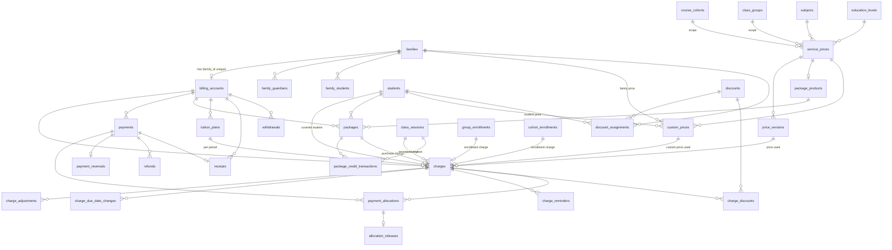

# Classora — Data model

**Status:** Accepted for the billing domain (GitHub issue #86, M6-01, 2026-10-27). The rules behind it are in [ADR-0006](adr/0006-financial-ledger-idempotency-and-numbering.md) (ledger, idempotency, numbering) and [ADR-0004](adr/0004-money-time-and-date-representation.md) (money, time and dates). Decision items are cited as **E1–E15** of issue #86.

## 1. Purpose and scope

Spec [`spec.md`](spec.md) §17 makes this file the home of the final entities, foreign keys, invariants, indexes and migration strategy, and requires a **schema review before implementing financial workflows**. This version is that review for the billing domain.

- **Covered:** the **billing** domain (module `billing`, M6) and the two **core** tables it needs (`idempotency_keys`, `number_series`).
- **Not covered:** the tables of earlier domains (identity, families, staff, catalog, scheduling, courses, academics, administration). They are documented in their migrations (`apps/api/migrations/versions/`), their model docstrings and their ADRs ([ADR-0005](adr/0005-scheduling-invariants-overrides-and-recurrence.md), [ADR-0007](adr/0007-authentication-sessions-recovery-and-delegation.md)). They are named here only where billing references them.
- **Payroll** (M7) is not covered, apart from the reserved `P` number series (§3.25).
- **Changes:** an implementing issue may rename a table or column, or adjust a column listed here, only by updating this file in the same pull request. A change to a rule of ADR-0006 needs an ADR amendment.

## 2. Conventions

- **Primary keys:** `id UUID`, generated as uuidv7 (`uuid.uuid7()` in Python, `uuidv7()` as the server default), like every other table. The exceptions are `payment_methods` (key `code`) and `number_series` (key `(code, year)`).
- **Standard columns:** every model has `created_at` and `updated_at` (`TIMESTAMPTZ NOT NULL`, set by the database; `app/core/models.py`). On an append-only table `updated_at` never moves.
- **Money:** `NUMERIC(14,2)` in MXN; rates and percentages `NUMERIC(14,4)`; Python `Decimal` through the `Money` type of #87; half-up rounding per line ([ADR-0004](adr/0004-money-time-and-date-representation.md)). There is **no currency column** (MXN only, spec §1) and no tax column.
- **Money mapping:** money columns use `app.core.money.MoneyType` and `Money`; sums use `money_sum` (#87).
- **Dates and instants:** `DATE` for calendar values (service dates, due dates, effective dates, periods, `received_on`, `expires_on`); `TIMESTAMPTZ` for instants (`posted_at`, `issued_at`, `effective_from` of cancellation rules). Local dates are computed in the center time zone (`business_settings.time_zone`).
- **Foreign keys:** every billing foreign key is `ON DELETE RESTRICT`. Billing rows are never deleted, so nothing cascades.
- **Audit:** every billing table except `idempotency_keys` and `number_series` is `Audited`. The audit event is inserted in the same transaction as the row (issue #22, `app/core/audit.py`); for mutable configuration rows, updates are audited too.
- **Concurrency token:** `version` (optimistic concurrency, `VersionedMixin`) exists only on **mutable configuration** rows. Append-only rows have none.
- **Staff text:** the only stored free text is staff-entered (`description`, `reason`, `note`, `reference`, product names). Everything a document or screen renders is otherwise stored as structured fields (kind, subject, minutes, period) and translated at display time ([ADR-0015](adr/0015-server-side-i18n.md)).
- **Immutability classes** used below:
  - **append-only:** no UPDATE, DELETE or TRUNCATE ever (§5.1);
  - **guarded:** immutable once another row references it (§5.2); `cancellation_billing_rules` is guarded by time instead: never updated, deletable only while upcoming (#99);
  - **mutable config / mutable reference:** edited in place with `version` and audit, never deleted once referenced (the `RESTRICT` foreign keys make that hold);
  - **transient:** deleted by a purge job;
  - **counter:** one row per series, updated under a row lock.

## 3. Billing tables

Overview. "Creating issue" is the issue whose migration creates the table. Whether `payments`, `refunds`, `payment_reversals` and `allocation_releases` are created by #90 or by #96/#100 may be adjusted by those issues' PMs, as long as this file is updated to say which.

| Table | Module | Creating issue | Class |
|---|---|---|---|
| `billing_accounts` | billing | #90 | mutable config |
| `billing_settings` | billing | #91 | mutable config (singleton) |
| `payment_methods` | billing | #90 (table, seed), #96 (first use) | mutable reference |
| `service_prices` | billing | #89 | mutable config |
| `price_versions` | billing | #89 | guarded: immutable once referenced |
| `custom_prices` | billing | #95 | mutable config |
| `discounts` | billing | #95 | mutable config |
| `discount_assignments` | billing | #95 | mutable config |
| `charge_discounts` | billing | #95 | append-only |
| `charges` | billing | #90 (sources added by #91–#94) | append-only |
| `charge_adjustments` | billing | #90 | append-only |
| `charge_due_date_changes` | billing | #97 | append-only |
| `charge_reminders` | billing | #97 | append-only |
| `payments` | billing | #90 (table), #96 (endpoints) | append-only |
| `payment_reversals` | billing | #90 (table), #100 (endpoints) | append-only |
| `payment_allocations` | billing | #90 | append-only |
| `allocation_releases` | billing | #90 | append-only |
| `refunds` | billing | #90 (table), #100 (endpoint) | append-only |
| `tuition_plans` | billing | #93 | mutable config |
| `package_products` | billing | #94 | mutable config |
| `packages` | billing | #94 | append-only |
| `package_credit_transactions` | billing | #94 | append-only |
| `receipts` | billing | #98 | append-only |
| `cancellation_billing_rules` | billing | #99 | guarded, effective-dated (an upcoming version may be deleted; §5.2) |
| `session_cancellation_decisions` | billing | #99 | append-only |
| `charge_duration_repricings` | billing | #99 | append-only |
| `withdrawals` | billing | #101 | append-only |
| `idempotency_keys` | core | #88 | transient (purged) |
| `number_series` | core | #98 | counter (row-locked UPDATE) |
| view `billing_ledger_entries` | billing | #90 | read-only view |

Referenced tables of earlier domains: `families`, `family_students`, `family_guardians`, `guardians`, `students`, `users`, `class_sessions`, `class_session_participants`, `class_groups`, `group_enrollments`, `course_cohorts`, `cohort_enrollments`, `subjects`, `education_levels`, `business_settings`, `user_preferences`, `audit_events`.

### 3.1 `billing_accounts`

One billing account per family (E4). Created on first use (`billing.service.ensure_billing_account`, #90 E4): a `SELECT` by `family_id`, and if there is none an ORM insert inside a savepoint; a violation of `uq_billing_accounts_family_id` (a concurrent first use) rolls the savepoint back, with its audit event, and the row is read again. The table is `Audited`, and the audit guard refuses ORM `INSERT … ON CONFLICT` on audited tables.

| Column | Type | Null | Check / note |
|---|---|---|---|
| `id` | UUID | no | PK |
| `family_id` | UUID | no | FK `families`, **UNIQUE** |
| `due_offset_days` | SMALLINT | no | default 0; `CHECK (due_offset_days BETWEEN 0 AND 60)` (E11 family override) |
| `version` | INTEGER | no | optimistic concurrency |

- **Access:** the guardians in `family_guardians` for `family_id` see the account (record policy, #102). Students and tutors see nothing in M6.
- **Lock:** every financial mutation locks this row `FOR UPDATE` as its last lock (§6).
- **Editing `due_offset_days` (#97 N6):** `PATCH /api/v1/families/{family_id}/billing-account` (`billing.manage`), body `{version | null, due_offset_days}`; `version: null` creates the account of a family that has none. The row is taken `FOR UPDATE`, then the version is checked (`409 version_conflict`); the same value writes nothing. The offset applies **only to charges posted afterwards** (`post_charge` reads it under the same lock, E11 "set at posting"); posted due dates never move.

### 3.2 `billing_settings`

A singleton (the `business_settings` pattern: a `singleton BOOLEAN` column with `CHECK (singleton)` and UNIQUE).

| Column | Type | Null | Check / note |
|---|---|---|---|
| `id` | UUID | no | PK |
| `singleton` | BOOLEAN | no | `CHECK (singleton)`, UNIQUE |
| `billing_starts_on` | DATE | yes | `NULL`: the sweepers post nothing; otherwise they post only for service dates on or after it (E1) |
| `version` | INTEGER | no | |

Created by #91 (migration 0062, which inserts the one row with `billing_starts_on = NULL`). Audited and versioned; a local `DATE`, so no time-zone dependency.

- **Routes (#91):** `GET /api/v1/billing/settings` (`billing.view`) and `PATCH /api/v1/billing/settings` (`billing.manage`, body `{version, billing_starts_on}`, no reauthentication). Any date from 2000-01-01 to 2099-12-31, past included, or `NULL` (billing off). Moving the date later or back to `NULL` pauses posting for the dates it excludes and never changes posted charges. Each change writes one `update` audit event with the old and new date; sending the current value writes nothing.
- **After commit**, a `PATCH` whose result is a date queues one `billing:post_session_charges` run (`app.core.jobs.defer_session_charges`) and one `billing:post_enrollment_charges` run (`defer_enrollment_charges`, #92).
- **Enrollment fees (#92 J6)** compare the floor with their due-date base (`max(enrollment local date, first counted session's local date)`), not with `service_date`.
- **Readers:** the sweepers read the floor with `billing.service.billing_starts_on(session, lock=True)` (`FOR SHARE`, after their own scheduling locks and before the account lock, §6).

The demo seed chooses its own date.

### 3.3 `payment_methods`

Billing-owned reference table (E12), created and seeded with `cash`, `transfer` and `other` by #90's migration (0061), because `payments` and `refunds` reference it; #96 is its first user. Labels come from the client catalogs. M8-04 (#121) adds editing behind reauthentication. The table has no `id`; its audit events use a UUIDv5 of `code` as `record_id` (`PaymentMethod.id`).

| Column | Type | Null | Check / note |
|---|---|---|---|
| `code` | VARCHAR(32) | no | PK; `CHECK (code ~ '^[a-z][a-z0-9_]*$')` |
| `is_active` | BOOLEAN | no | default true |
| `version` | INTEGER | no | |

A method is never deleted once used (`payments` and `refunds` reference it with `RESTRICT`).

### 3.4 `service_prices`

Catalog items (E9).

| Column | Type | Null | Check / note |
|---|---|---|---|
| `id` | UUID | no | PK |
| `class_type` | VARCHAR(16) | no | `individual` \| `group` \| `course` (the `class_sessions.kind` values) |
| `pricing_model` | VARCHAR(16) | no | `per_session` \| `full_course` \| `per_period` \| `package` |
| `subject_id` | UUID | yes | FK `subjects`; `NULL` only for a `package` row whose product has no subject (E10) |
| `education_level_id` | UUID | yes | FK `education_levels`; `NULL` = any level |
| `duration_minutes` | SMALLINT | yes | 15 to 480, only with `per_session` (#89); `NULL` = any duration |
| `cohort_id` | UUID | yes | FK `course_cohorts`; scope (spec §3, "each cohort has its own … pricing") |
| `group_id` | UUID | yes | FK `class_groups`; scope |
| `period_frequency` | VARCHAR(16) | yes | `weekly` \| `biweekly` \| `monthly`; set **iff** `pricing_model = 'per_period'` (`ck_service_prices_period_frequency`, #93 K2) |
| `version` | INTEGER | no | |

- **Checks:** `NOT (cohort_id IS NOT NULL AND group_id IS NOT NULL)`; `cohort_id` only with `class_type = 'course'`; `group_id` only with `class_type = 'group'`; `package` only with `class_type = 'individual'` (E10). Added by #89 (E4, E5):
  - the allowed combinations: `individual` with `per_session`, `per_period` or `package`; `group` with `per_session`, `full_course` or `per_period`; `course` with `full_course`;
  - `subject_id IS NOT NULL OR pricing_model = 'package'`;
  - `duration_minutes IS NULL OR (pricing_model = 'per_session' AND duration_minutes BETWEEN 15 AND 480)`;
  - a scoped row (cohort or group) has `education_level_id IS NULL AND duration_minutes IS NULL`.
- **API scope (#89 E5):** the #89 routes create, list and read `per_session` and `full_course` items and, since #93 B1, `per_period` items (with their `period_frequency`). `package` rows are created with their product (#94).
- **Pricing models:** `per_session` (individual sessions, and group sessions priced per session); `full_course` (a cohort fee, or a group flat fee per enrollment); `per_period` (group per-student pricing, through a tuition plan linked to the group enrollment, and tuition plans in general); `package` (the price of a package product).
- **Catalog key:** `UNIQUE NULLS NOT DISTINCT (class_type, pricing_model, subject_id, education_level_id, duration_minutes, cohort_id, group_id, period_frequency) WHERE pricing_model <> 'package'` (`period_frequency` added by #93 K2: a weekly and a monthly price of the same subject, level and scope are two items). A `package` row is identified by its product instead (`package_products.service_price_id` is UNIQUE), so two products for the same subject can coexist.
- The key columns don't change once a `price_versions` row exists; a different key is a new item.

### 3.5 `price_versions`

| Column | Type | Null | Check / note |
|---|---|---|---|
| `id` | UUID | no | PK |
| `service_price_id` | UUID | no | FK `service_prices` |
| `effective_from` | DATE | no | |
| `amount` | NUMERIC(14,2) | yes | `>= 0`; `NULL` = "not offered from this date" |

- **Ranges:** each version runs until the next one's `effective_from`. `UNIQUE (service_price_id, effective_from)` makes overlapping ranges impossible (the #89 constraint).
- **Lookup:** the version in effect on a local date `d` is the one with the greatest `effective_from <= d`. Precedence (E9): (1) custom student or family price (#95); (2) the cohort- or group-scoped price; (3) the catalog price with the exact level; (4) the catalog price with any level. A `NULL` amount means "not offered": with no price in effect the item is unbilled (`no_price`, E1).
- **Lookup ranks (#89 E4; `billing.service.lookup_price`, below step 1):** among the items with the service's class type, pricing model and subject, rank 0 is the item scoped to its cohort or group; 1 exact level and exact duration; 2 exact level, any duration; 3 any level, exact duration; 4 any level, any duration (a student without a level, or a query without a duration, matches only the "any" items). The most specific item **with a version in effect on `d`** decides; an item whose versions all start later is skipped. If the deciding version's amount is `NULL`, the result is no price, and lower ranks are **not** consulted.
- **Effective dates (#89 E3):** an item's first version may have any `effective_from`, past included. Every later version starts on or after the center's local today and after every existing version of the item. Versions are never edited; only an upcoming version (`effective_from` after today) may be deleted. A lookup for a past date therefore never changes once an item has a price.
- **Guarded:** a version referenced by any `charges` or `packages` row can't be updated or deleted (§5.2). A change is a new version.

### 3.6 `custom_prices` (#95)

A custom student or family price, step 1 of the lookup (#95 H6, H7).

| Column | Type | Null | Check / note |
|---|---|---|---|
| `id` | UUID | no | PK |
| `service_price_id` | UUID | no | FK `service_prices` (the item it overrides) |
| `student_id` | UUID | yes | FK `students` |
| `family_id` | UUID | yes | FK `families` |
| `effective_from` | DATE | no | on or after the center's local today when created (no backdating) |
| `expires_on` | DATE | yes | inclusive; `NULL` = open-ended; `>= effective_from` (`ck_custom_prices_dates`) |
| `amount` | NUMERIC(14,2) | no | `>= 0` |
| `version` | INTEGER | no | |

- `CHECK (num_nonnulls(student_id, family_id) = 1)` (`ck_custom_prices_one_target`).
- **No overlap:** `ex_custom_prices_student_overlap` and `ex_custom_prices_family_overlap` (`EXCLUDE USING gist`, partial on the target column) over `(service_price_id =, <target> =, daterange(effective_from, expires_on, '[]') &&)`.
- **Items:** only `per_session` and `full_course` items have custom prices in #95 (the models the #89 routes serve); #93/#94 may widen it.
- **Precedence (H6):** a custom price **matches** a query when its item is one of #89's candidates for the query (ranks 0–4) and it is in effect on the service date. A **student** price beats a **family** price; among one target's prices the item with the lowest rank wins. A matching custom price beats the catalog even when the catalog's deciding version is `NULL` or the item has no version in effect. A family price follows the student's family **at posting**.
- **Ending (H7):** only `expires_on` changes (to today or later, on or after `effective_from`, and on or after the latest `service_date` of a charge at it), or back to `NULL`. The amount, target, item and start never change: a new amount is a new row from a later date. Only an upcoming, unreferenced row may be deleted.
- **Guarded** once referenced by a charge (`charges.custom_price_id`, §5.2), except `expires_on`.

### 3.7 `discounts` (#95)

Reusable discounts, scholarships, sibling discounts and promotions (spec §6; #95 H2, H3, H8, H9).

| Column | Type | Null | Check / note |
|---|---|---|---|
| `id` | UUID | no | PK |
| `kind` | VARCHAR(16) | no | `scholarship` \| `sibling` \| `discount` \| `promotion`; never changes |
| `audience` | VARCHAR(16) | no | `all` (every matching charge) \| `assigned` (only `discount_assignments`); never changes |
| `name` | VARCHAR(120) | no | staff-entered, trimmed, 1–120, unique ignoring case (`uq_discounts_name_lower`) |
| `percent` | NUMERIC(14,4) | yes | `> 0 AND <= 100` |
| `amount` | NUMERIC(14,2) | yes | `> 0` (a fixed amount per charge) |
| `eligibility` | JSONB | no | a JSON object (`ck_discounts_eligibility_object`), default `{}`; the criteria below |
| `starts_on` | DATE | yes | inclusive, against the service date |
| `expires_on` | DATE | yes | inclusive; `starts_on <= expires_on` |
| `is_active` | BOOLEAN | no | default `true` |
| `version` | INTEGER | no | |

- `CHECK (num_nonnulls(percent, amount) = 1)`.
- **Kind rules** (CHECKs): `scholarship` ⇒ `audience = 'assigned'`; `sibling` ⇒ `audience = 'all'`; `promotion` ⇒ both dates. `min_family_students` is set for `sibling` only (checked by the API schema).
- **`eligibility`** (validated by `billing.discounts.DiscountEligibility`, `extra="forbid"`, stored canonical: lists sorted, no duplicates; every key optional, absent = any; every key must hold): `charge_kinds` (subset of `session`, `group_enrollment`, `cohort_enrollment`, `tuition_period`, `package_purchase`; never `manual`), `class_types` (subset of `individual`, `group`, `course`), `subject_ids` (1–50, the charge's subject), `education_level_ids` (1–50, the **student's** level at posting; a student with no level matches only when the key is absent), `min_family_students` (2–20, `sibling` only: the family has at least that many **active** students when the charge is posted; every student of such a family gets it). An empty list is refused.
- **Editable configuration (H8):** an edit or a deactivation affects only charges posted afterwards; posted charges keep their `charge_discounts` snapshot. Discounts are never deleted (no route; `RESTRICT` FKs).
- **Evaluated at posting (H9):** the window against the charge's service date; `is_active`, the assignments, the student's level and the family's active students as they are when the charge is posted. Nothing re-evaluates a posted charge.

### 3.7a `discount_assignments` (#95)

Who an `assigned` discount is for (H2). Mutable config (no `version`): rows are added and hard-deleted by the routes; nothing references them.

| Column | Type | Null | Check / note |
|---|---|---|---|
| `id` | UUID | no | PK |
| `discount_id` | UUID | no | FK `discounts` |
| `student_id` | UUID | yes | FK `students` |
| `family_id` | UUID | yes | FK `families` (covers each student of the family at posting) |

`CHECK (num_nonnulls(student_id, family_id) = 1)`; partial `UNIQUE (discount_id, student_id)` and `UNIQUE (discount_id, family_id)`; partial indexes on `student_id` and `family_id`.

### 3.8 `charge_discounts` (#95)

The discounts applied to a charge, snapshotted when it is posted (W4.2; H8). Append-only (§5.1).

| Column | Type | Null | Check / note |
|---|---|---|---|
| `id` | UUID | no | PK |
| `charge_id` | UUID | no | FK `charges` |
| `discount_id` | UUID | no | FK `discounts` |
| `position` | SMALLINT | no | application order, `>= 1`, `UNIQUE (charge_id, position)` |
| `kind` | VARCHAR(16) | no | the discount's kind at posting |
| `name` | VARCHAR(120) | no | the discount's name at posting |
| `percent` | NUMERIC(14,4) | yes | the discount's percentage at posting |
| `fixed_amount` | NUMERIC(14,2) | yes | the discount's fixed amount at posting; `num_nonnulls(percent, fixed_amount) = 1` |
| `amount` | NUMERIC(14,2) | no | `> 0`, what this line took off |

Σ `amount` per charge = `charges.discount_amount` (App, in the posting transaction: `ChargeDraft` checks it, `post_charge` inserts the lines only when it creates the charge).

### Price calculation (#95)

`billing.service.quote(PriceQuery) -> Quote | None` prices every charge a sweeper or a billing workflow posts (ADR-0006 E9):

1. **Base price** (`base_price`, `list_amount`): a matching custom price of the **student**, then of the **family** (§3.6), else exactly `lookup_price` (§3.5 ranks and `NULL` rule). `None` = no price.
2. **At most one discount per kind:** among the eligible discounts of one kind (§3.7), the one that takes the most off at its position wins (ties: earliest `created_at`, then `id`).
3. **Kinds in a fixed order:** `scholarship` → `sibling` → `discount` → `promotion` (the most specific first), each on the **running remainder**: a percentage line is `remainder × percent / 100` rounded once half-up (`Money.multiply`, ADR-0004); a fixed line is `min(amount, remainder)`. A `0.00` line is not recorded; the amount is never negative.
4. `discount_amount` = Σ lines; `amount = list_amount − discount_amount` (I7). A 100 % scholarship gives a `0.00` charge (`void`).

Discounts apply on top of a custom price too (H5). #92 prorates between `base_price` and `discounts_for` (`quote(query, prorate=(remaining, total))`: the base list amount is prorated first, then the discounts are computed on it); #99 reprices a duration change with `apply_discount_chain` over the charge's snapshot (never a new selection).

### 3.9 `charges`

What the family owes for one student and one thing (E1, E5, E9, E11). Always for one student.

| Column | Type | Null | Check / note |
|---|---|---|---|
| `id` | UUID | no | PK |
| `billing_account_id` | UUID | no | FK `billing_accounts` |
| `student_id` | UUID | no | FK `students` |
| `kind` | VARCHAR(24) | no | `session` \| `group_enrollment` \| `cohort_enrollment` \| `tuition_period` (from #93) \| `package_purchase` (from #94) \| `manual` |
| `class_session_id` | UUID | yes | FK `class_sessions`; source of `session` |
| `group_enrollment_id` | UUID | yes | FK `group_enrollments`; source of `group_enrollment` |
| `cohort_enrollment_id` | UUID | yes | FK `cohort_enrollments`; source of `cohort_enrollment` |
| `tuition_plan_id` | UUID | yes | source of `tuition_period` (column added by #93); composite FK `fk_charges_tuition_plan` `(tuition_plan_id, billing_account_id, student_id) → tuition_plans (id, billing_account_id, student_id)` RESTRICT (K9) |
| `package_id` | UUID | yes | source of `package_purchase` (column added by #94); composite FK `fk_charges_package` `(package_id, billing_account_id, student_id) → packages (id, billing_account_id, student_id)` RESTRICT |
| `service_date` | DATE | no | the session's original local date; the enrollment's local date; the period start (`period_start`); the purchase date; or the staff-entered date |
| `service_period_end` | DATE | yes | last day of a `tuition_period`; `>= service_date` (`ck_charges_service_period_end_valid`; `NULL` for every kind until #93) |
| `price_version_id` | UUID | yes | FK `price_versions`; the version used (`NULL` for `manual` and custom-priced charges) |
| `custom_price_id` | UUID | yes | FK `custom_prices` (column added by #95); the custom price used; never on `manual` (`ck_charges_manual_unpriced`) |
| `education_level_id` | UUID | yes | FK `education_levels`; the student's level at posting (snapshot) |
| `scheduled_minutes` | SMALLINT | yes | the session's `scheduled_minutes` at posting (snapshot; `session` only); 15–480 (`ck_charges_scheduled_minutes_range`, the `class_sessions` range) |
| `list_amount` | NUMERIC(14,2) | no | `>= 0`; price before discounts |
| `discount_amount` | NUMERIC(14,2) | no | `>= 0`; default 0 |
| `amount` | NUMERIC(14,2) | no | `>= 0`; `CHECK (amount = list_amount - discount_amount)` |
| `due_date` | DATE | no | set at posting, never updated (E11) |
| `description` | VARCHAR(200) | yes | `manual` only, trimmed, 1–200 characters (`ck_charges_description_valid`) |
| `posted_at` | TIMESTAMPTZ | no | |
| `posted_by_user_id` | UUID | yes | FK `users`; `NULL` when a job posted it |
| `proration_remaining` | SMALLINT | yes | the sessions left at enrollment of a prorated enrollment fee (#92 J3, J8; column added by #92) |
| `proration_total` | SMALLINT | yes | the proration denominator: the cohort snapshot's `session_count`, or a finite group's counted sessions (#92) |

- **Exactly one source per kind** (`CHECK`):
  - `session` ⇔ `class_session_id IS NOT NULL`, and `scheduled_minutes IS NOT NULL`;
  - `group_enrollment` ⇔ `group_enrollment_id IS NOT NULL`;
  - `cohort_enrollment` ⇔ `cohort_enrollment_id IS NOT NULL`;
  - `tuition_period` ⇔ `tuition_plan_id IS NOT NULL`, and `service_period_end IS NOT NULL`;
  - `package_purchase` ⇔ `package_id IS NOT NULL`;
  - `manual` ⇔ every source column `NULL`, and `description IS NOT NULL`.

  Written as `num_nonnulls(class_session_id, group_enrollment_id, cohort_enrollment_id, tuition_plan_id, package_id) = CASE WHEN kind = 'manual' THEN 0 ELSE 1 END` plus one implication per kind.
- **Staged CHECKs (#90 E3):** #90 creates the kinds whose source exists. `ck_charges_kind` allows `session`, `group_enrollment`, `cohort_enrollment` and `manual`; `ck_charges_one_source` is the rule above over the three existing source columns, with the `session` ⇔ `scheduled_minutes` and `manual` ⇔ `description` implications. #93 (`tuition_plan_id`) and #94 (`package_id`) each add their column, its foreign key and its natural key, and replace both named CHECKs to include their kind. **Since #93 (migration 0065):** `ck_charges_kind` adds `tuition_period`; `ck_charges_one_source` counts `tuition_plan_id` and adds `(kind = 'tuition_period') = (tuition_plan_id IS NOT NULL)` and `(kind = 'tuition_period') = (service_period_end IS NOT NULL)`. **Since #94 (migration 0066):** `ck_charges_kind` adds `package_purchase`; `ck_charges_one_source` counts `package_id` and adds `(kind = 'package_purchase') = (package_id IS NOT NULL)`, keeping every #90/#93 part. `package_purchase` is live: the package sale posts it (service date and due-date base = the purchase date, plus the account's `due_offset_days`, E11; priced by `quote` pinned to the product's item, so #95 discounts apply).
- **`price_version_id` and `custom_price_id`:** at most one is set (`ck_charges_one_price`, #95); a `manual` charge has no custom price (`ck_charges_manual_unpriced`) and no discount lines.
- **Natural keys** (partial unique indexes, J4):
  - `(class_session_id, student_id) WHERE kind = 'session'`;
  - `(group_enrollment_id) WHERE kind = 'group_enrollment'`;
  - `(cohort_enrollment_id) WHERE kind = 'cohort_enrollment'`;
  - `(tuition_plan_id, service_date) WHERE kind = 'tuition_period'`, i.e. `(tuition_plan_id, period_start)`;
  - `(package_id) WHERE kind = 'package_purchase'`.

  #90 names them `uq_charges_session_student`, `uq_charges_group_enrollment` and `uq_charges_cohort_enrollment`; #93 adds `uq_charges_tuition_period` and #94 `uq_charges_package_purchase`. Manual charges have no natural key; they rely on the API idempotency key (§3.24).
- **Posting (#90 E4):** `billing.service.post_charge` locks the account row, checks the natural key under the lock, and inserts through the ORM in a savepoint; a violation of a named natural-key index (a posting for the same key to another account) counts as already posted (`created = False`).
- **Composite targets:** `UNIQUE (id, billing_account_id)` and `UNIQUE (id, billing_account_id, student_id)`, referenced by the composite foreign keys of allocations and adjustments (I4, I5).
- **Kept account:** a charge keeps the account it was posted to, even if the student later moves to another family. There is no foreign key to `family_students`.
- **Rescheduling:** a rescheduled session keeps its charge and its `service_date`; reporting uses the session's current date (E7).
- **Proration (#92 J8, migration 0064):** `ck_charges_proration`: both proration columns `NULL`, or `kind IN ('group_enrollment', 'cohort_enrollment')` with `proration_total >= 1` and `proration_remaining BETWEEN 0 AND proration_total`. Every cohort fee and every finite-group fee sets both (`10/10` for an on-time enrollment); an open-ended group fee leaves both `NULL`. The full fee stays readable from `price_version_id`/`custom_price_id`.
- **Session charges (#91, #92):** `billing:post_session_charges` charges `individual` and, since #92, `group` sessions (`group/per_session` with `group_id` and the scheduled minutes, through the same eligibility predicate and price key); course sessions are never charged per session (#91 G1). **A group is never charged both per session and by enrollment (#92 J2):** a group session whose participant's covering enrollment period has a `group_enrollment` charge, or is fee-priced (see "Enrollment charges (#92)"), is `enrollment_priced`: no charge, not an unbilled item. Both posting paths re-check this after the account lock. A `0.00` price posts a zero charge (`list_amount = amount = 0.00`, status `void`); it is not an unbilled item (#91 G5). A key that `billing.service.package_covered_keys` returns takes the package path instead (no charge, not listed; #94, see "Prepaid packages (#94)"); the candidates also anti-join the `consume` rows, and `post_charge` refuses a `session` charge for a consumed key (`SessionSettledByPackageError`, counted `package_covered`). Since #95 the price is `billing.service.quote` (custom price, catalog, discounts; "Price calculation (#95)"), and a custom price makes an item the catalog doesn't price billable.

### Enrollment charges (#92)

ADR-0006 E1, E9, E11; the rules live in `app/workflows/enrollment_charges.py`.

- **Fees:** a cohort enrollment period gets the cohort's course fee (`course/full_course` with `cohort_id`); a **fee-priced** group enrollment period gets the group's flat fee (`group/full_course` with `group_id`). Both through `billing.service.quote`, with the owner's subject, `on` = the enrollment's local date, the student's current level and no duration.
- **Group pricing model (J2):** decided per enrollment period. A period is fee-priced when a `group/full_course` base price is in effect on its enrollment date and no `session` charge of the student exists on a group session starting at or after the period's `enrolled_at` (whatever the charge's net after `enrollment_removal` credits, sessions after `withdrawn_at` included: a period once charged per session is never fee-charged, QA #92 D1); otherwise it is session-priced and its confirmed and completed sessions are charged per session. With both prices the fee wins, unless session charges already exist. A group session participant with no covering period is session-priced. #93 extends "priced by enrollment" with a linked tuition plan (`tuition_priced`, see "Tuition plans (#93)").
- **Classification (in order):** fee already posted → J6 due-date base before `billing_starts_on` (`below_floor`) → group with a session charge in the period (`session_priced`) → no fee price (group: `session_priced`; cohort: `no_price`) → another period of the student in the same group or cohort has a fee with a net above `0.00` (`already_charged`, J5) → no family (`no_billing_account`) → billable. A cohort's `no_price` comes before `no_billing_account` (the reverse of #91 G4).
- **Proration (J3):** `list_amount = fee × remaining / total`, one half-up rounding (`Money.prorate`), **before** the discounts. `remaining` counts the owner's occurrences that start after the enrollment instant and are not `cancelled` or `skipped_closure`, materialized rows **and** occurrences of the series rules not materialized yet (minus projected dates on known closures). The denominator is the cohort snapshot's `session_count` (`remaining` clamped to it), or, for a group whose series are all finite, its counted occurrences; an open-ended group pays the full fee with no proration. `remaining = 0` gives a `0.00` charge.
- **Dates (J6, E11):** `service_date` = the enrollment's local date; the due-date base = `max(enrollment local date, first counted session's local date)`, plus the account's `due_offset_days`. The floor is compared with the due-date base, so advance enrollments made before go-live for a course that runs after it are charged.
- **Removal (J4):** see §3.10 `enrollment_removal`. Credits and restorations ignore the floor. A cohort withdrawal posts nothing.
- **Unbilled enrollments (J9):** `GET /api/v1/billing/unbilled-enrollments` lists the sweeper's candidates classified `no_price` or `no_billing_account`; a session-priced group period isn't listed (its sessions are in `/unbilled-items`, which carries `class_type` and `group`).

### 3.10 `charge_adjustments`

Signed corrections against one charge (E2, E3, E5, E8, E9). A credit is a negative adjustment.

| Column | Type | Null | Check / note |
|---|---|---|---|
| `id` | UUID | no | PK |
| `charge_id` | UUID | no | composite FK, see below |
| `billing_account_id` | UUID | no | |
| `student_id` | UUID | no | |
| `kind` | VARCHAR(24) | no | `duration_change` (E2) \| `cancellation_credit` (E3) \| `closure_credit` (E3, ADR-0005 D6) \| `enrollment_removal` (E9, #92) \| `withdrawal` (#101) \| `manual` (E8) \| `package_cancellation` (#100 R6, migration 0070) |
| `amount` | NUMERIC(14,2) | no | `CHECK (amount <> 0)` |
| `reason` | VARCHAR(500) | yes | staff text; required for `manual` (CHECK) and `package_cancellation` (the draft, #100) |
| `source_key` | VARCHAR(200) | yes | idempotency key of a generated adjustment |
| `posted_at` | TIMESTAMPTZ | no | |
| `posted_by_user_id` | UUID | yes | FK `users`; `NULL` for a job |

- **Composite FK:** `(charge_id, billing_account_id, student_id)` → `charges (id, billing_account_id, student_id)` (I5).
- **`source_key`:** partial UNIQUE `WHERE source_key IS NOT NULL` (`uq_charge_adjustments_source_key`). Every kind except `manual` must set it (`CHECK (kind = 'manual' OR source_key IS NOT NULL)`, #90); the implementing issue fixes the format, which includes the triggering event, for example `duration_change:<charge_id>:<session version after the edit>` (E2) or `cancellation_credit:<charge_id>` (E3). Manual adjustments rely on the API idempotency key.
- **`withdrawal` (#101):** `source_key withdrawal:<charge_id>:<withdrawal_id>`, only on `group_enrollment`, `cohort_enrollment`, `tuition_period` or `package_purchase` charges (never `session` or `manual`); `reason` = the withdrawal's reason.
- **Releases:** if an adjustment pushes the charge's net below its valid allocations, the newest allocations are released in the same transaction, and a smaller allocation is re-inserted when the release frees more than needed (E5). The released money becomes account credit.
- **Manual adjustments (#100 C2, R3):** `POST /api/v1/families/{family_id}/billing-account/charges/{charge_id}/adjustments` (`billing.manage`, `Idempotency-Key`) through `billing.service.post_manual_adjustment`. **Both signs** need reauthentication `finance.correction` (a debit also rewrites what a posted charge means; stricter than E8's wording, ADR-0006 implementation note). A credit below the net is `409 charge_net_negative` (I1); a credit releases the newest allocations (E5 above). A `package_purchase` charge is refused (`409 package_purchase_not_adjustable`): it is corrected only by a package cancellation (§3.20), so money and units move together. Manual charges (`kind = 'manual'`, #100 C1, R7) need `billing.manage` only.
- **`package_cancellation` (#100 R6):** the credit of a package-purchase cancellation, on the `package_purchase` charge only, `amount = −credit`, `source_key = package_cancellation:<package_id>` (one per package), `reason` = the staff reason. Added to `ck_charge_adjustments_kind` by migration 0070; the downgrade restores the 0061 list and fails while such rows exist.
- **Schedule reconciliation keys (#99):** `cancellation_credit:<charge_id>` (one cancellation credit per charge, `−net`); `closure_credit:<charge_id>:<n>`, where `n` is the number of `closure_credit` rows of the charge + 1, read under the account lock: odd `n` is a closure credit (`−net`), even `n` a **positive** restoration of exactly the credit before it (the occurrence is `confirmed` or `completed` again; Q3); `duration_change:<charge_id>:<session version the job saw>` (Q1: edits between two runs coalesce). `duration_change` is signed (shorter → negative, back to the original → positive).
- **`enrollment_removal` is signed (#92 J4):** a group withdrawal credits each `session` charge of the student on a group session that starts after the withdrawal and that the student left, with `−net` (skipped when the net is `0.00`; `source_key enrollment_removal:<charge_id>:<group_enrollment_id>:withdrawn`); a re-enrollment of the student in the same group restores each such charge with a **positive** `enrollment_removal` of minus the sum of its `enrollment_removal` adjustments (`…:<new group_enrollment_id>:enrolled`). Flat group fees and course fees are never adjusted this way (#101).

### 3.11 `charge_due_date_changes` (#97)

| Column | Type | Null | Check / note |
|---|---|---|---|
| `id` | UUID | no | PK |
| `charge_id` | UUID | no | composite FK `(charge_id, billing_account_id)` → `charges (id, billing_account_id)` (I4 style) |
| `billing_account_id` | UUID | no | the charge's account |
| `previous_due_date` | DATE | no | the effective due date before this change; `CHECK (due_date <> previous_due_date)` |
| `due_date` | DATE | no | the new due date; `CHECK (due_date BETWEEN '2000-01-01' AND '2099-12-31')` |
| `reason` | VARCHAR(500) | no | staff text (`staff_text_check`, trimmed 1–500) |
| `changed_by_user_id` | UUID | no | FK `users` `RESTRICT` |
| `created_at` | TIMESTAMPTZ | no | from `app.core.clock` |

The effective due date of a charge is the `due_date` of its latest change (by `created_at`, `id`), or `charges.due_date` when there is none (`billing.balances._effective_due_date()`; every status, the #96 oldest-first order, the overdue list and the reminders read it, never `charges.due_date` directly). Index `(charge_id, created_at, id)`. Created by migration 0067; `Audited` (one `create` event with the actor) and append-only (§5.1).

- **Writes (#97 N5):** `POST …/charges/{charge_id}/due-date-changes` (`billing.manage`, no `Idempotency-Key`, no reauthentication) under the account row `FOR UPDATE`; the charge's balance is re-read under the lock: `paid`/`void` → `409 charge_settled`; the current effective date → `409 due_date_unchanged`. Earlier dates are allowed.
- **Reads:** `GET …/due-date-changes` is staff only (`billing.view`): guardians never see the reasons. The charge reads carry `original_due_date` (`charges.due_date`) beside the effective `due_date`.

### 3.12 `payments`

An external payment (cash, transfer or other) recorded by staff (spec §1, §6; E8, E12).

| Column | Type | Null | Check / note |
|---|---|---|---|
| `id` | UUID | no | PK |
| `billing_account_id` | UUID | no | FK `billing_accounts` |
| `amount` | NUMERIC(14,2) | no | `> 0` |
| `received_on` | DATE | no | the local date the money was received (cash basis, E7) |
| `payment_method_code` | VARCHAR(32) | no | FK `payment_methods` |
| `reference` | VARCHAR(100) | yes | staff text |
| `payer_name` | VARCHAR(200) | yes | staff text; shown on the receipt |
| `note` | VARCHAR(500) | yes | staff text |
| `recorded_by_user_id` | UUID | no | FK `users` |

`UNIQUE (id, billing_account_id)` is the target of the composite foreign keys (I4).

**Recording (#96).** `POST /api/v1/families/{family_id}/billing-account/payments` (`payment.record`, `Idempotency-Key`; no reauthentication, M6) through `billing.service.record_payment`. `amount > 0` within `NUMERIC(14,2)`; `received_on` from 2000-01-01 to the center's today (backdating allowed, no future date); the method must be an **active** `payment_methods` row; `reference`, `payer_name` and `note` are trimmed and blank becomes `NULL` (so the staff-text CHECKs never fire). An inactive family may pay. A family's first payment creates its account (`ensure_billing_account`). `recorded_by_user_id` is the request's actor; a job never records a payment. The entry time is the row's `created_at`. #98 issues the receipt inside the same transaction.

### 3.13 `payment_reversals`

At most one per payment (E5). A reversal releases all of the payment's valid allocations in the same transaction.

| Column | Type | Null | Check / note |
|---|---|---|---|
| `id` | UUID | no | PK |
| `payment_id` | UUID | no | **UNIQUE**; composite FK `(payment_id, billing_account_id)` → `payments (id, billing_account_id)` |
| `billing_account_id` | UUID | no | |
| `reason` | VARCHAR(500) | no | staff text |
| `reversed_by_user_id` | UUID | no | FK `users` |

A payment with refunds can't be reversed (`409`, I3). Needs `finance.refund.approve` plus reauthentication `finance.refund_or_reversal` (E8).

**Reversal flow (#100 C3, R5; `billing.service.reverse_payment`).** `POST /api/v1/families/{family_id}/billing-account/payments/{payment_id}/reversal` `{reason}` (`Idempotency-Key`). Under the account lock: a reversal exists → `409 payment_already_reversed` (the UNIQUE is the backstop); any refund → `409 payment_has_refunds` (#90 QA O3); then the reversal row and one `allocation_releases` row per **valid** allocation of the payment (re-inserted ones included; already released ones untouched), `released_by_user_id` = the actor. A payment without allocations is reversible. The charges reopen (`paid` → `pending`/`overdue`/`partially_paid`) and the payment's remainder stops being account credit. The payment, its allocations and its receipt rows stay as they were; the receipt PDF shows #98's live "reversed" banner. There is no "un-allocate": a mis-allocated payment is reversed and recorded again. Reads (#100 R8): the payment detail carries `reversal` (`reason` and actor `null` for a caller without `billing.view`), the list `reversed_at`.

### 3.14 `payment_allocations`

Part of a payment applied to one charge of the same account (spec W4.3).

| Column | Type | Null | Check / note |
|---|---|---|---|
| `id` | UUID | no | PK |
| `payment_id` | UUID | no | composite FK `(payment_id, billing_account_id)` → `payments (id, billing_account_id)` |
| `charge_id` | UUID | no | composite FK `(charge_id, billing_account_id)` → `charges (id, billing_account_id)` |
| `billing_account_id` | UUID | no | |
| `amount` | NUMERIC(14,2) | no | `> 0` |
| `created_by_user_id` | UUID | yes | FK `users`; `NULL` when re-inserted by an adjustment's release |

An allocation is **valid** while it has no `allocation_releases` row.

**Allocation (#96 M2-M4; `app/modules/billing/payments.py`).** A payment is allocated in its own transaction (`oldest_first`, `explicit` or `none`); account credit is allocated later (`POST …/allocations`, `oldest_first` or `explicit`). Both run under the account lock and read every `open` amount after it.

- **Oldest first:** the account's charges with `open > 0`, every student included (a student who left the family too), ordered by **effective due date** (§3.11), then `service_date`, `posted_at`, `id`; each gets `min(open, money left)`. #97's due-date changes reorder it with no change in #96.
- **Explicit:** 1–200 distinct charges of the account, each line `> 0` and `≤ open`, all or nothing (`409 allocation_exceeds_open`, `422 allocation_charge_not_found`); a payment's lines add up to at most its amount (`422 allocation_exceeds_payment`).
- **The rest is account credit:** no row is written for unallocated money (E5).
- **Credit source (M4):** a credit allocation draws from the payments without a reversal whose remainder (`amount − Σ valid allocations − Σ refunds`, the same expression as account credit, `billing.service.payment_remainder_column`) is `> 0`, **oldest payment first** (`received_on`, `created_at`, `id`). One target line can become several rows, one per source payment. More than the credit → `409 insufficient_account_credit`; no credit or no open charge → `409 nothing_to_allocate`.
- There is no "un-allocate": an allocation ends only by a release (§3.15).

### 3.15 `allocation_releases`

A release frees a whole allocation (E5).

| Column | Type | Null | Check / note |
|---|---|---|---|
| `id` | UUID | no | PK |
| `allocation_id` | UUID | no | FK `payment_allocations`, **UNIQUE** |
| `payment_reversal_id` | UUID | yes | FK `payment_reversals`; set when a reversal released it |
| `charge_adjustment_id` | UUID | yes | FK `charge_adjustments`; set when an adjustment released it |
| `released_by_user_id` | UUID | yes | FK `users` |

`CHECK (num_nonnulls(payment_reversal_id, charge_adjustment_id) = 1)`. A #100 reversal writes one per valid allocation of the payment (§3.13); an adjustment's releases are E5's (§3.10).

### 3.16 `refunds`

Money paid back out of a payment's unallocated remainder (E5). A cash refund reduces account credit, not the outstanding amount.

| Column | Type | Null | Check / note |
|---|---|---|---|
| `id` | UUID | no | PK |
| `payment_id` | UUID | no | composite FK `(payment_id, billing_account_id)` → `payments (id, billing_account_id)` |
| `billing_account_id` | UUID | no | |
| `amount` | NUMERIC(14,2) | no | `> 0` |
| `refunded_on` | DATE | no | |
| `payment_method_code` | VARCHAR(32) | no | FK `payment_methods` (how the money went back) |
| `reference` | VARCHAR(100) | yes | staff text |
| `reason` | VARCHAR(500) | no | staff text |
| `withdrawal_id` | UUID | yes | FK `withdrawals` RESTRICT, indexed (migration 0071): the withdrawal that paid it out, `NULL` for a #100 refund |
| `refunded_by_user_id` | UUID | no | FK `users` |

Needs `finance.refund.approve` plus reauthentication `finance.refund_or_reversal` (E8).

**Refund rules (#100 C4, R4, R5; `billing.service.refund_payment`, also #101's entry point).** `POST /api/v1/families/{family_id}/billing-account/payments/{payment_id}/refunds` `{amount, refunded_on, payment_method_code, reference?, reason}` (`Idempotency-Key`). **Payment-scoped:** one row per request, drawn on that payment's remainder (`amount − Σ valid allocations − Σ refunds`, the #96 expression `payment_remainder_column`, read under the account lock); several partial refunds per payment are allowed. `refunded_on` from the payment's `received_on` (`422 refunded_on_before_payment`) to the center's today (`422 refunded_on_in_future`); an active method (`422 payment_method_unavailable`); a reversed payment → `409 payment_reversed`; above the remainder → `409 refund_exceeds_remainder` (details `remainder`). A refund lowers the account credit only, never the outstanding amount, and leaves the receipt unchanged (no refund banner, R9). **No undo in M6:** a wrong refund stays (no `refund_reversals` table). Reads: the payment detail's `refunds[]` (`reason` and actor `null` for a caller without `billing.view`; `reference` shown).

### 3.17 `tuition_plans` (#93)

A recurring tuition plan; one charge per plan per period (E1). Mutable config, `Audited`, versioned (migration 0065).

| Column | Type | Null | Check / note |
|---|---|---|---|
| `id` | UUID | no | PK |
| `billing_account_id` | UUID | no | FK `billing_accounts` RESTRICT; the family account the plan bills, fixed at creation (K9) |
| `student_id` | UUID | no | FK `students` RESTRICT |
| `service_price_id` | UUID | no | FK `service_prices` RESTRICT; the pinned `per_period` item (App, K2) |
| `group_enrollment_id` | UUID | yes | FK `group_enrollments` RESTRICT; group per-student pricing (E9, K6) |
| `frequency` | VARCHAR(16) | no | `weekly` \| `biweekly` \| `monthly` (`ck_tuition_plans_frequency_valid`); copied from the item |
| `starts_on` | DATE | no | the anchor of the period grid (K3) |
| `ends_on` | DATE | yes | `>= starts_on` (`ck_tuition_plans_dates`); a period end (App); `NULL` = open-ended |
| `due_offset_days` | SMALLINT | no | 0–60 (`ck_tuition_plans_due_offset_days_range`), default 0; the plan's due rule (E11) |
| `version` | INTEGER | no | |

- **Composite target:** `UNIQUE (id, billing_account_id, student_id)` (`uq_tuition_plans_id_account_student`), referenced by `charges.fk_charges_tuition_plan`, so a tuition charge always posts to its plan's account and student (K9).
- **No overlap** (`EXCLUDE USING gist`, `daterange(starts_on, ends_on, '[]') &&`): `ex_tuition_plans_enrollment_overlap` on `group_enrollment_id =` `WHERE group_enrollment_id IS NOT NULL`; `ex_tuition_plans_student_item_overlap` on `(student_id =, service_price_id =)` `WHERE group_enrollment_id IS NULL`. API: `409 tuition_plan_overlap`.
- **Key trigger** `tuition_plans_key_immutable` (`BEFORE UPDATE`, 42501): `billing_account_id`, `student_id`, `service_price_id`, `group_enrollment_id`, `frequency` and `starts_on` never change (they define the grid and the composite key); only `ends_on`, `due_offset_days` and the standard columns do.
- **Indexes:** `ix_tuition_plans_student_id`, `ix_tuition_plans_billing_account_id`.
- **Deleting** a plan is allowed only while it has no charge (API; the composite FK is RESTRICT).

### 3.17a `tuition_plan_pauses` (#93)

Pauses of a plan (K4). Mutable config, `Audited`, versioned.

| Column | Type | Null | Check / note |
|---|---|---|---|
| `id` | UUID | no | PK |
| `tuition_plan_id` | UUID | no | FK `tuition_plans` **CASCADE** |
| `starts_on` | DATE | no | a period start (App) |
| `ends_on` | DATE | yes | `>= starts_on` (`ck_tuition_plan_pauses_dates`); a period end (App); `NULL` = until resumed |
| `version` | INTEGER | no | |

- `EXCLUDE USING gist (tuition_plan_id WITH =, daterange(starts_on, ends_on, '[]') WITH &&)` (`ex_tuition_plan_pauses_overlap`): pauses of one plan never overlap, so there is at most one open pause.

### Tuition plans (#93)

ADR-0006 E1, E7, E9, E11; the rules live in `app/modules/billing/tuition.py` (pure grid and period state) and `app/workflows/tuition_charges.py` (the job and the unbilled read).

- **Price (K2):** a plan pins its `per_period` item; each period's base price is the item's version in effect on `period_start` (`billing.service.quote` with `PriceQuery.service_price_id`: the item's custom prices, then its version; no rank search), then the discounts (`charge_kind = 'tuition_period'`). `lookup_price` refuses `per_period` (`ValueError`). A new version changes only later periods; posted charges keep `price_version_id`. No custom prices on `per_period` items (K8).
- **Grid (K3):** periods are anchored at `starts_on` and whole: weekly `starts_on + 7k`, biweekly `+ 14k`, monthly `starts_on + k` months with the day clamped and always computed from `starts_on` (31 Jan → 28/29 Feb → 31 Mar → 30 Apr). A period ends the day before the next one starts. Local calendar dates of the center zone (ADR-0004); no instant is stored, so no time-zone dependency is registered. No proration, ever: `ends_on` is a period end and the last period is charged in full.
- **Period state** (`plan_period_state`, in order): `not_due` (`period_start` after the center's today) → `below_floor` (billing off or `period_start < billing_starts_on`) → `after_end` (`period_start > ends_on`) → `paused` (`period_start` inside a pause) → `enrollment_ended` (the linked enrollment was withdrawn on or before `period_start`) → `due`. A due period is then `family_changed` when the student's current family is not the plan's (K9), `no_price` when the pinned base price is `None`, else posted.
- **Posting (K5):** due when `period_start ≤ center today`; the daily job `billing:post_tuition_charges` (`30 7 * * *`, also deferred after a plan create, resume or extension and a non-null settings `PATCH`) posts every due, unposted period oldest first (catch-up). Charge: `kind = 'tuition_period'`, `service_date = period_start`, `service_period_end = period_end`, `due_date = period_start + plan.due_offset_days + account.due_offset_days`, the student's level snapshot. A `0.00` version posts a `0.00` charge (`void`).
- **Pauses (K4):** a paused period is never charged, never caught up; a pause starts after the last posted period and not before today's period; resume sets the open pause's `ends_on` (resuming on its own start deletes it).
- **Group per-student pricing (K6):** a plan linked to a group enrollment pins a `group/per_period` item scoped to the group or unscoped with its subject. The #92 classification gains `tuition_priced` (a period with a linked plan, any window, never gets a flat fee and is not listed); the #91 classification gains `tuition_priced` for a group session whose covering period has a linked plan whose window contains the session's local date (paused periods included): no charge, not listed. Outside the window J2 applies (a linked period is never fee-priced, so those sessions are charged per session). Linking is refused with a flat fee of net > 0 (`409 tuition_plan_enrollment_fee_charged`) or an in-window session charge of net > 0 (`409 tuition_plan_sessions_charged`), checked under the account lock; the #91 session step and the #92 fee step re-check `tuition_priced` under the same lock. A withdrawal stops the periods from its local date; posted periods stay (crediting them is #101).
- **Individual plans (K7):** a standalone recurring charge; they never change per-session charging (a center billing a student only by tuition gives them a `0.00` per-session custom price).
- **Account binding (K9):** a plan bills the family account of the student at creation (`409 student_has_no_family` without a family); after a family change the periods are `family_changed` (listed in `GET /api/v1/billing/unbilled-tuition-periods`, never posted to either account).
- **Unbilled tuition periods:** the due, unposted periods classified `family_changed` or `no_price`, computed on read; billing off → empty.

### 3.18 `package_products` (#94)

| Column | Type | Null | Check / note |
|---|---|---|---|
| `id` | UUID | no | PK |
| `service_price_id` | UUID | no | FK `service_prices` with `pricing_model = 'package'`, **UNIQUE** |
| `name` | VARCHAR(120) | no | staff text |
| `unit` | VARCHAR(8) | no | `sessions` \| `minutes` |
| `quantity` | INTEGER | no | `> 0` |
| `validity_days` | SMALLINT | no | `> 0` |
| `subject_id` | UUID | yes | FK `subjects`; `NULL` = any subject |
| `is_active` | BOOLEAN | no | |
| `version` | INTEGER | no | |

A product covers **individual sessions only** (E10). Named CHECKs `ck_package_products_name_valid` (trimmed, 1-120), `_unit_valid`, `_quantity_positive`, `_validity_days_positive`. **Fixed fields (#94 L7):** `unit`, `quantity`, `validity_days` and `subject_id` never change after creation (the API refuses them; a different offer is a new product); only `name` and `is_active` change. Never deleted (deactivated). The product's price is the versions of its `service_prices` row (`individual`/`package`, the product's subject or `NULL`), managed through the #89 version service with `pricing_models=("package",)`, so the #89 E3 date rules hold; the #89 catalog routes never serve `package` items. Routes: `/api/v1/billing/package-products` (list, create with the first version, detail, `PATCH` name/is_active, versions add/delete), all `billing.manage`, no `idempotent()` (configuration). The API bounds: 1-500 sessions or 15-30000 minutes in steps of 15, validity 1-730 days.

### 3.19 `packages` (#94)

A purchased package: one billing account and one student, never shared (spec §6).

| Column | Type | Null | Check / note |
|---|---|---|---|
| `id` | UUID | no | PK |
| `billing_account_id` | UUID | no | FK `billing_accounts` |
| `student_id` | UUID | no | FK `students` |
| `package_product_id` | UUID | no | FK `package_products` |
| `price_version_id` | UUID | no | FK `price_versions` (the price paid) |
| `unit` | VARCHAR(8) | no | snapshot of the product |
| `units_granted` | INTEGER | no | `> 0`; snapshot |
| `subject_id` | UUID | yes | snapshot of the product |
| `purchased_on` | DATE | no | local date |
| `expires_on` | DATE | no | `= purchased_on + validity_days` (App); `> purchased_on` |

`UNIQUE (id, billing_account_id, student_id)` (`uq_packages_id_account_student`, the target of `fk_charges_package`); CHECKs `ck_packages_unit_valid`, `ck_packages_units_granted_positive`, `ck_packages_dates`; indexes `(billing_account_id, student_id, expires_on)` and `(price_version_id)`. Append-only (§5.1) and audited. Its purchase charge (`charges.kind = 'package_purchase'`) is posted in the same transaction.

**Purchase (#94 L8):** `POST /api/v1/billing/packages {student_id, package_product_id}` (`billing.manage` + `idempotent()`). One transaction: the idempotency row → the product `FOR SHARE` (unknown `422`, inactive `409 package_product_inactive`) → the student (`422`) → the student's **current** family (`409 student_has_no_family`) → `quote` pinned to the product's item on the center's today (`charge_kind = 'package_purchase'`; none or `NULL` → `409 package_not_offered`) → the family's account `FOR UPDATE` → the `packages` row (`purchased_on` = the center's today, no backdating) → the `package_purchase` charge → the `grant` row. Billing off or a later floor never blocks it (L5).

### 3.20 `package_credit_transactions` (#94)

Units move only through these rows (E10), as signed integers in the package's unit.

| Column | Type | Null | Check / note |
|---|---|---|---|
| `id` | UUID | no | PK |
| `package_id` | UUID | no | FK `packages` |
| `kind` | VARCHAR(16) | no | `grant` \| `consume` \| `expire` \| `reversal` \| `refund` (#101, migration 0071) |
| `units` | INTEGER | no | `grant` > 0; `consume`, `expire`, `refund` < 0; `reversal` <> 0 |
| `class_session_id` | UUID | yes | FK `class_sessions`; `consume` only (`NOT NULL` for it) |
| `student_id` | UUID | yes | FK `students`; set with `class_session_id` |
| `reverses_transaction_id` | UUID | yes | FK `package_credit_transactions`; `reversal` only (`NOT NULL` for it) |
| `withdrawal_id` | UUID | yes | FK `withdrawals` RESTRICT; `CHECK ((kind = 'refund') = (withdrawal_id IS NOT NULL))` (migration 0071) |

- **Staged (#94 L10, the #90 E3 pattern):** #94 creates the table without `withdrawal_id`, and `ck_package_credit_transactions_kind` allows `grant`, `consume`, `expire` and `reversal`; #101 (migration 0071) adds `withdrawal_id` and `refund`, replacing the kind and units-sign CHECKs, plus the partial UNIQUE `uq_package_credit_transactions_refund (package_id) WHERE kind = 'refund'` (one per package, `units = −remaining`). `reversal` and `reverses_transaction_id` exist (self-FK, natural key) but #94 writes none.
- **`reversal` (#100 R6):** written **only** by a package-purchase cancellation (`POST /api/v1/billing/packages/{package_id}/cancellation` `{reason, credit_amount?}`, `billing.manage` + reauthentication `finance.correction` + `Idempotency-Key`; `billing.service.cancel_package`): under the account lock, a package with an earlier `reversal` (`cancelled`), an `expire` row or `expires_on <` the center's today (`expired`), or no units left (`exhausted`) → `409 package_not_cancellable` (details `reason`); otherwise one row `units = −remaining`, `reverses_transaction_id` = the `grant` row, so remaining is 0 afterwards (at most one per grant: the natural key). The purchase charge is credited with one `package_cancellation` adjustment (§3.10): default `net × remaining / units_granted` (`Money.prorate`), an explicit `credit_amount` from `0.00` to the net overrides it (`0.00` writes no adjustment; above the net → `409 charge_net_negative`). Released allocations become account credit (E5); the money goes back only through a refund (§3.16). Sessions the package covered but hadn't consumed lose the coverage (remaining 0) and the next session sweep charges them. #94's status gains `cancelled` (it wins over `expired` and `exhausted`).
- **CHECKs:** `ck_package_credit_transactions_units_sign` (the signs above, I6), `_consume_session` and `_consume_student` (`class_session_id`/`student_id` set ⇔ `consume`), `_reversal_target` (`reverses_transaction_id` set ⇔ `reversal`).
- **Natural keys:** `(package_id) WHERE kind = 'grant'`; `(package_id) WHERE kind = 'expire'`; `(package_id, class_session_id) WHERE kind = 'consume'`; `(reverses_transaction_id) WHERE kind = 'reversal'` (`uq_package_credit_transactions_grant`, `_expire`, `_consume`, `_reversal`). Indexes `(package_id)` and `(class_session_id, student_id) WHERE kind = 'consume'`.
- A minutes package consumes `scheduled_minutes` (E2). Consumption is first-expiring-first, possibly across packages, and all or nothing per `(class_session_id, student_id)` (E10); see "Prepaid packages (#94)".
- Unit movements are not money: they stay out of `billing_ledger_entries` and the #364 ledger (the purchase charge is there).

### Prepaid packages (#94)

ADR-0006 E1, E7, E10, E11; the rules live in `app/modules/billing/packages.py` (rows, coverage, consumption, expiry) and `app/modules/billing/package_rules.py` (the pure L4 plan and the status).

- **Eligible package (L2):** the same student; on the account of the student's **current** family (never a sibling's or a former family's, spec §6); `subject_id IS NULL` or the session's subject; `purchased_on ≤ service_date ≤ expires_on` where `service_date` is the **session's local date**, not today (a session dated before the purchase was normally charged, E10 "not converted"; one dated after `expires_on` is never covered); no `expire` row; remaining > 0.
- **Plan (L4, first-expiring-first):** eligible packages by `(expires_on, purchased_on, id)`. Sessions path: the first `sessions` package gives 1 unit, whatever the length. Minutes path: `minutes` packages in order, `min(remaining, still needed)` each, until `scheduled_minutes` are covered (possible only if their sum is enough). Both possible → the path whose first package expires first (a tie goes to sessions); neither → short (nothing consumed). One `consume` row per package used.
- **Coverage (L3, `package_covered_keys`):** a key is covered when a `consume` row exists for it, or it is an `individual` session whose closeout has **no approval yet** and a plan exists. An approved key that wasn't consumed is not covered: the session sweeper charges it on its next run. The approval never posts a charge. At most three statements per batch.
- **Consumption (`consume_session_credit`):** at closeout approval **revision 1** (`app/workflows/closeout_approval.on_closeout_approved`; later revisions, group and course sessions do nothing; attendance is ignored, L6) and in the expiry job's fallback (L1). Under the account lock: the current family (none → `no_package`) → its account `FOR UPDATE` → a `session` charge for the key → `charged`, nothing written → a `consume` row → `already_consumed` → no eligible package → `no_package` → no plan → `short` → the rows (a natural-key violation → `already_consumed`). The session's state is not checked (#99 consumes for a cancelled session's `charge` outcome).
- **Floor (L5):** `billing_starts_on` gates only automatic session charges. Purchases, consumption and expiry run with billing off.
- **Expiry (L1, `billing:expire_packages`, daily `40 7 * * *`):** for each package with `expires_on <` the center's today, no `expire` row and remaining > 0: first the **fallback consumption** of the student's pending covered sessions in the package's window (individual, `confirmed`/`completed`, local date in `[purchased_on, expires_on]`, the package's subject or any, no session charge, no `consume` row, no approved closeout), each in its own Unit of Work (session `FOR SHARE` → `consume_session_credit`); then one `expire` row for the remainder (account `FOR UPDATE`, remaining recomputed; natural key). A package whose fallback had a failing item waits for the next run. Every covered session therefore ends up consumed (at approval, or at the latest the day after its package expires) or charged by the sweeper. Breakage (E7) is the `expire` rows.
- **Reads (L9):** `GET /api/v1/billing/packages` (filters `student_id`, `family_id`, `status`) and `GET …/{id}` (with the movements), `billing.view`, staff only; #102 adds the family reads. Status: `cancelled` (a `reversal` row, #100) → `expired` (an `expire` row or `expires_on <` today) → `exhausted` (remaining 0) → `active`.

### 3.21 `receipts` (#98)

One receipt per payment, issued in the payment's transaction (E13). The row is a frozen snapshot.

| Column | Type | Null | Check / note |
|---|---|---|---|
| `id` | UUID | no | PK |
| `number` | VARCHAR(16) | no | **UNIQUE**; `R-YYYY-NNNNNN`, e.g. `R-2026-000123` |
| `payment_id` | UUID | no | **UNIQUE**; composite FK `(payment_id, billing_account_id)` → `payments (id, billing_account_id)` |
| `billing_account_id` | UUID | no | |
| `issued_at` | TIMESTAMPTZ | no | its center-local year is the number's year |
| `language` | VARCHAR(2) | no | `es` \| `en` ([ADR-0015](adr/0015-server-side-i18n.md)) |
| `template_version` | SMALLINT | no | `> 0` |
| `snapshot` | JSONB | no | center name, address and contact (business settings); family name and payer; amount and method; allocations as charge ids, amounts and structured labels |

Later changes to settings, templates (M8-04) or allocations don't change the row. A reversed payment's receipt keeps its number; the PDF shows a "reversed" banner from the `payment_reversals` row. Payments recorded before #98 merges get no receipt (no backfill).

**Implemented by #98, migration 0068** (`billing.models.Receipt`, `app/modules/billing/receipts.py`):

- **Constraints:** `ck_receipts_number_format` (`number ~ '^R-[0-9]{4}-[0-9]{6}$'`), `ck_receipts_language`, `ck_receipts_template_version_positive`, `ck_receipts_snapshot_object` (`jsonb_typeof(snapshot) = 'object'`), `uq_receipts_number`, `uq_receipts_payment_id`, `fk_receipts_payment_id_payments` (`(payment_id, billing_account_id)` → `payments (id, billing_account_id)` `RESTRICT`, I4); index `ix_receipts_billing_account_id_issued_at`. Append-only and `Audited`: `receipts_append_only()` with `receipts_no_update_delete` and `receipts_no_truncate` (SQLSTATE 42501, §5.1).
- **Issued** inside `billing.service.record_payment`, as its last step (P4): the snapshot inputs are read first, then `number_series` (§3.25), then the insert. A second receipt for one payment is refused.
- **Snapshot v1** (`ReceiptSnapshotV1`, `"v": 1`, validated on write and on read; money as strings): `center {name, address, phone, email}` (business settings at issue); `family {id, name}`; `payer_name` (null → the PDF shows the family name); `payment {id, amount, received_on, method_code, reference}`; `issued_on` (the center-local date of `issued_at`); `allocations [{charge_id, student_id, student_name, kind, service_date, service_period_end, scheduled_minutes, description, amount}]` (the payment's allocations at that moment, oldest first); `totals {allocated_total, unallocated}`. Labels are built at render time from `kind`, the dates, the minutes and the manual description (ADR-0015 language-neutral data). No staff note, no actor names; no subject, group or product names (a later snapshot v2 may add them).
- **Language (P5):** the stored `user_preferences.language` of the first receipt recipient (an active guardian profile with a login in `family_guardians`, by `family_guardians.created_at, id`) that has one; otherwise `es`. Every download renders in it.
- **Template versions (P8):** `template_version` picks `app/templates/receipts/v<N>/receipt.html` and the catalog keys `receipts.v<N>.*`; an unknown version is a `500`. A wording or layout change that would alter what an issued receipt says creates a new version and leaves the old one intact; styling-only fixes may edit the current one.
- **No backfill:** payments recorded before 0068 keep `receipt: null` on the reads.

### 3.22 `cancellation_billing_rules` (#99)

The money outcome per cancellation classification (E3). One row per effective instant, like `scheduling_policies`. **Guarded** (§5.2): a version never changes; an upcoming one may be deleted.

| Column | Type | Null | Check / note |
|---|---|---|---|
| `id` | UUID | no | PK |
| `effective_from` | TIMESTAMPTZ | no | **UNIQUE** |
| `excused_outcome` | VARCHAR(8) | no | `credit` \| `charge`; seeded `credit` |
| `on_time_outcome` | VARCHAR(8) | no | `credit` \| `charge`; seeded `credit` |
| `late_outcome` | VARCHAR(8) | no | `credit` \| `charge`; seeded `charge` |
| `no_show_outcome` | VARCHAR(8) | no | `credit` \| `charge`; seeded `charge` |
| `created_by_user_id` | UUID | yes | FK `users` RESTRICT; `NULL` for the seeded row |

- **Seed (migration 0069):** version 1, effective `2000-01-01T00:00:00Z`: credit / credit / charge / charge.
- **The outcome:** a cancellation that allows a makeup is always `credit` (E3); otherwise the rule's column for the classification. The rule is the version in force at the **classification instant**: an approved change request's `created_at` (#62), else the session's `cancelled_at` (a center cancellation: `excused`, makeup allowed). Every `excused` cancellation allows a makeup (#61 `classify_change`), so `excused_outcome` is inert today; it stays for a later policy without makeups.
- **Managed** with `billing.manage` (`POST`/`DELETE /api/v1/billing/cancellation-rules`, read with `billing.view`); writes take the advisory lock `b"clsCnRul"`.

### 3.22a `session_cancellation_decisions` (#99)

The billing outcome of one cancelled session for one participant (Q5). Append-only (§5.1), audited. It also explains a "nothing posted" outcome to staff and families.

| Column | Type | Null | Check / note |
|---|---|---|---|
| `id` | UUID | no | PK |
| `class_session_id` | UUID | no | FK `class_sessions` |
| `student_id` | UUID | no | FK `students` |
| `initiated_by` | VARCHAR(8) | no | `center` \| `family` \| `tutor` |
| `change_request_id` | UUID | yes | FK `session_change_requests`; the approved request |
| `classification` | VARCHAR(8) | no | `on_time` \| `late` \| `no_show` \| `excused` (the effective one, #62 E3) |
| `makeup_allowed` | BOOLEAN | no | |
| `classified_at` | TIMESTAMPTZ | no | the request's `created_at`, else `cancelled_at` |
| `rule_id` | UUID | no | FK `cancellation_billing_rules` (the version in force then) |
| `outcome` | VARCHAR(8) | no | `credit` \| `charge` |
| `result` | VARCHAR(16) | no | `credit` → `credited` \| `no_charge` \| `zero_charge` \| `already_zero`; `charge` → `charge_stands` \| `charged` \| `package_consumed` |
| `charge_id` | UUID | yes | FK `charges` |
| `charge_adjustment_id` | UUID | yes | FK `charge_adjustments`; set iff `result = 'credited'` |
| `decided_at` | TIMESTAMPTZ | no | |

`UNIQUE (class_session_id, student_id)` (`uq_session_cancellation_decisions_key`). A `charge` outcome that can't be posted yet (billing off, before the floor, no family, no price) writes **no** row and is retried (Q7). Every foreign key is `RESTRICT`; long names are explicit (`fk_session_cancellation_decisions_<column>`).

### 3.22b `charge_duration_repricings` (#99)

One repricing of a `session` charge to its session's new `scheduled_minutes` (E2, Q2). Append-only (§5.1), audited.

| Column | Type | Null | Check / note |
|---|---|---|---|
| `id` | UUID | no | PK |
| `charge_id` | UUID | no | FK `charges` |
| `class_session_id` | UUID | no | FK `class_sessions` |
| `session_version` | INTEGER | no | the session `version` the job saw |
| `previous_minutes` | SMALLINT | no | 15–480; the billed minutes before |
| `scheduled_minutes` | SMALLINT | no | 15–480; `<> previous_minutes` |
| `target_amount` | NUMERIC(14,2) | no | `>= 0` |
| `delta_amount` | NUMERIC(14,2) | no | may be `0.00` |
| `method` | VARCHAR(8) | no | `original` \| `catalog` \| `pro_rata` |
| `clamped` | BOOLEAN | no | the delta was raised so the net stays `>= 0.00` |
| `charge_adjustment_id` | UUID | yes | FK `charge_adjustments`; `CHECK ((delta_amount <> 0) = (charge_adjustment_id IS NOT NULL))` |

- `UNIQUE (charge_id, session_version)`; index `(charge_id, created_at DESC, id DESC)`: the latest row's `scheduled_minutes` are the charge's **billed minutes** (else `charges.scheduled_minutes`).
- **Target:** `charges.amount` when the new minutes equal the charge's snapshot (`original`); else `base_price` for the new minutes (the charge's service date, level snapshot and account family) with the charge's `charge_discounts` snapshot re-applied in position order (`catalog`, never re-selected); else `charges.amount` pro rata (`pro_rata`, `Money.prorate`). **Delta** = target − (`amount` + Σ `duration_change`): manual, `enrollment_removal`, withdrawal and the #99 credits stay; if the net would go below `0.00` the delta is `−net` (`clamped`). A `0.00` delta writes the row without an adjustment.

### 3.23 `withdrawals` (#101)

One settlement of a withdrawal (#101 A2, migration 0071; S1-S7): a student leaves a group, a course cohort or a prepaid package and the unused part is credited, as account credit or as a refund. Append-only (the §5.1 trigger pair).

| Column | Type | Null | Check / note |
|---|---|---|---|
| `id` | UUID | no | PK |
| `billing_account_id` | UUID | no | FK `billing_accounts` (the account of the lines, B6) |
| `student_id` | UUID | no | FK `students` |
| `group_enrollment_id` | UUID | yes | FK `group_enrollments`, partial UNIQUE `uq_withdrawals_group_enrollment` |
| `cohort_enrollment_id` | UUID | yes | FK `cohort_enrollments`, partial UNIQUE `uq_withdrawals_cohort_enrollment` |
| `package_id` | UUID | yes | composite FK `(package_id, billing_account_id, student_id)` → `packages`, partial UNIQUE `uq_withdrawals_package` (S2) |
| `outcome` | VARCHAR(16) | no | `refund` \| `account_credit` |
| `amount` | NUMERIC(14,2) | no | `>= 0`: Σ the applied credits of the lines |
| `refund_amount` | NUMERIC(14,2) | no | `>= 0`; `CHECK ((outcome = 'refund') = (refund_amount > 0))` |
| `withdrawn_at` | TIMESTAMPTZ | no | the instant used: now for an active enrollment or a package, the enrollment's `withdrawn_at` when settling an M4 withdrawal (S3) |
| `reason` | VARCHAR(500) | no | trimmed staff text |
| `preview` | JSONB | no | the confirmed preview plus `outcome`, `overrides`, `applied` (per charge) and `automatic_credit_keys` |
| `confirmed_by_user_id` | UUID | no | FK `users` `ON DELETE RESTRICT` |

- `CHECK (num_nonnulls(group_enrollment_id, cohort_enrollment_id, package_id) = 1)`: exactly one subject, at most one withdrawal per subject.
- **Lines (B4):** the fee that pays for the period (its own `group_enrollment`/`cohort_enrollment` charge, or the J5 latest earlier fee with net > 0; never a fee another withdrawal already credited), the posted `tuition_period` charges of a plan linked to the group enrollment whose `service_period_end ≥` the withdrawal's local date (#93 K6), or the package's `package_purchase` charge. **Never** a `session` or `manual` charge: #92 J4 credits group session charges in the M4 hook of the same transaction (shown as `automatic_credits`, never in `amount`).
- **Formula (S1):** per line `credit = net × U / D` (`Money.prorate`). Fee: `D` = the owner's counted sessions (materialized + projected, not `cancelled`/`skipped_closure`) after the fee period's `enrolled_at`, `U` = the same after `withdrawn_at`. Linked tuition period: the same counts inside `[service_date, service_period_end]` (local dates). Package: `U` = remaining units, `D` = `units_granted`. Policies: `open_ended_fee` (an open-ended group fee: `0.00`) → `nothing_delivered` (`D = 0`: the net) → `fully_used` (`U = 0`: `0.00`) → `pro_rata`. A per-line override `0.00..net` is allowed; the reason is required either way.
- **Outcomes (S4):** both post one `withdrawal` adjustment per line with an applied credit > 0 (§3.10); E5 releases the newest allocations above the new net. `account_credit` stops there (the freed money stays account credit, never allocated automatically). `refund` additionally refunds the money freed in this transaction (by #101's credits and #92's J4 credits): one `refunds` row per source payment, oldest `received_on` first, `Σ = refund_amount`. Nothing freed → `409 withdrawal_nothing_to_refund`.
- **Due charges (S6):** a billable unposted fee and the due unposted periods of a linked plan are posted in the same transaction, then credited; afterwards the #92 classification answers `withdrawal_settled` for the period, so no fee is posted later.
- **Packages (S2, S7):** a package withdrawal writes one `refund` units row of `−remaining` (§3.20) plus the `withdrawal` adjustment on the purchase charge; the status becomes `withdrawn`. Expired, cancelled, exhausted or withdrawn → `409 package_not_withdrawable`; a started covered session awaiting its closeout approval → `409 withdrawal_closeout_pending`.

### 3.24 `idempotency_keys` (core, #88)

API idempotency (E6). Not `Audited`. Migration `0059` (#88).

| Column | Type | Null | Check / note |
|---|---|---|---|
| `id` | UUID | no | PK |
| `user_id` | UUID | no | FK `users` `ON DELETE RESTRICT` |
| `endpoint` | TEXT | no | method + route template, e.g. `POST /api/v1/billing/payments`; `CHECK (char_length(endpoint) BETWEEN 1 AND 300)` |
| `key` | TEXT | no | `CHECK (key ~ '^[A-Za-z0-9_-]{16,128}$')` |
| `request_hash` | BYTEA | no | raw SHA-256 over method, concrete path and canonical JSON body; `CHECK (octet_length(request_hash) = 32)` |
| `response_status` | SMALLINT | yes | `BETWEEN 200 AND 299` (only `2xx` is stored); `NULL` only inside the claiming transaction, never committed |
| `response_body` | JSONB | yes | `NULL` for a `204` (and inside the claiming transaction) |
| `expires_at` | TIMESTAMPTZ | no | claim time + 7 days; an expired row counts as absent and is replaced by the next claim (ADR-0006 implementation note) |

`UNIQUE (user_id, endpoint, key)` (`uq_idempotency_keys_user_endpoint_key`); index `ix_idempotency_keys_expires_at`. Rows are deleted by the hourly `idempotency:purge_keys` job.

### 3.25 `number_series` (core, #98)

Gap-free yearly counters (E13).

| Column | Type | Null | Check / note |
|---|---|---|---|
| `code` | TEXT | no | `CHECK (code IN ('R', 'P'))`: `R` (receipts), `P` (payslips, reserved for M7) |
| `year` | SMALLINT | no | the center-local year of the issue instant |
| `last_value` | INTEGER | no | `>= 0` |

`PRIMARY KEY (code, year)`. The row is created with `INSERT … ON CONFLICT DO NOTHING`, then locked `FOR UPDATE` and incremented inside the posting transaction, so a rollback returns the number. Not `Audited` (the receipt is).

**Implemented by #98, migration 0068** (`app/core/numbering_models.NumberSeries`, `app/core/numbering.next_number`): `ck_number_series_code`, `ck_number_series_year_range` (2000–9999), `ck_number_series_last_value_non_negative`; no seed rows. `next_number` runs the `INSERT … ON CONFLICT DO NOTHING` and then `UPDATE … SET last_value = last_value + 1 … RETURNING last_value` (the row lock is the `FOR UPDATE`); a value above 999999 raises `NumberSeriesExhaustedError` (`500`; the payment rolls back too).

### 3.26 View `billing_ledger_entries` (#90)

A read-only `UNION ALL` of the money rows of one account, for the cursor-paginated history (architecture §4.4) and the per-student filter. One row per `charges`, `charge_adjustments`, `payments`, `payment_reversals`, `payment_allocations`, `allocation_releases` and `refunds` row. The cursor is `(occurred_at, entry_id)`. The view stores nothing and is never written; it is defined only in migration 0061 and read through a `table()` construct outside the ORM metadata (`billing.balances.LEDGER_VIEW`). The columns (#90):

| Column | charges | charge_adjustments | payments | payment_reversals | payment_allocations | allocation_releases | refunds |
|---|---|---|---|---|---|---|---|
| `entry_type` | `charge` | `adjustment` | `payment` | `payment_reversal` | `allocation` | `allocation_release` | `refund` |
| `entry_id` | id | id | id | id | id | id | id |
| `billing_account_id` | own | own | own | own | own | via allocation | own |
| `kind` | `kind` | `kind` | `payment_method_code` | NULL | NULL | NULL | `payment_method_code` |
| `student_id` | own | own | NULL | NULL | via charge | via allocation → charge | NULL |
| `charge_id` | id | `charge_id` | NULL | NULL | `charge_id` | via allocation | NULL |
| `payment_id` | NULL | NULL | id | `payment_id` | `payment_id` | via allocation | `payment_id` |
| `amount` | `amount` | `amount` (signed) | `amount` | the payment's `amount` | `amount` | the allocation's `amount` | `amount` |
| `balance_effect` | `+amount` | `+amount` (signed) | `−amount` | `+` payment amount | `0` | `0` | `+amount` |
| `occurred_at` | `posted_at` | `posted_at` | `created_at` | `created_at` | `created_at` | `created_at` | `created_at` |

`balance_effect` is the row's effect on the net balance: Σ `balance_effect` over an account equals its net balance (§4.2, given I3: a payment with refunds is never reversed).

### 3.27 `charge_reminders` (#97)

One row per charge and reminder stage, so the reminder job is idempotent (E11, natural key `(charge_id, stage)`). The in-app notifications to the account's guardians are inserted in the same transaction through `create_notification`, as `{type, params}` ([ADR-0015](adr/0015-server-side-i18n.md)). The `notifications` table itself has no dedup key, and one charge stage notifies several guardians, so the key lives here.

| Column | Type | Null | Check / note |
|---|---|---|---|
| `id` | UUID | no | PK |
| `charge_id` | UUID | no | FK `charges` `RESTRICT` |
| `stage` | VARCHAR(24) | no | `CHECK (stage IN ('due_soon', 'overdue', 'overdue_followup'))`, generated from `billing.reminders.REMINDER_STAGES` |
| `due_date` | DATE | no | the effective due date the stage was computed from |
| `sent_at` | TIMESTAMPTZ | no | |

- **Stages and windows (#97 N1):** with D the charge's **effective** due date (§3.11) and today the center's local date: `due_soon` D−3..D, `overdue` D+1..D+13, `overdue_followup` from D+14. A charge gets only the stage of the window it is in at the run; a missed window is never caught up; a due-date change after a stage was sent never re-sends that stage (the extended charge gets only the stages it hasn't had).
- **Natural key:** `UNIQUE (charge_id, stage)` (`uq_charge_reminders_charge_stage`); the job inserts with `INSERT … ON CONFLICT DO NOTHING RETURNING` and notifies only for the rows inserted now.
- **Not `Audited`** (#97 N4): an operational log like `notifications`; the audit guard refuses `ON CONFLICT DO NOTHING` on audited tables.
- **Notifications (#97 N2, N3):** one `billing.payment_reminder` `{family_id, kind: <stage>, count, open_total, due_on}` per recipient, account and stage per run (`due_on` is the earliest effective due date of those charges). The recipients are the logins of the **active** guardian profiles in the account's family (`family_guardians` → `guardians.is_active` → `guardians.user_id`); students' own logins are not notified. With no recipient nothing is written, so the charge is reconsidered on the next run while it is still in a window. Only charges with open > 0 are reminded; inactive families and students are still reminded while money is open.
- **Immutability:** append-only (§5.1 triggers).
- **Index:** the unique key serves the lookup by charge.

## 4. Invariants and derived values

### 4.1 Invariants

**DB** means a constraint, foreign key or trigger. **App** means checked by the billing service **under the billing account lock** (§6) in the mutating transaction. The "Proven by" issue holds the test; #103 also runs them all over randomized sequences.

| ID | Invariant | Enforced | Proven by |
|---|---|---|---|
| I1 | `net(charge) >= 0` | App | #90, #103 |
| I2 | Σ valid allocations ≤ net, per charge | App | #96 (`test_billing_payments_record.py`, `_credit.py`, `_concurrency.py`), #103 |
| I3 | Σ valid allocations + Σ refunds ≤ payment amount; a reversed payment has no valid allocation; a payment with refunds can't be reversed (`409`) | App (`payment_reversals.payment_id` UNIQUE is DB) | #96 (`test_billing_payments_credit.py`, `_concurrency.py`), #100 (`test_billing_payment_reversals.py`, `test_billing_refunds.py`, `test_billing_corrections_concurrency.py`), #103 |
| I4 | An allocation, its payment and its charge are in the same account; so are reversals, refunds and receipts with their payment | DB (composite FKs) | #90 |
| I5 | An adjustment is in the same account and for the same student as its charge | DB (composite FK) | #90 |
| I6 | Sign and range checks: charge amounts ≥ 0; adjustment ≠ 0; payment, allocation, refund > 0; `due_offset_days` 0–60; package unit signs per kind | DB (`CHECK`) | #90, #94 |
| I7 | `charges.amount = list_amount − discount_amount` | DB (`CHECK`) | #90, #95 |
| I8 | Package remaining units ≥ 0 (and exactly 0 after a #100 cancellation) | App | #94, #100 (`test_billing_package_cancellation.py`, `test_billing_corrections_concurrency.py`), #103 |
| I9 | At most one of {session charge, package consumption} per `(class_session_id, student_id)` | App, **both sides under the account lock** (#94 L3): `post_charge` refuses a `session` charge for a consumed key, and the consumption writes nothing for a charged key (each side also has its DB natural key) | #94, #103 |
| I10 | Receipt numbers are gap-free and unique per series and year | DB (`receipts.number` UNIQUE) + App (`number_series` row lock) | #98, #103 |
| I11 | Posted rows never change | DB (triggers, §5) | #90 (and each issue that creates an append-only table) |
| I12 | Withdrawals (#101): at most one per enrollment or package; `withdrawal` adjustments only on `group_enrollment`, `cohort_enrollment`, `tuition_period` or `package_purchase` charges, never `session`; Σ refunds with a `withdrawal_id` = `withdrawals.refund_amount`; a `refund` units row ⇒ remaining 0 and status `withdrawn`; no enrollment fee posted for a settled period | DB (partial UNIQUEs, `refund` CHECKs) + App (the workflow, under the account lock; #92 `withdrawal_settled`) | #101 (`test_billing_withdrawals_*.py`), #103 |

### 4.2 Derived values

Nothing below is stored. A verified snapshot is allowed only for reporting (ISSUE-F3).

- `net(charge) = amount + Σ adjustments`.
- `open(charge) = net − Σ valid allocations`.
- **Outstanding** (account) = Σ `open` over the account's charges.
- **Outstanding per student** = Σ `open` over the account's charges for that student. Account credit is account-level only and is not split per student.
- **Account credit** = Σ over payments that aren't reversed of (`amount − Σ valid allocations − Σ refunds`).
- **Net balance** = outstanding − account credit.
- **Charge status:**
  - `void`: net = 0 and no allocation;
  - `paid`: open = 0 and not `void`;
  - `overdue`: open > 0 and the effective due date (§3.11) is before today in the center's local date;
  - `partially_paid`: open > 0, Σ valid allocations > 0 and not overdue;
  - `pending`: open > 0, no valid allocation and not overdue.
- **Package remaining units** = Σ `package_credit_transactions.units` for the package. A package can cover a session when remaining > 0, it has no `expire` row and `purchased_on ≤` the **session's local date** `≤ expires_on` (#94 L2: by the service date, not by today; the expiry job runs for `expires_on <` the center's today). Several packages cover first-expiring-first with the L4 plan ("Prepaid packages (#94)").

Spec W4.4 "posted charges/adjustments less valid allocations and refunds" is read with *refunds* as the credit-side corrections (negative adjustments) (ADR-0006).

## 5. Immutability mechanism

### 5.1 Append-only tables

Every append-only table gets the migration 0004 pattern (`apps/api/migrations/versions/0004_audit_events.py`), created in the same migration as the table:

- a trigger function `<table>_append_only()` that raises `RAISE EXCEPTION '<table> is append-only' USING ERRCODE = 'insufficient_privilege'` (SQLSTATE **42501**);
- `CREATE TRIGGER <table>_no_update_delete BEFORE UPDATE OR DELETE ON <table> FOR EACH ROW …`;
- `CREATE TRIGGER <table>_no_truncate BEFORE TRUNCATE ON <table> FOR EACH STATEMENT …`.

Privileges alone can't do it: the local, test and CI database role is a superuser. #165 (M10-10) adds the least-privilege role later; the triggers stay. A migration may disable a trigger only in its **own downgrade**, for that one statement.

### 5.2 Guarded tables

`price_versions` (and `custom_prices` from #95) get a `BEFORE UPDATE OR DELETE` row trigger that raises 42501 when the row is referenced by any `charges` or `packages` row, plus the `BEFORE TRUNCATE` trigger. An unreferenced version may still be corrected or removed.

**`custom_prices` (#95 H7):** `custom_prices_guard()` (triggers `custom_prices_no_referenced_change`, `custom_prices_no_truncate`): when any `charges.custom_price_id` references the row, `DELETE` is refused and `UPDATE` is refused **unless only `expires_on`, `version` and `updated_at` change** (ending a custom price is allowed); `TRUNCATE` is always refused. The `RESTRICT` foreign key is the concurrent backstop.

**`cancellation_billing_rules` (#99 Q6):** `cancellation_billing_rules_guard()` (triggers `cancellation_billing_rules_no_change`, `BEFORE UPDATE OR DELETE FOR EACH ROW`, and `cancellation_billing_rules_no_truncate`) refuses every `UPDATE`, the `DELETE` of a version with `effective_from <= now()` and every `TRUNCATE` (42501). Only an upcoming version can be deleted; a decision never references one (decisions reference versions in force at a past instant), and the `RESTRICT` foreign key is the backstop.

**Staged predicate (#89 E2).** `charges` and `packages` don't exist when `price_versions` is created, so the trigger function `price_versions_guard()` (triggers `price_versions_no_referenced_change` and `price_versions_no_truncate`) asks `price_version_is_referenced(version_id uuid) RETURNS boolean` (`LANGUAGE sql VOLATILE`). Migration 0060 (#89) creates it as `SELECT false`. #90's migration replaces it (`CREATE OR REPLACE`) with an `EXISTS` on `charges.price_version_id`, and #94's (0066) adds `OR EXISTS` on `packages.price_version_id`; each downgrade restores the previous body. The `RESTRICT` foreign keys from `charges` and `packages` stay the concurrent backstop.

## 6. Concurrency

- **Lock order** for every financial mutation:
  1. the calling workflow's own scheduling or courses locks (session, group, cohort, per-student advisory locks; ADR-0005), if any;
  2. `billing_accounts` row `FOR UPDATE`, always the **last** business lock;
  3. `number_series` row `FOR UPDATE`, only when a receipt is issued (#98: confirmed; the receipt's snapshot inputs are read before it, so it is held for the insert and until commit).

  The App invariants of §4.1 are checked after step 2.
- **Payments (#96):** the `idempotency_keys` row → the family's account (created if missing) → the account row `FOR UPDATE` → the charges' `open` amounts and the payment remainders, read under it → the payment and allocation rows → (#98) the receipt's snapshot reads → `number_series` → the receipt row. A credit allocation takes the same order without creating an account (and issues no receipt). Two payments, credit allocations or adjustments (`post_adjustment`) on one account serialize on the account row; on different accounts they don't wait for each other's account, but two **payments** in the same year serialize on the receipt's `number_series` row from the receipt to the commit (gap-free numbering, E13; no deadlock: the series row is always the last lock).
- **Corrections, reversals and refunds (#100):** the `idempotency_keys` row → (a manual charge: the family's account, created if missing) → the account row `FOR UPDATE` (the last lock) → everything the rule depends on read under it (reversals, refunds, valid allocations, the payment remainder, the package's units and its purchase charge's net) → the rows. A package cancellation and `consume_session_credit` on the same package serialize on that account row (I8), as do a reversal and a credit allocation drawing on the payment (I3). Corrections on different accounts don't wait for each other.
- **Due dates (#97):** the offset `PATCH` and a due-date change take the account row `FOR UPDATE` (a racing `post_charge` sees the old or the new offset, never a torn value). The reminder job's Unit of Work per account: `billing_settings` `FOR SHARE` (billing off stops the run) → the account row **`FOR SHARE`** (`billing.service.share_lock_billing_account`; it waits for every `FOR UPDATE` writer: payments, adjustments, due-date changes, postings) → the open amounts and effective due dates re-read under it → `charge_reminders` `ON CONFLICT DO NOTHING` → the notifications, committed together.
- **Withdrawals (#101):** the `idempotency_keys` row → for an enrollment, the M4 sequence (students → zone `FOR SHARE` → group/cohort `FOR UPDATE` → producing series `FOR UPDATE` → enrollment `FOR UPDATE`; `lock_group_enrollment_for_settlement` / `cohort_enrollment.lock_for_settlement`), the preview recomputed and its fingerprint checked → the M4 withdrawal of an active enrollment (sessions `FOR UPDATE`; the #92 hook takes the account) → `billing_settings` `FOR SHARE` → `billing_accounts` `FOR UPDATE` (re-entrant, **last**) → the due fee/tuition posted, the real lines and releases checked against the prediction, then the rows. A package takes only the account lock. The #92 and #93 sweepers take the group/cohort row `FOR SHARE` first, so they wait for a confirm (and then see `withdrawal_settled` / `enrollment_ended`); `consume_session_credit` and `cancel_package` serialize with a package withdrawal on the account row.
- **API requests:** the `idempotency_keys` row is inserted first in the business transaction, before any lock. A concurrent duplicate blocks on the unique index until the first commits, then reads the stored response (E6).
- **Jobs and sweepers:** insert on the natural keys and treat a conflict as success. On `Audited` tables (every ledger table) that is not `INSERT … ON CONFLICT DO NOTHING`, which the audit guard refuses: the posting primitives (`post_charge`, `post_adjustment`, `ensure_billing_account`; #90 E4) check the key under the account lock and insert through the ORM in a savepoint, and a violation of a named natural-key index rolls the savepoint back and returns the existing row (`created = False`). The non-audited `number_series` keeps `ON CONFLICT DO NOTHING`; periodic tasks use a Procrastinate `queueing_lock` (ADR-0003). They never use `idempotency_keys`. The jobs: `billing:post_session_charges` (every 15 minutes, #91; in `app/workflows/session_charge_tasks.py`, logic in `app/workflows/session_charges.py`), `billing:post_enrollment_charges` (every 15 minutes, #92; in `app/workflows/enrollment_charge_tasks.py`, logic in `app/workflows/enrollment_charges.py`), `billing:post_tuition_charges` (daily at 07:30 UTC, #93; in `app/workflows/tuition_charge_tasks.py`, logic in `app/workflows/tuition_charges.py`), the daily package expiry `billing:expire_packages` (07:40 UTC, #94; in `app/workflows/package_expiry_tasks.py`, logic in `app/workflows/package_expiry.py`), the reminder job `billing:send_charge_reminders` (daily at 15:00 UTC, #97; in `app/workflows/charge_reminder_tasks.py`, logic in `app/workflows/charge_reminders.py`; natural key `charge_reminders (charge_id, stage)`) and `idempotency:purge_keys` (hourly, #88).
- **Session charges (#91):** one Unit of Work per candidate `(class_session_id, student_id)`, in this order: the session row `FOR SHARE` (`scheduling.service.lock_session_for_billing`; every scheduling writer that changes a session's state, time, duration or participants takes it `FOR UPDATE`; the participants are read after the lock) → `billing_settings` `FOR SHARE` → `billing_accounts` `FOR UPDATE` (in `post_charge`, last). A group session re-checks the J2 rule after the account lock (#92 E3).
- **Enrollment charges (#92):** the sweeper's Unit of Work per candidate period takes the group row (`scheduling.service.lock_group_for_billing`) or the cohort row (`courses.service.lock_cohort_for_billing`) `FOR SHARE` → `billing_settings` `FOR SHARE` → `billing_accounts` `FOR UPDATE` (last), and re-reads the J2/J5 facts under the account lock. The hooks run after the M4 locks (students → zone → group or cohort `FOR UPDATE` → series → sessions) → `billing_settings` `FOR SHARE` (enrollments only) → `billing_accounts` `FOR UPDATE`. The M4 writers take the group or cohort row `FOR UPDATE`, so a sweeper step and an enrollment change serialize.
- **Tuition charges (#93):** the job's Unit of Work per plan takes (linked) the group row `FOR SHARE` (`scheduling.service.lock_group_for_billing`) → the plan row `FOR SHARE` → `billing_settings` `FOR SHARE` → `billing_accounts` `FOR UPDATE` (in `post_charge`, last). The plan writes (`PATCH`, `DELETE`, pauses, resume) take (linked) the group `FOR SHARE` then the plan row `FOR UPDATE`, so a pause waits for a posting (or the posting for the pause). A linked plan create takes the group `FOR SHARE` → the account `FOR UPDATE`, then checks the K6 refusals; the #91 session step and the #92 fee step re-check `tuition_priced` after the same account lock.
- **Packages (#94):** the account row `FOR UPDATE` is the last lock everywhere. Closeout approval: closeout `FOR UPDATE` → session `FOR SHARE` → account (in `consume_session_credit`) → then the approval request row (decided after the hook; no billing path takes it). Session sweeper: session `FOR SHARE` → `billing_settings` `FOR SHARE` → account (`post_charge` re-checks the consumption, I9). Purchase: the idempotency row → the product `FOR SHARE` → account. Expiry job: session `FOR SHARE` (fallback items) → account (consumption and `expire`, remaining recomputed under it, so I8 holds). No cycle.
- **Schedule reconciliation (#99):** the job `billing:reconcile_session_charges` (every 15 minutes; in `app/workflows/schedule_reconciliation_tasks.py`, logic in `app/workflows/schedule_reconciliation.py`; also queued after commit by the session cancel, session `PATCH`, series edit and cancellation, change-request approval and billing settings `PATCH` routes and at the end of `scheduling:materialize_series`) takes, per candidate `(class_session_id, student_id)` in its own Unit of Work: the session row `FOR SHARE` (`lock_session_for_billing`; kind, state and participant re-checked) → `billing_settings` `FOR SHARE` → the key's charge's account `FOR UPDATE` (last; net, closure total, billed amount and minutes read under it), or, without a charge, the account inside `consume_session_credit` or `post_charge` (last). One session per Unit of Work: no deadlock with scheduling writers (sessions `FOR UPDATE`, never an account) or the #92 hooks (sessions → account). Natural keys: `uq_charge_adjustments_source_key`, `uq_session_cancellation_decisions_key`, `uq_charge_duration_repricings_charge_version` (a concurrent worker's row → savepoint rolled back, done).
- **Scheduling transactions** never post charges: a billing failure can't roll back a schedule change (E1). Enrollment charges are the exception: they are posted in the M4 hooks' Unit of Work (`apply_enrollment_change`, `apply_cohort_enrollment_change`), which already holds the enrollment locks.

## 7. Indexes

Beyond primary keys, unique keys and natural keys, for the access paths of spec §16 ("family, … billing status"):

- `charges (billing_account_id, posted_at, id)`: account history;
- `charges (student_id, service_date)`: per-student breakdown;
- `charges (billing_account_id, due_date)`: overdue and reminders;
- `charges (price_version_id) WHERE price_version_id IS NOT NULL` (`ix_charges_price_version_id`, #90): the price-version predicate (§5.2) and the `RESTRICT` check when an unreferenced version is deleted;
- `charges (custom_price_id) WHERE custom_price_id IS NOT NULL` (`ix_charges_custom_price_id`, #95): the custom-price guard and the `expires_on` check;
- `custom_prices (student_id, service_price_id)` and `(family_id, service_price_id)` (partial; #95), besides the exclusion constraints' gist indexes;
- `discount_assignments (student_id)` and `(family_id)` (partial; #95): the per-charge discount lookup;
- `charge_discounts (charge_id, position)` (the unique key);
- `charge_adjustments (charge_id)`;
- `charge_due_date_changes (charge_id, created_at)`;
- `charge_reminders (charge_id, stage)` (the unique key);
- `payments (billing_account_id, received_on, id)`;
- `payment_allocations (charge_id)` and `payment_allocations (payment_id)`;
- `refunds (payment_id)`;
- `packages (billing_account_id, student_id, expires_on)`: first-expiring-first lookup;
- `packages (price_version_id)`: the price-version predicate (§5.2) and the `RESTRICT` check;
- `package_credit_transactions (package_id)`;
- `package_credit_transactions (class_session_id, student_id) WHERE kind = 'consume'`: the I9 checks and the sweeper's anti-join;
- `receipts (billing_account_id, issued_at)`;
- `charge_duration_repricings (charge_id, created_at DESC, id DESC)`: the billed minutes (#99);
- `price_versions (service_price_id, effective_from)` (the unique key);
- `idempotency_keys (expires_at)`: purge.

## 8. Migration strategy

- One Alembic migration per implementing issue, migration-first, expand-and-contract, so the previous image keeps working (architecture §5).
- Triggers and their functions are created in the same migration as their table, and dropped in its downgrade.
- Reference seeds (`payment_methods`, the first `cancellation_billing_rules` row, `billing_settings` with `billing_starts_on = NULL`) are inserted by the creating migration. Permissions are seeded by the first issue that uses them (ADR-0006).
- **No data backfill of charges:** history before `billing_starts_on` is never charged (E1). Receipts are not backfilled (E13).

## 9. Relationships

## 10. M6 issue coverage

Each M6 issue, the ADR-0006 / ADR-0015 decision items it relies on, and the tables it creates or uses. QA checks each issue's acceptance criteria against its row.

| Issue | Decision items | Tables |
|---|---|---|
| #87 M6-02 Money | E5 (`NUMERIC(14,2)`, half-up per line, no currency), ADR-0004 | none (value object) |
| #88 M6-03 Idempotency | E6 | `idempotency_keys` |
| #89 M6-04 Price catalog | E8 (`billing.manage`), E9 (key, versions, lookup, guarded trigger) | `service_prices`, `price_versions` |
| #90 M6-05 Account and ledger core | E4, E5 (rows, triggers, balances, statuses, the release on a credit), E11 (`due_date`, `due_offset_days`); `billing.view` and the read routes in #364 (M6-05b) | `billing_accounts`, `payment_methods` (table, seed), `charges`, `charge_adjustments`, `payments`, `payment_reversals`, `payment_allocations`, `allocation_releases`, `refunds`, view `billing_ledger_entries` |
| #91 M6-06 Session charges | E1 (sweeper, floor, unbilled list, `apply_confirmation_charge` removed), E2 (`scheduled_minutes`), E9 (lookup), E10 (covered by a package → no charge), E11 (session due date) | `billing_settings`, `charges` |
| #92 M6-07 Enrollment charges | E1 (M4 hooks + sweeper `billing:post_enrollment_charges`, group per-session charges in the #91 sweeper), E9 (`full_course`, late proration, `enrollment_removal`), E11 | `charges` (`proration_remaining`, `proration_total`), `charge_adjustments` |
| #93 M6-08 Tuition plans | E1 (daily job, local periods), E9 (`per_period`, group per-student), E11 (`period_start + due_offset_days`) | `tuition_plans`, `tuition_plan_pauses`, `service_prices` (`period_frequency`), `charges` (`tuition_plan_id`) |
| #94 M6-09 Packages | E1 (purchase; the floor gates only session charges, L5), E6 (purchase key), E7 (`expire` rows), E10 (coverage by service date, first-expiring-first, consumption at approval revision 1, the L1 expiry fallback), E11 (purchase date) | `package_products`, `packages`, `package_credit_transactions` (no `withdrawal_id`/`refund` yet, L10), `service_prices` (`package` items), `charges` (`package_id`) |
| #95 M6-10 Discounts, custom prices | E8 (`billing.manage`), E9 (precedence step 1, stacking, discount snapshot equation) | `custom_prices`, `discounts`, `discount_assignments`, `charge_discounts`, `charges` (`custom_price_id`) |
| #96 M6-11 Payments, allocations | E5 (allocations, account credit, I2/I3), E6, E8 (`payment.record`, seeded by `make seed`; no reauthentication), E12 (method from the seeded table); no migration (the tables exist since 0061) | `payment_methods`, `payments`, `payment_allocations` |
| #97 M6-12 Due dates, reminders | E11 (rules, family override, `charge_due_date_changes`, local-date overdue, `(charge_id, stage)`); migration 0067 | `charge_due_date_changes`, `charge_reminders`, `billing_accounts` (`due_offset_days` edits) |
| #98 M6-13 Receipts | E13 (`number_series`, snapshot incl. template version, one per payment), E14, E15; migration 0068; P1–P9 (a) (issued in `record_payment`, recipient language, snapshot v1, versioned templates, family-scoped download) | `receipts`, `number_series` (PDF and i18n infrastructure: #383, M6-13a) |
| #99 M6-14 Reconciliation | E2 (delta adjustment, Q2 billed base and clamp), E3 (rules, outcomes, closures and their restoration, Q3), E10 (`charge` debits units, Q9); Q1 job over committed schedule state; migration 0069 | `cancellation_billing_rules`, `session_cancellation_decisions`, `charge_duration_repricings`, `charge_adjustments` (`cancellation_credit`, `closure_credit`, `duration_change`) |
| #100 M6-15 Reversals, refunds | E5 (reversal releases allocations, refunds from the remainder, I3), E6, E8 (`finance.refund.approve`, `finance.refund_or_reversal`, `finance.correction` for every manual adjustment, R3), E10 (package-purchase cancellation, R6), E11 (manual charges, R7), E13 (no receipt change, R9); migration 0070 (`package_cancellation` kind) | `charges` (`manual`), `charge_adjustments` (`manual`, `package_cancellation`), `payment_reversals`, `allocation_releases`, `refunds`, `package_credit_transactions` (`reversal`) |
| #101 M6-16 Withdrawals | E8 (permission combination, S5: reauthentication on both outcomes), E9 (flat and course fees only here, S1 pro rata by unused sessions), E10 (unused units, S2 package subject); S3 settle-only, S4 refund = freed money, S6 due charges posted then credited (`withdrawal_settled`), S7 package rules; migration 0071 (`withdrawals`, `refunds.withdrawal_id`, `package_credit_transactions.withdrawal_id` + `refund`) | `withdrawals`, `charge_adjustments` (`withdrawal`), `refunds`, `package_credit_transactions` (`refund`) |
| #102 M6-17 Family portal | E4 (`family_guardians`, per-child filter, no student or tutor access), E13 (receipt download) | reads only |
| #103 M6-18 Invariant suite | E5, E6, E10, E13; invariants I1–I11 (§4.1) | all of the above |
