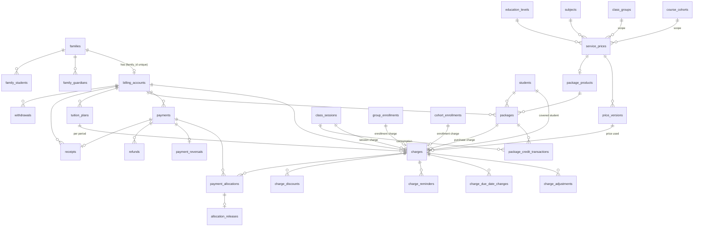

# Classora — Data model

**Status:** Accepted for the billing domain (GitHub issue #86, M6-01, 2026-10-27). The rules behind it are in [ADR-0006](adr/0006-financial-ledger-idempotency-and-numbering.md) (ledger, idempotency, numbering) and [ADR-0004](adr/0004-money-time-and-date-representation.md) (money, time and dates). Decision items are cited as **E1–E15** of issue #86.

## 1. Purpose and scope

Spec [`spec.md`](spec.md) §17 makes this file the home of the final entities, foreign keys, invariants, indexes and migration strategy, and requires a **schema review before implementing financial workflows**. This version is that review for the billing domain.

- **Covered:** the **billing** domain (module `billing`, M6) and the two **core** tables it needs (`idempotency_keys`, `number_series`).
- **Not covered:** the tables of earlier domains (identity, families, staff, catalog, scheduling, courses, academics, administration). They are documented in their migrations (`apps/api/migrations/versions/`), their model docstrings and their ADRs ([ADR-0005](adr/0005-scheduling-invariants-overrides-and-recurrence.md), [ADR-0007](adr/0007-authentication-sessions-recovery-and-delegation.md)). They are named here only where billing references them.
- **Payroll** (M7) is not covered, apart from the reserved `P` number series (§3.25).
- **Changes:** an implementing issue may rename a table or column, or adjust a column listed here, only by updating this file in the same pull request. A change to a rule of ADR-0006 needs an ADR amendment.

## 2. Conventions

- **Primary keys:** `id UUID`, generated as uuidv7 (`uuid.uuid7()` in Python, `uuidv7()` as the server default), like every other table. The exceptions are `payment_methods` (key `code`) and `number_series` (key `(code, year)`).
- **Standard columns:** every model has `created_at` and `updated_at` (`TIMESTAMPTZ NOT NULL`, set by the database; `app/core/models.py`). On an append-only table `updated_at` never moves.
- **Money:** `NUMERIC(14,2)` in MXN; rates and percentages `NUMERIC(14,4)`; Python `Decimal` through the `Money` type of #87; half-up rounding per line ([ADR-0004](adr/0004-money-time-and-date-representation.md)). There is **no currency column** (MXN only, spec §1) and no tax column.
- **Money mapping:** money columns use `app.core.money.MoneyType` and `Money`; sums use `money_sum` (#87).
- **Dates and instants:** `DATE` for calendar values (service dates, due dates, effective dates, periods, `received_on`, `expires_on`); `TIMESTAMPTZ` for instants (`posted_at`, `issued_at`, `effective_from` of cancellation rules). Local dates are computed in the center time zone (`business_settings.time_zone`).
- **Foreign keys:** every billing foreign key is `ON DELETE RESTRICT`. Billing rows are never deleted, so nothing cascades.
- **Audit:** every billing table except `idempotency_keys` and `number_series` is `Audited`. The audit event is inserted in the same transaction as the row (issue #22, `app/core/audit.py`); for mutable configuration rows, updates are audited too.
- **Concurrency token:** `version` (optimistic concurrency, `VersionedMixin`) exists only on **mutable configuration** rows. Append-only rows have none.
- **Staff text:** the only stored free text is staff-entered (`description`, `reason`, `note`, `reference`, product names). Everything a document or screen renders is otherwise stored as structured fields (kind, subject, minutes, period) and translated at display time ([ADR-0015](adr/0015-server-side-i18n.md)).
- **Immutability classes** used below:
  - **append-only:** no UPDATE, DELETE or TRUNCATE ever (§5.1);
  - **guarded:** immutable once another row references it (§5.2);
  - **mutable config / mutable reference:** edited in place with `version` and audit, never deleted once referenced (the `RESTRICT` foreign keys make that hold);
  - **transient:** deleted by a purge job;
  - **counter:** one row per series, updated under a row lock.

## 3. Billing tables

Overview. "Creating issue" is the issue whose migration creates the table. Whether `payments`, `refunds`, `payment_reversals` and `allocation_releases` are created by #90 or by #96/#100 may be adjusted by those issues' PMs, as long as this file is updated to say which.

| Table | Module | Creating issue | Class |
|---|---|---|---|
| `billing_accounts` | billing | #90 | mutable config |
| `billing_settings` | billing | #91 | mutable config (singleton) |
| `payment_methods` | billing | #96 | mutable reference |
| `service_prices` | billing | #89 | mutable config |
| `price_versions` | billing | #89 | guarded: immutable once referenced |
| `custom_prices` | billing | #95 | mutable config |
| `discounts` | billing | #95 | mutable config |
| `charge_discounts` | billing | #95 | append-only |
| `charges` | billing | #90 (sources added by #91–#94) | append-only |
| `charge_adjustments` | billing | #90 | append-only |
| `charge_due_date_changes` | billing | #97 | append-only |
| `charge_reminders` | billing | #97 | append-only |
| `payments` | billing | #90 (table), #96 (endpoints) | append-only |
| `payment_reversals` | billing | #90 (table), #100 (endpoints) | append-only |
| `payment_allocations` | billing | #90 | append-only |
| `allocation_releases` | billing | #90 | append-only |
| `refunds` | billing | #90 (table), #100 (endpoint) | append-only |
| `tuition_plans` | billing | #93 | mutable config |
| `package_products` | billing | #94 | mutable config |
| `packages` | billing | #94 | append-only |
| `package_credit_transactions` | billing | #94 | append-only |
| `receipts` | billing | #98 | append-only |
| `cancellation_billing_rules` | billing | #99 | append-only, effective-dated |
| `withdrawals` | billing | #101 | append-only |
| `idempotency_keys` | core | #88 | transient (purged) |
| `number_series` | core | #98 | counter (row-locked UPDATE) |
| view `billing_ledger_entries` | billing | #90 | read-only view |

Referenced tables of earlier domains: `families`, `family_students`, `family_guardians`, `guardians`, `students`, `users`, `class_sessions`, `class_session_participants`, `class_groups`, `group_enrollments`, `course_cohorts`, `cohort_enrollments`, `subjects`, `education_levels`, `business_settings`, `user_preferences`, `audit_events`.

### 3.1 `billing_accounts`

One billing account per family (E4). Created on first use with `INSERT … ON CONFLICT (family_id) DO NOTHING`.

| Column | Type | Null | Check / note |
|---|---|---|---|
| `id` | UUID | no | PK |
| `family_id` | UUID | no | FK `families`, **UNIQUE** |
| `due_offset_days` | SMALLINT | no | default 0; `CHECK (due_offset_days BETWEEN 0 AND 60)` (E11 family override) |
| `version` | INTEGER | no | optimistic concurrency |

- **Access:** the guardians in `family_guardians` for `family_id` see the account (record policy, #102). Students and tutors see nothing in M6.
- **Lock:** every financial mutation locks this row `FOR UPDATE` as its last lock (§6).

### 3.2 `billing_settings`

A singleton (the `business_settings` pattern: a `singleton BOOLEAN` column with `CHECK (singleton)` and UNIQUE).

| Column | Type | Null | Check / note |
|---|---|---|---|
| `id` | UUID | no | PK |
| `singleton` | BOOLEAN | no | `CHECK (singleton)`, UNIQUE |
| `billing_starts_on` | DATE | yes | `NULL`: the sweepers post nothing; otherwise they post only for service dates on or after it (E1) |
| `version` | INTEGER | no | |

Managed with `billing.manage`. The demo seed chooses its own date.

### 3.3 `payment_methods`

Billing-owned reference table (E12), seeded with `cash`, `transfer` and `other`. Labels come from the client catalogs. M8-04 (#121) adds editing behind reauthentication.

| Column | Type | Null | Check / note |
|---|---|---|---|
| `code` | VARCHAR(32) | no | PK; `CHECK (code ~ '^[a-z][a-z0-9_]*$')` |
| `is_active` | BOOLEAN | no | default true |
| `version` | INTEGER | no | |

A method is never deleted once used (`payments` and `refunds` reference it with `RESTRICT`).

### 3.4 `service_prices`

Catalog items (E9).

| Column | Type | Null | Check / note |
|---|---|---|---|
| `id` | UUID | no | PK |
| `class_type` | VARCHAR(16) | no | `individual` \| `group` \| `course` (the `class_sessions.kind` values) |
| `pricing_model` | VARCHAR(16) | no | `per_session` \| `full_course` \| `per_period` \| `package` |
| `subject_id` | UUID | yes | FK `subjects`; `NULL` only for a `package` row whose product has no subject (E10) |
| `education_level_id` | UUID | yes | FK `education_levels`; `NULL` = any level |
| `duration_minutes` | SMALLINT | yes | `> 0`; `NULL` = any duration |
| `cohort_id` | UUID | yes | FK `course_cohorts`; scope (spec §3, "each cohort has its own … pricing") |
| `group_id` | UUID | yes | FK `class_groups`; scope |
| `version` | INTEGER | no | |

- **Checks:** `NOT (cohort_id IS NOT NULL AND group_id IS NOT NULL)`; `cohort_id` only with `class_type = 'course'`; `group_id` only with `class_type = 'group'`; `package` only with `class_type = 'individual'` (E10).
- **Pricing models:** `per_session` (individual sessions, and group sessions priced per session); `full_course` (a cohort fee, or a group flat fee per enrollment); `per_period` (group per-student pricing, through a tuition plan linked to the group enrollment, and tuition plans in general); `package` (the price of a package product).
- **Catalog key:** `UNIQUE NULLS NOT DISTINCT (class_type, pricing_model, subject_id, education_level_id, duration_minutes, cohort_id, group_id) WHERE pricing_model <> 'package'`. A `package` row is identified by its product instead (`package_products.service_price_id` is UNIQUE), so two products for the same subject can coexist.
- The key columns don't change once a `price_versions` row exists; a different key is a new item.

### 3.5 `price_versions`

| Column | Type | Null | Check / note |
|---|---|---|---|
| `id` | UUID | no | PK |
| `service_price_id` | UUID | no | FK `service_prices` |
| `effective_from` | DATE | no | |
| `amount` | NUMERIC(14,2) | yes | `>= 0`; `NULL` = "not offered from this date" |

- **Ranges:** each version runs until the next one's `effective_from`. `UNIQUE (service_price_id, effective_from)` makes overlapping ranges impossible (the #89 constraint).
- **Lookup:** the version in effect on a local date `d` is the one with the greatest `effective_from <= d`. Precedence (E9): (1) custom student or family price (#95); (2) the cohort- or group-scoped price; (3) the catalog price with the exact level; (4) the catalog price with any level. A `NULL` amount means "not offered": with no price in effect the item is unbilled (`no_price`, E1). #89 documents how a `NULL` at one step interacts with the lower steps.
- **Guarded:** a version referenced by any `charges` or `packages` row can't be updated or deleted (§5.2). A change is a new version.

### 3.6 `custom_prices` (#95)

A custom student or family price, step 1 of the lookup. #95 may add columns; this is the minimum.

| Column | Type | Null | Check / note |
|---|---|---|---|
| `id` | UUID | no | PK |
| `service_price_id` | UUID | no | FK `service_prices` (the item it overrides) |
| `student_id` | UUID | yes | FK `students` |
| `family_id` | UUID | yes | FK `families` |
| `effective_from` | DATE | no | |
| `amount` | NUMERIC(14,2) | no | `>= 0` |
| `version` | INTEGER | no | |

`CHECK (num_nonnulls(student_id, family_id) = 1)`. #95 documents the precedence between a student and a family price. Once referenced by a charge (`charges.custom_price_id`) it is guarded like `price_versions`.

### 3.7 `discounts` (#95)

Reusable discounts, scholarships, sibling discounts and promotions (spec §6).

| Column | Type | Null | Check / note |
|---|---|---|---|
| `id` | UUID | no | PK |
| `kind` | VARCHAR(16) | no | `discount` \| `scholarship` \| `sibling` \| `promotion` |
| `name` | VARCHAR(120) | no | staff-entered |
| `percent` | NUMERIC(14,4) | yes | `> 0 AND <= 100` |
| `amount` | NUMERIC(14,2) | yes | `> 0` |
| `eligibility` | JSONB | no | structured criteria, defined by #95 |
| `starts_on` | DATE | yes | |
| `expires_on` | DATE | yes | |
| `is_active` | BOOLEAN | no | |
| `version` | INTEGER | no | |

`CHECK (num_nonnulls(percent, amount) = 1)`. The stacking and precedence rules are #95's.

### 3.8 `charge_discounts` (#95)

The discounts applied to a charge, snapshotted when it is posted (W4.2).

| Column | Type | Null | Check / note |
|---|---|---|---|
| `id` | UUID | no | PK |
| `charge_id` | UUID | no | FK `charges` |
| `discount_id` | UUID | no | FK `discounts` |
| `position` | SMALLINT | no | application order, `UNIQUE (charge_id, position)` |
| `amount` | NUMERIC(14,2) | no | `> 0` |

Σ `amount` per charge = `charges.discount_amount` (App, in the posting transaction).

### 3.9 `charges`

What the family owes for one student and one thing (E1, E5, E9, E11). Always for one student.

| Column | Type | Null | Check / note |
|---|---|---|---|
| `id` | UUID | no | PK |
| `billing_account_id` | UUID | no | FK `billing_accounts` |
| `student_id` | UUID | no | FK `students` |
| `kind` | VARCHAR(24) | no | `session` \| `group_enrollment` \| `cohort_enrollment` \| `tuition_period` \| `package_purchase` \| `manual` |
| `class_session_id` | UUID | yes | FK `class_sessions`; source of `session` |
| `group_enrollment_id` | UUID | yes | FK `group_enrollments`; source of `group_enrollment` |
| `cohort_enrollment_id` | UUID | yes | FK `cohort_enrollments`; source of `cohort_enrollment` |
| `tuition_plan_id` | UUID | yes | FK `tuition_plans`; source of `tuition_period` |
| `package_id` | UUID | yes | FK `packages`; source of `package_purchase` |
| `service_date` | DATE | no | the session's original local date; the enrollment's local date; the period start (`period_start`); the purchase date; or the staff-entered date |
| `service_period_end` | DATE | yes | last day of a `tuition_period`; `>= service_date` |
| `price_version_id` | UUID | yes | FK `price_versions`; the version used (`NULL` for `manual` and custom-priced charges) |
| `custom_price_id` | UUID | yes | FK `custom_prices` (column added by #95) |
| `education_level_id` | UUID | yes | FK `education_levels`; the student's level at posting (snapshot) |
| `scheduled_minutes` | SMALLINT | yes | the session's `scheduled_minutes` at posting (snapshot; `session` only) |
| `list_amount` | NUMERIC(14,2) | no | `>= 0`; price before discounts |
| `discount_amount` | NUMERIC(14,2) | no | `>= 0`; default 0 |
| `amount` | NUMERIC(14,2) | no | `>= 0`; `CHECK (amount = list_amount - discount_amount)` |
| `due_date` | DATE | no | set at posting, never updated (E11) |
| `description` | VARCHAR(200) | yes | `manual` only, trimmed, 1–200 characters |
| `posted_at` | TIMESTAMPTZ | no | |
| `posted_by_user_id` | UUID | yes | FK `users`; `NULL` when a job posted it |

- **Exactly one source per kind** (`CHECK`):
  - `session` ⇔ `class_session_id IS NOT NULL`, and `scheduled_minutes IS NOT NULL`;
  - `group_enrollment` ⇔ `group_enrollment_id IS NOT NULL`;
  - `cohort_enrollment` ⇔ `cohort_enrollment_id IS NOT NULL`;
  - `tuition_period` ⇔ `tuition_plan_id IS NOT NULL`, and `service_period_end IS NOT NULL`;
  - `package_purchase` ⇔ `package_id IS NOT NULL`;
  - `manual` ⇔ every source column `NULL`, and `description IS NOT NULL`.

  Written as `num_nonnulls(class_session_id, group_enrollment_id, cohort_enrollment_id, tuition_plan_id, package_id) = CASE WHEN kind = 'manual' THEN 0 ELSE 1 END` plus one implication per kind.
- **`price_version_id` and `custom_price_id`:** at most one is set.
- **Natural keys** (partial unique indexes, J4):
  - `(class_session_id, student_id) WHERE kind = 'session'`;
  - `(group_enrollment_id) WHERE kind = 'group_enrollment'`;
  - `(cohort_enrollment_id) WHERE kind = 'cohort_enrollment'`;
  - `(tuition_plan_id, service_date) WHERE kind = 'tuition_period'`, i.e. `(tuition_plan_id, period_start)`;
  - `(package_id) WHERE kind = 'package_purchase'`.

  Manual charges have no natural key; they rely on the API idempotency key (§3.24).
- **Composite targets:** `UNIQUE (id, billing_account_id)` and `UNIQUE (id, billing_account_id, student_id)`, referenced by the composite foreign keys of allocations and adjustments (I4, I5).
- **Kept account:** a charge keeps the account it was posted to, even if the student later moves to another family. There is no foreign key to `family_students`.
- **Rescheduling:** a rescheduled session keeps its charge and its `service_date`; reporting uses the session's current date (E7).

### 3.10 `charge_adjustments`

Signed corrections against one charge (E2, E3, E5, E8, E9). A credit is a negative adjustment.

| Column | Type | Null | Check / note |
|---|---|---|---|
| `id` | UUID | no | PK |
| `charge_id` | UUID | no | composite FK, see below |
| `billing_account_id` | UUID | no | |
| `student_id` | UUID | no | |
| `kind` | VARCHAR(24) | no | `duration_change` (E2) \| `cancellation_credit` (E3) \| `closure_credit` (E3, ADR-0005 D6) \| `enrollment_removal` (E9, #92) \| `withdrawal` (#101) \| `manual` (E8) |
| `amount` | NUMERIC(14,2) | no | `CHECK (amount <> 0)` |
| `reason` | VARCHAR(500) | yes | staff text; required for `manual` |
| `source_key` | VARCHAR(200) | yes | idempotency key of a generated adjustment |
| `posted_at` | TIMESTAMPTZ | no | |
| `posted_by_user_id` | UUID | yes | FK `users`; `NULL` for a job |

- **Composite FK:** `(charge_id, billing_account_id, student_id)` → `charges (id, billing_account_id, student_id)` (I5).
- **`source_key`:** partial UNIQUE `WHERE source_key IS NOT NULL`. Generated adjustments always set it; the implementing issue fixes the format, which includes the triggering event, for example `duration_change:<charge_id>:<session version after the edit>` (E2) or `cancellation_credit:<charge_id>` (E3). Manual adjustments rely on the API idempotency key.
- **Releases:** if an adjustment pushes the charge's net below its valid allocations, the newest allocations are released in the same transaction, and a smaller allocation is re-inserted when the release frees more than needed (E5). The released money becomes account credit.
- A negative `manual` adjustment is a financial correction: `billing.manage` plus reauthentication `finance.correction` (E8).

### 3.11 `charge_due_date_changes` (#97)

| Column | Type | Null | Check / note |
|---|---|---|---|
| `id` | UUID | no | PK |
| `charge_id` | UUID | no | FK `charges` |
| `due_date` | DATE | no | the new due date |
| `reason` | VARCHAR(500) | no | staff text |
| `changed_by_user_id` | UUID | no | FK `users` |

The effective due date of a charge is the `due_date` of its latest change (by `created_at`, `id`), or `charges.due_date` when there is none. Index `(charge_id, created_at)`.

### 3.12 `payments`

An external payment (cash, transfer or other) recorded by staff (spec §1, §6; E8, E12).

| Column | Type | Null | Check / note |
|---|---|---|---|
| `id` | UUID | no | PK |
| `billing_account_id` | UUID | no | FK `billing_accounts` |
| `amount` | NUMERIC(14,2) | no | `> 0` |
| `received_on` | DATE | no | the local date the money was received (cash basis, E7) |
| `payment_method_code` | VARCHAR(32) | no | FK `payment_methods` |
| `reference` | VARCHAR(100) | yes | staff text |
| `payer_name` | VARCHAR(200) | yes | staff text; shown on the receipt |
| `note` | VARCHAR(500) | yes | staff text |
| `recorded_by_user_id` | UUID | no | FK `users` |

`UNIQUE (id, billing_account_id)` is the target of the composite foreign keys (I4).

### 3.13 `payment_reversals`

At most one per payment (E5). A reversal releases all of the payment's valid allocations in the same transaction.

| Column | Type | Null | Check / note |
|---|---|---|---|
| `id` | UUID | no | PK |
| `payment_id` | UUID | no | **UNIQUE**; composite FK `(payment_id, billing_account_id)` → `payments (id, billing_account_id)` |
| `billing_account_id` | UUID | no | |
| `reason` | VARCHAR(500) | no | staff text |
| `reversed_by_user_id` | UUID | no | FK `users` |

A payment with refunds can't be reversed (`409`, I3). Needs `finance.refund.approve` plus reauthentication `finance.refund_or_reversal` (E8).

### 3.14 `payment_allocations`

Part of a payment applied to one charge of the same account (spec W4.3).

| Column | Type | Null | Check / note |
|---|---|---|---|
| `id` | UUID | no | PK |
| `payment_id` | UUID | no | composite FK `(payment_id, billing_account_id)` → `payments (id, billing_account_id)` |
| `charge_id` | UUID | no | composite FK `(charge_id, billing_account_id)` → `charges (id, billing_account_id)` |
| `billing_account_id` | UUID | no | |
| `amount` | NUMERIC(14,2) | no | `> 0` |
| `created_by_user_id` | UUID | yes | FK `users`; `NULL` when re-inserted by an adjustment's release |

An allocation is **valid** while it has no `allocation_releases` row.

### 3.15 `allocation_releases`

A release frees a whole allocation (E5).

| Column | Type | Null | Check / note |
|---|---|---|---|
| `id` | UUID | no | PK |
| `allocation_id` | UUID | no | FK `payment_allocations`, **UNIQUE** |
| `payment_reversal_id` | UUID | yes | FK `payment_reversals`; set when a reversal released it |
| `charge_adjustment_id` | UUID | yes | FK `charge_adjustments`; set when an adjustment released it |
| `released_by_user_id` | UUID | yes | FK `users` |

`CHECK (num_nonnulls(payment_reversal_id, charge_adjustment_id) = 1)`.

### 3.16 `refunds`

Money paid back out of a payment's unallocated remainder (E5). A cash refund reduces account credit, not the outstanding amount.

| Column | Type | Null | Check / note |
|---|---|---|---|
| `id` | UUID | no | PK |
| `payment_id` | UUID | no | composite FK `(payment_id, billing_account_id)` → `payments (id, billing_account_id)` |
| `billing_account_id` | UUID | no | |
| `amount` | NUMERIC(14,2) | no | `> 0` |
| `refunded_on` | DATE | no | |
| `payment_method_code` | VARCHAR(32) | no | FK `payment_methods` (how the money went back) |
| `reference` | VARCHAR(100) | yes | staff text |
| `reason` | VARCHAR(500) | no | staff text |
| `withdrawal_id` | UUID | yes | FK `withdrawals`; set by #101 |
| `refunded_by_user_id` | UUID | no | FK `users` |

Needs `finance.refund.approve` plus reauthentication `finance.refund_or_reversal` (E8).

### 3.17 `tuition_plans` (#93)

A recurring tuition plan; one charge per plan per period (E1).

| Column | Type | Null | Check / note |
|---|---|---|---|
| `id` | UUID | no | PK |
| `billing_account_id` | UUID | no | FK `billing_accounts` |
| `student_id` | UUID | no | FK `students` |
| `service_price_id` | UUID | no | FK `service_prices` with `pricing_model = 'per_period'` (App) |
| `group_enrollment_id` | UUID | yes | FK `group_enrollments`; group per-student pricing (E9) |
| `frequency` | VARCHAR(16) | no | `weekly` \| `biweekly` \| `monthly` |
| `starts_on` | DATE | no | |
| `ends_on` | DATE | yes | `>= starts_on`; `NULL` = open-ended |
| `due_offset_days` | SMALLINT | no | `>= 0`; the plan's due rule (E11) |
| `version` | INTEGER | no | |

Periods follow the center's local dates. Pausing or ending a plan stops future periods and never touches posted charges. #93 may add a pause column. Composite `UNIQUE (id, billing_account_id, student_id)` lets a tuition charge be checked against its plan's account and student.

### 3.18 `package_products` (#94)

| Column | Type | Null | Check / note |
|---|---|---|---|
| `id` | UUID | no | PK |
| `service_price_id` | UUID | no | FK `service_prices` with `pricing_model = 'package'`, **UNIQUE** |
| `name` | VARCHAR(120) | no | staff text |
| `unit` | VARCHAR(8) | no | `sessions` \| `minutes` |
| `quantity` | INTEGER | no | `> 0` |
| `validity_days` | SMALLINT | no | `> 0` |
| `subject_id` | UUID | yes | FK `subjects`; `NULL` = any subject |
| `is_active` | BOOLEAN | no | |
| `version` | INTEGER | no | |

A product covers **individual sessions only** (E10).

### 3.19 `packages` (#94)

A purchased package: one billing account and one student, never shared (spec §6).

| Column | Type | Null | Check / note |
|---|---|---|---|
| `id` | UUID | no | PK |
| `billing_account_id` | UUID | no | FK `billing_accounts` |
| `student_id` | UUID | no | FK `students` |
| `package_product_id` | UUID | no | FK `package_products` |
| `price_version_id` | UUID | no | FK `price_versions` (the price paid) |
| `unit` | VARCHAR(8) | no | snapshot of the product |
| `units_granted` | INTEGER | no | `> 0`; snapshot |
| `subject_id` | UUID | yes | snapshot of the product |
| `purchased_on` | DATE | no | local date |
| `expires_on` | DATE | no | `= purchased_on + validity_days` (App); `> purchased_on` |

`UNIQUE (id, billing_account_id, student_id)`. Its purchase charge (`charges.kind = 'package_purchase'`) is posted in the same transaction.

### 3.20 `package_credit_transactions` (#94)

Units move only through these rows (E10), as signed integers in the package's unit.

| Column | Type | Null | Check / note |
|---|---|---|---|
| `id` | UUID | no | PK |
| `package_id` | UUID | no | FK `packages` |
| `kind` | VARCHAR(16) | no | `grant` \| `consume` \| `expire` \| `refund` \| `reversal` |
| `units` | INTEGER | no | `grant` > 0; `consume`, `expire`, `refund` < 0; `reversal` <> 0 |
| `class_session_id` | UUID | yes | FK `class_sessions`; `consume` only (`NOT NULL` for it) |
| `student_id` | UUID | yes | FK `students`; set with `class_session_id` |
| `reverses_transaction_id` | UUID | yes | FK `package_credit_transactions`; `reversal` only (`NOT NULL` for it) |
| `withdrawal_id` | UUID | yes | FK `withdrawals`; set by #101 for `refund` |

- **Natural keys:** `(package_id) WHERE kind = 'grant'`; `(package_id) WHERE kind = 'expire'`; `(package_id, class_session_id) WHERE kind = 'consume'`; `(reverses_transaction_id) WHERE kind = 'reversal'`.
- A minutes package consumes `scheduled_minutes` (E2). Consumption is first-expiring-first, possibly across packages, and all or nothing per `(class_session_id, student_id)` (E10).

### 3.21 `receipts` (#98)

One receipt per payment, issued in the payment's transaction (E13). The row is a frozen snapshot.

| Column | Type | Null | Check / note |
|---|---|---|---|
| `id` | UUID | no | PK |
| `number` | VARCHAR(16) | no | **UNIQUE**; `R-YYYY-NNNNNN`, e.g. `R-2026-000123` |
| `payment_id` | UUID | no | **UNIQUE**; composite FK `(payment_id, billing_account_id)` → `payments (id, billing_account_id)` |
| `billing_account_id` | UUID | no | |
| `issued_at` | TIMESTAMPTZ | no | its center-local year is the number's year |
| `language` | VARCHAR(2) | no | `es` \| `en` ([ADR-0015](adr/0015-server-side-i18n.md)) |
| `template_version` | SMALLINT | no | `> 0` |
| `snapshot` | JSONB | no | center name, address and contact (business settings); family name and payer; amount and method; allocations as charge ids, amounts and structured labels |

Later changes to settings, templates (M8-04) or allocations don't change the row. A reversed payment's receipt keeps its number; the PDF shows a "reversed" banner from the `payment_reversals` row. Payments recorded before #98 merges get no receipt (no backfill).

### 3.22 `cancellation_billing_rules` (#99)

The money outcome per cancellation classification (E3). One row per effective instant, like `scheduling_policies`.

| Column | Type | Null | Check / note |
|---|---|---|---|
| `id` | UUID | no | PK |
| `effective_from` | TIMESTAMPTZ | no | **UNIQUE** |
| `excused_outcome` | VARCHAR(8) | no | `credit` \| `charge`; seeded `credit` |
| `on_time_outcome` | VARCHAR(8) | no | `credit` \| `charge`; seeded `credit` |
| `late_outcome` | VARCHAR(8) | no | `credit` \| `charge`; seeded `charge` |
| `no_show_outcome` | VARCHAR(8) | no | `credit` \| `charge`; seeded `charge` |
| `created_by_user_id` | UUID | yes | FK `users`; `NULL` for the seeded row |

The rule in effect at the change's classification instant applies. Managed with `billing.manage`.

### 3.23 `withdrawals` (#101)

An admin-managed withdrawal from a group or cohort enrollment, with its confirmed preview.

| Column | Type | Null | Check / note |
|---|---|---|---|
| `id` | UUID | no | PK |
| `billing_account_id` | UUID | no | FK `billing_accounts` |
| `student_id` | UUID | no | FK `students` |
| `group_enrollment_id` | UUID | yes | FK `group_enrollments`, partial UNIQUE |
| `cohort_enrollment_id` | UUID | yes | FK `cohort_enrollments`, partial UNIQUE |
| `preview` | JSONB | no | the confirmed calculation: consumed and unused sessions and hours, the policy result |
| `outcome` | VARCHAR(16) | no | `refund` \| `account_credit` |
| `amount` | NUMERIC(14,2) | no | `>= 0` |
| `confirmed_by_user_id` | UUID | no | FK `users` |

`CHECK (num_nonnulls(group_enrollment_id, cohort_enrollment_id) = 1)`: one withdrawal per enrollment. The credit is posted as `withdrawal` adjustments; a `refund` outcome also writes `refunds` rows (and `refund` package transactions for unused package units).

### 3.24 `idempotency_keys` (core, #88)

API idempotency (E6). Not `Audited`. Migration `0059` (#88).

| Column | Type | Null | Check / note |
|---|---|---|---|
| `id` | UUID | no | PK |
| `user_id` | UUID | no | FK `users` `ON DELETE RESTRICT` |
| `endpoint` | TEXT | no | method + route template, e.g. `POST /api/v1/billing/payments`; `CHECK (char_length(endpoint) BETWEEN 1 AND 300)` |
| `key` | TEXT | no | `CHECK (key ~ '^[A-Za-z0-9_-]{16,128}$')` |
| `request_hash` | BYTEA | no | raw SHA-256 over method, concrete path and canonical JSON body; `CHECK (octet_length(request_hash) = 32)` |
| `response_status` | SMALLINT | yes | `BETWEEN 200 AND 299` (only `2xx` is stored); `NULL` only inside the claiming transaction, never committed |
| `response_body` | JSONB | yes | `NULL` for a `204` (and inside the claiming transaction) |
| `expires_at` | TIMESTAMPTZ | no | claim time + 7 days; an expired row counts as absent and is replaced by the next claim (ADR-0006 implementation note) |

`UNIQUE (user_id, endpoint, key)` (`uq_idempotency_keys_user_endpoint_key`); index `ix_idempotency_keys_expires_at`. Rows are deleted by the hourly `idempotency:purge_keys` job.

### 3.25 `number_series` (core, #98)

Gap-free yearly counters (E13).

| Column | Type | Null | Check / note |
|---|---|---|---|
| `code` | TEXT | no | `CHECK (code IN ('R', 'P'))`: `R` (receipts), `P` (payslips, reserved for M7) |
| `year` | SMALLINT | no | the center-local year of the issue instant |
| `last_value` | INTEGER | no | `>= 0` |

`PRIMARY KEY (code, year)`. The row is created with `INSERT … ON CONFLICT DO NOTHING`, then locked `FOR UPDATE` and incremented inside the posting transaction, so a rollback returns the number. Not `Audited` (the receipt is).

### 3.26 View `billing_ledger_entries` (#90)

A read-only `UNION ALL` of the money rows of one account, for the cursor-paginated history (architecture §4.4) and the per-student filter. One row per `charges`, `charge_adjustments`, `payments`, `payment_reversals`, `payment_allocations`, `allocation_releases` and `refunds` row, with at least: `billing_account_id`, `entry_type`, `entry_id`, `student_id` (`NULL` for payment-level rows), `amount`, `occurred_at` (`posted_at` or `created_at`). The cursor is `(occurred_at, entry_id)`. #90 fixes the exact columns. The view stores nothing and is never written.

### 3.27 `charge_reminders` (#97)

One row per charge and reminder stage, so the reminder job is idempotent (E11, natural key `(charge_id, stage)`). The in-app notifications to the account's guardians (`family_guardians` → `guardians.user_id`) are inserted in the same transaction through `create_notification`, as `{type, params}` ([ADR-0015](adr/0015-server-side-i18n.md)). The `notifications` table itself has no dedup key, and one charge stage notifies several guardians, so the key lives here.

| Column | Type | Null | Check / note |
|---|---|---|---|
| `id` | UUID | no | PK |
| `charge_id` | UUID | no | FK `charges` |
| `stage` | VARCHAR(24) | no | the reminder stage; #97 defines the stage codes and their offsets from the effective due date |
| `sent_at` | TIMESTAMPTZ | no | |

- **Natural key:** `UNIQUE (charge_id, stage)`; the job inserts with `INSERT … ON CONFLICT DO NOTHING` and notifies only when the row was inserted.
- **Immutability:** append-only (§5.1 triggers).
- **Index:** the unique key serves the lookup by charge.

## 4. Invariants and derived values

### 4.1 Invariants

**DB** means a constraint, foreign key or trigger. **App** means checked by the billing service **under the billing account lock** (§6) in the mutating transaction. The "Proven by" issue holds the test; #103 also runs them all over randomized sequences.

| ID | Invariant | Enforced | Proven by |
|---|---|---|---|
| I1 | `net(charge) >= 0` | App | #90, #103 |
| I2 | Σ valid allocations ≤ net, per charge | App | #96, #103 |
| I3 | Σ valid allocations + Σ refunds ≤ payment amount; a reversed payment has no valid allocation; a payment with refunds can't be reversed (`409`) | App (`payment_reversals.payment_id` UNIQUE is DB) | #96, #100, #103 |
| I4 | An allocation, its payment and its charge are in the same account; so are reversals, refunds and receipts with their payment | DB (composite FKs) | #90 |
| I5 | An adjustment is in the same account and for the same student as its charge | DB (composite FK) | #90 |
| I6 | Sign and range checks: charge amounts ≥ 0; adjustment ≠ 0; payment, allocation, refund > 0; `due_offset_days` 0–60; package unit signs per kind | DB (`CHECK`) | #90, #94 |
| I7 | `charges.amount = list_amount − discount_amount` | DB (`CHECK`) | #90, #95 |
| I8 | Package remaining units ≥ 0 | App | #94, #103 |
| I9 | At most one of {session charge, package consumption} per `(class_session_id, student_id)` | App (each side also has its DB natural key) | #94, #103 |
| I10 | Receipt numbers are gap-free and unique per series and year | DB (`receipts.number` UNIQUE) + App (`number_series` row lock) | #98, #103 |
| I11 | Posted rows never change | DB (triggers, §5) | #90 (and each issue that creates an append-only table) |

### 4.2 Derived values

Nothing below is stored. A verified snapshot is allowed only for reporting (ISSUE-F3).

- `net(charge) = amount + Σ adjustments`.
- `open(charge) = net − Σ valid allocations`.
- **Outstanding** (account) = Σ `open` over the account's charges.
- **Outstanding per student** = Σ `open` over the account's charges for that student. Account credit is account-level only and is not split per student.
- **Account credit** = Σ over payments that aren't reversed of (`amount − Σ valid allocations − Σ refunds`).
- **Net balance** = outstanding − account credit.
- **Charge status:**
  - `void`: net = 0 and no allocation;
  - `paid`: open = 0 and not `void`;
  - `overdue`: open > 0 and the effective due date (§3.11) is before today in the center's local date;
  - `partially_paid`: open > 0, Σ valid allocations > 0 and not overdue;
  - `pending`: open > 0, no valid allocation and not overdue.
- **Package remaining units** = Σ `package_credit_transactions.units` for the package. A package is usable while remaining > 0 and today (center local) ≤ `expires_on` and it has no `expire` row.

Spec W4.4 "posted charges/adjustments less valid allocations and refunds" is read with *refunds* as the credit-side corrections (negative adjustments) (ADR-0006).

## 5. Immutability mechanism

### 5.1 Append-only tables

Every append-only table gets the migration 0004 pattern (`apps/api/migrations/versions/0004_audit_events.py`), created in the same migration as the table:

- a trigger function `<table>_append_only()` that raises `RAISE EXCEPTION '<table> is append-only' USING ERRCODE = 'insufficient_privilege'` (SQLSTATE **42501**);
- `CREATE TRIGGER <table>_no_update_delete BEFORE UPDATE OR DELETE ON <table> FOR EACH ROW …`;
- `CREATE TRIGGER <table>_no_truncate BEFORE TRUNCATE ON <table> FOR EACH STATEMENT …`.

Privileges alone can't do it: the local, test and CI database role is a superuser. #165 (M10-10) adds the least-privilege role later; the triggers stay. A migration may disable a trigger only in its **own downgrade**, for that one statement.

### 5.2 Guarded tables

`price_versions` (and `custom_prices` from #95) get a `BEFORE UPDATE OR DELETE` row trigger that raises 42501 when the row is referenced by any `charges` or `packages` row, plus the `BEFORE TRUNCATE` trigger. An unreferenced version may still be corrected or removed.

## 6. Concurrency

- **Lock order** for every financial mutation:
  1. the calling workflow's own scheduling or courses locks (session, group, cohort, per-student advisory locks; ADR-0005), if any;
  2. `billing_accounts` row `FOR UPDATE`, always the **last** business lock;
  3. `number_series` row `FOR UPDATE`, only when a receipt is issued.

  The App invariants of §4.1 are checked after step 2.
- **API requests:** the `idempotency_keys` row is inserted first in the business transaction, before any lock. A concurrent duplicate blocks on the unique index until the first commits, then reads the stored response (E6).
- **Jobs and sweepers:** insert on the natural keys with `INSERT … ON CONFLICT DO NOTHING` and treat a conflict as success; periodic tasks use a Procrastinate `queueing_lock` (ADR-0003). They never use `idempotency_keys`. The jobs: `billing:post_session_charges` (every 15 minutes, #91), the enrollment sweepers (#92), the daily tuition job (#93), the daily package expiry job (#94), the reminder job (#97, natural key `charge_reminders (charge_id, stage)`) and `idempotency:purge_keys` (hourly, #88).
- **Scheduling transactions** never post charges: a billing failure can't roll back a schedule change (E1). Enrollment charges are the exception: they are posted in the M4 hooks' Unit of Work (`apply_enrollment_change`, `apply_cohort_enrollment_change`), which already holds the enrollment locks.

## 7. Indexes

Beyond primary keys, unique keys and natural keys, for the access paths of spec §16 ("family, … billing status"):

- `charges (billing_account_id, posted_at, id)`: account history;
- `charges (student_id, service_date)`: per-student breakdown;
- `charges (billing_account_id, due_date)`: overdue and reminders;
- `charge_adjustments (charge_id)`;
- `charge_due_date_changes (charge_id, created_at)`;
- `charge_reminders (charge_id, stage)` (the unique key);
- `payments (billing_account_id, received_on, id)`;
- `payment_allocations (charge_id)` and `payment_allocations (payment_id)`;
- `refunds (payment_id)`;
- `packages (billing_account_id, student_id, expires_on)`: first-expiring-first lookup;
- `package_credit_transactions (package_id)`;
- `receipts (billing_account_id, issued_at)`;
- `price_versions (service_price_id, effective_from)` (the unique key);
- `idempotency_keys (expires_at)`: purge.

## 8. Migration strategy

- One Alembic migration per implementing issue, migration-first, expand-and-contract, so the previous image keeps working (architecture §5).
- Triggers and their functions are created in the same migration as their table, and dropped in its downgrade.
- Reference seeds (`payment_methods`, the first `cancellation_billing_rules` row, `billing_settings` with `billing_starts_on = NULL`) are inserted by the creating migration. Permissions are seeded by the first issue that uses them (ADR-0006).
- **No data backfill of charges:** history before `billing_starts_on` is never charged (E1). Receipts are not backfilled (E13).

## 9. Relationships

## 10. M6 issue coverage

Each M6 issue, the ADR-0006 / ADR-0015 decision items it relies on, and the tables it creates or uses. QA checks each issue's acceptance criteria against its row.

| Issue | Decision items | Tables |
|---|---|---|
| #87 M6-02 Money | E5 (`NUMERIC(14,2)`, half-up per line, no currency), ADR-0004 | none (value object) |
| #88 M6-03 Idempotency | E6 | `idempotency_keys` |
| #89 M6-04 Price catalog | E8 (`billing.manage`), E9 (key, versions, lookup, guarded trigger) | `service_prices`, `price_versions` |
| #90 M6-05 Account and ledger core | E4, E5 (rows, triggers, balances, statuses), E8 (`billing.view`), E11 (`due_date`, `due_offset_days`) | `billing_accounts`, `charges`, `charge_adjustments`, `payments`, `payment_reversals`, `payment_allocations`, `allocation_releases`, `refunds`, view `billing_ledger_entries` |
| #91 M6-06 Session charges | E1 (sweeper, floor, unbilled list, `apply_confirmation_charge`), E2 (`scheduled_minutes`), E9 (lookup), E10 (covered by a package → no charge), E11 (session due date) | `billing_settings`, `charges` |
| #92 M6-07 Enrollment charges | E1 (M4 hooks + sweeper), E9 (`full_course`, late proration, `enrollment_removal`), E11 | `charges`, `charge_adjustments` |
| #93 M6-08 Tuition plans | E1 (daily job, local periods), E9 (`per_period`, group per-student), E11 (`period_start + due_offset_days`) | `tuition_plans`, `charges` |
| #94 M6-09 Packages | E1 (purchase), E6 (purchase key), E10, E11 (purchase date) | `package_products`, `packages`, `package_credit_transactions`, `charges` |
| #95 M6-10 Discounts, custom prices | E9 (precedence step 1, discount snapshot equation) | `custom_prices`, `discounts`, `charge_discounts` |
| #96 M6-11 Payments, allocations | E5 (allocations, account credit, I2/I3), E6, E8 (`payment.record`), E12 (method from the seeded table) | `payment_methods`, `payments`, `payment_allocations` |
| #97 M6-12 Due dates, reminders | E11 (rules, family override, `charge_due_date_changes`, local-date overdue, `(charge_id, stage)`) | `charge_due_date_changes`, `charge_reminders` |
| #98 M6-13 Receipts | E13 (`number_series`, snapshot incl. template version, one per payment), E14, E15 | `receipts`, `number_series` |
| #99 M6-14 Reconciliation | E2 (delta adjustment), E3 (rules, outcomes, closures), E10 (`charge` debits units) | `cancellation_billing_rules`, `charge_adjustments` |
| #100 M6-15 Reversals, refunds | E5 (reversal releases allocations, refunds from the remainder, I3), E6, E8 (`finance.refund.approve`, `finance.refund_or_reversal`, `finance.correction`) | `payment_reversals`, `allocation_releases`, `refunds` |
| #101 M6-16 Withdrawals | E8 (permission combination), E9 (flat and course fees only here), E10 (unused units) | `withdrawals`, `charge_adjustments`, `refunds`, `package_credit_transactions` |
| #102 M6-17 Family portal | E4 (`family_guardians`, per-child filter, no student or tutor access), E13 (receipt download) | reads only |
| #103 M6-18 Invariant suite | E5, E6, E10, E13; invariants I1–I11 (§4.1) | all of the above |
