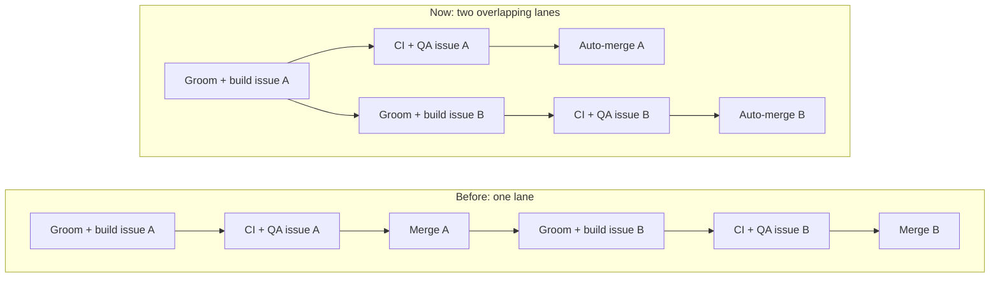

# Classora — Agent-Driven Development Guide

**Workflow:** GitHub Issues are the **only active implementation backlog**. A Product Manager agent grooms, a Software Engineer agent implements, and a QA agent verifies. An orchestrator manages transitions. Prompts here **operate on issues**; they are not a parallel set of build instructions.

> This is an implementation guide, not the public root `README.md`. The canonical product scope is `_docs/spec.md` and architecture is `_docs/architecture.md`. Do not silently replace approved choices.

## 1. Shared baseline and repository layout

Classora is a bilingual (Spanish/English), MXN-only management platform for **one** tutoring/test-preparation center. It handles role-scoped tutoring operations, courses, students and guardians, scheduling, assessments, files, billing, payroll, expenses and analytics.

Approved stack: React/Vite/TypeScript + Tailwind/shadcn; FastAPI + async SQLAlchemy/asyncpg/Alembic; PostgreSQL + PgBouncer; **Procrastinate backed by PostgreSQL, with a separate worker container and periodic jobs**; Docker Compose; AWS EC2 + Terraform; ECR + GitHub Actions + SSM; Caddy + CloudFront; S3 and pgBackRest; OpenTelemetry + Grafana/Prometheus/Loki/Tempo. **No Redis, Celery, RDS, or automatic banking transfers.**

```text
classora/
├── README.md                     # Human-facing overview, kept current
├── AGENTS.md                     # Universal agent instructions and README gate
├── CLAUDE.md                     # @AGENTS.md
├── apps/
│   ├── web/
│   └── api/
├── packages/api-client/
├── infrastructure/
│   ├── terraform/
│   ├── docker/
│   ├── observability/
│   └── scripts/
├── _docs/
│   ├── spec.md
│   ├── architecture.md
│   ├── data-model.md
│   ├── api.md
│   ├── design-system.md
│   ├── testing-guidelines.md
│   ├── process.md
│   ├── task-template.md
│   ├── adr/
│   └── team/
│       ├── pm.md
│       ├── software-engineer.md
│       └── qa-engineer.md
├── e2e/
├── .github/workflows/
├── compose.yaml
└── Makefile
```

Do not create a redundant `docs/`, `frontend/` or `backend/` directory.

## 2. One backlog, multiple supporting documents

| Source                           | Authority                                                                                     |
| -------------------------------- | --------------------------------------------------------------------------------------------- |
| `_docs/spec.md`                  | **What** Classora must do and acceptance-level product constraints                            |
| `_docs/architecture.md` and ADRs | **How** it must be built and documented technical exceptions                                  |
| GitHub Issues                    | **What implementation work remains**, issue status, acceptance criteria, comments, QA verdict |
| `AGENTS.md` + `_docs/process.md` | **How agents work** and task lifecycle                                                        |
| `_docs/team/*.md`                | Role-specific agent instructions                                                              |
| Root `README.md`                 | **Human entry point**, current project overview and verified startup instructions             |

`_docs/tasks.md` is **temporary import material**, not a second living backlog. Once Issues are created and cross-checked, archive or delete the temporary file; link durable requirements back to `_docs/spec.md`.

## 3. Root README policy: mandatory gate after every issue

The root `README.md` must be the first useful page a human sees, **not** the entire specification, internal agent guide, or a chronological build diary. Keep it short, accurate, approachable:

- Product name, one-paragraph description and honest maturity/status.
- Brief list of **implemented** features (planned features clearly marked).
- Condensed architecture/stack.
- Prerequisites, minimum local setup, verified commands and configuration approach.
- Development/test commands that actually exist.
- Links to spec, architecture, agent workflow, and contribution guidance.
- Brief deployment information only once deployments exist.

Never copy issue acceptance criteria, long prompts, agent logs, internal runbooks, unverified URLs, AWS account details, passwords, or extensive change history into root README. Prefer links into `_docs/`.

**Mandatory gate for every issue:** After implementation **and again before QA PASS / closing**, determine whether that issue changed anything a new developer/user needs to know. If yes, update root README **in the same PR/issue** and verify instructions. If not, do not modify it. Every issue implementation comment and QA verdict must include one of:

- `README updated: <sections and verification>`
- `README reviewed: no update necessary`

A QA **PASS requires** a correct README verdict, plus accurate instructions if affected. A README gate is not satisfied by adding noise to the README. Each follow-up engineering issue must repeat the gate.

## 4. Seed the repository and backlog

**Prompt: verify the specification before writing code**

```text
Read _docs/spec.md. Create _docs/architecture.md using the decisions already
made for Classora. Do not change technologies or introduce a new architectural
style. Identify only concrete ambiguities, contradictions, and missing
implementation details. For each issue, suggest a resolution and mark it as
PROPOSED, not APPROVED. Do not write application code yet.
```

**One-time bootstrap:** establish root README, AGENTS.md, CLAUDE.md, `_docs/spec.md`, `_docs/architecture.md` and process docs. Infrastructure and feature implementation should be tracked as Issues, not executed directly via ad-hoc prompts.

**Prompt — generate planning backlog (no code):**

```text
Read _docs/spec.md and _docs/architecture.md.
Create _docs/tasks.md as a temporary import list of small independent
implementation tasks. First task: empty monorepo, verified local dev setup,
readiness endpoint, and one passing test. Organize by milestone and dependency.
Each task: goal, measurable acceptance criteria, dependencies, out of scope,
constraints, likely files, tests, and README impact check.
Cover backend, frontend, security, financial integrity, operations and QA.
No code. Do not change product scope. Review root README and report the
README verdict if the repo documentation changes.
```

**Prompt — publish backlog as issues:**

```text
Convert reviewed _docs/tasks.md into GitHub Issues for Classora.
Use milestone and labels (foundation, frontend, backend, database,
security, infra, testing, docs). Preserve acceptance criteria, dependencies,
and spec references. Avoid duplicates. Confirm the issue count and links.
Once confirmed, GitHub Issues become the only active backlog. Review README and report verdict.
```

These are backlog **creation** prompts, not permission to implement every task.

### Suggested milestones

1. Foundation and local developer experience.
2. Identity, security, students and guardians.
3. Tutors, qualifications, availability, rooms.
4. Scheduling, recurrence, approvals and courses.
5. Academics, documents, learning plans and reports.
6. Billing, credits, payments and adjustments.
7. Payroll, expenses and finance controls.
8. Administration, analytics, internationalization.
9. DEV/PROD deployment, recovery, observability.
10. Security verification and production readiness.

Introduce CI, tests and database resilience early rather than deferring everything to the final milestone.

### Delivery sequence: local first, then monitoring, then AWS

The milestone numbers above group the work by topic. They are not the order of delivery. Classora is delivered in four phases. First the full application runs locally, then its monitoring runs locally, then it is deployed to AWS DEV, and finally to PROD. Within a phase, follow the issue dependencies. Do not start a phase until the previous one is done, unless the owner says otherwise.

**Phase 1 — Full application running locally (`make dev`)**

1. M1 — Foundation and local developer experience (done 2026-10-18).
2. M2 — Identity, access and families.
3. M3 — Catalog, tutors, approvals and notifications.
4. M4 — Scheduling and courses.
5. M5 — Academics and documents.
6. M6 — Billing and payments.
7. M7 — Payroll, expenses and financial reporting.
8. M8 — Administration, analytics and internationalization.
9. Local hardening from M10: M10-01 authorization sweep, M10-03 accessibility audit and M10-07 privacy and legal retention review. These depend only on M2–M8.

Exit criterion: every role can complete its main flows on the local Compose stack, and CI is green on `develop`.

**Phase 2 — Monitoring running locally**

1. M9-01 — decision gate (ADR-0010 to ADR-0014). It is documentation only and also fixes the telemetry and error-tracking choices.
2. M9-13 (local part) — a local observability stack in Compose: OTel Collector, Prometheus, Loki, Tempo and Grafana, with the same configuration the monitoring host will use later.
3. M9-14 — API, worker and PostgreSQL telemetry sent to the local collector.
4. M9-15 — dashboards and alerts provisioned as code and checked in local Grafana. The backup panel and its alerts wait for M9-12 in Phase 3.
5. M9-16 — error tracking as decided in M9-01.

Exit criterion: `make dev` together with the observability stack shows logs, metrics, traces and errors for the local application in Grafana.

Backlog change needed before Phase 2: M9-13 to M9-15 are currently groomed for the AWS monitoring host. M9-13 depends on M9-04, and M9-15 depends on M9-12. The PM must re-groom them, or split off local issues, before Phase 2 starts.

**Phase 3 — AWS DEV**

1. M9-02 Terraform bootstrap and GitHub OIDC → M9-03 Terraform PR plans.
2. M9-04 DEV network, compute and storage → M9-05 ECR → M9-06 image build and publish on `develop`.
3. M9-07 secrets in Parameter Store → M9-08 host runtime → M9-09 edge Caddy → M9-10 CloudFront and DNS.
4. M9-11 DEV deployment through SSM with readiness gate and rollback.
5. M9-12 backups, WAL archiving and DEV restore drill.
6. M9-13 (AWS part) — the monitoring EC2 host, reusing the Phase 2 configuration, with the DEV agents pointed at it. Then the backup panel and alerts from M9-15.

Exit criterion: merges to `develop` deploy to DEV automatically, and DEV is monitored and backed up.

**Phase 4 — AWS PROD and go-live**

1. M9-17 PROD environment and promotion workflow → M9-18 operational runbooks.
2. M10-02 security review, M10-04 load and sizing on the micro target, M10-05 PROD restore and PITR drill, M10-06 end-to-end coverage of W1–W8. All of them need M9-17.
3. M10-08 go-live checklist.

Exit criterion: the go-live checklist is signed off by the owner.

## 5. Issue template (`_docs/task-template.md`)

```markdown
## Goal

A specific user-visible or operational result.

## Acceptance criteria

- [ ] A checkable success case.
- [ ] A checkable failure/authorization case.
- [ ] Tests and README review completed.

## Dependencies

- #<issue-number> or none.

## Out of scope

- Anything intentionally excluded (link follow-up Issues).

## Constraints

- Relevant `_docs/spec.md` sections and ADRs.
- Database/API boundaries, approved libraries, files changed.
- Privacy, auditing, migration and financial precision expectations.

## Verification

- Commands to run and observable outcome.

## README gate

- [ ] Reviewed root `README.md` and updated only if needed.
- [ ] Final issue comment states updated sections or no-update verdict.
```

## 6. Always-on AGENTS.md instructions

Place these rules into the real root `AGENTS.md` (do not make this guide an alternative instruction file):

```markdown
# Classora agent instructions

- Read relevant sections of `_docs/spec.md` and `_docs/architecture.md`.
- Follow `_docs/process.md`; GitHub Issues are the only active backlog.
- Each agent works on exactly one groomed issue; the orchestrator keeps at most
  two issues in flight, each in its own worktree (`_docs/process.md`).
- Do not implement extra features, adjust acceptance criteria during coding,
  or introduce Redis/Celery/RDS without a new approved ADR.
- Use tests, migrations and authorization checks suited to the change.
- Document findings and exact test commands/results in the issue.
- AFTER EVERY ISSUE OR FOLLOW-UP CODING PROMPT: review root `README.md`.
  Update only if public onboarding, implemented capabilities, tech stack,
  verified commands, deployment status or links changed. Never put task logs
  or internal notes in the README. Report one of:
  `README updated: ...` / `README reviewed: no update necessary`.
- QA must verify the README gate before PASS. The orchestrator must not close
  an issue without a QA PASS and README verdict.
```

`CLAUDE.md` can contain only `@AGENTS.md`.

## 7. Specialized agent roles

### Product Manager (`_docs/team/pm.md`)

```text
Given GitHub issue #N, consult its spec and architecture references.
Make acceptance criteria checkable and include success, failure, roles,
edge cases, dependencies, tests and explicit out of scope. Add a README
impact check to the issue. If details conflict with approved requirements,
comment and escalate rather than guessing. Do not implement code.
```

### Software Engineer (`_docs/team/software-engineer.md`)

```text
Implement ONLY groomed GitHub issue #N. Respect its acceptance criteria,
_docs/spec.md, _docs/architecture.md, and the relevant API/data/docs rules.
Add backend/frontend/E2E tests and migration checks as appropriate.
Run tests, commit changes, and comment the exact changes and commands/results.
Review root README.md, update reader-facing content only if needed,
verify any changed commands/links, and post a README verdict.
DO NOT close the issue or claim independent QA PASS.
```

### QA Engineer (`_docs/team/qa-engineer.md`)

```text
Independently verify GitHub issue #N against acceptance criteria and the
running application; inspect authorization, boundary conditions, and tests.
Verify the root README review verdict, and if README content changed,
check its commands/links for accuracy. Do not edit production code or
quietly fix acceptance criteria. Post QA: PASS or QA: FAIL with checkboxes,
reproduction steps, test commands/results, and README verification.
Any missing README gate or inaccurate affected README instructions = FAIL.
```

## 8. Orchestration lifecycle and prompts

The orchestrator coordinates work but does **not** silently substitute for PM, Engineering or QA.

```text
Select one ready GitHub issue
  → PM grooms and clarifies it
  → Engineer implements and performs README gate
  → QA independently verifies behavior AND README gate
     ├─ FAIL → engineer addresses findings, repeats README gate → QA again
     └─ PASS → orchestrator enables auto-merge, closes issue once merged
```

Classora overlaps delivery ([`_docs/process.md`](../process.md)): once an issue is handed off to QA, the next issue's engineer may start in its own git worktree, so at most two issues are in flight. A dependent issue branches from its prerequisite's branch and merges `develop` after the prerequisite lands. Each issue keeps its own QA PASS, README verdict and merge; after them the orchestrator runs `gh pr merge <number> --auto --squash` and GitHub merges when `ci-required` is green. A flaky test gets an issue on first sighting and only the failed job is re-run. Engineers and QA run the native local stack (`make db-shared`, own database and ports); CI's Docker-based jobs are the parity check on every pull request. On an 8 GB machine, heavy commands run one at a time across agents.

**Manual prompts:**

```text
Groom GitHub issue #12 according to _docs/team/pm.md.
```

```text
Implement GitHub issue #12 according to _docs/team/software-engineer.md.
```

```text
QA GitHub issue #12 according to _docs/team/qa-engineer.md.
```

**Orchestration prompt (if your tool supports subagents, otherwise run manually):**

```text
Read AGENTS.md and _docs/process.md. Select one ready Classora GitHub issue.
Dispatch PM → Engineer → independent QA. If FAIL, engineer fixes and QA reruns.
Every engineer cycle must review root README.md; QA must verify the verdict.
Only after a documented QA PASS and green checks may you close that issue.
Do not process blocked issues or silently edit scope; record blockers.
Stop after this issue unless I explicitly request another.
```

Do not assume a `/goal` command exists: looping commands depend on the installed agent harness and its capabilities. Do not allow autonomous direct PROD deploys, destructive migrations or financial data edits without explicit human approval.

\*\*PROMPT:

```
/goal work through issues M1-01 to M1-04
```

## 9. Example issue: tutor availability

**Issue title:** Add tutor weekly availability and exception dates.

- **Goal:** Tutors may submit availability; administrators see it while scheduling.
- **Acceptance:** scoped tutor updates, holiday/exception behavior, read permissions, conflict checks, backend enforcement; unauthorized updates return an appropriate error.
- **Out of scope:** booking calendar UI and payroll logic (own issues).
- **Tests:** API integration and role/ownership tests, UI tests for update/error states.
- **README impact:** likely **no update** for an internal feature increment unless newly visible functionality changes the project feature summary.

This issue links `_docs/spec.md` and `_docs/architecture.md`; it should not duplicate their full contents.

## 10. Definition of Done and release controls

An issue is complete only when:

- [ ] Groomed criteria are satisfied and scope is respected.
- [ ] Appropriate authorization, integrity, audit and edge-case checks exist.
- [ ] Tests pass, including PostgreSQL integration and relevant Playwright tests.
- [ ] Schema, OpenAPI, ADRs and focused docs are changed if required.
- [ ] **Root README gate completed and verified; no unnecessary edits.**
- [ ] Engineer commits and documents what was tested.
- [ ] Independent QA explicitly posts PASS.
- [ ] CI checks succeed and issue is closed by orchestrator/human.

Deployments remain separate GitHub Issues: immutable image digest to ECR, auto DEV from `develop`, approved PROD from `main`, Terraform safety gates, SSM deployments and health/rollback verification. Financial invariants and privacy must be tested at issue level, not left for a final QA sweep.

## 11. First actions

1. Check in the approved `_docs/spec.md` and `_docs/architecture.md`.
2. Add `AGENTS.md`, `_docs/process.md`, `_docs/task-template.md` and role descriptions with the README gate.
3. Seed a small backlog, review it, publish to GitHub Issues, then eliminate `_docs/tasks.md` as an active backlog.
4. Groom and implement the **foundation** issue; independently QA it; close only after PASS and README review.

**Key distinction from the prompt-driven guide:** implementation instructions live in individual issues and are executed by role-specific agents. The root README rule applies after **every issue** in exactly the same way as it applies after **every prompt** in the prompt-driven workflow.

## 12. How delivery got faster (plain-language summary)

This section explains, without technical background, how Classora work was delivered at first and how it has been delivered since the workflow change of 2026-10-20 ([#216](https://github.com/JaimeSolisS/classora/issues/216), [#217](https://github.com/JaimeSolisS/classora/issues/217), auto-merge). The rules themselves live in [`_docs/process.md`](../process.md); this is only the story and the numbers.

### The words used here

- **Issue:** one piece of work on the to-do list (for example "tutor availability"), kept on GitHub.
- **PM (Product Manager):** the agent that turns an issue into a clear checklist of what "done" means before anyone builds it.
- **Engineer:** the agent that builds the change and writes the automatic tests for it.
- **QA (Quality Assurance):** a separate agent that checks every item on the checklist and says PASS or FAIL; it never fixes code itself.
- **CI (Continuous Integration):** GitHub's robot that re-runs all automatic checks on every proposed change, so nothing broken slips in. Its work is split into "jobs" (batches of checks).
- **Pull request (PR):** a proposed change waiting to be accepted into the shared code.
- **Merge:** accepting the change into the shared code (`develop`), so it becomes part of the product.
- **Worktree:** a separate copy of the project folder, so two pieces of work can sit side by side without touching each other.
- **Automatic tests / test suite:** small programs that check the product still behaves correctly; the "suite" is the whole collection, and the "API tests" are the ones for the server part of the app (the API is how the screens talk to the server).
- **Flaky test:** a check that sometimes fails for no real reason and passes when run again.
- **README / README check:** the README is the project's front-page instructions; after every issue someone confirms whether it needs updating, so it never goes out of date.
- **Database / database server:** the database is where the app keeps its data; the database server is the program that holds one or more databases.
- **Docker:** a tool that packages the whole app into a sealed box so it runs the same on every computer; reliable, but heavy to build.

### Before: one issue at a time

At first, the team worked like a single-lane road: the next issue could not start until the previous one had merged.

1. PM groomed the issue, the Engineer built it, then the PR was opened and CI ran.
2. QA checked it; on FAIL the Engineer fixed it and QA checked again.
3. Only after the merge did the next issue start.

Where the waiting came from:

- **Everything was in a queue.** While QA checked one issue, nobody built the next one.
- **Heavy local setup.** Every Engineer and QA agent built its own full copy of the application in Docker. Each copy took several minutes and several GB of disk; once the disk filled up and Docker crashed ([#44](https://github.com/JaimeSolisS/classora/issues/44)).
- **One long CI job.** All API tests ran one after another in a single job of about 12 minutes; once it hit its 15-minute limit ([#207](https://github.com/JaimeSolisS/classora/issues/207)).
- **Flaky tests cost a full re-run.** A random failure meant running every test again.

### Now: two lanes, lighter setup, faster checks

- **Overlapping issues.** As soon as one issue is handed to QA, the next issue's Engineer may start. At most two issues are in flight, each in its own worktree.
- **Light local setup.** Agents run the app directly on the computer, sharing one database server, each with its own database ([#216](https://github.com/JaimeSolisS/classora/issues/216)). Starting it takes seconds instead of minutes.
- **Parallel CI.** The API tests are split into several jobs that run at the same time ([#217](https://github.com/JaimeSolisS/classora/issues/217)), and every test now runs exactly once per PR.
- **Auto-merge.** Once QA says PASS and the README check is recorded, GitHub merges by itself the moment CI is green; nobody has to wait around to press the button.
- **Flakes fixed on first sighting.** A flaky test gets its own issue the first time it appears, and only the failed job is re-run ([#215](https://github.com/JaimeSolisS/classora/issues/215)).
- **Heavy work one at a time.** The machine has 8 GB of memory, so at most two agents do heavy work at once and the heaviest commands take turns.

What did **not** change:

- Every issue still gets its **own QA PASS**, its **own green CI** and its **own README check**. QA still found real problems under the new flow: on #44, a security checker flagged an issue and a website-certificate setting was broken; on #45, an automatic test that clicks through the screens like a user was looking for the wrong button.
- The Docker-based checks still run in CI on **every** PR, so the lighter local setup never replaces the reference checks.

### Before vs now at a glance



In the "Now" lane, issue B is being built while issue A is in QA; each still has its own QA and merge.

### Measured times

| Measure | Before | Now | Improvement |
| --- | --- | --- | --- |
| Time per merged issue (average gap between merges) | ~100 min | ~69 min | ~31 min less (≈ 31% faster) |
| Whole CI run | ~12 min (12m04s) | ~6.5 min (4m41s–6m49s, median ~6m22s) | ~5.5 min less (≈ 46% faster) |
| Local app setup per agent | several minutes (own Docker copy) | ~35 s (app run directly on the computer) | minutes → seconds |
| PR open → merge (median) | ~32 min | ~78 min | not comparable (see below) |

How it was measured (from GitHub timestamps, except the owner's pause, which comes from the team's run log; nothing estimated):

- **Before:** the seven M3 issues #37–#43, merged between 07:08 and 17:09 UTC on 2026-10-20 (PRs #201, #203, #205, #206, #209, #211, #210): 6 gaps in ~10 h 01 min ≈ 100 min each (median gap ~75 min). CI: develop run 39512878314, whole run 12m04s, of which the single API test job took 11m46s.
- **Now:** #44 (PR #212, the last issue on the old flow), then #45 (PR #221), #198 (PR #223) and #197 (PR #225), merged between 23:31 on 2026-10-20 and 03:39 UTC on 2026-10-21: 248 min, minus a 42-minute pause by the owner to free memory (02:17–02:59 UTC, from the run log), = ~206 active min for 3 issues ≈ 69 min each. CI after the split: all successful runs between 01:18 and 03:30 UTC on 2026-10-21 took 4m41s–6m49s (median ~6m22s), for example develop runs 39528596766 (4m41s) and 39537494359 (6m26s) and the PR runs of the delivered issues 39527214503, 39527882830, 39531516787, 39531896544 and 39538404189 (5m38s–6m49s). Local setup: ~35 s from creating the database to the app running with sample data (QA of #197).
- Times come from PR `createdAt`/`mergedAt` (`gh pr view <n> --json createdAt,mergedAt`) and CI run durations (`gh run view <id>`).

Honest caveats:

- **Small sample:** 3 issues after versus 6 gaps before.
- **Overloaded machine:** the 8 GB computer was at times heavily overloaded during the new-flow issues, which slowed them; the "heavy work one at a time" rule came from this.
- **Extra work in the same window:** the team also delivered four process issues in parallel (#213, #215, #216, #217), which the per-issue figure does not count.
- **PR open → merge** got longer because issues now overlap: a PR stays open while QA works and while the next issue is being built, so this figure no longer measures waiting time the way it did before.
