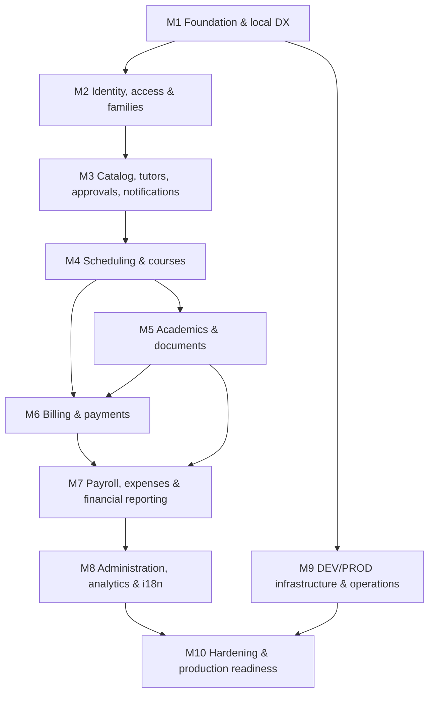

# Classora — Implementation Task Import List

> **ARCHIVED — 2026-10-16. Do not edit or plan from this file.** All 156 tasks were imported as GitHub Issues [#1–#156](https://github.com/JaimeSolisS/classora/issues), with the task ID in each title (for example, `[M1-01]` = #1). Each milestone `M1`–`M10` became a GitHub milestone. **GitHub Issues are now the only active backlog.** This file is kept only as the import record and for the global constraints in §0.3, which the issues link to.
>
> ~~**TEMPORARY IMPORT MATERIAL.**~~ This file seeds GitHub Issues. Once the issues are created and cross-checked, GitHub Issues become the **only** active backlog. At that point, archive or delete this file (see `_docs/guides/agent-driven-guide.md` §2).
>
> **Derived from:** `_docs/spec.md` v1.2 and `_docs/architecture.md` (draft, 2026-10-16).  
> **Scope:** This list adds no product scope. Every task traces to a spec section. The architecture document's §10 resolutions are **PROPOSED**. Tasks that depend on one are blocked by an explicit **decision gate** task until the related ADR is approved.  
> **No code is included.**

---

## 0. How to read this list

### 0.1 Task format

| Field | Meaning |
|---|---|
| **ID** | `M<milestone>-<nn>`. The number is for ordering only; dependencies define the real order. |
| **Labels** | Suggested GitHub labels: `foundation`, `frontend`, `backend`, `database`, `security`, `finance`, `infra`, `testing`, `docs`, `decision`. |
| **Goal** | The observable result once the task is done. |
| **Acceptance criteria** | Checkable outcomes, including at least one failure or authorization case where relevant. |
| **Dependencies** | Task IDs that must be **done** first. |
| **Out of scope** | What is intentionally excluded and which task covers it instead. |
| **Constraints** | Task-specific spec and architecture references, on top of §0.3. |
| **Likely files** | A starting point, not a mandate. |
| **Tests** | The minimum tests the PR must add. |
| **README impact** | The expected outcome of the README gate. The implementer still runs the gate. |

### 0.2 Decision gates

Tasks labeled `decision` produce **ADRs or product decisions only, never code**. They turn PROPOSED resolutions from `_docs/architecture.md` §10 into APPROVED ones. Each needs explicit owner sign-off. If a decision differs from the proposal, update the dependent tasks before starting them.

### 0.3 Constraints that apply to every task

- Follow `_docs/spec.md` and `_docs/architecture.md`. Do **not** add Redis, Celery, RDS, Fargate, email/SMS/WhatsApp to users, online payment processing, CFDI, a CRM, multi-tenancy or a native app.
- Do not add a library or AWS service that the spec doesn't name unless the relevant ADR approves it.
- Enforce authorization **on the server**: role permission **plus** record-level policy. Every endpoint task adds at least one allowed test and one denied test.
- Validate every operation with its own Pydantic schemas. Return errors as RFC 9457 Problem Details with a stable `code`. Use UUID keys and `TIMESTAMPTZ` UTC for instants (calendar dates per ADR-0004).
- Money uses `Decimal` and never floats. Posted financial records are corrected only through adjustments or reversals. Financial mutations are transactional and idempotent.
- Audit important mutations (per `_docs/architecture.md` ISSUE-A3) once the audit infrastructure (M2-04) exists.
- Schema changes are migration-first (Alembic) and expand-and-contract compatible with the previous image.
- Frontend calls go through the generated API client. Every screen has loading, empty and error states. All UI text is externalized for es and en. The target is WCAG 2.2 AA. Financial mutations get no optimistic updates.
- Regenerate the API client whenever the API changes; CI drift checks must pass.
- **Definition of done** (spec §17): acceptance criteria pass, tests exist, permissions, financial invariants and audit are exercised, the contract is in sync, migrations are safe, user-facing states are handled, required docs are updated, and a README verdict is recorded.
- **README gate:** the issue comment and the QA verdict state either `README updated: <sections + verification>` or `README reviewed: no update necessary`.

### 0.4 Milestones and dependency flow

**M9 runs in parallel.** Tasks M9-01 to M9-11 depend only on M1, so DEV can be deployed early and every later milestone ships continuously to DEV. Do not hold infrastructure back until the end.

### 0.5 Decision gate → blocked tasks

| Gate | ADRs / decisions | Blocks |
|---|---|---|
| M1-06 | ADR-0001 versions, ADR-0003 DB connection topology and Procrastinate driver, ADR-0004 money/time/date | M1-07, M1-08, M1-16, M6-02 |
| M2-01 | ADR-0002 module boundaries, ADR-0007 auth/sessions/recovery/delegation, ADR-0008 rate limiting, ISSUE-G2 naming | M2-02 onward |
| M4-01 | ADR-0005 scheduling invariants and recurrence; product: offer deadline, makeup after closures; FullCalendar licence (ISSUE-X2) | M4-02 onward |
| M5-01 | ADR-0009 files (scanner, previews, local emulator) | M5-02 onward |
| M6-01 | ADR-0006 ledger, idempotency, numbering; product: F1, F2, F6, F7; billing section of `_docs/data-model.md`; ADR-0015 server-side i18n | M6-04 onward |
| M7-01 | Payroll section of `_docs/data-model.md` | M7-02 onward |
| M9-01 | ADR-0010 edge, ADR-0011 release, ADR-0012 secrets, ADR-0013 backups, ADR-0014 error tracking and telemetry | M9-02 onward |

---

## M1 — Foundation and local developer experience

#### M1-01 — Empty monorepo, verified local dev setup, readiness endpoint, one passing test
- **Labels:** foundation, backend, infra, testing
- **Goal:** A new developer can clone the repo, run one command, and get a running FastAPI API backed by local PostgreSQL. The API answers liveness and readiness checks, and one automated test passes.
- **Acceptance criteria:**
  - [ ] The tree matches `_docs/spec.md` §11 at the top level (`apps/web`, `apps/api/app/{core,modules,workflows}`, `apps/api/{migrations,tests}`, `packages/api-client`, `infrastructure/{terraform,docker,observability,scripts}`, `e2e`, `.github/workflows`). Empty directories hold a `.gitkeep`. There is no `docs/`, `frontend/` or `backend/` directory.
  - [ ] `make dev` starts PostgreSQL and the API with Docker Compose. `GET /health/live` returns `200` while the process is up.
  - [ ] `GET /health/ready` returns `200` when PostgreSQL is reachable and `503` with a Problem Details body when it is not (verified by stopping the database container).
  - [ ] `make test` runs pytest, and at least one test of `/health/ready` passes.
  - [ ] `.gitignore` excludes `.env`, virtualenvs, `node_modules` and build output. No secrets are committed.
- **Dependencies:** none
- **Out of scope:**
  - Frontend app (M1-04)
  - PgBouncer (M1-08)
  - Alembic and ORM models (M1-07)
  - CI (M1-10)
  - Lint and type tooling beyond what runs the test (M1-03)
- **Constraints:**
  - Spec §10 (FastAPI, uv, Docker Compose, Makefile `dev/test`), spec §11, architecture §9.3 health endpoints.
  - Use the uv-managed Python project in `apps/api`.
  - Health endpoints are not under `/api/v1`.
- **Likely files:** `compose.yaml`, `Makefile`, `apps/api/pyproject.toml`, `apps/api/uv.lock`, `apps/api/app/main.py`, `apps/api/app/core/health.py`, `apps/api/tests/test_health.py`, `infrastructure/docker/api.Dockerfile`, `.gitignore`, `.env.example`
- **Tests:** pytest for `/health/live` and for `/health/ready` with the database up and down (the down case may use a dependency override).
- **README impact:** **Update expected.** Add the one-paragraph description, an honest "pre-alpha" status, prerequisites, the `make dev` and `make test` commands as verified, and links to spec and architecture.

#### M1-02 — Agent and process documentation bootstrap
- **Labels:** docs
- **Goal:** Coding agents and humans share one entry point and one workflow.
- **Acceptance criteria:**
  - [ ] `AGENTS.md` contains the always-on rules from `_docs/guides/agent-driven-guide.md` §6, including the README gate.
  - [ ] `CLAUDE.md` contains only `@AGENTS.md`.
  - [ ] `_docs/process.md`, `_docs/task-template.md` and `_docs/team/{pm,software-engineer,qa-engineer}.md` exist and match the guide.
  - [ ] ISSUE-G1 is resolved in the docs, if approved: spec references point to `_docs/guides/`, and the `mkdir` command in `full-guide.md` no longer creates `_docs/architecture/`.
- **Dependencies:** none
- **Out of scope:** Changing product requirements in `_docs/spec.md` beyond the reference fixes.
- **Constraints:** Spec §17 document roles. Do not duplicate spec content in these documents.
- **Likely files:** `AGENTS.md`, `CLAUDE.md`, `_docs/process.md`, `_docs/task-template.md`, `_docs/team/*.md`, `_docs/spec.md` (references only), `_docs/guides/full-guide.md`
- **Tests:** none (docs). Check links manually.
- **README impact:** **Update likely.** Add links to the agent workflow and contribution guidance.

#### M1-03 — Backend toolchain and quality gates
- **Labels:** foundation, backend, testing
- **Goal:** Backend code is linted, formatted, type-checked and tested with one command each.
- **Acceptance criteria:**
  - [ ] `make lint` runs Ruff check and format-check plus mypy (strict for `app/`) and exits non-zero on a deliberate violation.
  - [ ] `make test` separates unit and integration markers, and coverage is reported.
  - [ ] A pytest fixture strategy for Testcontainers PostgreSQL is in place and used by one integration test.
- **Dependencies:** M1-01
- **Out of scope:** Frontend lint (M1-04), CI wiring (M1-10).
- **Constraints:** Spec §10 tooling (uv, Ruff, mypy) and spec §10 quality (pytest, Testcontainers).
- **Likely files:** `apps/api/pyproject.toml`, `apps/api/tests/conftest.py`, `Makefile`
- **Tests:** an integration test against a Testcontainers database.
- **README impact:** Update the commands section if `make lint` is new to users.

#### M1-04 — Frontend skeleton
- **Labels:** foundation, frontend, testing
- **Goal:** A React + TypeScript + Vite app builds, lints, tests and runs in local Compose.
- **Acceptance criteria:**
  - [ ] `apps/web` uses pnpm, TypeScript `strict`, ESLint and Prettier. `make lint` covers both apps.
  - [ ] One Vitest component test passes as part of `make test`.
  - [ ] `make dev` serves the web app locally, and its placeholder page shows the API's live status.
  - [ ] A production build (`pnpm build`) succeeds with no type errors.
- **Dependencies:** M1-01
- **Out of scope:** Routing, data layer and design system (M1-13, M1-14), i18n (M1-15), production web image (M9-06).
- **Constraints:** Spec §10 frontend stack and tooling. Use a pnpm workspace that includes `packages/api-client`.
- **Likely files:** `apps/web/{package.json,vite.config.ts,tsconfig.json,src/main.tsx,src/App.tsx}`, `pnpm-workspace.yaml`, `compose.yaml`, `Makefile`
- **Tests:** Vitest render test.
- **README impact:** **Update expected.** Add Node/pnpm prerequisites and the web URL.

#### M1-05 — Typed configuration and environment template
- **Labels:** foundation, backend, security
- **Goal:** All runtime configuration is validated at startup, and a missing or invalid value fails fast.
- **Acceptance criteria:**
  - [ ] pydantic-settings defines the settings for the database URL(s), environment name, cookie and security options, and storage.
  - [ ] Starting with a required value missing exits non-zero with a clear message that does not print secret values.
  - [ ] `.env.example` documents every variable with safe placeholders. `.env` is git-ignored.
- **Dependencies:** M1-03
- **Out of scope:** SSM delivery (M9-07).
- **Constraints:** Spec §10 configuration.
- **Likely files:** `apps/api/app/core/config.py`, `.env.example`, `apps/api/tests/unit/test_config.py`
- **Tests:** unit tests for valid, missing and invalid settings.
- **README impact:** Update the configuration section to describe the `.env.example` copy step.

#### M1-06 — Decision gate: versions, database topology, money and time
- **Labels:** decision, docs
- **Goal:** Approve or amend ISSUE-D1, D2, D3, D7, J1 and J2 as ADR-0001, ADR-0003 and ADR-0004.
- **Acceptance criteria:**
  - [ ] ADR files exist in `_docs/adr/` with status `Accepted` or `Rejected` and the owner's sign-off.
  - [ ] `_docs/architecture.md` §10 entries are updated to APPROVED, or rewritten.
  - [ ] The Procrastinate driver support claim has been verified against the pinned version.
- **Dependencies:** none
- **Out of scope:** Implementation.
- **Constraints:** Do not introduce technologies beyond the spec without recording an explicit decision.
- **Likely files:** `_docs/adr/0001-*.md`, `_docs/adr/0003-*.md`, `_docs/adr/0004-*.md`, `_docs/architecture.md`
- **Tests:** none.
- **README impact:** Not expected. Version prerequisites in the README follow from M1-07.

#### M1-07 — Database layer, Unit of Work and Alembic baseline
- **Labels:** foundation, backend, database
- **Goal:** Modules can persist data through async SQLAlchemy inside one transaction per request. Schema changes go through Alembic.
- **Acceptance criteria:**
  - [ ] An async engine and session factory (asyncpg) are in place, plus a Unit of Work dependency that commits on success and rolls back on exception, shown by a test.
  - [ ] A base model provides a UUID primary key, `created_at`/`updated_at` as `TIMESTAMPTZ`, and an optional `version` column for optimistic locking.
  - [ ] The baseline Alembic migration enables the approved extensions (per ADR-0004 and ISSUE-D6). `make migrate` upgrades to head.
  - [ ] `/health/ready` checks database connectivity through the engine.
  - [ ] A naming convention for constraints and indexes is configured so migrations are deterministic.
- **Dependencies:** M1-05, M1-06
- **Out of scope:** Domain tables. PgBouncer (M1-08).
- **Constraints:** Spec §10 ORM, migrations, keys and time. Architecture §5, ISSUE-D3, ISSUE-D7.
- **Likely files:** `apps/api/app/core/db.py`, `apps/api/app/core/uow.py`, `apps/api/app/core/models.py`, `apps/api/migrations/{env.py,versions/0001_baseline.py}`, `apps/api/alembic.ini`
- **Tests:** integration tests for UoW commit and rollback, migration upgrade from empty, and the version-conflict primitive.
- **README impact:** Update to add `make migrate`.

#### M1-08 — PgBouncer and connection topology
- **Labels:** foundation, database, infra
- **Goal:** API traffic goes through PgBouncer. The worker, the LISTEN connection and Alembic connect directly, per ADR-0003.
- **Acceptance criteria:**
  - [ ] Local Compose splits into a **data stack** (PostgreSQL, PgBouncer) and an **app stack**, matching the per-host layout in architecture §9.1.
  - [ ] The API connects through PgBouncer with asyncpg statement caching configured as ADR-0003 specifies. 50 concurrent requests to an endpoint that queries the database succeed without prepared-statement errors.
  - [ ] Settings expose separate URLs for direct and pooled connections. Alembic uses the direct one.
  - [ ] PgBouncer and PostgreSQL ports are not published to the host outside the developer override.
- **Dependencies:** M1-07
- **Out of scope:** Production tuning (M10-04).
- **Constraints:** Spec §10 connection pool and spec §10 deployment. Architecture ISSUE-D1.
- **Likely files:** `compose.yaml` (or `infrastructure/docker/compose.data.yaml` and `compose.app.yaml`), `infrastructure/docker/pgbouncer/*`, `apps/api/app/core/db.py`
- **Tests:** an integration concurrency test through PgBouncer.
- **README impact:** Update if Compose commands or files change.

#### M1-09 — API conventions: errors, request IDs, logging, pagination
- **Labels:** foundation, backend
- **Goal:** Every endpoint shares the same error, tracing and pagination behavior.
- **Acceptance criteria:**
  - [ ] Unhandled exceptions, validation errors and domain errors render as RFC 9457 bodies with `type`, `title`, `status`, `code`, `request_id` and, where relevant, `errors[]` with field paths.
  - [ ] An `X-Request-ID` header is accepted or generated and echoed back, and it appears in every log line.
  - [ ] Logs are structured JSON. Configured sensitive keys are redacted, including passwords and tokens.
  - [ ] Helpers exist for offset and cursor pagination and for a `version_conflict` (409) error.
  - [ ] Internal error details are never exposed to clients in non-local environments.
- **Dependencies:** M1-03
- **Out of scope:** OTel tracing export (M9-14).
- **Constraints:** Spec §10 API errors, pagination and versioning. Architecture §4.3, §4.4 and ISSUE-D5.
- **Likely files:** `apps/api/app/core/{errors.py,logging.py,middleware.py,pagination.py}`
- **Tests:** unit and integration tests for each error type, request ID propagation, redaction and pagination boundaries.
- **README impact:** Not expected.

#### M1-10 — CI pipeline for pull requests
- **Labels:** foundation, testing, infra
- **Goal:** Every PR runs lint, types, tests, migrations and build checks automatically.
- **Acceptance criteria:**
  - [ ] A GitHub Actions workflow runs on PRs: backend lint and types, backend unit and integration tests (Testcontainers), frontend lint, type-check, Vitest and build.
  - [ ] A migration check upgrades an empty database to head and fails if model metadata and migrations differ (autogenerate diff is empty).
  - [ ] Path filters skip unaffected jobs, but a required aggregate status check always reports.
  - [ ] Dependency caches for uv and pnpm are configured. A typical PR runs in under 10 minutes; record the measurement.
- **Dependencies:** M1-03, M1-04, M1-07
- **Out of scope:** Security scanning (M1-11), E2E (M1-18), image build and deploy (M9-06).
- **Constraints:** Spec §10 CI/CD and spec W8.1.
- **Likely files:** `.github/workflows/ci.yml`
- **Tests:** CI itself. A deliberately failing lint, test or migration PR must block the merge.
- **README impact:** Update to add a CI badge or status line if desired. Otherwise no update.

#### M1-11 — CI security scanning
- **Labels:** security, testing, infra
- **Goal:** PRs are scanned for vulnerable dependencies, leaked secrets and insecure code patterns.
- **Acceptance criteria:**
  - [ ] Dependency scanning covers Python and npm.
  - [ ] Secret detection runs over the diff and the full history.
  - [ ] Static security analysis covers Python and TypeScript. Container image scanning is ready to attach to M9-06.
  - [ ] The tool choices are recorded in an ADR and use only CI tooling, with no runtime technology added.
  - [ ] A planted dummy secret in a test branch fails the check.
- **Dependencies:** M1-10
- **Out of scope:** Penetration testing (M10-02).
- **Constraints:** Spec §10 quality and security.
- **Likely files:** `.github/workflows/security.yml`, `_docs/adr/00xx-ci-security-tooling.md`
- **Tests:** a negative test with the planted secret and a known-vulnerable package pin on a throwaway branch.
- **README impact:** Not expected.

#### M1-12 — OpenAPI export, generated client and drift check
- **Labels:** foundation, backend, frontend
- **Goal:** The frontend consumes a typed client generated from the FastAPI OpenAPI document, and CI catches any drift.
- **Acceptance criteria:**
  - [ ] A `make api-client` target exports the OpenAPI document without a running server and regenerates `packages/api-client`.
  - [ ] The web app calls `/health/live` through the generated client.
  - [ ] CI fails if regenerating the client produces a diff.
  - [ ] `_docs/api.md` documents the conventions: paths, errors, pagination, versions, idempotency header and money as strings.
- **Dependencies:** M1-04, M1-09, M1-10
- **Out of scope:** Domain endpoints.
- **Constraints:** Spec §10 API contracts. Architecture ISSUE-X4. Generator choice per that issue's approval.
- **Likely files:** `packages/api-client/*`, `apps/api/app/core/openapi.py`, `Makefile`, `.github/workflows/ci.yml`, `_docs/api.md`
- **Tests:** a CI drift job and a Vitest test that uses the client with a mocked fetch.
- **README impact:** Update to add `make api-client`.

#### M1-13 — Frontend app shell and data layer
- **Labels:** frontend
- **Goal:** A routed SPA shell with server-state caching, UI state and centralized error handling.
- **Acceptance criteria:**
  - [ ] React Router has a layout route and a 404 page. A placeholder for route guards exists, with real guards added in M2-10.
  - [ ] A TanStack Query client provides default retry rules: no retry on 4xx and never on mutations. A Zustand store holds UI state only.
  - [ ] A central error handler maps Problem Details `code` values to translatable messages and shows the request ID for support. An error boundary covers render failures.
  - [ ] Skeleton and loading primitives are shown in Storybook (after M1-14) or a demo route.
- **Dependencies:** M1-12
- **Out of scope:** Authentication (M2-10), i18n catalogs (M1-15).
- **Constraints:** Spec §10 routing and state/data, spec §10 frontend error handling.
- **Likely files:** `apps/web/src/{app/router.tsx,app/queryClient.ts,app/errors.ts,stores/ui.ts,components/feedback/*}`
- **Tests:** Vitest tests for error mapping, the retry policy and the error boundary.
- **README impact:** Not expected.

#### M1-14 — Design system foundation
- **Labels:** frontend
- **Goal:** Shared tokens, themes and documented components.
- **Acceptance criteria:**
  - [ ] Tailwind and shadcn/ui are configured, and the design tokens are defined centrally (color, spacing, typography, radius).
  - [ ] Light, dark and system themes switch without reload. Contrast meets AA, as verified by the automated check.
  - [ ] Storybook runs (`make storybook` or `pnpm storybook`) with at least Button, Input, Dialog, Table and Skeleton stories, plus an accessibility addon check.
  - [ ] `_docs/design-system.md` describes the tokens, theming and role-adaptive layout principles.
- **Dependencies:** M1-04
- **Out of scope:** Persisting the theme preference in the database (M2-18).
- **Constraints:** Spec §10 UI, spec §10 quality (WCAG 2.2 AA, Storybook, tokens).
- **Likely files:** `apps/web/tailwind.config.*`, `apps/web/src/styles/tokens.css`, `apps/web/src/components/ui/*`, `apps/web/.storybook/*`, `_docs/design-system.md`
- **Tests:** Storybook accessibility checks and a Vitest theme toggle test.
- **README impact:** Update to add the Storybook command.

#### M1-15 — Internationalization and time foundation
- **Labels:** frontend
- **Goal:** The UI renders in Spanish or English with correct date and time handling in the center's time zone.
- **Acceptance criteria:**
  - [ ] react-i18next is set up with `es` and `en` namespaces. The language switcher persists locally until M2-18.
  - [ ] date-fns locales and date-fns-tz helpers format instants in a configured time zone. There is a utility that never derives local dates from UTC dates.
  - [ ] A CI check fails on missing translation keys between `es` and `en`.
  - [ ] Money is formatted with `Intl.NumberFormat` for MXN from string values (ADR-0004).
- **Dependencies:** M1-13, M1-06
- **Out of scope:** Server-side i18n (M6-13, ADR-0015).
- **Constraints:** Spec §10 i18n and dates, spec §16 time. Architecture ISSUE-D2 and ISSUE-D3.
- **Likely files:** `apps/web/src/i18n/*`, `apps/web/src/lib/{time.ts,money.ts}`
- **Tests:** Vitest for tz boundaries (for example, 23:30 local vs UTC date), money formatting and the missing-key check.
- **README impact:** Not expected.

#### M1-16 — Procrastinate worker container
- **Labels:** foundation, backend, infra
- **Goal:** Background and periodic jobs run in a separate worker container built from the API codebase.
- **Acceptance criteria:**
  - [ ] Procrastinate's schema is applied through the migration path chosen in ADR-0003.
  - [ ] A `worker` service in Compose runs the worker using the same image as the API.
  - [ ] A demo task can be deferred from an API endpoint (local and DEV only) and completes. A periodic demo task runs on schedule with deduplication (ISSUE-J2).
  - [ ] A failing task retries according to its configured policy and is then marked failed and stays queryable after a worker restart (W7.3).
  - [ ] The worker shuts down gracefully within a configured timeout.
  - [ ] Task arguments carry IDs only, never personal data (ISSUE-J3).
- **Dependencies:** M1-08
- **Out of scope:** Failed-job admin UI (M8-11), business jobs.
- **Constraints:** Spec §10 background work, spec W7. Architecture §6, ISSUE-J1 and ISSUE-J2.
- **Likely files:** `apps/api/app/core/jobs.py`, `apps/api/app/worker.py`, `compose.yaml`, `apps/api/migrations/versions/*`
- **Tests:** integration tests for defer and execute, retry then fail, persistence across a restart, and periodic deduplication with two workers.
- **README impact:** **Update expected.** Describe the worker service and how to see its logs.

#### M1-17 — Seeds and test factories
- **Labels:** foundation, backend, testing
- **Goal:** Reference data can be seeded idempotently, and realistic demo or test data can be generated.
- **Acceptance criteria:**
  - [ ] `make seed` runs reference seeds idempotently: running it twice gives the same row counts.
  - [ ] A Factory Boy and Faker base exists with locale-aware (es_MX) generation. A separate demo-data command refuses to run when `ENV=prod`.
- **Dependencies:** M1-07
- **Out of scope:** Domain-specific factories (added with each domain task).
- **Constraints:** Spec §10 seed/test data. DEV uses synthetic data only (ISSUE-I7).
- **Likely files:** `apps/api/app/seeds/*`, `apps/api/tests/factories/*`, `Makefile`
- **Tests:** an idempotency test and a production-guard test.
- **README impact:** Update to add `make seed`.

#### M1-18 — Testing guidelines and E2E harness
- **Labels:** testing, docs
- **Goal:** QA has written rules and a working Playwright pipeline against a seeded app.
- **Acceptance criteria:**
  - [ ] `_docs/testing-guidelines.md` covers test layers, fixtures, the permission-matrix approach, financial invariant tests and E2E data rules.
  - [ ] `e2e/` contains a Playwright smoke test (app loads, API is live) and an automated accessibility scan of the shell.
  - [ ] CI runs E2E against the app built in Compose with seeded fixtures. Failures upload traces.
- **Dependencies:** M1-10, M1-13, M1-17
- **Out of scope:** Feature E2E (added per task), full W1–W8 coverage (M10-06).
- **Constraints:** Spec §10 quality (Playwright, accessibility tests, E2E with seeded fixtures).
- **Likely files:** `_docs/testing-guidelines.md`, `e2e/{playwright.config.ts,tests/smoke.spec.ts}`, `.github/workflows/e2e.yml`
- **Tests:** the smoke and accessibility E2E.
- **README impact:** Update to add `make e2e`.

---

## M2 — Identity, access and families

#### M2-01 — Decision gate: auth, sessions, recovery, delegation, rate limits, boundaries
- **Labels:** decision, security, docs
- **Goal:** Approve or amend ISSUE-A1, G2, S1–S7 as ADR-0002, ADR-0007 and ADR-0008. This includes the password hashing algorithm, session timeouts, the reauthentication list, the out-of-band recovery delivery method and the delegable permissions.
- **Acceptance criteria:**
  - [ ] The ADRs are accepted with owner sign-off.
  - [ ] Product decisions on S1, S5 and S6 are recorded.
  - [ ] The architecture document is updated.
- **Dependencies:** none
- **Out of scope:** Implementation.
- **Constraints:** No outbound email unless the scope is explicitly changed (spec §1, §14).
- **Likely files:** `_docs/adr/0002-*.md`, `_docs/adr/0007-*.md`, `_docs/adr/0008-*.md`, `_docs/architecture.md`
- **Tests:** none.
- **README impact:** Not expected.

#### M2-02 — Users, roles and permissions model
- **Labels:** backend, database, security
- **Goal:** Users can hold one or more predefined roles. Permissions are code-defined, and delegable permissions can be granted per user.
- **Acceptance criteria:**
  - [ ] Tables and migration for users (with states `pending`, `active`, `suspended`, `archived`), roles, permissions, user roles and per-user delegated permissions.
  - [ ] Reference seeds create the seven spec roles (Owner, Administrator, Academic Coordinator, Finance Staff, Tutor, Student, Parent/Guardian) and their permission sets. Seeding is idempotent.
  - [ ] Effective permissions are the union of the user's roles plus delegations. Only the Owner can grant delegable permissions.
  - [ ] An initial Owner bootstrap command exists and works only when no Owner exists yet.
- **Dependencies:** M1-07, M1-17, M2-01
- **Out of scope:** Login (M2-05), admin UI (M2-13).
- **Constraints:** Spec §2. Architecture ISSUE-S2, ISSUE-F7 (permission names), ISSUE-G2 (`AuthSession` naming).
- **Likely files:** `apps/api/app/modules/identity/{models.py,service.py,permissions.py}`, `apps/api/app/seeds/roles.py`, migration
- **Tests:** unit tests for permission resolution, seed idempotency, Owner-only delegation and the bootstrap guard.
- **README impact:** Update to document the Owner bootstrap command.

#### M2-03 — Authorization framework and permission matrix
- **Labels:** backend, security, testing
- **Goal:** Endpoints declare the required permission and a record-level policy, and tests verify both systematically.
- **Acceptance criteria:**
  - [ ] A FastAPI dependency `require(permission)` exists, along with a record-policy interface used by services (`can_view_student(user, student)` style).
  - [ ] A machine-readable permission matrix (role × endpoint × expected outcome) lives in the test suite.
  - [ ] A parametrized test runs the matrix against every registered route. A route with no matrix entry fails CI.
  - [ ] Denials return `403` with Problem Details. Records that exist but are not visible return `404` to avoid existence leaks; this rule is documented.
- **Dependencies:** M2-02
- **Out of scope:** Domain policies (added per domain).
- **Constraints:** Spec §2, §9 and §16 permissions, spec §10 automated authorization tests.
- **Likely files:** `apps/api/app/core/authz.py`, `apps/api/tests/authz/{matrix.yaml,test_matrix.py}`
- **Tests:** the matrix test itself, plus unit tests for the dependency.
- **README impact:** Not expected.

#### M2-04 — Audit event infrastructure
- **Labels:** backend, database, security
- **Goal:** Mutations to audited models automatically record actor, action, timestamp, request ID and prior/new values in the same transaction.
- **Acceptance criteria:**
  - [ ] An append-only `audit_events` table. The application database role cannot UPDATE or DELETE rows, as a test proves.
  - [ ] An `Audited` marker on models produces JSON diffs on insert, update and soft-delete. Excluded fields (secrets, password hashes) never appear.
  - [ ] If the business transaction rolls back, no audit row persists.
  - [ ] Cursor-paginated query API by record, actor and time range, behind an audit-view permission.
- **Dependencies:** M1-07, M1-09, M2-03
- **Out of scope:** Audit viewer UI (M8-03).
- **Constraints:** Spec §9 audit, spec §16 historical truth. Architecture ISSUE-A3.
- **Likely files:** `apps/api/app/modules/administration/audit/*`, `apps/api/app/core/uow.py`, migration
- **Tests:** integration tests for the diff, rollback, the privilege restriction and redaction.
- **README impact:** Not expected.

#### M2-05 — Login, logout and server sessions
- **Labels:** backend, security
- **Goal:** Users authenticate with a password and receive an HTTP-only session cookie backed by PostgreSQL.
- **Acceptance criteria:**
  - [ ] `POST /api/v1/auth/login` verifies the password with the ADR-0007 hash. Only `active` users succeed. Error messages do not reveal whether an account exists.
  - [ ] On success, the server creates an `AuthSession` row that stores only a hash of the token, and sets the cookie with the ADR-0007 attributes. The session ID is rotated on login.
  - [ ] `POST /api/v1/auth/logout` revokes the session server-side. `GET /api/v1/auth/me` returns the user, roles, effective permissions and preferences.
  - [ ] Login attempts are audited.
- **Dependencies:** M2-02, M2-04
- **Out of scope:** CSRF (M2-06), expiry (M2-07), rate limits (M2-09), UI (M2-10).
- **Constraints:** Spec §10 session store and security. Architecture ISSUE-S4.
- **Likely files:** `apps/api/app/modules/identity/{auth_router.py,sessions.py,passwords.py}`, migration
- **Tests:** integration tests for success, wrong password, suspended user, cookie flags, session fixation (ID rotated) and logout revocation.
- **README impact:** Update to explain how to log in locally with the seeded Owner.

#### M2-06 — CSRF protection and security headers
- **Labels:** backend, security
- **Goal:** Unsafe requests require a valid CSRF token and an allowed Origin. Responses carry baseline security headers.
- **Acceptance criteria:**
  - [ ] POST, PUT, PATCH and DELETE without a valid `X-CSRF-Token` or with a foreign `Origin` return `403`.
  - [ ] The token is issued with the session and exposed to the SPA through the ADR-0007 mechanism.
  - [ ] API responses set `Cache-Control: no-store` and `X-Content-Type-Options`. The CSP and frame-ancestors policy for the SPA is documented and enforced in Caddy, or in a local proxy for now.
- **Dependencies:** M2-05
- **Out of scope:** Edge headers in production (M9-09).
- **Constraints:** Spec §10 security (CSRF).
- **Likely files:** `apps/api/app/core/csrf.py`, `apps/api/app/core/middleware.py`
- **Tests:** integration tests for a missing token, a wrong token, a foreign Origin and the valid path.
- **README impact:** Not expected.

#### M2-07 — Session lifecycle and user states
- **Labels:** backend, security
- **Goal:** Sessions expire and can be revoked. User state changes immediately affect access while history is preserved.
- **Acceptance criteria:**
  - [ ] Idle and absolute timeouts follow ADR-0007 per role class. An expired session returns `401` with code `session_expired`.
  - [ ] Suspending or archiving a user, changing their password, or changing their roles revokes all of that user's sessions.
  - [ ] Archived users keep their historical records and audit references; there is no cascade delete.
  - [ ] A periodic job purges expired session rows.
- **Dependencies:** M2-05, M1-16
- **Out of scope:** Admin UI (M2-13).
- **Constraints:** Spec §2 user states, spec §10 session expiration and revocation.
- **Likely files:** `apps/api/app/modules/identity/{sessions.py,service.py,tasks.py}`
- **Tests:** integration tests with a time-travel fixture for expiry, a revocation test per trigger, and a purge job test.
- **README impact:** Not expected.

#### M2-08 — Reauthentication for sensitive actions
- **Labels:** backend, security
- **Goal:** Endpoints flagged as sensitive require a recent password confirmation.
- **Acceptance criteria:**
  - [ ] `POST /api/v1/auth/reauthenticate` marks the session as reauthenticated for the ADR window (proposed 5 minutes).
  - [ ] A `require_recent_auth` dependency returns `403` with code `reauth_required` when the session is not recently reauthenticated.
  - [ ] The ADR-0007 sensitive action list is registered. The permission matrix test asserts that each listed endpoint uses the dependency.
- **Dependencies:** M2-05
- **Out of scope:** The frontend dialog (M2-10).
- **Constraints:** Spec §2 and §10 reauthentication. Architecture ISSUE-S5.
- **Likely files:** `apps/api/app/core/authz.py`, `apps/api/app/modules/identity/auth_router.py`
- **Tests:** integration tests for the window boundary and wrong-password attempts (counted by M2-09).
- **README impact:** Not expected.

#### M2-09 — Rate limiting for authentication endpoints
- **Labels:** backend, security
- **Goal:** Brute force against the login, reauthentication, token redemption and registration endpoints is throttled correctly across API processes without Redis.
- **Acceptance criteria:**
  - [ ] PostgreSQL-backed counters keyed by client IP and account, with ADR-0008 thresholds. Exceeding a limit returns `429` with `Retry-After`.
  - [ ] Two API worker processes share the limit, verified by a test.
  - [ ] The client IP comes only from trusted proxy headers (configurable list). An untrusted `X-Forwarded-For` is ignored.
  - [ ] A periodic job cleans up old counters.
- **Dependencies:** M2-05, M1-16
- **Out of scope:** General API limits and Caddy module (per ADR-0008, M9-09).
- **Constraints:** Spec §10 rate limits, spec §18.4. Architecture ISSUE-S3.
- **Likely files:** `apps/api/app/core/ratelimit.py`, migration
- **Tests:** integration tests for the threshold, the window reset, multi-process behavior and spoofed headers.
- **README impact:** Not expected.

#### M2-10 — Frontend authentication and guarded routes
- **Labels:** frontend, security
- **Goal:** Users log in, see navigation for their roles, and are prompted to reauthenticate or log in again when the server requires it.
- **Acceptance criteria:**
  - [ ] The login page meets WCAG requirements (labels, errors, keyboard) and is available in es and en.
  - [ ] Session bootstrap calls `/auth/me`. Route guards hide navigation and routes the user's permissions don't allow; this is for UX only.
  - [ ] A `session_expired` response redirects to login and preserves the return path. A `reauth_required` response opens a password dialog and retries the original request once.
  - [ ] Logout clears the query cache.
- **Dependencies:** M2-05, M2-06, M2-08, M1-13, M1-15
- **Out of scope:** Registration and recovery UI (M2-11, M2-12).
- **Constraints:** Spec §10 routing (guarded views), spec §16 (never rely on the frontend alone).
- **Likely files:** `apps/web/src/features/auth/*`, `apps/web/src/app/router.tsx`
- **Tests:** Vitest for the guard and the reauth retry. Playwright for login, logout and wrong password.
- **README impact:** Not expected.

#### M2-11 — Invitations and self-registration requests
- **Labels:** backend, frontend, security
- **Goal:** Admins invite users, and people can request an account that an administrator then approves. No email is sent.
- **Acceptance criteria:**
  - [ ] An admin creates an invitation for a role. The system produces a single-use, time-limited token shown as a link or QR code for out-of-band delivery (ADR-0007). Only the token hash is stored.
  - [ ] Redeeming the token sets a password and activates the account. Reuse or expiry returns `410`.
  - [ ] A self-registration request creates a `pending` user and an approval-inbox entry (a simple list until M3-04). An admin approves or rejects it.
  - [ ] Registration never enrolls a student in anything (spec §9).
  - [ ] Everything is audited.
- **Dependencies:** M2-05, M2-04, M2-09
- **Out of scope:** Linking guardians to students (M2-16).
- **Constraints:** Spec §9 registration. Architecture ISSUE-S1.
- **Likely files:** `apps/api/app/modules/identity/invitations.py`, `apps/web/src/features/auth/{redeem,register}/*`
- **Tests:** integration tests for redemption, reuse, expiry and approve/reject. E2E for the invite-to-login flow.
- **README impact:** Not expected.

#### M2-12 — Staff-issued password reset
- **Labels:** backend, frontend, security
- **Goal:** Authorized staff can issue a one-time reset token for a user, to be delivered out of band.
- **Acceptance criteria:**
  - [ ] Issuing a token requires the permission and recent reauthentication. The token is single-use and expires per ADR-0007.
  - [ ] Redeeming it sets a new password and revokes every session for that user.
  - [ ] Staff cannot see or set the password themselves.
  - [ ] Issuing and redeeming are audited.
- **Dependencies:** M2-11, M2-08, M2-07
- **Out of scope:** Self-service email reset (not in scope).
- **Constraints:** Spec §14 and §18.2. Architecture ISSUE-S1.
- **Likely files:** `apps/api/app/modules/identity/recovery.py`, `apps/web/src/features/auth/reset/*`
- **Tests:** integration tests for permission, reauthentication, single use and session revocation.
- **README impact:** Not expected.

#### M2-13 — User administration
- **Labels:** backend, frontend, security
- **Goal:** Owner and Administrators manage users, roles, delegations and states.
- **Acceptance criteria:**
  - [ ] The user list is searchable and filterable by role and state, with offset pagination.
  - [ ] Role assignment and changes to delegated permissions require reauthentication. Only the Owner can delegate. The last active Owner cannot be removed or suspended.
  - [ ] Suspend, archive and reactivate actions revoke sessions as defined in M2-07.
  - [ ] Every change is audited and protected by optimistic version checks.
- **Dependencies:** M2-03, M2-04, M2-07, M2-08, M2-10, M2-11
- **Out of scope:** Imports (M8-05).
- **Constraints:** Spec §2 and §9. Architecture ISSUE-S2.
- **Likely files:** `apps/api/app/modules/identity/admin_router.py`, `apps/web/src/features/users/*`
- **Tests:** authorization matrix rows, a last-Owner guard test and E2E for suspending a user (who then loses access).
- **README impact:** Not expected.

#### M2-14 — Catalog: education levels and subjects
- **Labels:** backend, frontend, database
- **Goal:** Admins maintain education levels and subjects per level.
- **Acceptance criteria:**
  - [ ] CRUD with deactivation instead of hard delete. Names are unique per level.
  - [ ] Reference seeds provide example levels (elementary, middle school, high school, university).
  - [ ] Read access for all authenticated users. Write access requires the catalog permission.
- **Dependencies:** M2-03, M2-04
- **Out of scope:** Pricing (M6-04).
- **Constraints:** Spec §4 subject catalog.
- **Likely files:** `apps/api/app/modules/catalog/*`, `apps/web/src/features/catalog/*`
- **Tests:** integration tests for uniqueness and deactivation, plus matrix rows.
- **README impact:** Not expected.

#### M2-15 — Student profiles and emergency contacts
- **Labels:** backend, frontend, database
- **Goal:** Staff create and maintain student academic profiles, whether or not the student has a login.
- **Acceptance criteria:**
  - [ ] Profile fields: personal and contact details, school information, education level, and emergency contacts (one or more).
  - [ ] Fuzzy search by name uses trigram and unaccent. Results are paginated.
  - [ ] Staff roles can view and edit according to the matrix. Tutors see only students they are assigned to (the policy is stubbed until M4 and tested with fixtures).
  - [ ] Edits are audited and use optimistic version checks.
- **Dependencies:** M2-14, M2-04
- **Out of scope:** Documents (M5-08), student login (M2-17).
- **Constraints:** Spec §4 student profile, spec §16 privacy (minimize exposure). Architecture ISSUE-D6.
- **Likely files:** `apps/api/app/modules/families/{students.py,models.py,router.py}`, `apps/web/src/features/students/*`
- **Tests:** integration tests for CRUD, search with accents and version conflicts. Matrix rows.
- **README impact:** Not expected.

#### M2-16 — Guardians, family accounts and student links
- **Labels:** backend, frontend, security
- **Goal:** One guardian can be linked to several children, and one child to several guardians. Guardians see only their linked children.
- **Acceptance criteria:**
  - [ ] Guardian profiles, a family grouping that will later own the billing account, and an explicit student–guardian link with relationship type.
  - [ ] The guardian record policy grants access only to linked children. Requests for other students return `404`.
  - [ ] An admin can link and unlink, and unlinking revokes access immediately.
  - [ ] Changes are audited.
- **Dependencies:** M2-15, M2-11
- **Out of scope:** Billing account (M6-05), consent (M2-17).
- **Constraints:** Spec §2 Parent/Guardian, spec §16 identifiers and relations.
- **Likely files:** `apps/api/app/modules/families/{guardians.py,links.py}`, `apps/web/src/features/families/*`
- **Tests:** an IDOR test (a guardian of family A requests a student in family B), plus multi-guardian and multi-child cases.
- **README impact:** Not expected.

#### M2-17 — Consent, privacy notice and optional student login
- **Labels:** backend, frontend, security
- **Goal:** Consent and privacy-notice acceptance are recorded, and student logins respect the rules for minors and adults.
- **Acceptance criteria:**
  - [ ] Consent records store who, when, which notice version and the scope. Privacy-notice acceptance is required at first login and again whenever the notice version changes.
  - [ ] Creating a login for a minor student requires a linked guardian's consent (ISSUE-S7).
  - [ ] For adult students, guardians get academic visibility only with recorded student consent. Billing visibility is unaffected (ISSUE-S6, as approved).
  - [ ] Student users see only their own records.
- **Dependencies:** M2-16, M2-11
- **Out of scope:** Final legal wording (M10-07).
- **Constraints:** Spec §2 Student, spec §9 privacy. Architecture ISSUE-S6 and ISSUE-S7.
- **Likely files:** `apps/api/app/modules/families/consent.py`, `apps/web/src/features/consent/*`
- **Tests:** integration tests for a minor without consent (blocked), an adult with and without consent, and a notice version bump forcing re-acceptance.
- **README impact:** Not expected.

#### M2-18 — User preferences
- **Labels:** backend, frontend
- **Goal:** Language and theme preferences persist per user in the database.
- **Acceptance criteria:**
  - [ ] A preferences endpoint, included in `/auth/me`, stores language and theme. The UI applies them at login.
  - [ ] The local preference from M1-15 migrates to the server preference after the first login.
- **Dependencies:** M2-10, M1-14, M1-15
- **Out of scope:** Notification preferences (M8-02), dashboard layout (M8-10).
- **Constraints:** Spec §10 database-backed user preferences.
- **Likely files:** `apps/api/app/modules/identity/preferences.py`, `apps/web/src/features/preferences/*`
- **Tests:** integration and Vitest tests.
- **README impact:** Not expected.

---

## M3 — Catalog, tutors, approvals and notifications

#### M3-01 — Business settings core
- **Labels:** backend, frontend
- **Goal:** Central settings exist for brand basics, operating hours and the center time zone.
- **Acceptance criteria:**
  - [ ] Typed settings are stored in the database. Changes are audited and need the settings permission.
  - [ ] The center time zone defaults to `America/Mexico_City`. Changing it once scheduled data exists is blocked with code `tz_change_requires_migration` (ISSUE-D3).
  - [ ] The frontend reads the time zone for all scheduling displays.
- **Dependencies:** M2-03, M2-04
- **Out of scope:** Payment methods, receipt templates and policies (M4-16, M8-04).
- **Constraints:** Spec §9 central settings, spec §16 time.
- **Likely files:** `apps/api/app/modules/administration/settings/*`, `apps/web/src/features/settings/*`
- **Tests:** integration tests for the time-zone guard. Matrix rows.
- **README impact:** Not expected.

#### M3-02 — Academic periods, holidays and closures
- **Labels:** backend, frontend
- **Goal:** Admins define academic periods and center-wide holidays, closures and vacation periods.
- **Acceptance criteria:**
  - [ ] Periods use `DATE` ranges and cannot overlap within a type, enforced by a constraint.
  - [ ] Closures use `DATE` ranges in the center time zone. An API answers "is the center closed on local date X?".
  - [ ] Edits are audited.
- **Dependencies:** M3-01
- **Out of scope:** Effect on recurrence (M4-08).
- **Constraints:** Spec §3 holidays and closures, spec §4 academic periods. Architecture ISSUE-D3.
- **Likely files:** `apps/api/app/modules/catalog/{periods.py,closures.py}`
- **Tests:** integration tests for overlap rejection and local-date boundary cases.
- **README impact:** Not expected.

#### M3-03 — Classrooms catalog
- **Labels:** backend, frontend
- **Goal:** A basic classroom catalog with name, capacity and availability.
- **Acceptance criteria:**
  - [ ] CRUD with deactivation. Capacity must be a positive integer, enforced by a check constraint.
  - [ ] Availability windows per room.
  - [ ] There is no equipment inventory (spec §3).
- **Dependencies:** M2-03, M2-04
- **Out of scope:** Booking checks (M4-02).
- **Constraints:** Spec §3 classroom catalog.
- **Likely files:** `apps/api/app/modules/catalog/classrooms.py`, `apps/web/src/features/classrooms/*`
- **Tests:** integration tests for constraints. Matrix rows.
- **README impact:** Not expected.

#### M3-04 — Approval inbox core
- **Labels:** backend, frontend
- **Goal:** A generic approval request model that every approval workflow plugs into.
- **Acceptance criteria:**
  - [ ] An approval request has type, subject reference, requester, assignee, status (`pending`, `approved`, `rejected`, `changes_requested`, `cancelled`), priority and timestamps.
  - [ ] Each type has a handler interface for approve and reject, which runs inside the subject's Unit of Work. Transitions are validated, and a request cannot be approved twice.
  - [ ] An inbox API filters by assignee, type and status according to the user's permissions.
  - [ ] Self-registration (M2-11) migrates to this model.
- **Dependencies:** M2-03, M2-04, M2-11
- **Out of scope:** Full inbox UI (M8-01). A basic list view is enough here.
- **Constraints:** Spec §9 approval inbox.
- **Likely files:** `apps/api/app/modules/administration/approvals/*`, `apps/web/src/features/approvals/*`
- **Tests:** integration tests for the state machine, a concurrent double-approve (exactly one succeeds) and permission filtering.
- **README impact:** Not expected.

#### M3-05 — Notifications: persistence, list and read state
- **Labels:** backend, frontend
- **Goal:** Users receive in-app notifications with read and unread state.
- **Acceptance criteria:**
  - [ ] Notifications are stored as `{type, params}` (ISSUE-X1) for one recipient. A service function creates them inside the caller's transaction.
  - [ ] Users can list notifications (cursor pagination), mark one or all as read, and get an unread count.
  - [ ] A notification bell polls through TanStack Query and renders messages from i18n keys.
  - [ ] Users see only their own notifications.
- **Dependencies:** M2-03, M2-10
- **Out of scope:** Live delivery (M3-06), preferences (M8-02).
- **Constraints:** Spec §1 and §9 (in-app only).
- **Likely files:** `apps/api/app/modules/administration/notifications/*`, `apps/web/src/features/notifications/*`
- **Tests:** integration tests for ownership and read state. Vitest for rendering in es and en.
- **README impact:** Not expected.

#### M3-06 — Live notifications over SSE
- **Labels:** backend, frontend, infra
- **Goal:** New notifications appear without polling.
- **Acceptance criteria:**
  - [ ] `NOTIFY` is issued in the creating transaction with `{user_id, notification_id}` only.
  - [ ] Each API process holds one direct LISTEN connection and fans out to authenticated SSE subscribers (ISSUE-N1).
  - [ ] A heartbeat goes out every 15 seconds. The client reconnects with `Last-Event-ID` and falls back to polling.
  - [ ] A user never receives events for another user, verified with two subscribers.
  - [ ] If the LISTEN connection drops, it reconnects without the API restarting.
- **Dependencies:** M3-05, M1-08
- **Out of scope:** CloudFront and Caddy timeout tuning (M9-09, M9-10).
- **Constraints:** Spec §10 notifications, spec §18.4. Architecture ISSUE-D1 and ISSUE-N1.
- **Likely files:** `apps/api/app/modules/administration/notifications/{sse.py,listener.py}`, `apps/web/src/features/notifications/useLiveNotifications.ts`
- **Tests:** integration tests for delivery, isolation and listener reconnection. A Playwright test that a notification appears live.
- **README impact:** Not expected.

#### M3-07 — Tutor profiles
- **Labels:** backend, frontend
- **Goal:** Tutor profiles are linked to tutor users, can be managed by admins and are partly self-editable.
- **Acceptance criteria:**
  - [ ] Profile fields: contact details, professional experience and teaching subjects/levels (read-only, derived from approved qualifications).
  - [ ] Tutors can edit allowed fields on their own profile only. Admins can edit everything.
  - [ ] Edits are audited.
- **Dependencies:** M2-11, M2-14
- **Out of scope:** Supporting documents (M5-08), compensation (M7-02).
- **Constraints:** Spec §4 tutor profile.
- **Likely files:** `apps/api/app/modules/staff/*`, `apps/web/src/features/tutors/*`
- **Tests:** integration and matrix tests, plus an IDOR test where one tutor edits another tutor's profile.
- **README impact:** Not expected.

#### M3-08 — Tutor qualification requests and approval
- **Labels:** backend, frontend
- **Goal:** Tutors request subject and education-level qualifications, and administrators approve them.
- **Acceptance criteria:**
  - [ ] A request creates an approval item. Approval creates a qualification record (tutor, subject, level) and rejection records a reason.
  - [ ] Duplicate active qualifications are prevented by a constraint.
  - [ ] The tutor receives a notification of the decision.
  - [ ] Only approved qualifications count for eligibility (used in M4-06).
- **Dependencies:** M3-07, M3-04, M3-05
- **Out of scope:** Recommendations (M4-06).
- **Constraints:** Spec §3 qualifications, spec §16 explicit qualification relationships.
- **Likely files:** `apps/api/app/modules/staff/qualifications.py`, `apps/web/src/features/tutors/qualifications/*`
- **Tests:** integration tests for approve, reject and duplicate. Matrix rows.
- **README impact:** Not expected.

#### M3-09 — Tutor availability, exceptions and limits
- **Labels:** backend, frontend
- **Goal:** Tutors publish weekly availability and exceptions, preferred rooms, teaching limits and required breaks.
- **Acceptance criteria:**
  - [ ] Weekly availability is stored as local wall-clock time in the center time zone. Exceptions and time off are stored as date or time ranges.
  - [ ] Daily and weekly teaching limits and the required break length are configurable per tutor.
  - [ ] An API answers "is tutor T available for local interval X?", taking closures into account.
  - [ ] When no assignments exist, changes apply directly. When an assignment is affected, the change goes through approval (M4-18).
- **Dependencies:** M3-07, M3-03, M3-02
- **Out of scope:** The approval flow for affected assignments (M4-18).
- **Constraints:** Spec §3 schedule administration. Architecture ISSUE-D3.
- **Likely files:** `apps/api/app/modules/staff/availability.py`, `apps/web/src/features/tutors/availability/*`
- **Tests:** unit tests for the availability calculation, including time-zone edges. Integration tests for the API.
- **README impact:** Not expected.

---

## M4 — Scheduling and courses

#### M4-01 — Decision gate: scheduling invariants, recurrence and calendar licence
- **Labels:** decision, docs
- **Goal:** Approve ISSUE-D4, SC1, SC2, SC3 and X2 as ADR-0005 and record the related product decisions: the offer deadline and makeup or billing after closures.
- **Acceptance criteria:**
  - [ ] ADR-0005 is accepted.
  - [ ] The product decisions are recorded.
  - [ ] The FullCalendar licence decision is recorded.
- **Dependencies:** none
- **Out of scope:** Implementation.
- **Constraints:** Spec §3.
- **Likely files:** `_docs/adr/0005-*.md`, `_docs/architecture.md`
- **Tests:** none.
- **README impact:** Not expected.

#### M4-02 — Class session model and database-level conflict constraints
- **Labels:** backend, database
- **Goal:** Class sessions exist with lifecycle states. Tutor and room double-booking is impossible at the database level.
- **Acceptance criteria:**
  - [ ] A `ClassSession` has type (individual, group, course), subject, level, tutor, room, `starts_at`/`ends_at`, scheduled and actual duration fields (ISSUE-F2), state per ADR-0005, and `version`.
  - [ ] An exclusion constraint prevents overlapping tutor or room time ranges for non-cancelled sessions, including `offered` ones. A concurrent insert test produces exactly one success.
  - [ ] A participants relation links sessions to students. Effective capacity follows ISSUE-SC3.
- **Dependencies:** M4-01, M3-03, M3-07, M2-15
- **Out of scope:** API and UI (M4-03).
- **Constraints:** Spec §3 overlap prevention, spec §16 consistency. Architecture ISSUE-D4 and ISSUE-G2.
- **Likely files:** `apps/api/app/modules/scheduling/models.py`, migration
- **Tests:** integration tests for the exclusion constraint under concurrency and for state transitions.
- **README impact:** Not expected.

#### M4-03 — Create a one-off individual session with conflict validation
- **Labels:** backend, frontend
- **Goal:** An administrator schedules an individual session, and every rule is checked on the server (W1.1–2).
- **Acceptance criteria:**
  - [ ] Checks run for student overlap (with an advisory lock), tutor and room overlap, tutor availability, approved qualification, room capacity and center closures.
  - [ ] A violation returns `409` or `422` with a list of conflicts, each with a code and details. Nothing is created silently (W1.2).
  - [ ] The session is created in `draft` or `offered` state per ADR-0005.
  - [ ] Only users with the scheduling permission can create sessions.
- **Dependencies:** M4-02, M3-08, M3-09, M3-02
- **Out of scope:** Overrides (M4-04), recurrence (M4-08), charges (M6-06).
- **Constraints:** Spec §3, spec W1.
- **Likely files:** `apps/api/app/modules/scheduling/{service.py,conflicts.py,router.py}`, `apps/web/src/features/scheduling/create/*`
- **Tests:** an integration test per conflict type, a concurrent student double-booking test and matrix rows.
- **README impact:** Not expected.

#### M4-04 — Overrides for soft restrictions
- **Labels:** backend, frontend, security
- **Goal:** Authorized administrators can override overridable restrictions, with a reason and an audit record (W1.6).
- **Acceptance criteria:**
  - [ ] Only the ADR-0005 soft restrictions can be overridden. Hard constraints still reject.
  - [ ] An override requires the `schedule.override` permission (delegable) and a non-empty reason. It creates an audit event that lists the overridden rules.
  - [ ] The UI shows which conflicts can be overridden.
- **Dependencies:** M4-03, M2-04
- **Out of scope:** Workload warnings (M4-05).
- **Constraints:** Spec §3 overrides. Architecture ISSUE-D4.
- **Likely files:** `apps/api/app/modules/scheduling/overrides.py`
- **Tests:** integration tests for an allowed override, a hard-rule rejection, a missing permission and a missing reason.
- **README impact:** Not expected.

#### M4-05 — Alternate slot recommendations and workload warnings
- **Labels:** backend, frontend
- **Goal:** When a slot conflicts, the system suggests alternatives. Exceeding workload limits produces warnings rather than blocking.
- **Acceptance criteria:**
  - [ ] Given a conflicting request, the system returns up to N valid alternative slots within a configurable window, all of which pass every hard and soft check.
  - [ ] Exceeding a daily or weekly limit or a required break adds warnings to the response but does not block.
- **Dependencies:** M4-03
- **Out of scope:** Tutor recommendation (M4-06).
- **Constraints:** Spec §3 alternate slots and workload limits.
- **Likely files:** `apps/api/app/modules/scheduling/suggestions.py`
- **Tests:** unit tests for the slot search. Integration tests for warnings.
- **README impact:** Not expected.

#### M4-06 — Tutor eligibility and replacement suggestions
- **Labels:** backend, frontend
- **Goal:** The system recommends eligible tutors by subject, level, schedule and workload, and suggests replacements.
- **Acceptance criteria:**
  - [ ] Results include only tutors with an approved qualification who are available and conflict-free, ranked by a documented workload rule.
  - [ ] Replacement suggestions for an existing session exclude the current tutor.
- **Dependencies:** M4-03
- **Out of scope:** Automatic assignment (not in scope).
- **Constraints:** Spec §3 recommendations.
- **Likely files:** `apps/api/app/modules/scheduling/eligibility.py`
- **Tests:** unit tests for the ranking. Integration tests for the filtering.
- **README impact:** Not expected.

#### M4-07 — Assignment offers: accept and decline
- **Labels:** backend, frontend
- **Goal:** Tutors accept or decline offered assignments. A declined assignment returns for reassignment (W1.3–4).
- **Acceptance criteria:**
  - [ ] The offer is visible to the assigned tutor, who receives a notification.
  - [ ] Accept sets the session to `confirmed`. Decline sets it to `unassigned` and creates an actionable admin item.
  - [ ] An offer past its deadline becomes an approval-inbox item (ADR-0005).
  - [ ] Only the offered tutor can respond.
  - [ ] Confirmed sessions appear on the calendars of authorized students and guardians; others do not.
- **Dependencies:** M4-03, M3-04, M3-05
- **Out of scope:** Calendar UI (M4-12).
- **Constraints:** Spec §3, spec W1.3–4. Architecture ISSUE-SC1.
- **Likely files:** `apps/api/app/modules/scheduling/offers.py`, `apps/web/src/features/tutor-portal/offers/*`
- **Tests:** integration tests for accept, decline, expiry and an IDOR case where another tutor tries to respond.
- **README impact:** Not expected.

#### M4-08 — Recurring series and rolling materialization
- **Labels:** backend, database
- **Goal:** Recurring sessions are defined by RRULE and materialized on a rolling horizon, skipping closures.
- **Acceptance criteria:**
  - [ ] A series stores the RRULE, local start time, duration and time zone (ISSUE-D3).
  - [ ] A worker job materializes occurrences up to the ADR horizon and is idempotent, enforced by a unique `(series_id, original_start)` constraint.
  - [ ] An occurrence that falls on a closure becomes `skipped_closure` rather than being deleted.
  - [ ] Every materialized occurrence passes the M4-03 checks. Conflicts are reported to the inbox and never created silently.
- **Dependencies:** M4-03, M1-16, M3-02
- **Out of scope:** Editing (M4-09).
- **Constraints:** Spec §3 recurrence. Architecture ISSUE-SC2. The RRULE library must be approved in ADR-0005.
- **Likely files:** `apps/api/app/modules/scheduling/{recurrence.py,tasks.py}`
- **Tests:** unit tests for RRULE expansion across time-zone and DST edges. Integration tests for a job rerun creating no duplicates and for closure skipping.
- **README impact:** Not expected.

#### M4-09 — Editing recurring series
- **Labels:** backend, frontend
- **Goal:** Admins can change one occurrence or this and all future occurrences without rewriting completed history (W1.5).
- **Acceptance criteria:**
  - [ ] A single-occurrence edit creates an exception that survives regeneration.
  - [ ] A "this and future" edit splits the series: the old series ends with `UNTIL` and a new series starts. Completed and past occurrences stay untouched, as a test proves.
  - [ ] Cancelling future occurrences is supported.
- **Dependencies:** M4-08
- **Out of scope:** Financial adjustments (M6-14).
- **Constraints:** Spec §3, spec W1.5.
- **Likely files:** `apps/api/app/modules/scheduling/series_edit.py`, `apps/web/src/features/scheduling/series/*`
- **Tests:** integration tests for each edit mode and for history immutability.
- **README impact:** Not expected.

#### M4-10 — Substitutions and occurrence cancellations by administrators
- **Labels:** backend, frontend
- **Goal:** Admins assign a substitute tutor to an occurrence or cancel it.
- **Acceptance criteria:**
  - [ ] A substitution record keeps the original tutor and the substitute. The substitute must pass the eligibility checks and goes through the offer flow.
  - [ ] Cancellation records a reason. Affected users are notified.
- **Dependencies:** M4-07, M4-06
- **Out of scope:** Family-requested cancellations (M4-17), compensation effects (M7-04).
- **Constraints:** Spec §3.
- **Likely files:** `apps/api/app/modules/scheduling/substitutions.py`
- **Tests:** integration tests.
- **README impact:** Not expected.

#### M4-11 — Ongoing group tutoring
- **Labels:** backend, frontend
- **Goal:** Admins create continuing groups with a capacity and enroll or remove students, including after the start date.
- **Acceptance criteria:**
  - [ ] A group has a subject, level, capacity, tutor and a recurring series.
  - [ ] Enroll and remove actions are admin-only. Capacity follows ISSUE-SC3. Each enrollment change emits a domain hook that M6-07 consumes for billing.
  - [ ] Students can only view their own group's sessions.
- **Dependencies:** M4-08
- **Out of scope:** Billing (M6-07).
- **Constraints:** Spec §3 group tutoring and enrollment.
- **Likely files:** `apps/api/app/modules/scheduling/groups.py`, `apps/web/src/features/groups/*`
- **Tests:** integration tests for capacity, the admin-only rule and mid-term changes.
- **README impact:** Not expected.

#### M4-12 — Calendar UI
- **Labels:** frontend
- **Goal:** FullCalendar day, week and month views with filters, scoped to what the user may see.
- **Acceptance criteria:**
  - [ ] Filters by tutor, student, room and class type. Data loads per visible range.
  - [ ] Events render in the center time zone, with the state shown visually and an accessible text alternative.
  - [ ] Only views permitted by the M4-01 licence decision are used.
  - [ ] Admin views are desktop-oriented. Keyboard navigation works.
- **Dependencies:** M4-03, M1-13
- **Out of scope:** Drag-and-drop (M4-13), family views (M4-22).
- **Constraints:** Spec §3 calendar, spec §10 calendar.
- **Likely files:** `apps/web/src/features/calendar/*`, a range-query endpoint in `scheduling`
- **Tests:** Vitest for filters. Playwright for navigating views.
- **README impact:** Not expected.

#### M4-13 — Drag-and-drop rescheduling
- **Labels:** frontend, backend
- **Goal:** Admins reschedule by dragging, and the server validates every move.
- **Acceptance criteria:**
  - [ ] A drop sends a reschedule request that includes `version`. The server runs the M4-03 checks.
  - [ ] A conflict reverts the event and shows the conflicts. A version conflict prompts a reload.
  - [ ] Overridable conflicts offer the override dialog (M4-04).
- **Dependencies:** M4-12, M4-04
- **Out of scope:** Financial effects (M6-14).
- **Constraints:** Spec §3 drag-and-drop validated on the server. Architecture ISSUE-D5.
- **Likely files:** `apps/web/src/features/calendar/dnd/*`, `apps/api/app/modules/scheduling/reschedule.py`
- **Tests:** a Playwright drag test for both the success and conflict paths.
- **README impact:** Not expected.

#### M4-14 — Available slots and session requests by guardians and students
- **Labels:** backend, frontend, security
- **Goal:** A linked guardian or an authenticated student requests an individual session from the available slots (W2.1–2).
- **Acceptance criteria:**
  - [ ] The available-slots API shows only slots that pass the checks. Tutor identities are shown per settings.
  - [ ] A request creates a **pending** request and an approval item. It does not create a session or occupy any calendar time (W2.2).
  - [ ] A guardian cannot request for an unlinked child (`404`/`403`, W2.4).
  - [ ] The mobile-friendly UI is available in es and en.
- **Dependencies:** M4-03, M2-16, M2-17, M3-04
- **Out of scope:** Approval (M4-15).
- **Constraints:** Spec §1 (request, not booking), spec §3, spec W2.
- **Likely files:** `apps/api/app/modules/scheduling/requests.py`, `apps/web/src/features/family-portal/requests/*`
- **Tests:** integration tests for no occupancy and IDOR. E2E for the request flow.
- **README impact:** Not expected.

#### M4-15 — Admin review of session requests
- **Labels:** backend, frontend
- **Goal:** An administrator confirms a request by choosing a qualified tutor, or rejects it. The requester sees the result (W2.3–4).
- **Acceptance criteria:**
  - [ ] Confirming creates the session through the M4-03 path, so conflicts are re-checked at confirmation time. Rejecting requires a reason.
  - [ ] The requester is notified and sees the final status.
  - [ ] The process is implemented as a workflow in `app/workflows/`.
- **Dependencies:** M4-14, M4-07
- **Out of scope:** Charges (M6-06 hooks in later).
- **Constraints:** Spec W2. Architecture §4.2.
- **Likely files:** `apps/api/app/workflows/confirm_session_request.py`
- **Tests:** integration tests for confirm, conflict at confirmation and reject. E2E for the request through to the visible result.
- **README impact:** Not expected.

#### M4-16 — Scheduling policy configuration
- **Labels:** backend, frontend
- **Goal:** Admins configure the notice window, no-show and makeup policies.
- **Acceptance criteria:**
  - [ ] Policies are typed and effective-dated. Edits are audited.
  - [ ] A pure policy evaluator answers "is this cancellation late or a no-show, and is a makeup allowed?" for a given time.
- **Dependencies:** M3-01
- **Out of scope:** Financial consequences (M6-14, M7-04).
- **Constraints:** Spec §3 cancellation policies.
- **Likely files:** `apps/api/app/modules/scheduling/policies.py`
- **Tests:** unit tests for the evaluator boundaries.
- **README impact:** Not expected.

#### M4-17 — Cancellation and reschedule requests with approval
- **Labels:** backend, frontend
- **Goal:** Guardians, students and tutors request cancellations or reschedules, and admins approve them according to policy.
- **Acceptance criteria:**
  - [ ] Each request records the policy classification at request time. An admin can approve, reject or make an exception, with a reason.
  - [ ] Approval applies the change through the series and occurrence services and emits hooks for billing (M6-14) and payroll (M7-04).
  - [ ] An audit trail and notifications are produced.
- **Dependencies:** M4-16, M4-15, M4-09
- **Out of scope:** The financial entries themselves (M6-14).
- **Constraints:** Spec §3 attendance and changes.
- **Likely files:** `apps/api/app/modules/scheduling/change_requests.py`, `apps/web/src/features/*/change-requests/*`
- **Tests:** integration tests for each policy class and for exceptions.
- **README impact:** Not expected.

#### M4-18 — Availability changes that affect existing assignments
- **Labels:** backend, frontend
- **Goal:** An availability change that conflicts with existing assignments needs administrator approval.
- **Acceptance criteria:**
  - [ ] Submitting a change detects the affected sessions. Without conflicts, it applies directly. With conflicts, it creates an approval item that lists the affected sessions.
  - [ ] Approval applies the change and flags the affected sessions for reassignment.
- **Dependencies:** M3-09, M4-07, M3-04
- **Out of scope:** Automatic reassignment.
- **Constraints:** Spec §3.
- **Likely files:** `apps/api/app/modules/staff/availability_changes.py`
- **Tests:** integration tests.
- **README impact:** Not expected.

#### M4-19 — Course templates and modules
- **Labels:** backend, frontend
- **Goal:** Reusable course templates with syllabus modules, subjects, duration, materials references and completion criteria definitions.
- **Acceptance criteria:**
  - [ ] Templates can be created, edited and deactivated. Modules are ordered.
  - [ ] Completion criteria are configurable: minimum attendance percentage, required modules and required assessments.
  - [ ] Changes to a template do not alter cohorts already created from it (snapshot on creation).
- **Dependencies:** M2-14
- **Out of scope:** Materials files (M5-08).
- **Constraints:** Spec §3 structured course.
- **Likely files:** `apps/api/app/modules/courses/templates.py`, `apps/web/src/features/courses/*`
- **Tests:** integration tests for the snapshot behavior.
- **README impact:** Not expected.

#### M4-20 — Cohorts
- **Labels:** backend, frontend
- **Goal:** Each cohort of a course has its own dates, tutors, capacity and generated sessions.
- **Acceptance criteria:**
  - [ ] A cohort is created from a template. Its sessions are generated through the recurrence service and pass the conflict checks.
  - [ ] Tutors are assigned per cohort through the offer flow. The cohort references its price (linked in M6).
- **Dependencies:** M4-19, M4-08, M4-07
- **Out of scope:** Enrollment (M4-21).
- **Constraints:** Spec §3.
- **Likely files:** `apps/api/app/modules/courses/cohorts.py`
- **Tests:** integration tests.
- **README impact:** Not expected.

#### M4-21 — Cohort enrollment and withdrawal
- **Labels:** backend, frontend
- **Goal:** Admins enroll and withdraw students in cohorts, including after the start date.
- **Acceptance criteria:**
  - [ ] Only administrators can enroll or withdraw (spec §1). Capacity is enforced.
  - [ ] Enrollment and withdrawal emit hooks for billing (M6-07, M6-16).
  - [ ] Enrolled students and their guardians see the cohort schedule.
- **Dependencies:** M4-20
- **Out of scope:** Refunds and credits (M6-16).
- **Constraints:** Spec §1 and §3.
- **Likely files:** `apps/api/app/modules/courses/enrollment.py`
- **Tests:** integration tests for capacity and the admin-only rule. Matrix rows.
- **README impact:** Not expected.

#### M4-22 — Role-scoped schedule views for tutors and families
- **Labels:** frontend
- **Goal:** Tutors, students and guardians see their own schedules in a mobile-friendly view.
- **Acceptance criteria:**
  - [ ] Tutors see their assigned sessions. Students see their own. Guardians see their linked children's sessions, with a child selector.
  - [ ] The list view and calendar view work at phone width and pass the accessibility scan.
  - [ ] An IDOR test confirms that no other family's events leak.
- **Dependencies:** M4-12, M2-16
- **Out of scope:** Linked homework and summaries (M5-17).
- **Constraints:** Spec §3 and §10 (responsive, role-adapted).
- **Likely files:** `apps/web/src/features/{tutor-portal,family-portal}/schedule/*`
- **Tests:** Playwright on a mobile viewport. Integration IDOR test.
- **README impact:** Not expected.

---

## M5 — Academics and documents

#### M5-01 — Decision gate: files, scanning and previews
- **Labels:** decision, docs, security
- **Goal:** Approve ISSUE-FL1, FL2 and FL3 as ADR-0009: the scanner option, upload mechanics, the preview scope and the local S3 emulator.
- **Acceptance criteria:**
  - [ ] ADR-0009 is accepted.
  - [ ] If the scanner choice affects instance sizing, that is noted for M10-04.
- **Dependencies:** none
- **Out of scope:** Implementation.
- **Constraints:** Spec §5 and §18.5.
- **Likely files:** `_docs/adr/0009-*.md`
- **Tests:** none.
- **README impact:** Not expected.

#### M5-02 — Object storage abstraction and local S3 emulator
- **Labels:** backend, infra
- **Goal:** The backend talks to S3-compatible storage through one interface. Local development uses an emulator in Compose.
- **Acceptance criteria:**
  - [ ] A storage service can create presigned POST and GET URLs, copy, delete, and read tags, with buckets and prefixes configured through settings.
  - [ ] The local emulator starts with `make dev`, and buckets are created automatically.
  - [ ] There are no public buckets. An integration test confirms that anonymous access is refused.
- **Dependencies:** M5-01, M1-05
- **Out of scope:** Production bucket (M9-04).
- **Constraints:** Spec §5 and §10 files.
- **Likely files:** `apps/api/app/core/storage.py`, `compose.yaml`
- **Tests:** integration tests against the emulator.
- **README impact:** **Update expected.** Add the local storage service and how to reach it.

#### M5-03 — Presigned uploads, pending state and quotas
- **Labels:** backend, frontend, security
- **Goal:** Authorized users upload files directly to storage, with type, size and quota limits enforced (W6.1–2).
- **Acceptance criteria:**
  - [ ] The upload-request endpoint checks record access, allowed type (PDF, images, Word, Excel, PowerPoint), per-file size, and the per-user, library and global quotas. It returns a presigned POST with a `content-length-range` condition.
  - [ ] A file record is created in `pending_scan` state and quota is reserved. Pending files cannot be downloaded.
  - [ ] Oversized or disallowed uploads are rejected by storage or by the API, with tests for both.
  - [ ] An accessible upload component shows progress.
- **Dependencies:** M5-02, M2-03
- **Out of scope:** Scanning (M5-04).
- **Constraints:** Spec §5, spec W6.1–2. Architecture ISSUE-FL2.
- **Likely files:** `apps/api/app/modules/documents/{uploads.py,quotas.py,models.py}`, `apps/web/src/components/upload/*`
- **Tests:** integration tests for quota exceeded, wrong type, size limit and an unauthorized record.
- **README impact:** Not expected.

#### M5-04 — Malware scan and file release
- **Labels:** backend, security
- **Goal:** A file is released only after a clean scan.
- **Acceptance criteria:**
  - [ ] The worker consumes the scan result per ADR-0009. A clean file moves to `released/` and becomes `available`. An infected file becomes `rejected`, its object is deleted, its quota is released and the uploader is notified.
  - [ ] A file whose scan result is missing past a timeout is flagged for admins.
  - [ ] Local development uses a stub scanner, and a test fixture simulates an infected result.
- **Dependencies:** M5-03, M1-16
- **Out of scope:** Previews (M5-05).
- **Constraints:** Spec §5 malware scanning, spec W6.2. Architecture ISSUE-FL1.
- **Likely files:** `apps/api/app/modules/documents/{scanning.py,tasks.py}`
- **Tests:** integration tests for the clean, infected and timeout paths.
- **README impact:** Not expected.

#### M5-05 — Authorized downloads, visibility and previews
- **Labels:** backend, frontend, security
- **Goal:** Only permitted viewers get short-lived download URLs. PDFs and images preview in the browser (W6.3).
- **Acceptance criteria:**
  - [ ] Visibility levels are `private`, `tutor_only` and `shared` (with explicit grants to students or guardians). Each is enforced through the record policy.
  - [ ] A download request returns a presigned GET with the ADR TTL. Content-Disposition follows ISSUE-FL2.
  - [ ] An IDOR test: a guardian requests another family's file and gets `404`. A known URL expires after the TTL.
  - [ ] Inline preview for PDF and images. Other types are download-only.
- **Dependencies:** M5-04
- **Out of scope:** Library browsing (M5-07).
- **Constraints:** Spec §5, spec W6.3, spec §16 presigned-link permissions.
- **Likely files:** `apps/api/app/modules/documents/{downloads.py,access.py}`, `apps/web/src/components/file-preview/*`
- **Tests:** integration tests for authorization and IDOR. Playwright for the preview.
- **README impact:** Not expected.

#### M5-06 — Recycle bin, restore and purge
- **Labels:** backend, frontend
- **Goal:** Deleted files go to a recoverable recycle bin and are purged permanently after the retention period (W6.4).
- **Acceptance criteria:**
  - [ ] Soft delete moves a file to the recycle bin and hides it everywhere else. Authorized users can restore it within the retention period.
  - [ ] A periodic job permanently deletes the object and the metadata after retention, and the action is audited.
  - [ ] The retention period is configurable in settings.
- **Dependencies:** M5-05
- **Out of scope:** Legal retention policy (M8-12).
- **Constraints:** Spec §5 soft delete, spec W6.4.
- **Likely files:** `apps/api/app/modules/documents/recycle.py`
- **Tests:** integration tests with time travel for restore and purge.
- **README impact:** Not expected.

#### M5-07 — Shared academic library
- **Labels:** backend, frontend
- **Goal:** A searchable library organized by folders, subject, level, category, document type and tags.
- **Acceptance criteria:**
  - [ ] Folder tree CRUD, tagging and categories.
  - [ ] Search combines full-text and trigram matching per ISSUE-D6 and respects visibility.
  - [ ] Results are paginated and filterable.
- **Dependencies:** M5-05
- **Out of scope:** Attaching library items to courses (M5-08).
- **Constraints:** Spec §5. Architecture ISSUE-D6.
- **Likely files:** `apps/api/app/modules/documents/library.py`, `apps/web/src/features/library/*`
- **Tests:** integration tests for search in Spanish and English and for visibility filtering.
- **README impact:** Not expected.

#### M5-08 — Attachments and resource reuse
- **Labels:** backend, frontend
- **Goal:** Files can be attached to student records, tutor profiles, lessons, assignments and courses, and library resources can be reused.
- **Acceptance criteria:**
  - [ ] A generic attachment link (owner type and ID). Visibility is inherited, or narrowed further.
  - [ ] Library resources can be linked to course templates and sessions without copying.
- **Dependencies:** M5-07, M4-19, M3-07
- **Out of scope:** Assignment submissions (M5-15).
- **Constraints:** Spec §4 file attachments, spec §5 reuse.
- **Likely files:** `apps/api/app/modules/documents/attachments.py`
- **Tests:** integration tests for inherited visibility.
- **README impact:** Not expected.

#### M5-09 — Attendance
- **Labels:** backend, frontend
- **Goal:** Tutors mark attendance as present, absent or late. Admins can correct it, and corrections are audited.
- **Acceptance criteria:**
  - [ ] Only the assigned tutor (or a substitute) can mark attendance, and only for that session's participants.
  - [ ] An admin correction requires a reason and is audited.
  - [ ] Guardians and students see attendance for their own linked records.
- **Dependencies:** M4-03
- **Out of scope:** Closeout (M5-10).
- **Constraints:** Spec §3 attendance.
- **Likely files:** `apps/api/app/modules/scheduling/attendance.py`, `apps/web/src/features/tutor-portal/attendance/*`
- **Tests:** integration tests including IDOR. Matrix rows.
- **README impact:** Not expected.

#### M5-10 — Guided session closeout submission
- **Labels:** backend, frontend
- **Goal:** Tutors close a session in one guided flow: attendance, actual hours, structured summary and submission (W3.1–2).
- **Acceptance criteria:**
  - [ ] The structured summary covers topics, performance, homework and next steps. Actual duration is stored separately from scheduled duration (ISSUE-F2).
  - [ ] Submission creates a pending approval item. Unapproved hours are not available to payroll (W3.2).
  - [ ] The flow works on mobile and validates required fields on both client and server.
- **Dependencies:** M5-09, M3-04
- **Out of scope:** Review (M5-11).
- **Constraints:** Spec §3 closeout, spec W3.
- **Likely files:** `apps/api/app/modules/academics/closeout.py`, `apps/web/src/features/tutor-portal/closeout/*`
- **Tests:** integration tests. Playwright on a mobile viewport.
- **README impact:** Not expected.

#### M5-11 — Closeout review and corrections
- **Labels:** backend, frontend
- **Goal:** An authorized academic reviewer approves a closeout or requests corrections. Tutors can request corrections later (W3.3).
- **Acceptance criteria:**
  - [ ] Approval requires `teaching_hours.approve` (ISSUE-F7). Approved hours are marked approved, with the approver and timestamp.
  - [ ] "Request changes" returns the closeout to the tutor. A tutor's correction request after approval needs re-approval.
  - [ ] Once the hours are in a finalized payroll period, a correction produces a pending adjustment marker for M7-08 instead of changing the original record.
- **Dependencies:** M5-10
- **Out of scope:** Payroll math (M7-04).
- **Constraints:** Spec §3 corrections, spec §7, spec W3.3 and W3.5.
- **Likely files:** `apps/api/app/modules/academics/closeout_review.py`
- **Tests:** integration tests for each transition and a permission matrix.
- **README impact:** Not expected.

#### M5-12 — Internal notes and parent-facing information
- **Labels:** backend, frontend, security
- **Goal:** Tutors write internal notes that never reach families, and can optionally publish parent-facing learning information (W5.1).
- **Acceptance criteria:**
  - [ ] Each note has a visibility of `internal` or `family`. Internal notes are never returned to guardians or students by any endpoint; a test walks every family endpoint to confirm.
  - [ ] Publishing to families is an explicit action.
- **Dependencies:** M5-10, M2-16
- **Out of scope:** Progress reports (M5-16).
- **Constraints:** Spec §2 and §4 internal notes, spec W5.
- **Likely files:** `apps/api/app/modules/academics/notes.py`
- **Tests:** a leak test and matrix rows.
- **README impact:** Not expected.

#### M5-13 — Evaluations and unified academic history
- **Labels:** backend, frontend
- **Goal:** Diagnostic and ongoing evaluations use templates and criteria, and they roll up into one history per student by subject and period.
- **Acceptance criteria:**
  - [ ] Evaluation templates with grading criteria. Evaluations hold scores and feedback, linked to the tutor, subject and period.
  - [ ] Contributions from several tutors appear in one chronological history, groupable by period.
  - [ ] Tutors can edit only their own evaluations. Historical access follows the read-only rule for former students.
- **Dependencies:** M3-02, M4-03
- **Out of scope:** Dashboards (M5-17).
- **Constraints:** Spec §4 evaluations and history.
- **Likely files:** `apps/api/app/modules/academics/evaluations.py`, `apps/web/src/features/academics/evaluations/*`
- **Tests:** integration tests for the roll-up and edit permissions.
- **README impact:** Not expected.

#### M5-14 — Learning plans
- **Labels:** backend, frontend
- **Goal:** Structured learning plans with objectives, milestones, due dates, activities and progress, visible to students and guardians.
- **Acceptance criteria:**
  - [ ] Plans can be created and edited by assigned tutors and staff. Progress is tracked per milestone.
  - [ ] Students and their linked guardians can view the plan.
- **Dependencies:** M2-15, M4-03
- **Out of scope:** Dashboards (M5-17).
- **Constraints:** Spec §4 learning plans.
- **Likely files:** `apps/api/app/modules/academics/learning_plans.py`
- **Tests:** integration and matrix tests.
- **README impact:** Not expected.

#### M5-15 — Assignments, submissions and grading
- **Labels:** backend, frontend
- **Goal:** Tutors set assignments, students upload their work, tutors grade it, and guardians track completion.
- **Acceptance criteria:**
  - [ ] An assignment has instructions and a deadline. Submissions use the upload pipeline (M5-03 to M5-05) and are visible to the student, the tutor and linked guardians.
  - [ ] Late submissions are flagged. Grade and feedback are stored, and the student is notified.
  - [ ] Students cannot see other students' submissions.
- **Dependencies:** M5-05, M4-03
- **Out of scope:** Plagiarism checks (not in scope).
- **Constraints:** Spec §4 assignments.
- **Likely files:** `apps/api/app/modules/academics/assignments.py`, `apps/web/src/features/academics/assignments/*`
- **Tests:** integration tests including IDOR. E2E for the submit-and-grade flow.
- **README impact:** Not expected.

#### M5-16 — Progress reports with admin approval
- **Labels:** backend, frontend
- **Goal:** Tutors prepare weekly, monthly or on-demand progress reports. Families see them only after admin approval (W5.2).
- **Acceptance criteria:**
  - [ ] A report moves through `draft`, `submitted`, `approved_for_family` or `changes_requested`. The family endpoints return only `approved_for_family` reports.
  - [ ] A periodic job creates draft placeholders for weekly or monthly reports when that is configured.
  - [ ] Approval is audited, and guardians are notified.
- **Dependencies:** M5-13, M3-04
- **Out of scope:** PDF export (M8-07).
- **Constraints:** Spec §4, spec W5.2.
- **Likely files:** `apps/api/app/modules/academics/progress_reports.py`
- **Tests:** an integration test that unapproved reports never leak.
- **README impact:** Not expected.

#### M5-17 — Academic history and progress dashboards
- **Labels:** frontend, backend
- **Goal:** Students, guardians and tutors see grade trends, attendance, completed objectives, homework and session summaries, according to their permissions.
- **Acceptance criteria:**
  - [ ] Student and guardian views (per child) show linked attendance, homework, materials and approved summaries (spec §3 last bullet), with Recharts trends.
  - [ ] Tutors see current students fully and former students read-only (W5.4).
  - [ ] Charts have accessible text or table alternatives.
- **Dependencies:** M5-13, M5-14, M5-15, M5-09, M4-22
- **Out of scope:** Center-wide analytics (M8-09).
- **Constraints:** Spec §3 and §4, spec W5.3–4.
- **Likely files:** `apps/web/src/features/{family-portal,tutor-portal}/progress/*`, read endpoints in `academics`
- **Tests:** integration tests for the access rules. Playwright with an accessibility scan.
- **README impact:** Not expected.

#### M5-18 — Course completion evaluation
- **Labels:** backend
- **Goal:** Course completion is computed from the configured attendance, module and assessment criteria.
- **Acceptance criteria:**
  - [ ] For each enrolled student, the system computes whether each criterion is met, using the template snapshot (M4-19).
  - [ ] Admins see the completion status per cohort. A student sees their own.
- **Dependencies:** M4-21, M5-09, M5-13
- **Out of scope:** Certificates (not in scope).
- **Constraints:** Spec §3 completion criteria.
- **Likely files:** `apps/api/app/modules/courses/completion.py`
- **Tests:** unit tests for criteria evaluation.
- **README impact:** Not expected.

---

## M6 — Billing and payments

#### M6-01 — Decision gate: ledger, idempotency, billing timing and server-side i18n
- **Labels:** decision, finance, docs
- **Goal:**
  - Approve ISSUE-F1–F7, J4 and X1 as ADR-0006 and ADR-0015.
  - Write and review the billing section of `_docs/data-model.md`. Spec §17 requires a schema review before financial workflows.
  - Record the Owner's decisions on charge timing, billed duration, accrual recognition and permission assignment.
- **Acceptance criteria:**
  - [ ] The ADRs are accepted.
  - [ ] `_docs/data-model.md` covers billing entities, FKs, invariants, indexes and the immutability mechanism.
  - [ ] The Owner has signed off.
- **Dependencies:** M1-06
- **Out of scope:** Implementation.
- **Constraints:** Spec §6, spec §16, spec §18.1.
- **Likely files:** `_docs/adr/0006-*.md`, `_docs/adr/0015-*.md`, `_docs/data-model.md`
- **Tests:** none.
- **README impact:** Not expected.

#### M6-02 — Money type and rounding
- **Labels:** backend, finance
- **Goal:** One shared money type with the approved precision and rounding rules.
- **Acceptance criteria:**
  - [ ] A `Money` value object (Decimal, MXN) maps to SQLAlchemy `NUMERIC` and to Pydantic string serialization per ADR-0004.
  - [ ] Rounding rules: half-up at line level per ISSUE-D2. Constructing a value from a float raises an error.
  - [ ] An allocation helper splits an amount across N parts so the parts sum exactly to the original.
- **Dependencies:** M1-06, M1-07
- **Out of scope:** Ledger tables (M6-05).
- **Constraints:** Spec §16 money.
- **Likely files:** `apps/api/app/core/money.py`
- **Tests:** property-based or parametrized unit tests for rounding, split sums and float rejection.
- **README impact:** Not expected.

#### M6-03 — Idempotency-key infrastructure
- **Labels:** backend, finance, security
- **Goal:** Financial POST endpoints are safe to retry and can't double-post.
- **Acceptance criteria:**
  - [ ] A dependency requires the `Idempotency-Key` header on decorated endpoints. A missing key returns `400` with code `idempotency_key_required`.
  - [ ] A replay with the same key and body returns the stored response. The same key with a different body returns `422`. Concurrent duplicates execute exactly once, as a test proves.
  - [ ] Stored keys expire per ADR-0006, and a periodic job cleans them up.
  - [ ] The frontend client helper generates one key per submission and reuses it on retry.
- **Dependencies:** M1-09, M2-05, M1-16
- **Out of scope:** Business endpoints.
- **Constraints:** Spec §6, spec §10 financial operations, spec W4.4. Architecture ISSUE-F4.
- **Likely files:** `apps/api/app/core/idempotency.py`, `apps/web/src/lib/idempotency.ts`, migration
- **Tests:** integration tests for replay, mismatch and concurrency.
- **README impact:** Not expected.

#### M6-04 — Service price catalog with effective dates
- **Labels:** backend, frontend, finance
- **Goal:** Prices by subject, level, duration and class type, versioned by effective date.
- **Acceptance criteria:**
  - [ ] Price versions use non-overlapping effective date ranges per catalog key, enforced by a constraint.
  - [ ] A lookup function returns the price in effect on a given local date.
  - [ ] Price versions are immutable once used by a charge. Changes create a new version.
- **Dependencies:** M6-01, M6-02, M2-14
- **Out of scope:** Discounts (M6-10).
- **Constraints:** Spec §6 pricing, spec §16 historical truth.
- **Likely files:** `apps/api/app/modules/billing/pricing.py`, `apps/web/src/features/billing/pricing/*`
- **Tests:** integration tests for overlap rejection, date lookup and the immutability of used prices.
- **README impact:** Not expected.

#### M6-05 — Family billing account and ledger core
- **Labels:** backend, database, finance
- **Goal:** Each family has a billing account with an append-only ledger, and its balance is derived from that ledger.
- **Acceptance criteria:**
  - [ ] Ledger tables for charges, adjustments, payments, allocations, credits and refunds per ADR-0006. Each charge references the student it covers.
  - [ ] Posted rows cannot be updated or deleted by the application role, enforced by the ADR mechanism and proven by a test.
  - [ ] The balance follows the W4.4 formula. A balance query per family and per student returns pending, partially paid and overdue amounts.
  - [ ] Every financial mutation runs in one transaction and is audited.
- **Dependencies:** M6-01, M6-02, M2-16, M2-04
- **Out of scope:** Charge generation (M6-06 onward).
- **Constraints:** Spec §6 billing workflow, spec §16. Architecture ISSUE-F3.
- **Likely files:** `apps/api/app/modules/billing/{models.py,ledger.py,balances.py}`, migration
- **Tests:** integration tests for immutability, the balance equation and audit.
- **README impact:** Not expected.

#### M6-06 — Charges for individual sessions
- **Labels:** backend, finance
- **Goal:** Confirmed billable individual sessions generate exactly one charge at the historical price (W4.1–2).
- **Acceptance criteria:**
  - [ ] Charges are posted at the time ADR-0006/F1 defines, with the price in effect on the service date.
  - [ ] Charge generation runs as a job with a natural-key unique constraint. A retried job or a duplicate trigger creates no second charge.
  - [ ] Sessions covered by a package take the package path (M6-09) instead.
- **Dependencies:** M6-04, M6-05, M4-07, M1-16
- **Out of scope:** Discounts (M6-10), schedule-change adjustments (M6-14).
- **Constraints:** Spec §6, spec W4.1–2. Architecture ISSUE-F1 and ISSUE-J4.
- **Likely files:** `apps/api/app/modules/billing/charges.py`, `apps/api/app/modules/billing/tasks.py`
- **Tests:** an integration test that runs the job twice (one charge), concurrent workers, and a later price change leaving existing charges alone.
- **README impact:** Not expected.

#### M6-07 — Group and course enrollment charges
- **Labels:** backend, finance
- **Goal:** Group (per student, per session or full course) and course enrollments generate the correct charges, including enrollments that start mid-way.
- **Acceptance criteria:**
  - [ ] The enrollment hooks from M4-11 and M4-21 create charges according to the pricing model, idempotently.
  - [ ] Adding a student after the start date applies the configured proration or adjustment rule. Removing a student creates an adjustment, never an edit.
- **Dependencies:** M6-06, M4-11, M4-21
- **Out of scope:** Withdrawal refunds (M6-16).
- **Constraints:** Spec §3 enrollment adjustments, spec §6.
- **Likely files:** `apps/api/app/modules/billing/enrollment_charges.py`
- **Tests:** integration tests for each pricing model and for mid-period changes.
- **README impact:** Not expected.

#### M6-08 — Recurring tuition plans
- **Labels:** backend, frontend, finance
- **Goal:** Weekly, biweekly and monthly tuition plans generate charges each period.
- **Acceptance criteria:**
  - [ ] A plan has a frequency, amount (from pricing), start and end, and due-date rule.
  - [ ] A periodic job posts one charge per plan per period. The natural key `(plan_id, period_start)` prevents duplicates.
  - [ ] Pausing or ending a plan stops future charges without changing past ones.
- **Dependencies:** M6-05, M6-04, M1-16
- **Out of scope:** Reminders (M6-12).
- **Constraints:** Spec §6 recurring tuition, spec W7.2.
- **Likely files:** `apps/api/app/modules/billing/tuition.py`
- **Tests:** integration tests for period boundaries in local time and job reruns.
- **README impact:** Not expected.

#### M6-09 — Prepaid packages and credits
- **Labels:** backend, frontend, finance
- **Goal:** Families buy hour-based or session-based packages with expiration dates, and delivered sessions consume credit.
- **Acceptance criteria:**
  - [ ] Purchasing a package posts a charge and grants a credit balance with an expiry date.
  - [ ] An approved closeout (M5-11) debits credit, first-expiring-first, through a credit transaction that is idempotent per session.
  - [ ] Expired credit stops being usable, and expiry is recorded as a ledger event.
  - [ ] Credits are not shared or transferred between families (spec §6).
- **Dependencies:** M6-05, M5-11
- **Out of scope:** Refunds of unused credit (M6-16).
- **Constraints:** Spec §6 packages. Architecture ISSUE-F3.
- **Likely files:** `apps/api/app/modules/billing/packages.py`
- **Tests:** integration tests for consumption order, expiry, insufficient credit and a double-approval retry.
- **README impact:** Not expected.

#### M6-10 — Discounts, scholarships and custom pricing
- **Labels:** backend, frontend, finance
- **Goal:** Reusable discounts, scholarships, sibling discounts, promotions and custom student or family pricing apply correctly and are kept with the charge.
- **Acceptance criteria:**
  - [ ] A discount has a type, eligibility criteria, value (percentage or amount) and expiry.
  - [ ] The discounts applied are snapshotted on the charge line. Changing a discount later doesn't alter existing charges (W4.2).
  - [ ] The stacking and precedence rules are documented and tested.
- **Dependencies:** M6-06
- **Out of scope:** Marketing campaigns (not in scope).
- **Constraints:** Spec §6.
- **Likely files:** `apps/api/app/modules/billing/discounts.py`
- **Tests:** unit tests for stacking. Integration tests for snapshot immutability.
- **README impact:** Not expected.

#### M6-11 — Recording payments and allocations
- **Labels:** backend, frontend, finance, security
- **Goal:** Finance and admin users record external payments (cash, transfer or other) and allocate them across charges for one or more children (W4.3–4).
- **Acceptance criteria:**
  - [ ] A payment has a date, amount, method (from settings) and reference. It requires an idempotency key (M6-03) and the `payment.record` permission.
  - [ ] Allocations can split one payment across several charges in the same family. Over-allocation is rejected by a constraint or a transactional check. Unallocated remainders stay as account credit.
  - [ ] A duplicate submission does not double-post. Concurrent allocations on the same charge can't exceed its amount.
  - [ ] The UI does no optimistic update and confirms only after the server responds.
- **Dependencies:** M6-05, M6-03
- **Out of scope:** Receipts (M6-13), reversals (M6-15).
- **Constraints:** Spec §6 payments, spec W4.3–4.
- **Likely files:** `apps/api/app/modules/billing/payments.py`, `apps/web/src/features/billing/payments/*`
- **Tests:** integration tests for partial and multi-child allocation, over-allocation, concurrency and replay. E2E for recording a payment.
- **README impact:** Not expected.

#### M6-12 — Due dates, overdue tracking and in-app reminders
- **Labels:** backend, frontend, finance
- **Goal:** Charges have due dates. Overdue amounts are tracked, and families get in-app reminders.
- **Acceptance criteria:**
  - [ ] The due date comes from the service or plan rule, with a family override. Overdue status is computed in the center's local date.
  - [ ] A periodic reminder job sends in-app notifications only, idempotently per charge and reminder stage.
- **Dependencies:** M6-06, M3-05
- **Out of scope:** Email or WhatsApp (not in scope).
- **Constraints:** Spec §1, spec §6.
- **Likely files:** `apps/api/app/modules/billing/reminders.py`
- **Tests:** integration tests for local-date overdue boundaries and reminder deduplication.
- **README impact:** Not expected.

#### M6-13 — Branded PDF receipts
- **Labels:** backend, finance
- **Goal:** Downloadable branded, non-tax receipts with gap-free numbering, in the recipient's language.
- **Acceptance criteria:**
  - [ ] The receipt number is allocated gap-free inside the payment transaction (ISSUE-F5).
  - [ ] The worker generates the PDF with WeasyPrint, stores it as a released file and gives authorized users a download link.
  - [ ] The text says it is not a CFDI. Language follows ADR-0015.
  - [ ] Only family members and authorized staff can download it.
- **Dependencies:** M6-11, M5-05, M6-01
- **Out of scope:** CFDI (not in scope). Receipt template editing (M8-04).
- **Constraints:** Spec §6 receipts, spec §10 reports. Architecture ISSUE-F5 and ISSUE-X1.
- **Likely files:** `apps/api/app/modules/billing/receipts.py`, `apps/api/app/templates/receipts/*`
- **Tests:** integration tests for numbering under concurrency (no gaps or duplicates), access control and PDF snapshots in both languages.
- **README impact:** Not expected.

#### M6-14 — Reconciling schedule changes
- **Labels:** backend, finance
- **Goal:** Cancellations, reschedules and changes to billable duration produce policy-correct adjustments automatically (W4.5).
- **Acceptance criteria:**
  - [ ] A reschedule keeps the existing charge. A cancellation evaluates the policy (M4-16) and creates a credit or adjustment, or nothing. A billable duration change creates a delta adjustment.
  - [ ] It is implemented as a workflow consuming the M4-17 and M4-09 hooks, and it is idempotent per change event.
  - [ ] Posted entries are never edited, as a test proves.
- **Dependencies:** M6-06, M6-09, M4-17
- **Out of scope:** Payroll effects (M7-04).
- **Constraints:** Spec §3 and §6 reconciliation, spec W4.5.
- **Likely files:** `apps/api/app/workflows/reconcile_schedule_change.py`
- **Tests:** an integration test per policy class, a replay test and an immutability assertion.
- **README impact:** Not expected.

#### M6-15 — Refunds, reversals and corrections
- **Labels:** backend, frontend, finance, security
- **Goal:** Financial corrections always keep the source transaction.
- **Acceptance criteria:**
  - [ ] Reversing a payment creates a reversal entry and releases its allocations. A refund records the method and reference.
  - [ ] Both need the permission, reauthentication and an idempotency key, and both are audited with a reason.
  - [ ] A test confirms the original rows are unchanged.
- **Dependencies:** M6-11, M2-08
- **Out of scope:** Withdrawal calculation (M6-16).
- **Constraints:** Spec §6 refunds and corrections.
- **Likely files:** `apps/api/app/modules/billing/corrections.py`
- **Tests:** integration tests for the reversal and refund flows, reauthentication enforcement and immutability.
- **README impact:** Not expected.

#### M6-16 — Withdrawals: unused sessions to refund or credit
- **Labels:** backend, frontend, finance
- **Goal:** An admin-managed withdrawal calculates unused sessions or hours and applies a policy-based refund or account credit.
- **Acceptance criteria:**
  - [ ] The calculation preview lists consumed and unused sessions and hours and the policy result. The admin confirms before anything posts.
  - [ ] Confirming withdraws the enrollment (M4-21) and posts the refund or credit in one workflow transaction.
- **Dependencies:** M6-15, M6-09, M4-21
- **Out of scope:** Credit transfer between families (not selected).
- **Constraints:** Spec §6 withdrawals.
- **Likely files:** `apps/api/app/workflows/withdraw_enrollment.py`
- **Tests:** integration tests for the calculation and atomicity.
- **README impact:** Not expected.

#### M6-17 — Family billing portal
- **Labels:** frontend, finance, security
- **Goal:** Guardians see consolidated family charges with a per-student breakdown, payments, receipts and balances (W4.6).
- **Acceptance criteria:**
  - [ ] Only charges for the guardian's own family are shown, with per-child filters.
  - [ ] Receipts can be downloaded. Balances match the ledger.
  - [ ] An IDOR test confirms no cross-family access.
  - [ ] Mobile-friendly, in es and en.
- **Dependencies:** M6-11, M6-13
- **Out of scope:** Online payment (not in scope).
- **Constraints:** Spec §6, spec W4.6.
- **Likely files:** `apps/web/src/features/family-portal/billing/*`
- **Tests:** Playwright on a mobile viewport. Integration IDOR test.
- **README impact:** Not expected.

#### M6-18 — Financial invariant and concurrency suite
- **Labels:** testing, finance
- **Goal:** Automated tests prove the billing invariants under retries and concurrency (W7.4).
- **Acceptance criteria:**
  - [ ] Randomized operation sequences (charges, payments, allocations, reversals, adjustments) keep the W4.4 balance equation true.
  - [ ] Concurrent duplicate submissions and job retries never create duplicate postings.
  - [ ] The suite runs in CI on every PR that touches the billing module.
- **Dependencies:** M6-11, M6-14, M6-15
- **Out of scope:** Payroll invariants (M7-07).
- **Constraints:** Spec §16 consistency, spec W4 and W7.4.
- **Likely files:** `apps/api/tests/finance/*`
- **Tests:** the suite itself.
- **README impact:** Not expected.

---

## M7 — Payroll, expenses and financial reporting

#### M7-01 — Decision gate: payroll data model
- **Labels:** decision, finance, docs
- **Goal:** Write and review the payroll and expense sections of `_docs/data-model.md`: rates, periods, lines, locks and adjustments.
- **Acceptance criteria:**
  - [ ] The sections are reviewed and approved.
- **Dependencies:** M6-01
- **Out of scope:** Implementation.
- **Constraints:** Spec §7 and §8.
- **Likely files:** `_docs/data-model.md`
- **Tests:** none.
- **README impact:** Not expected.

#### M7-02 — Compensation models and rate history
- **Labels:** backend, frontend, finance
- **Goal:** Tutor compensation can be per hour, per session, per course, fixed salary, or salary plus extras, with tutor-specific, effective-dated rates per class type.
- **Acceptance criteria:**
  - [ ] Rate versions do not overlap per tutor and class type, enforced by a constraint.
  - [ ] A lookup returns the rate in effect on a given service date (W3.4).
  - [ ] Tutors see only their own rates. Finance and Owner see all.
- **Dependencies:** M7-01, M3-07, M6-02
- **Out of scope:** Calculation (M7-04).
- **Constraints:** Spec §7, spec §16.
- **Likely files:** `apps/api/app/modules/payroll/rates.py`
- **Tests:** integration tests for lookup and visibility.
- **README impact:** Not expected.

#### M7-03 — Payroll periods by frequency
- **Labels:** backend, finance
- **Goal:** Each tutor has a weekly, biweekly or monthly payroll period generated on schedule.
- **Acceptance criteria:**
  - [ ] Periods use `DATE` ranges in the center time zone, with no gaps or overlaps per tutor (constraint).
  - [ ] A periodic job opens new periods idempotently.
- **Dependencies:** M7-02, M1-16
- **Out of scope:** Calculation (M7-04).
- **Constraints:** Spec §7.
- **Likely files:** `apps/api/app/modules/payroll/periods.py`
- **Tests:** integration tests for frequency boundaries.
- **README impact:** Not expected.

#### M7-04 — Payroll calculation from approved work
- **Labels:** backend, finance
- **Goal:** Payroll lines come only from approved hours and sessions at the effective rates, including payments for late cancellations, no-shows and makeups.
- **Acceptance criteria:**
  - [ ] Only approved closeouts in the period are included (W3.2 and W3.4). Recalculating an open period gives the same result.
  - [ ] The cancellation, no-show and makeup pay rules are configurable and consume the M4-17 policy outcomes.
  - [ ] Each line references its source sessions for traceability.
- **Dependencies:** M7-03, M5-11, M4-17
- **Out of scope:** Salary proration (M7-05), finalization (M7-07).
- **Constraints:** Spec §7, spec W3.
- **Likely files:** `apps/api/app/modules/payroll/calculation.py`
- **Tests:** integration tests including a rate change mid-period (lines split by service date) and exclusion of unapproved hours.
- **README impact:** Not expected.

#### M7-05 — Fixed salary and proration
- **Labels:** backend, finance
- **Goal:** Fixed salaries, salary plus additional paid hours, and proration for partial periods.
- **Acceptance criteria:**
  - [ ] The proration rules are configurable and documented, with rounding per ADR-0004.
  - [ ] Finance can review the prorated amount before finalization.
- **Dependencies:** M7-04
- **Out of scope:** Bonuses (M7-06).
- **Constraints:** Spec §7.
- **Likely files:** `apps/api/app/modules/payroll/salary.py`
- **Tests:** unit tests for proration cases.
- **README impact:** Not expected.

#### M7-06 — Bonuses and deductions
- **Labels:** backend, frontend, finance
- **Goal:** Manual or recurring bonuses and deductions with types, descriptions and effective dates.
- **Acceptance criteria:**
  - [ ] Recurring items apply automatically in the periods they cover, idempotently per period.
  - [ ] Each item is shown as a separate payroll line.
- **Dependencies:** M7-03
- **Out of scope:** Tax calculations (not in scope).
- **Constraints:** Spec §7.
- **Likely files:** `apps/api/app/modules/payroll/bonuses.py`
- **Tests:** integration tests.
- **README impact:** Not expected.

#### M7-07 — Payroll workflow and lock
- **Labels:** backend, frontend, finance, security
- **Goal:** Coordinators verify hours, Finance prepares payroll, and the Owner or a delegated Administrator approves it. The finalized period is then locked.
- **Acceptance criteria:**
  - [ ] States are `open → prepared → finalized`. The permissions are `payroll.prepare` and `payroll.finalize`, and finalizing requires reauthentication plus an idempotency key.
  - [ ] A finalized period rejects any change to its lines, enforced by the database or a transactional check.
  - [ ] An invariant test confirms the period total equals the sum of its lines.
- **Dependencies:** M7-04, M7-05, M7-06, M2-08, M6-03
- **Out of scope:** Corrections (M7-08).
- **Constraints:** Spec §7, spec W3.5. Architecture ISSUE-F7.
- **Likely files:** `apps/api/app/modules/payroll/workflow.py`, `apps/web/src/features/payroll/*`
- **Tests:** integration tests for transitions, permissions, lock enforcement and concurrent finalize attempts.
- **README impact:** Not expected.

#### M7-08 — Corrections after lock
- **Labels:** backend, finance
- **Goal:** Corrections to hours or rates that affect a finalized period become traceable adjustments in a future period (W3.5).
- **Acceptance criteria:**
  - [ ] Re-approved closeouts (M5-11) that affect a locked period create a payroll adjustment in the next open period. Each adjustment references the original line.
  - [ ] Locked periods stay unchanged, as a test proves.
- **Dependencies:** M7-07
- **Out of scope:** none.
- **Constraints:** Spec §3 and §7.
- **Likely files:** `apps/api/app/modules/payroll/adjustments.py`
- **Tests:** integration tests.
- **README impact:** Not expected.

#### M7-09 — Logging payroll payments
- **Labels:** backend, frontend, finance
- **Goal:** Payments made outside the platform are logged with date, method, reference and proof.
- **Acceptance criteria:**
  - [ ] A payment is linked to a finalized period. Proof is uploaded through the file pipeline with `private` visibility.
  - [ ] An idempotency key is required. A duplicate is rejected.
- **Dependencies:** M7-07, M5-05
- **Out of scope:** Bank transfers (not in scope).
- **Constraints:** Spec §7.
- **Likely files:** `apps/api/app/modules/payroll/payments.py`
- **Tests:** integration tests.
- **README impact:** Not expected.

#### M7-10 — Tutor earnings portal and payslips
- **Labels:** frontend, backend, finance, security
- **Goal:** Tutors see their own approved earnings, sessions, hours, rates, bonuses, deductions and payment dates, and can download payslips.
- **Acceptance criteria:**
  - [ ] Tutors see only their own data; an IDOR test checks this. Only approved and finalized amounts are shown as earnings.
  - [ ] The payslip PDF has gap-free numbering and uses the tutor's language.
- **Dependencies:** M7-09, M6-13
- **Out of scope:** Tax documents.
- **Constraints:** Spec §2 (tutors see only their own pay), spec §7.
- **Likely files:** `apps/web/src/features/tutor-portal/earnings/*`, `apps/api/app/modules/payroll/payslips.py`
- **Tests:** IDOR and PDF snapshot tests.
- **README impact:** Not expected.

#### M7-11 — Expense categories and vendors
- **Labels:** backend, frontend, finance
- **Goal:** Admin-defined expense categories and vendors that can be renamed or deactivated without corrupting historical reports.
- **Acceptance criteria:**
  - [ ] Categories are referenced by ID. Renaming one doesn't change past report groupings, which use the stable ID; historical reports may show the name used at the time, if that is decided.
  - [ ] Deactivated categories can't be used for new expenses but still appear in reports.
- **Dependencies:** M2-03, M2-04
- **Out of scope:** Expenses (M7-12).
- **Constraints:** Spec §8.
- **Likely files:** `apps/api/app/modules/finance/categories.py`
- **Tests:** integration tests.
- **README impact:** Not expected.

#### M7-12 — Operating expenses
- **Labels:** backend, frontend, finance
- **Goal:** Record one-time expenses with vendor, due date, paid or unpaid status, method, reference and receipt attachment.
- **Acceptance criteria:**
  - [ ] Amounts use the money type. Marking an expense paid records an expense payment entry, never an edit. Corrections use adjustments.
  - [ ] The receipt attachment has `private` visibility (Finance and Owner only).
- **Dependencies:** M7-11, M5-05, M6-02
- **Out of scope:** Recurring templates (M7-13).
- **Constraints:** Spec §8.
- **Likely files:** `apps/api/app/modules/finance/expenses.py`, `apps/web/src/features/finance/expenses/*`
- **Tests:** integration and matrix tests.
- **README impact:** Not expected.

#### M7-13 — Recurring expense templates
- **Labels:** backend, finance
- **Goal:** Weekly, monthly and annual templates generate expenses automatically.
- **Acceptance criteria:**
  - [ ] A periodic job generates one expense per template per period, with the natural key `(template_id, period_start)`.
  - [ ] Editing a template affects only future periods.
- **Dependencies:** M7-12, M1-16
- **Out of scope:** none.
- **Constraints:** Spec §8.
- **Likely files:** `apps/api/app/modules/finance/templates.py`
- **Tests:** an integration test that a rerun creates no duplicates.
- **README impact:** Not expected.

#### M7-14 — Financial reports
- **Labels:** backend, frontend, finance
- **Goal:** Cash-basis and accrual-basis reports, receivables and payables, and center-wide plus per-class-type revenue, direct tutor cost and gross profit.
- **Acceptance criteria:**
  - [ ] Cash basis uses payment dates. Accrual basis uses the ADR-0006/F6 recognition rules.
  - [ ] Receivables and outstanding payables are reported separately.
  - [ ] Profitability is broken down for individual tutoring, group tutoring and courses. There is no shared-overhead allocation (spec §8).
  - [ ] Totals reconcile with the ledger and payroll on fixture data.
  - [ ] Access is limited to Owner and Finance.
- **Dependencies:** M6-14, M7-07, M7-12
- **Out of scope:** Exports (M8-07), dashboards (M8-10).
- **Constraints:** Spec §8.
- **Likely files:** `apps/api/app/modules/reporting/finance.py`
- **Tests:** a reconciliation integration test on fixed fixtures.
- **README impact:** Not expected.

---

## M8 — Administration, analytics and internationalization

#### M8-01 — Complete approval inbox
- **Labels:** frontend, backend
- **Goal:** One central inbox for every approval type, with assignees, statuses and priorities.
- **Acceptance criteria:**
  - [ ] Filters, sorting, assignment and reassignment, and a detail panel for each type. Actions run through the type handlers.
  - [ ] Every approval type built so far appears in the inbox. A test enumerates the registered types.
  - [ ] Usable with keyboard and screen reader.
- **Dependencies:** M3-04, M4-15, M5-11, M5-16, M7-07
- **Out of scope:** New approval types.
- **Constraints:** Spec §9.
- **Likely files:** `apps/web/src/features/approvals/*`
- **Tests:** Playwright for approve and reject per type. Accessibility scan.
- **README impact:** Not expected.

#### M8-02 — Notification preferences
- **Labels:** backend, frontend
- **Goal:** Users choose which in-app notification types they receive.
- **Acceptance criteria:**
  - [ ] Preferences apply per type. Mandatory types (for example, security notices) cannot be turned off.
  - [ ] Notification creation respects the preferences.
- **Dependencies:** M3-06, M2-18
- **Out of scope:** External channels (not in scope).
- **Constraints:** Spec §9.
- **Likely files:** `apps/api/app/modules/administration/notifications/preferences.py`
- **Tests:** integration tests.
- **README impact:** Not expected.

#### M8-03 — Audit trail viewer
- **Labels:** frontend
- **Goal:** Authorized staff browse the audit history per record, actor and date range.
- **Acceptance criteria:**
  - [ ] Cursor-paginated list with a diff view. Only users with the audit-view permission see it, and the view is read-only.
- **Dependencies:** M2-04
- **Out of scope:** Exporting audit data (M8-07, if permitted).
- **Constraints:** Spec §9.
- **Likely files:** `apps/web/src/features/audit/*`
- **Tests:** Vitest and matrix rows.
- **README impact:** Not expected.

#### M8-04 — Complete business settings
- **Labels:** backend, frontend
- **Goal:** All the central settings from the spec can be managed: brand, operating hours, academic periods, pricing defaults, payment methods, scheduling policies and receipt templates.
- **Acceptance criteria:**
  - [ ] Every settings group is editable by an authorized role and audited. Settings that need reauthentication follow ADR-0007.
  - [ ] Receipt template changes affect only receipts generated afterwards.
- **Dependencies:** M3-01, M4-16, M6-13
- **Out of scope:** none.
- **Constraints:** Spec §9 settings.
- **Likely files:** `apps/web/src/features/settings/*`, `apps/api/app/modules/administration/settings/*`
- **Tests:** integration and E2E tests.
- **README impact:** Not expected.

#### M8-05 — Import pipeline: students and tutors
- **Labels:** backend, frontend
- **Goal:** CSV or Excel imports of students and tutors with staging, a validation report and an explicit commit step.
- **Acceptance criteria:**
  - [ ] Upload (file pipeline) creates an import job. The worker parses the file into staging and produces a per-row report of errors and warnings.
  - [ ] The admin reviews and commits. The commit is transactional per batch, deduplicates by natural key and is audited.
  - [ ] Malformed files fail gracefully and visibly.
- **Dependencies:** M5-03, M2-15, M3-07, M1-16
- **Out of scope:** Schedules and financial data (M8-06).
- **Constraints:** Spec §9 imports. Architecture ISSUE-L1.
- **Likely files:** `apps/api/app/modules/administration/imports/*`, `apps/web/src/features/imports/*`
- **Tests:** integration tests with good, bad and duplicate fixtures.
- **README impact:** Not expected.

#### M8-06 — Importing schedules and financial data
- **Labels:** backend, finance
- **Goal:** Import schedules and opening financial data through the same pipeline.
- **Acceptance criteria:**
  - [ ] Imported schedules pass every conflict check, and conflicts are reported per row.
  - [ ] Financial imports post as ordinary ledger entries with an import reference. Committing the same import twice is impossible.
- **Dependencies:** M8-05, M4-08, M6-11
- **Out of scope:** none.
- **Constraints:** Spec §9, spec §6 immutability.
- **Likely files:** `apps/api/app/modules/administration/imports/{schedules.py,finance.py}`
- **Tests:** integration tests.
- **README impact:** Not expected.

#### M8-07 — Asynchronous exports
- **Labels:** backend, frontend
- **Goal:** PDF, CSV and Excel exports with configurable columns, grouping and date ranges, generated in the background.
- **Acceptance criteria:**
  - [ ] An export runs as a worker job (openpyxl or WeasyPrint), and the result is a released file the requester can access. A notification is sent when it's ready.
  - [ ] Export row limits are enforced. Exported data respects the requester's permissions.
  - [ ] Bulk personal-data exports require reauthentication (ADR-0007).
- **Dependencies:** M1-16, M5-05, M2-08
- **Out of scope:** Saved setups (M8-08).
- **Constraints:** Spec §8 exports, spec §16 performance.
- **Likely files:** `apps/api/app/modules/reporting/exports.py`
- **Tests:** integration tests for the size cap, permission filtering and the formats.
- **README impact:** Not expected.

#### M8-08 — Saved report setups
- **Labels:** backend, frontend
- **Goal:** Users save report configurations (columns, grouping, date ranges) and run them again.
- **Acceptance criteria:**
  - [ ] Setups are saved per user, with optional sharing to a role.
  - [ ] Running a saved setup produces the same output as configuring it by hand.
- **Dependencies:** M8-07
- **Out of scope:** none.
- **Constraints:** Spec §8. Architecture ISSUE-A2.
- **Likely files:** `apps/api/app/modules/reporting/saved.py`
- **Tests:** integration tests.
- **README impact:** Not expected.

#### M8-09 — Analytics KPIs
- **Labels:** backend, frontend
- **Goal:** Analytics covering revenue trends, utilization, student retention, course profitability, tutor performance, unpaid balances, payroll and other KPIs from the spec.
- **Acceptance criteria:**
  - [ ] Each KPI has a documented definition in `_docs/` and an endpoint with date-range parameters.
  - [ ] Results match the definitions on fixed fixture data. The queries meet a documented performance budget on seeded volumes.
- **Dependencies:** M7-14, M5-17
- **Out of scope:** Dashboard customization (M8-10).
- **Constraints:** Spec §8 analytics.
- **Likely files:** `apps/api/app/modules/reporting/kpis.py`, `apps/web/src/features/analytics/*`
- **Tests:** integration tests per KPI.
- **README impact:** Not expected.

#### M8-10 — Customizable role-based dashboards
- **Labels:** frontend, backend
- **Goal:** Each role has a default dashboard. Users can drag, reorder and select widgets, and their layout is saved.
- **Acceptance criteria:**
  - [ ] Each role has a default layout and only the widgets it is permitted to see.
  - [ ] Drag and reorder work with the keyboard (ADR-approved library, ISSUE-X3). The layout persists per user.
- **Dependencies:** M8-09, M2-18
- **Out of scope:** Custom widget authoring.
- **Constraints:** Spec §8 dashboards.
- **Likely files:** `apps/web/src/features/dashboard/*`, `apps/api/app/modules/reporting/dashboards.py`
- **Tests:** Playwright for keyboard reordering. Accessibility scan.
- **README impact:** Not expected.

#### M8-11 — Failed jobs admin view and retry
- **Labels:** backend, frontend
- **Goal:** Admins see failed background jobs and can retry them when permitted.
- **Acceptance criteria:**
  - [ ] The list shows task, status, attempts, sanitized last error and timestamps, with filters.
  - [ ] Retrying requires a permission and is audited. Because tasks are idempotent, retrying doesn't duplicate business data; this is checked with the charge job.
- **Dependencies:** M1-16, M2-13, M6-06
- **Out of scope:** Infrastructure alerts (M9-15).
- **Constraints:** Spec §9 diagnostics, spec W7.3. Architecture ISSUE-J3.
- **Likely files:** `apps/api/app/modules/administration/jobs.py`, `apps/web/src/features/admin/jobs/*`
- **Tests:** integration tests for retry idempotency.
- **README impact:** Not expected.

#### M8-12 — Soft delete, recovery and retention
- **Labels:** backend, security
- **Goal:** Eligible records can be soft-deleted and recovered. Retention jobs follow the approved policy while keeping financial and audit records.
- **Acceptance criteria:**
  - [ ] Soft delete and restore work for the record types marked eligible. Financial records are never eligible.
  - [ ] A retention job anonymizes or deletes according to the configured periods and legal floors (ISSUE-L2), and logs a summary.
  - [ ] This task is blocked until the legal retention values are recorded (M10-07 can provide them earlier).
- **Dependencies:** M2-04, M5-06
- **Out of scope:** Legal advice.
- **Constraints:** Spec §9 privacy, spec §14 retention vs immutability, spec §16.
- **Likely files:** `apps/api/app/modules/administration/retention.py`
- **Tests:** integration tests confirming that financial and audit records are kept and personal data is anonymized.
- **README impact:** Not expected.

#### M8-13 — Internationalization completeness audit
- **Labels:** frontend, testing
- **Goal:** Every screen, error, notification and PDF is complete in both Spanish and English.
- **Acceptance criteria:**
  - [ ] The missing-key check passes. Every Problem `code` has a translation in both languages.
  - [ ] A Playwright run in each language covers the main flows. Server-side PDFs are checked in both languages.
- **Dependencies:** M8-01 to M8-12
- **Out of scope:** Additional languages.
- **Constraints:** Spec §1 bilingual.
- **Likely files:** `apps/web/src/i18n/*`, `e2e/tests/i18n/*`
- **Tests:** the audit itself.
- **README impact:** Not expected.

---

## M9 — DEV/PROD infrastructure and operations (can start after M1)

#### M9-01 — Decision gate: edge, release, secrets, backups and telemetry
- **Labels:** decision, infra, security, docs
- **Goal:** Approve ISSUE-I1 to I10 and O1 to O3 as ADR-0010 to ADR-0014.
- **Acceptance criteria:**
  - [ ] The ADRs are accepted, including the Sentry decision and the custom Caddy build.
- **Dependencies:** none
- **Out of scope:** Implementation.
- **Constraints:** Spec §10 deployment and observability, spec §18.3, §18.7 and §18.8.
- **Likely files:** `_docs/adr/0010-*.md` to `_docs/adr/0014-*.md`
- **Tests:** none.
- **README impact:** Not expected.

#### M9-02 — Terraform bootstrap and GitHub OIDC
- **Labels:** infra, security
- **Goal:** Remote state and least-privilege CI roles exist.
- **Acceptance criteria:**
  - [ ] The S3 state backend is encrypted and versioned, with native locking. State is separate for DEV, PROD and monitoring.
  - [ ] GitHub OIDC roles exist for DEV and PROD and are scoped to their environment, branch and protected environments. A DEV role cannot touch PROD resources, as a policy simulation shows.
  - [ ] Critical resources have `prevent_destroy`.
- **Dependencies:** M9-01
- **Out of scope:** Compute (M9-04).
- **Constraints:** Spec §10 IaC and CI/CD.
- **Likely files:** `infrastructure/terraform/{bootstrap,modules/iam-oidc,envs/*}`
- **Tests:** `terraform validate`, tflint or an equivalent linter, and an IAM policy simulation.
- **README impact:** Not expected. Infrastructure docs belong in `_docs/` and runbooks.

#### M9-03 — Terraform PR plans and destructive-change gate
- **Labels:** infra, testing
- **Goal:** PRs show Terraform plans. Destructive plans need approval even in DEV.
- **Acceptance criteria:**
  - [ ] The plan is posted to the PR. A plan containing delete or replace actions routes to an environment that requires approval (ISSUE-I10).
  - [ ] DEV applies on merge to `develop`. PROD applies only with approval.
- **Dependencies:** M9-02
- **Out of scope:** none.
- **Constraints:** Spec §10 IaC.
- **Likely files:** `.github/workflows/terraform.yml`
- **Tests:** a dry-run PR with a planted destructive change that gets gated.
- **README impact:** Not expected.

#### M9-04 — DEV network, compute and storage
- **Labels:** infra, security
- **Goal:** The DEV EC2 instance, encrypted EBS data volume, Elastic IP, Route 53 origin record, S3 buckets and security groups exist.
- **Acceptance criteria:**
  - [ ] The instance type and EBS size are variables. The data volume is gp3, encrypted, has `prevent_destroy` and can be reattached.
  - [ ] Security groups: web traffic only from the CloudFront prefix list. There is no inbound SSH or PostgreSQL. SSM access works.
  - [ ] VPC layout per ISSUE-I9. Uploads and backup buckets block public access and are encrypted.
- **Dependencies:** M9-02
- **Out of scope:** CloudFront (M9-10), host software (M9-08).
- **Constraints:** Spec §10 deployment and network.
- **Likely files:** `infrastructure/terraform/modules/{network,app-host,buckets}`, `infrastructure/terraform/envs/dev`
- **Tests:** `terraform plan` review and a port scan from outside showing only the expected exposure.
- **README impact:** Not expected.

#### M9-05 — ECR repositories and lifecycle
- **Labels:** infra
- **Goal:** ECR repositories with tag immutability and a lifecycle policy that never removes a deployed or rollback image.
- **Acceptance criteria:**
  - [ ] Repositories exist for `api` (shared with the worker), `web`, `caddy` and `postgres` (with pgBackRest).
  - [ ] Tag immutability is on. The lifecycle policy keeps images tagged as deployed or rollback candidates, and a dry run shows they are retained.
- **Dependencies:** M9-02
- **Out of scope:** none.
- **Constraints:** Spec §10 images.
- **Likely files:** `infrastructure/terraform/modules/ecr`
- **Tests:** a lifecycle policy preview.
- **README impact:** Not expected.

#### M9-06 — Image build and publish on `develop`
- **Labels:** infra, security
- **Goal:** Merges to `develop` build, scan and push images, tagged by git SHA.
- **Acceptance criteria:**
  - [ ] Multi-stage, non-root images are built. The production `web` image follows ADR-0010.
  - [ ] Images are scanned, and critical findings fail the build. Images are tagged with the SHA and the digest is recorded.
  - [ ] Images contain no secrets; an image inspection check confirms this.
- **Dependencies:** M9-05, M1-10, M1-11
- **Out of scope:** Deployment (M9-11).
- **Constraints:** Spec §10 images and CI/CD. Architecture ISSUE-I6.
- **Likely files:** `.github/workflows/build.yml`, `infrastructure/docker/*.Dockerfile`
- **Tests:** CI run and a scan gate test.
- **README impact:** Not expected.

#### M9-07 — Secrets delivery through Parameter Store
- **Labels:** infra, security
- **Goal:** Secrets flow from GitHub to SSM Parameter Store to an instance env file, without ever being logged.
- **Acceptance criteria:**
  - [ ] Per-environment `SecureString` paths exist. The instance role can read only its own environment's path.
  - [ ] The env file is rendered at mode `0600` and owned by root. Run Command parameters contain no secrets, as a log review shows.
- **Dependencies:** M9-04
- **Out of scope:** Secret rotation automation.
- **Constraints:** Spec §10 configuration, spec §14 secrets. Architecture ISSUE-I1.
- **Likely files:** `infrastructure/scripts/render-env.sh`, `infrastructure/terraform/modules/ssm-params`
- **Tests:** a review of CI and SSM logs for secret strings, and a permissions check on the host.
- **README impact:** Not expected.

#### M9-08 — Host runtime: Compose stacks, systemd and safe volume mount
- **Labels:** infra, database
- **Goal:** The instance boots into running data and app stacks without risking existing data.
- **Acceptance criteria:**
  - [ ] cloud-init installs Docker, and systemd units start the data stack before the app stack. The restart policy is `unless-stopped`.
  - [ ] The mount script formats a volume **only** if it has no filesystem, and is tested against a volume that already holds data.
  - [ ] Replacing the instance and reattaching the volume preserves the database, as a drill in DEV shows.
- **Dependencies:** M9-04, M9-07, M1-08
- **Out of scope:** Deploy automation (M9-11).
- **Constraints:** Spec §10 deployment.
- **Likely files:** `infrastructure/terraform/modules/app-host/cloud-init.yaml`, `infrastructure/scripts/mount-data-volume.sh`, `infrastructure/docker/compose.{data,app}.yaml`, systemd units
- **Tests:** the reattach drill, with evidence recorded in the issue.
- **README impact:** Not expected.

#### M9-09 — Edge Caddy: TLS, origin verification and proxying
- **Labels:** infra, security
- **Goal:** Caddy obtains origin certificates through the approved challenge, accepts only requests from this CloudFront distribution, and routes to web and api.
- **Acceptance criteria:**
  - [ ] A custom Caddy build is produced if ADR-0010 requires it. A certificate is issued and renewal is tested with a staging CA.
  - [ ] Requests without the origin verification header get `403`. Trusted proxy configuration exists for client IPs.
  - [ ] The SSE route is unbuffered. `/health/*` is not reachable from outside. Security headers and CSP are set.
- **Dependencies:** M9-04, M9-06
- **Out of scope:** CloudFront (M9-10).
- **Constraints:** Spec §10 network and HTTPS. Architecture ISSUE-I2, ISSUE-I3, ISSUE-I4 and ISSUE-S3.
- **Likely files:** `infrastructure/docker/caddy/{Dockerfile,Caddyfile}`
- **Tests:** curl checks: direct to the origin without the header (`403`), through CloudFront (`200`), and the health path from outside (blocked).
- **README impact:** Not expected.

#### M9-10 — CloudFront distribution and DNS
- **Labels:** infra, security
- **Goal:** Customer hostnames go through CloudFront to the HTTPS origin, with the correct caching behaviors.
- **Acceptance criteria:**
  - [ ] An ACM certificate covers the customer hostnames. The origin protocol is HTTPS only.
  - [ ] Behaviors per ISSUE-I4: `/api/*` is not cached and forwards cookies and `Origin`; hashed assets are cached long; `index.html` is `no-cache`.
  - [ ] The origin response timeout supports the SSE heartbeat (ISSUE-N1). A custom origin header is configured.
- **Dependencies:** M9-09
- **Out of scope:** WAF (not selected).
- **Constraints:** Spec §10 network.
- **Likely files:** `infrastructure/terraform/modules/cdn`
- **Tests:** header and cache checks with curl. An SSE connection stays open for 5 minutes.
- **README impact:** Not expected.

#### M9-11 — DEV deployment through SSM with readiness gate and rollback
- **Labels:** infra
- **Goal:** Merging to `develop` deploys to DEV automatically, applying migrations first and rolling back the image if readiness fails (W8.2 and W8.4).
- **Acceptance criteria:**
  - [ ] The deploy script follows ISSUE-I5: record previous digests, pull, migrate on a direct connection, `up`, poll readiness, and restore the previous digests on failure.
  - [ ] A deliberately broken readiness check triggers a rollback, and the database migrations are not reversed.
  - [ ] Deployed digests are tagged for ECR retention.
- **Dependencies:** M9-06, M9-08, M9-09, M9-10
- **Out of scope:** PROD (M9-17).
- **Constraints:** Spec §10 CI/CD and migrations, spec W8.2 and W8.4.
- **Likely files:** `.github/workflows/deploy-dev.yml`, `infrastructure/scripts/deploy.sh`
- **Tests:** a rollback drill in DEV with evidence.
- **README impact:** **Update likely.** Add a brief deployment-status line once DEV exists, with no URLs or account details.

#### M9-12 — Backups, WAL archiving and restore drill (DEV)
- **Labels:** infra, database
- **Goal:** pgBackRest backups and PITR to S3 work, and a restore has been demonstrated.
- **Acceptance criteria:**
  - [ ] The PostgreSQL image includes pgBackRest. WAL archiving runs, and full and differential schedules plus retention follow ADR-0013.
  - [ ] A restore to a point in time succeeds in a scratch container, with row counts verified. The procedure is documented in a runbook.
  - [ ] Backup failures show up in monitoring (M9-15).
- **Dependencies:** M9-08
- **Out of scope:** PROD drill (M10-05).
- **Constraints:** Spec §10 backups, spec W8.5. Architecture ISSUE-I7.
- **Likely files:** `infrastructure/docker/postgres/*`, `infrastructure/scripts/backup-*.sh`, `_docs/runbooks/restore.md`
- **Tests:** the drill, with evidence.
- **README impact:** Not expected.

#### M9-13 — Monitoring host stack
- **Labels:** infra, security
- **Goal:** The dedicated monitoring EC2 runs the OTel Collector, Prometheus, Loki, Tempo and Grafana with retention configured.
- **Acceptance criteria:**
  - [ ] Grafana is reachable over authenticated HTTPS per ISSUE-O3, with no anonymous access.
  - [ ] Ingest ports accept traffic only from the DEV and PROD security groups.
  - [ ] Retention is configured per telemetry type, and data volumes are encrypted.
- **Dependencies:** M9-04
- **Out of scope:** App instrumentation (M9-14).
- **Constraints:** Spec §10 observability.
- **Likely files:** `infrastructure/observability/*`, `infrastructure/terraform/modules/monitoring-host`
- **Tests:** an access test (unauthorized ingest is refused) and a Grafana login check.
- **README impact:** Not expected.

#### M9-14 — Application and host telemetry
- **Labels:** backend, infra
- **Goal:** The API, worker and host send logs, metrics and traces to the monitoring stack.
- **Acceptance criteria:**
  - [ ] OTel instrumentation covers FastAPI, SQLAlchemy and outgoing S3 calls. Trace IDs appear in logs.
  - [ ] A host agent collector gathers host, Docker and PostgreSQL metrics (ISSUE-O2). Procrastinate queue depth and failed-job count are exported.
  - [ ] Personal data is never sent in span attributes; there is a scrubbing test.
- **Dependencies:** M9-13, M1-09, M1-16
- **Out of scope:** Dashboards (M9-15).
- **Constraints:** Spec §10 observability, spec §16 privacy.
- **Likely files:** `apps/api/app/core/telemetry.py`, `infrastructure/observability/agent/*`
- **Tests:** an integration test with an in-memory exporter and the scrubbing test.
- **README impact:** Not expected.

#### M9-15 — Dashboards and alerts
- **Labels:** infra
- **Goal:** Grafana dashboards and dashboard-only alerts for CPU, RAM, disk, health, queue and backups.
- **Acceptance criteria:**
  - [ ] Dashboards are provisioned as code. Alert rules fire visibly in Grafana with no email or external channel (spec §10).
  - [ ] A simulated disk-full or readiness failure shows up as a firing alert.
- **Dependencies:** M9-14, M9-12
- **Out of scope:** External paging (not in scope).
- **Constraints:** Spec §10 observability.
- **Likely files:** `infrastructure/observability/grafana/provisioning/*`
- **Tests:** a simulated alert, with evidence.
- **README impact:** Not expected.

#### M9-16 — Error tracking per ADR
- **Labels:** backend, infra, security
- **Goal:** Implement the decision approved in ISSUE-O1 (Sentry SaaS with scrubbing, or OTel-only error tracking).
- **Acceptance criteria:**
  - [ ] Unhandled errors from the API, the worker and the web app are captured with the request ID. No personal data is sent; there is a scrubbing test.
  - [ ] No email or external alerting is enabled.
- **Dependencies:** M9-01, M9-14
- **Out of scope:** none.
- **Constraints:** Spec §10 observability and §18.3.
- **Likely files:** `apps/api/app/core/errors.py`, `apps/web/src/app/errors.ts`
- **Tests:** a test error captured in DEV and the scrubbing test.
- **README impact:** Not expected.

#### M9-17 — PROD environment and promotion workflow
- **Labels:** infra, security
- **Goal:** PROD exists independently. Releases promote the exact DEV-tested digest through an approved workflow (W8.3).
- **Acceptance criteria:**
  - [ ] Terraform creates the PROD environment from the same modules with its own variables.
  - [ ] `main` accepts fast-forward only. The PROD workflow resolves the digest by SHA, refuses digests never deployed to DEV, and requires GitHub environment approval.
  - [ ] The release tag `vX.Y.Z-YYYYMMDD` is applied to the git commit and the image.
  - [ ] Readiness-gated rollout and rollback work as in DEV.
- **Dependencies:** M9-11, M9-12, M9-03
- **Out of scope:** Go-live (M10-08).
- **Constraints:** Spec §10 CI/CD, spec W8.3. Architecture ISSUE-I6.
- **Likely files:** `.github/workflows/deploy-prod.yml`, `infrastructure/terraform/envs/prod`
- **Tests:** a promotion dry run, and a refusal test with an untested digest.
- **README impact:** Update the brief deployment section only when PROD exists, with no URLs or credentials.

#### M9-18 — Operational runbooks
- **Labels:** docs, infra
- **Goal:** Operators have tested procedures for deploy, rollback, restore, instance replacement, volume resize, certificate issues and secret rotation.
- **Acceptance criteria:**
  - [ ] Each runbook names its preconditions, commands (SSM-based), verification and expected downtime.
  - [ ] At least deploy, rollback and restore have been rehearsed in DEV.
- **Dependencies:** M9-11, M9-12, M9-17
- **Out of scope:** none.
- **Constraints:** Spec §13 phase 6.
- **Likely files:** `_docs/runbooks/*.md`
- **Tests:** rehearsal evidence.
- **README impact:** Update to add a link to the runbooks index, if useful for new developers. Otherwise no update.

---

## M10 — Hardening and production readiness

#### M10-01 — Authorization sweep
- **Labels:** security, testing
- **Goal:** Every endpoint, job, generated file and presigned link is checked against the permission matrix and the record policies.
- **Acceptance criteria:**
  - [ ] The matrix covers 100% of routes, as the CI check enforces.
  - [ ] IDOR tests exist for every family-, tutor- and student-scoped resource.
  - [ ] Jobs that generate user-visible output check the authorization of the eventual reader.
- **Dependencies:** M8-13
- **Out of scope:** none.
- **Constraints:** Spec §16 permissions.
- **Likely files:** `apps/api/tests/authz/*`
- **Tests:** the sweep.
- **README impact:** Not expected.

#### M10-02 — Security review
- **Labels:** security
- **Goal:** Targeted review of sessions, CSRF, headers and CSP, uploads, presigned URLs, rate limits, secrets and dependency posture.
- **Acceptance criteria:**
  - [ ] Findings are triaged and every high or critical one is fixed or has an accepted ADR.
  - [ ] Verification covers session fixation, CSRF bypass, file-type spoofing, presigned URL reuse after TTL, header spoofing for rate limits, and origin bypass of CloudFront.
- **Dependencies:** M10-01, M9-17
- **Out of scope:** Third-party certification.
- **Constraints:** Spec §10 quality and security, spec §14.
- **Likely files:** `_docs/security-review.md` (findings), follow-up issues
- **Tests:** a regression test for each fixed finding.
- **README impact:** Not expected.

#### M10-03 — Accessibility audit (WCAG 2.2 AA)
- **Labels:** frontend, testing
- **Goal:** The main flows for each role meet WCAG 2.2 AA.
- **Acceptance criteria:**
  - [ ] Automated accessibility scans pass on every main route.
  - [ ] A manual keyboard and screen-reader pass covers login, scheduling, closeout, the payment record, the family portal and the inbox.
  - [ ] Issues are fixed or ticketed with a severity.
- **Dependencies:** M8-13
- **Out of scope:** none.
- **Constraints:** Spec §10 accessibility.
- **Likely files:** `e2e/tests/a11y/*`
- **Tests:** the accessibility suite.
- **README impact:** Not expected.

#### M10-04 — Load, performance and sizing on the micro target
- **Labels:** infra, testing
- **Goal:** Measure whether the micro instance can carry the expected load, then make the sizing decision.
- **Acceptance criteria:**
  - [ ] A load profile is agreed with the Owner (concurrent users per role).
  - [ ] RAM, CPU and p95 latency are measured for the API, worker (PDF generation), PostgreSQL and PgBouncer on DEV.
  - [ ] Compose memory limits and PostgreSQL settings are tuned (ISSUE-I8).
  - [ ] The resize decision and the deploy-downtime tolerance and RTO/RPO are recorded in an ADR.
- **Dependencies:** M9-17, M8-09
- **Out of scope:** Horizontal scaling (not in scope).
- **Constraints:** Spec §14 (micro is a target), spec §18.7.
- **Likely files:** `e2e/load/*` or `infrastructure/scripts/load/*`, `_docs/adr/00xx-sizing.md`
- **Tests:** the load test report.
- **README impact:** Not expected.

#### M10-05 — PROD backup restore and PITR drill
- **Labels:** infra, database
- **Goal:** Prove PROD recoverability before relying on it (W8.5).
- **Acceptance criteria:**
  - [ ] A PITR restore of PROD into an isolated target meets the recorded RTO/RPO, with verified row counts and checksums.
  - [ ] The restored data stays isolated and is destroyed after verification. It is not copied to DEV.
- **Dependencies:** M9-17, M9-12, M10-04
- **Out of scope:** none.
- **Constraints:** Spec §10 backups, spec W8.5.
- **Likely files:** `_docs/runbooks/restore.md`
- **Tests:** drill evidence.
- **README impact:** Not expected.

#### M10-06 — End-to-end coverage of W1–W8
- **Labels:** testing
- **Goal:** Each acceptance workflow in spec §15 has at least one passing E2E or integration scenario.
- **Acceptance criteria:**
  - [ ] A traceability table maps each W step to a test, and every step is covered.
  - [ ] The suite passes in CI against seeded fixtures.
- **Dependencies:** M8-13, M9-17
- **Out of scope:** none.
- **Constraints:** Spec §15.
- **Likely files:** `e2e/tests/workflows/*`, `_docs/testing-guidelines.md` (traceability)
- **Tests:** the suite.
- **README impact:** Not expected.

#### M10-07 — Privacy and legal retention review
- **Labels:** security, docs, decision
- **Goal:** Confirm consent wording, privacy notice, minors' data access and retention periods for the operating jurisdiction.
- **Acceptance criteria:**
  - [ ] Legal-approved values are recorded in settings or an ADR.
  - [ ] The consent and privacy notice texts are versioned in both languages. M8-12 is configured with the approved values.
- **Dependencies:** M2-17
- **Out of scope:** Implementing new legal features beyond the spec.
- **Constraints:** Spec §9 privacy, spec §18.9.
- **Likely files:** `_docs/adr/00xx-retention.md`, settings seeds
- **Tests:** none, beyond the M8-12 tests.
- **README impact:** Not expected.

#### M10-08 — Go-live checklist
- **Labels:** docs, infra
- **Goal:** A signed-off checklist confirms production readiness.
- **Acceptance criteria:**
  - [ ] M10-01 to M10-07 are done.
  - [ ] Monitoring, alerts and backups have been verified in PROD. The initial Owner has been bootstrapped. Reference seeds are applied and there is no demo data.
  - [ ] The README is accurate for the current maturity.
- **Dependencies:** M10-01 to M10-07
- **Out of scope:** Data migration from legacy systems (not in scope unless covered by M8-05 and M8-06).
- **Constraints:** Spec §13 phase 6.
- **Likely files:** `_docs/go-live-checklist.md`
- **Tests:** checklist evidence.
- **README impact:** **Update expected.** Change the status from pre-release to production.

---

## Appendix A — Coverage cross-check (spec → tasks)

| Spec area | Tasks |
|---|---|
| §1 boundaries | Global constraints §0.3; M4-14 (request, not booking); M6-12 (in-app only) |
| §2 roles and permissions | M2-02, M2-03, M2-07, M2-08, M2-13, M2-16, M2-17, M10-01 |
| §3 classes and scheduling | M3-02, M3-03, M3-09, M4-02 to M4-22 |
| §3 attendance and closeout | M5-09, M5-10, M5-11, M6-14, M7-04 |
| §4 academics | M2-15, M3-07, M5-12 to M5-18 |
| §5 documents | M5-02 to M5-08 |
| §6 billing | M6-02 to M6-18 |
| §7 payroll | M7-02 to M7-10 |
| §8 finance and reporting | M7-11 to M7-14, M8-07 to M8-10 |
| §9 operations and governance | M2-04, M2-11, M3-01, M3-04 to M3-06, M8-01 to M8-05, M8-11, M8-12 |
| §10 stack | M1-01 to M1-18 |
| §10 deployment | M9-02 to M9-11, M9-17 |
| §10 observability | M9-13 to M9-16 |
| §10 quality and security | M1-10, M1-11, M1-18, M10-01 to M10-03 |
| §14 and §18 open items | Decision gates M1-06, M2-01, M4-01, M5-01, M6-01, M7-01, M9-01, M10-07 |
| §15 workflows W1–W8 | Referenced per task; M10-06 traceability |

## Appendix B — Import notes

- Create one GitHub milestone per `M#` and one issue per task. Keep the IDs in issue titles so dependencies can be mapped to `#numbers`.
- Create decision-gate issues first. Mark dependent issues as blocked until their gate is closed.
- Once the import is cross-checked, archive or delete this file (agent-driven guide §2).
